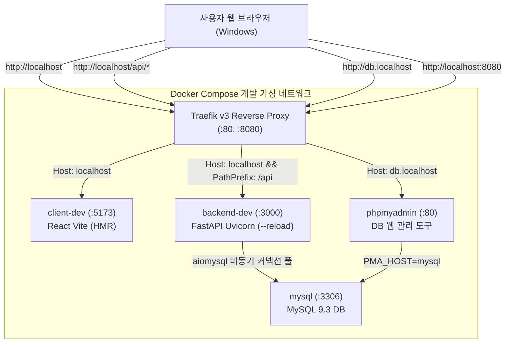
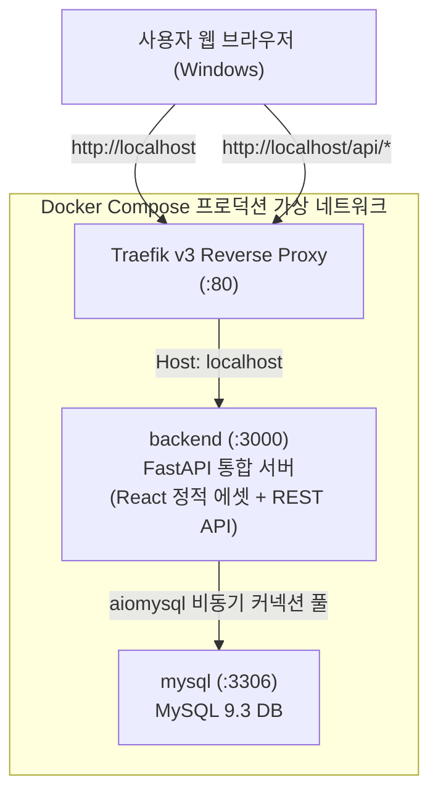

# Windows 환경에서의 Todo App (FastAPI & React) 실행 가이드

> **문서명**: `How to Execute.md` (`수행방법.md`)  
> **대상 프로젝트**: Getting Started Todo App (FastAPI + React + MySQL / SQLite)  
> **운영체제**: Windows 10 / Windows 11 (PowerShell & CMD)

본 문서는 **Windows 환경**에서 Python(FastAPI) 백엔드와 React(Vite) 프론트엔드로 구성된 Todo 애플리케이션을 실행하는 모든 방법(개발용 Docker Compose, 프로덕션 빌드용 compose-prod-build.yml, 로컬 개발 모드, 로컬 프로덕션 빌드, 단일 컨테이너 실행)과 Windows 전용 팁 및 트러블슈팅을 정리한 종합 가이드입니다.

---

## 📌 목차
1. [시스템 아키텍처 및 Windows 포트 맵](#1-시스템-아키텍처-및-windows-포트-맵)
2. [사전 준비 사항 (Windows 환경)](#2-사전-준비-사항-windows-환경)
3. [방법 1. Docker Compose 기반 개발 환경 실행 (`compose.yaml`)](#3-방법-1-docker-compose-기반-개발-환경-실행-composeyaml)
4. [방법 2. Docker Compose 기반 프로덕션 빌드 실행 (`compose-prod-build.yml`)](#4-방법-2-docker-compose-기반-프로덕션-빌드-실행-compose-prod-buildyml)
5. [방법 3. Windows 로컬 개발 모드 실행 (Docker 미사용)](#5-방법-3-windows-로컬-개발-모드-실행-docker-미사용)
6. [방법 4. Windows 로컬 프로덕션 빌드 모드 실행](#6-방법-4-windows-로컬-프로덕션-빌드-모드-실행)
7. [방법 5. Windows 원클릭 일괄 실행 (PowerShell 스크립트)](#7-방법-5-windows-원클릭-일괄-실행-powershell-스크립트)
8. [방법 6. 단일 Docker 이미지 빌드 및 실행 (`Dockerfile:final`)](#8-방법-6-단일-docker-이미지-빌드-및-실행-dockerfilefinal)
9. [백엔드 비동기 단위/통합 테스트 (Pytest)](#9-백엔드-비동기-단위통합-테스트-pytest)
10. [Windows 환경 전용 문제 해결 (Troubleshooting)](#10-windows-환경-전용-문제-해결-troubleshooting)

---

## 1. 시스템 아키텍처 및 Windows 포트 맵

### 1.1 Docker Compose 개발 아키텍처 (`compose.yaml`)


### 1.2 Docker Compose 프로덕션 빌드 아키텍처 (`compose-prod-build.yml`)


### 1.3 서비스별 접속 URL 및 포트 요약

| 모드 | 서비스 | 접속 주소 (URL) | 용도 및 설명 | 기본 계정 |
| :--- | :--- | :--- | :--- | :--- |
| **개발 (Compose)** | **Todo App** | [http://localhost](http://localhost) | Traefik -> React(5173) + FastAPI(3000) 라우팅 | - |
| **개발 (Compose)** | **FastAPI Swagger** | [http://localhost/api/docs](http://localhost/api/docs) | 백엔드 대화형 OpenAPI 문서 | - |
| **개발 (Compose)** | **phpMyAdmin** | [http://db.localhost](http://db.localhost) | MySQL 9.3 웹 관리자 인터페이스 | ID: `root`<br/>PW: `secret` |
| **개발 (Compose)** | **Traefik 대시보드** | [http://localhost:8080](http://localhost:8080) | 프록시 라우터/서비스 모니터링 | - |
| **프로덕션 (Compose)** | **Todo App** | [http://localhost](http://localhost) | Traefik -> 통합 FastAPI 서버(3000) 직접 서빙 | - |
| **로컬 개발 모드** | **Todo App** | [http://localhost:5173](http://localhost:5173) | Vite Dev Server + 로컬 SQLite | - |
| **로컬 프로덕션 모드**| **Todo App** | [http://localhost:3000](http://localhost:3000) | FastAPI 정적 마운트 + 로컬 SQLite | - |

---

## 2. 사전 준비 사항 (Windows 환경)

Windows에서 프로젝트를 실행하기 위해 필요한 기본 도구들을 확인합니다:

### 2.1 도구 설치 확인 (PowerShell 또는 CMD)
```powershell
# 1. Python 버전 확인 (3.10 이상 권장)
python --version

# 2. Node.js 및 npm 버전 확인 (Node 18 이상 권장)
node -v
npm.cmd -v

# 3. Docker 및 Docker Compose 버전 확인 (Docker 사용 시)
docker --version
docker compose version
```

### 2.2 Windows PowerShell 스크립트 실행 권한 부여 (필수)
Windows 기본 보안 정책으로 인해 가상환경 활성화(`Activate.ps1`)나 `npm` 실행 시 보안 에러가 발생할 수 있습니다.
PowerShell을 관리자 권한 또는 일반 창으로 열고 다음 명령을 실행합니다:
```powershell
Set-ExecutionPolicy -Scope Process -ExecutionPolicy Bypass
```

---

## 3. 방법 1. Docker Compose 기반 개발 환경 실행 (`compose.yaml`)

개발 환경 전용으로, **Traefik v3, React(Vite HMR), FastAPI(Uvicorn Reload), MySQL 9.3, phpMyAdmin**이 함께 기동되며 실시간 코드 동기화(Watch 모드)를 지원합니다.

### 3.1 컨테이너 빌드 및 백그라운드 기동
```powershell
docker compose up -d --build
```

### 3.2 상태 및 실시간 로그 확인
```powershell
# 컨테이너 상태 및 헬스체크 확인
docker compose ps

# 전체 실시간 로그 모니터링
docker compose logs -f

# 특정 서비스 로그만 모니터링 (예: backend 또는 client)
docker compose logs -f backend
```

### 3.3 실시간 코드 동기화 (Compose Watch)
- `client/src/*` 수정: 브라우저에서 React HMR로 즉각 반영
- `backend/src/*` 및 `backend/main.py` 수정: Uvicorn 서버가 컨테이너 내부에서 자동 리로드(Reload)

### 3.4 서비스 종료
```powershell
# 컨테이너 중지 (DB 볼륨 데이터 유지)
docker compose down

# DB 볼륨(todo-mysql-data)까지 완전 삭제 초기화 시
docker compose down -v
```

---

## 4. 방법 2. Docker Compose 기반 프로덕션 빌드 실행 (`compose-prod-build.yml`)

React 프론트엔드를 정적 파일로 컴파일하여 FastAPI 서버 내부(`src/static`)에 패키징한 후, **Traefik + 통합 FastAPI + MySQL 9.3**만을 기동하는 경량 프로덕션 환경입니다. (phpMyAdmin 및 Node dev 서버 제외)

### 4.1 프로덕션 빌드 및 기동
```powershell
docker compose -f compose-prod-build.yml up -d --build
```

### 4.2 상태 확인 및 브라우저 접속
```powershell
docker compose -f compose-prod-build.yml ps
```
- **접속 주소**: **[http://localhost](http://localhost)**
- **동작 원리**: 포트 80으로 들어오는 모든 요청이 Traefik을 거쳐 통합 FastAPI 컨테이너(포트 3000)로 전달되며, 루트(`/`)에서는 React SPA가 서빙되고 `/api/*`는 백엔드 라우터가 처리합니다.

### 4.3 서비스 종료
```powershell
docker compose -f compose-prod-build.yml down
```

---

## 5. 방법 3. Windows 로컬 개발 모드 실행 (Docker 미사용)

Docker 없이 윈도우 로컬 머신에서 Python과 Node.js로 실행합니다. 로컬 SQLite 파일 데이터베이스(`backend/todo.db`)를 사용합니다.

### 5.1 터미널 1: Backend (FastAPI) 기동
```powershell
cd backend
python -m venv .venv
.\.venv\Scripts\Activate.ps1
pip install -r requirements.txt

# Uvicorn 개발 서버 실행 (포트 3000)
uvicorn src.main:app --host 0.0.0.0 --port 3000 --reload
```
- API Swagger 문서: [http://localhost:3000/docs](http://localhost:3000/docs)

### 5.2 터미널 2: Client (React + Vite) 기동
```powershell
cd client
npm.cmd install
npm.cmd run dev
```
- 브라우저 접속: **[http://localhost:5173](http://localhost:5173)**
- `client/vite.config.js`의 `/api` 프록시를 통해 `http://127.0.0.1:3000`으로 자동 라우팅됩니다.

---

## 6. 방법 4. Windows 로컬 프로덕션 빌드 모드 실행

React를 최적화 빌드(`dist`)하여 `backend/src/static`으로 복사한 뒤, 단일 FastAPI 서버로 서빙합니다.

```powershell
# 1. React 빌드 및 backend/src/static으로 자동 복사
cd client
npm.cmd run build

# 2. FastAPI 단독 서버 기동
cd ..\backend
.\.venv\Scripts\Activate.ps1
uvicorn src.main:app --host 0.0.0.0 --port 3000
```
- 브라우저 접속: **[http://localhost:3000](http://localhost:3000)**

---

## 7. 방법 5. Windows 원클릭 일괄 실행 (PowerShell 스크립트)

루트 디렉터리에서 아래 명령을 실행하면 2개의 PowerShell 창이 자동으로 열리며 백엔드와 프론트엔드가 동시에 실행됩니다:

```powershell
# 백엔드 서버 새 창으로 실행
Start-Process powershell -ArgumentList "-NoExit", "-Command", "cd backend; if (-not (Test-Path .venv)) { python -m venv .venv; .\.venv\Scripts\Activate.ps1; pip install -r requirements.txt } else { .\.venv\Scripts\Activate.ps1 }; uvicorn src.main:app --host 0.0.0.0 --port 3000 --reload"

# 프론트엔드 개발 서버 새 창으로 실행
Start-Process powershell -ArgumentList "-NoExit", "-Command", "cd client; if (-not (Test-Path node_modules)) { npm.cmd install }; npm.cmd run dev"
```

---

## 8. 방법 6. 단일 Docker 이미지 빌드 및 실행 (`Dockerfile:final`)

멀티스테이지 [Dockerfile](file:///d:/Lecture%20Notes/2026-2CloudComputing/Hw/2week/getting-started-todo-app-FastAPI/Dockerfile)의 `final` 스테이지를 직접 빌드하여 단독 컨테이너로 실행합니다:

```powershell
# 1. 단일 프로덕션 이미지 빌드 (backend 테스트 자동 통과 후 생성)
docker build -t todo-fastapi-app:latest .

# 2. 컨테이너 백그라운드 실행 (호스트 3000번 포트 연결)
docker run -d -p 3000:3000 --name todo-app todo-fastapi-app:latest

# 3. 브라우저 접속
# http://localhost:3000

# 4. 컨테이너 종료 및 삭제
docker stop todo-app
docker rm todo-app
```

---

## 9. 백엔드 비동기 단위/통합 테스트 (Pytest)

```powershell
cd backend
.\.venv\Scripts\Activate.ps1
pytest -v
```

---

## 10. Windows 환경 전용 문제 해결 (Troubleshooting)

### Q1. PowerShell에서 `.\.venv\Scripts\Activate.ps1` 실행 시 보안 오류 발생
* **해결 방법**: `Set-ExecutionPolicy -Scope Process -ExecutionPolicy Bypass` 실행 후 다시 활성화합니다.

### Q2. PowerShell에서 `npm` 실행 시 `UnauthorizedAccess` 오류 발생
* **해결 방법**: Windows 명령 프롬프트 배치 파일인 **`npm.cmd`** 로 실행합니다:
  ```powershell
  npm.cmd install
  npm.cmd run dev
  ```

### Q3. Vite 프록시 통신 실패 (404 Not Found 또는 ECONNREFUSED)
* **해결 방법**: [client/vite.config.js](file:///d:/Lecture%20Notes/2026-2CloudComputing/Hw/2week/getting-started-todo-app-FastAPI/client/vite.config.js)의 proxy target이 IPv6(`localhost`) 대신 IPv4 주소인 `http://127.0.0.1:3000`으로 명시되어 있는지 확인합니다.

### Q4. 브라우저에서 JavaScript 파일 로드 시 MIME Type 에러 발생
* **해결 방법**: 본 프로젝트의 [backend/src/main.py](file:///d:/Lecture%20Notes/2026-2CloudComputing/Hw/2week/getting-started-todo-app-FastAPI/backend/src/main.py) 최상단에 Windows 레지스트리 보정 코드(`mimetypes.add_type("application/javascript", ".js")`)가 이미 적용되어 있습니다.

### Q5. Docker Compose 실행 시 80번 포트 충돌 발생
* **해결 방법**: Windows 웹 서비스(W3SVC) 중지:
  ```powershell
  net stop w3svc
  ```

### Q6. `http://db.localhost` (phpMyAdmin) 접속 실패 (404/403 오류 등)
* **원인**:
  1. Windows `hosts` 파일에 과거 Minikube IP(`192.168.49.2 db.localhost`) 등이 등록되어 로컬 Traefik(127.0.0.1) 대신 엉뚱한 IP로 요청이 전달된 경우.
  2. 프로덕션 빌드 파일(`compose-prod-build.yml`)에 `phpmyadmin` 서비스가 누락되어 라우터가 등록되지 않은 경우.
* **해결 방법**:
  1. `C:\Windows\System32\drivers\etc\hosts` 파일에 `db.localhost`가 `127.0.0.1`로 올바르게 지정되어 있는지 확인합니다:
     ```text
     127.0.0.1 db.localhost
     ```
  2. PowerShell에서 DNS 캐시를 갱신합니다:
     ```powershell
     ipconfig /flushdns
     ```
  3. `compose.yaml` 및 [compose-prod-build.yml](file:///d:/Lecture%20Notes/2026-2CloudComputing/Hw/2week/getting-started-todo-app-FastAPI/compose-prod-build.yml) 모두 `phpmyadmin` 서비스가 정의되어 있는지 확인하고 컨테이너를 실행합니다:
     ```powershell
     docker compose up -d
     # 또는 프로덕션 빌드: docker compose -f compose-prod-build.yml up -d
     ```

### Q7. 코드 수정 후 브라우저 화면이 갱신되지 않을 때
* **해결 방법**: 브라우저에서 **`Ctrl + F5`** (강력 새로고침)를 누릅니다.
