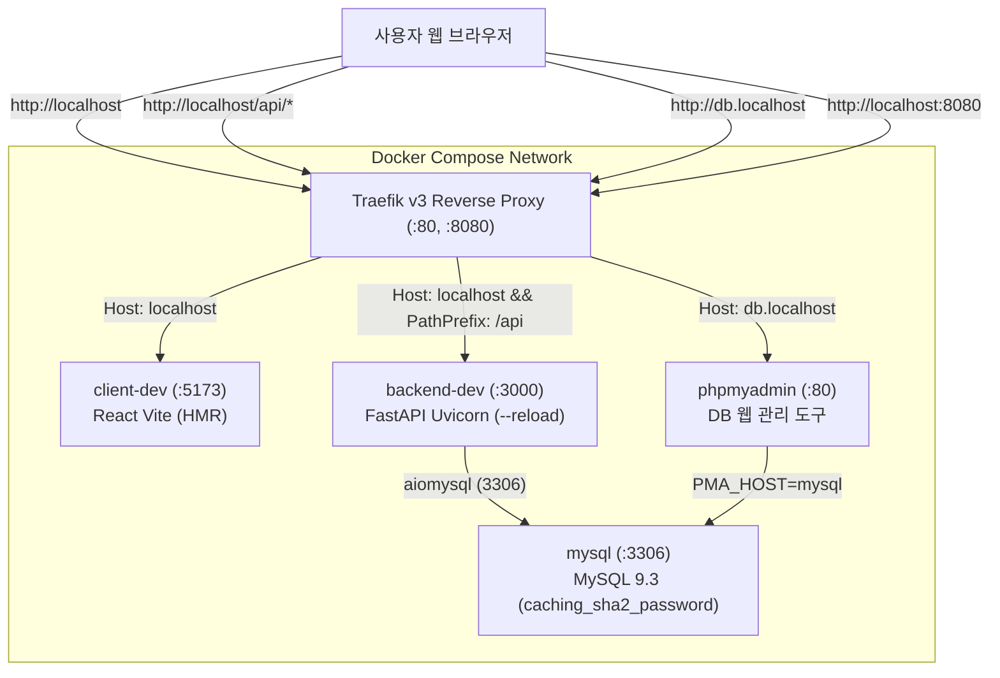

# Getting Started Todo App - 윈도우즈(Windows) 실행 가이드

본 문서는 **FastAPI + Uvicorn** 비동기 Python 백엔드와 **React (Vite)** 프론트엔드, **MySQL 9.3**, **Traefik v3**, **phpMyAdmin**으로 구성된 Todo App을 윈도우즈(Windows) 환경에서 실행하는 다양한 방법을 정리한 가이드입니다.

---

## 📋 사전 준비 (Prerequisites)

| 실행 방식 | 필수 설치 도구 |
| :--- | :--- |
| **Docker Compose 실행 (권장)** | **[Docker Desktop for Windows](https://www.docker.com/products/docker-desktop/)** (WSL2 백엔드 권장) |
| **로컬 독립 실행** | **Python (3.10 이상)**, **Node.js (LTS 버전)** |

---

## 🐳 Case 1. Docker Compose 기반 풀 스택 실행 (추천)

Docker Compose를 이용하면 **Traefik 리버스 프록시, React 프론트엔드, FastAPI 백엔드, MySQL 9.3 데이터베이스, phpMyAdmin 웹 관리 도구**가 하나의 가상 네트워크 안에서 유기적으로 연동되어 원클릭으로 기동됩니다.

### 1.1 시스템 구성 및 포트 맵



---

### 1.2 실행 및 빌드 명령어

PowerShell 또는 CMD를 열고 프로젝트 루트 폴더에서 실행합니다:

```powershell
# 1. 모든 컨테이너 빌드 및 백그라운드 기동
docker compose up -d --build

# 2. 컨테이너 상태 및 헬스체크 확인
docker compose ps

# 3. 로그 실시간 모니터링 (필요 시)
docker compose logs -f
# 특정 컨테이너만 볼 때: docker compose logs -f backend
```

---

### 1.3 접속 주소 (Access URLs)

| 서비스 | 접속 URL | 설명 | 계정 정보 |
| :--- | :--- | :--- | :--- |
| **Todo App (메인)** | [http://localhost](http://localhost) | React UI + FastAPI 백엔드 연동 | - |
| **phpMyAdmin (DB 관리)** | [http://db.localhost](http://db.localhost) | MySQL 9.3 웹 관리자 화면 | 사용자: `root`<br/>암호: `secret` |
| **FastAPI Swagger Docs** | [http://localhost/api/docs](http://localhost/api/docs) | 백엔드 OpenAPI 자동 문서 | - |
| **Traefik 대시보드** | [http://localhost:8080](http://localhost:8080) | 리버스 프록시 라우팅 상태 대시보드 | - |

---

### 1.4 코드 실시간 동기화 (Watch Mode)
`compose.yaml`에 `develop.watch` 설정이 적용되어 있어, 로컬 소스 코드를 수정하면 컨테이너 내부로 즉시 동기화됩니다:
- `client/src/*` 수정 시 ➡️ 브라우저에서 HMR(Hot Module Replacement)로 즉시 반영
- `backend/src/*` 수정 시 ➡️ Uvicorn이 자동으로 리로드(Reload)

---

### 1.5 서비스 중지 및 초기화

```powershell
# 1. 서비스 중지 (데이터 보존)
docker compose down

# 2. 데이터베이스 볼륨까지 완전 초기화할 때
docker compose down -v
```

---

## 💻 Case 2. 로컬 개발 모드 (`npm run dev`) 실행 방법

Docker 없이 윈도우즈 로컬에 설치된 Python과 Node.js로 실행하는 방법입니다. (기본 SQLite 파일 DB 사용)

### 1단계: Backend 환경 설정 및 기동 (터미널 1)
```powershell
cd backend

# 가상환경 생성 및 활성화
python -m venv .venv
.\.venv\Scripts\Activate.ps1
# (스크립트 실행 오류 시: Set-ExecutionPolicy -Scope Process -ExecutionPolicy Bypass)

# 의존성 설치
pip install -r requirements.txt

# Uvicorn 서버 실행 (포트 3000)
uvicorn src.main:app --host 0.0.0.0 --port 3000 --reload
# 또는: python main.py
```
> 기동 주소: `http://localhost:3000` (Swagger UI: `http://localhost:3000/docs`)

---

### 2단계: Client 개발 서버 실행 (터미널 2)
새로운 PowerShell 터미널 창을 열고 실행합니다:
```powershell
cd client

# 패키지 설치 (최초 1회만)
npm install

# Vite 개발 서버 실행
npm run dev
```

---

### 3단계: 브라우저 접속
- **웹 브라우저 접속**: [http://localhost:5173](http://localhost:5173)
- **동작 원리**: 
  - 프론트엔드의 `/api/*` 요청은 `vite.config.js`의 프록시 설정을 통해 백엔드(`http://127.0.0.1:3000`)로 자동 포워딩됩니다.

---

## 🚀 Case 3. 프로덕션 빌드 모드 (`npm run build`) 실행 방법

React 코드를 최적화된 정적 번들(HTML, CSS, JS)로 빌드한 후 단일 FastAPI 서버로 서빙하는 방식입니다.

### 1단계: Client 빌드 및 정적 파일 복사
```powershell
cd client

# 빌드 및 backend/src/static 폴더로 자동 복사 실행
npm run build
```
> 💡 `npm run build` 실행 시 `copy-build.js` 스크립트가 실행되어 `client/dist/` 폴더 산출물이 `backend/src/static/`으로 자동 복사됩니다.

---

### 2단계: FastAPI 단독 통합 서버 실행
```powershell
cd backend
.\.venv\Scripts\Activate.ps1

# 서버 기동
uvicorn src.main:app --host 0.0.0.0 --port 3000
```
- **웹 브라우저 접속**: [http://localhost:3000](http://localhost:3000)
- **동작 원리**: FastAPI가 `/` 및 정적 파일을 `backend/src/static`에서 서빙하고, `/api/*` 요청은 라우터에서 직접 처리합니다.

---

## 🔍 문제 해결 및 팁 (Troubleshooting)

| 증상 | 원인 및 해결 방법 |
| :--- | :--- |
| **Docker Compose 실행 시 502 Bad Gateway** | MySQL 9.3의 `caching_sha2_password` 인증에 필요한 `cryptography` 패키지가 반영되지 않은 구버전 이미지일 때 발생합니다.<br/>`docker compose up -d --build` 명령으로 백엔드 이미지를 리빌드하여 해결합니다. |
| **Docker 데몬 권한 오류 (`permission denied ... npipe`)** | Docker Desktop이 실행 중이지 않거나 Windows 관리자 권한이 필요합니다. Docker Desktop 앱을 먼저 켜고 PowerShell을 관리자 권한으로 실행하세요. |
| **PowerShell 스크립트 실행 오류 (`Activate.ps1`)** | PowerShell 보안 정책 문제입니다. PowerShell에 `Set-ExecutionPolicy -Scope Process -ExecutionPolicy Bypass`를 입력한 후 다시 활성화하세요. |
| **Vite 프록시 404 오류** | Windows에서 Node가 `localhost`를 IPv6(`::1`)로 찾는 문제입니다. `vite.config.js`의 target을 `http://127.0.0.1:3000`으로 지정하면 정상 동작합니다. |
| **JS MIME Type 오류 (`text/plain` 에러)** | Windows 레지스트리의 `.js` MIME 타입 누락 문제입니다. `src/main.py`에 `mimetypes.add_type("application/javascript", ".js")`가 등록되어 자동으로 해결됩니다. |
| **phpMyAdmin 접속 불가 (`db.localhost`)** | 브라우저가 `*.localhost` 서브도메인을 로컬루프백으로 해석합니다. 접속이 안 될 경우 `http://localhost:8080` (Traefik 대시보드)에서 `phpmyadmin` 라우터 상태를 확인하세요. |
| **브라우저 캐시 문제** | 코드 변경 후 화면이 갱신되지 않으면 브라우저에서 **`Ctrl + F5`** (강력 새로고침)를 누르세요. |
