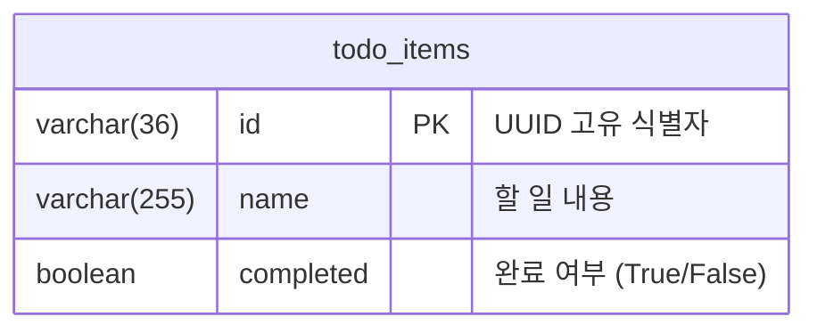
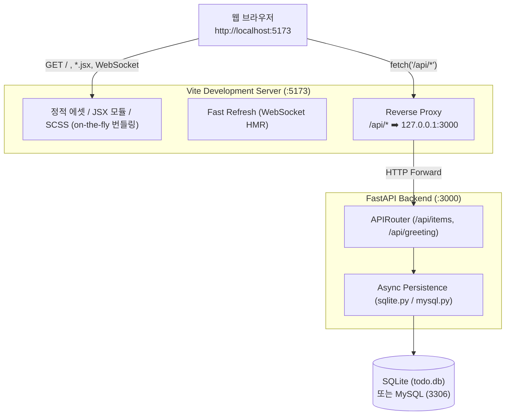
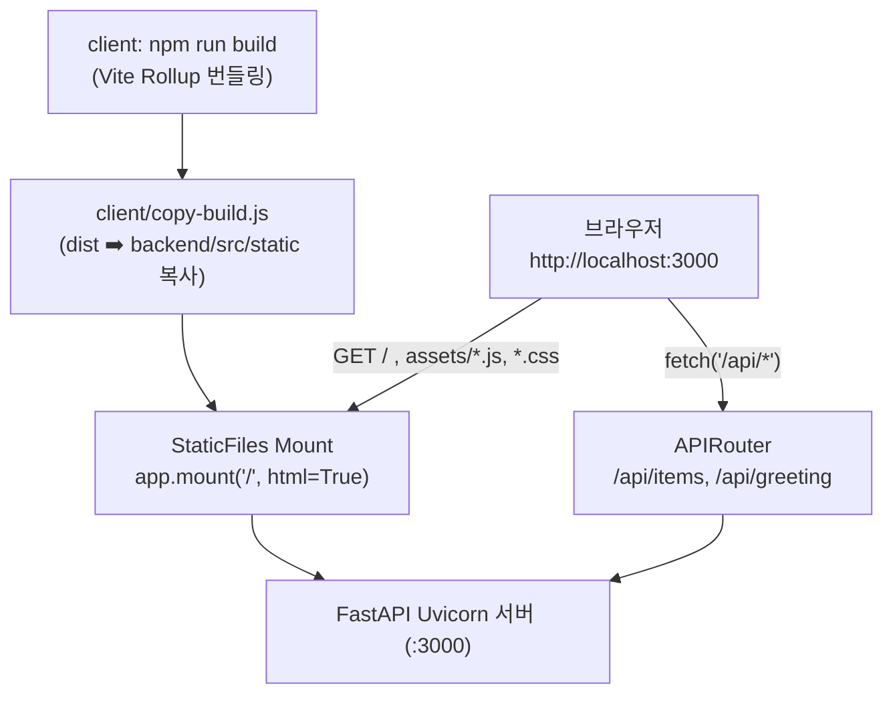
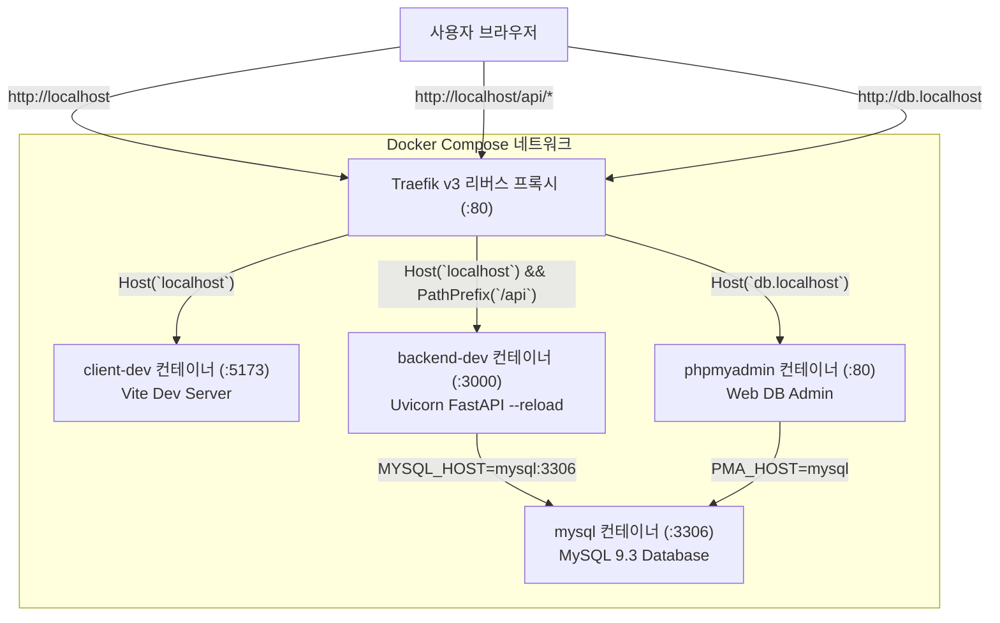
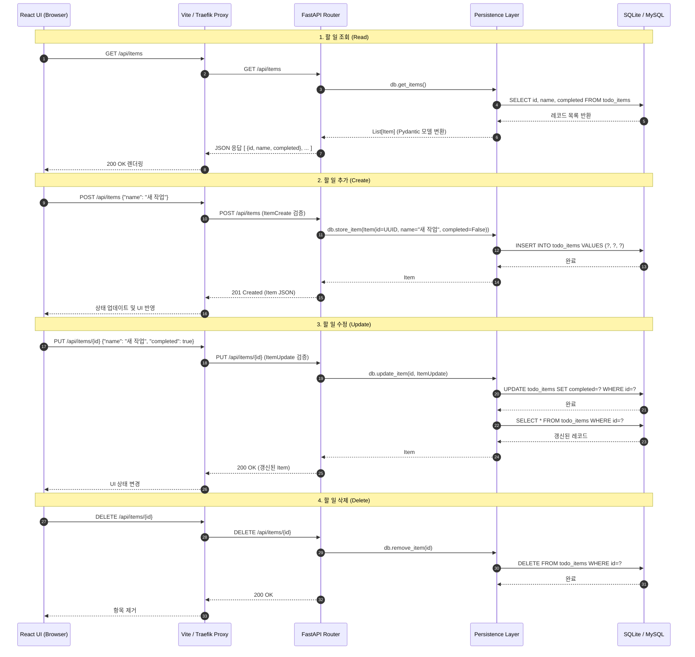

# 'Getting-Started-Todo-App (FastAPI & React)' 프로젝트 동작 구조

## 0. 프로젝트 디렉토리 및 파일 구조

`node_modules`, `.venv`, `.git` 등을 제외한 주요 디렉토리 및 파일 구조는 다음과 같다.

```text
getting-started-todo-app-FastAPI/
├─ backend/                               # Python / FastAPI 백엔드
│  ├─ requirements.txt                    # 백엔드 의존성 (FastAPI, Uvicorn, aiosqlite, aiomysql, cryptography 등)
│  ├─ pytest.ini                          # Pytest 비동기 모드 및 테스트 설정 (asyncio_mode = auto)
│  ├─ main.py                             # 최상위 실행 래퍼 진입점
│  ├─ spec/                               # Pytest 단위 및 통합 테스트 코드
│  │  ├─ __init__.py
│  │  ├─ test_sqlite.py                   # SQLite 영속성 계층 CRUD 비동기 테스트
│  │  └─ routes/                          # FastAPI 라우트 테스트 (HTTPX AsyncClient)
│  │     ├─ __init__.py
│  │     ├─ test_addItem.py               # POST /api/items 테스트
│  │     ├─ test_getItems.py              # GET /api/items 테스트
│  │     ├─ test_updateItem.py            # PUT /api/items/{id} 테스트
│  │     ├─ test_deleteItem.py            # DELETE /api/items/{id} 테스트
│  │     └─ test_getGreeting.py           # GET /api/greeting 테스트
│  └─ src/
│     ├─ __init__.py
│     ├─ main.py                          # FastAPI 애플리케이션 생성, lifespan(DB init/teardown), CORS, 정적 파일 마운트
│     ├─ models.py                        # Pydantic 데이터 모델 (Item, ItemCreate, ItemUpdate, GreetingResponse)
│     ├─ persistence/
│     │  ├─ __init__.py                   # MYSQL_HOST 환경변수 유무에 따라 mysql.py / sqlite.py 동적 선택
│     │  ├─ mysql.py                      # aiomysql 기반 비동기 MySQL 연결 풀 및 쿼리 구현
│     │  └─ sqlite.py                     # aiosqlite 기반 비동기 SQLite 파일 DB 구현
│     ├─ routes/                          # API 라우터
│     │  ├─ __init__.py
│     │  ├─ items.py                      # /api/items 및 /items CRUD 엔드포인트
│     │  └─ greeting.py                   # /api/greeting 및 /greeting 엔드포인트
│     └─ static/                          # 프로덕션 빌드 시 client 산출물(dist)이 복사되어 정적 서빙되는 위치
│
├─ client/                                # React 19 + Vite 6 프론트엔드
│  ├─ package.json                        # 클라이언트 의존성/스크립트 (dev, build, copy-build 등)
│  ├─ vite.config.js                      # React 플러그인 + /api reverse proxy 설정
│  ├─ copy-build.js                       # npm run build 완료 후 dist 내용을 backend/src/static으로 자동 복사하는 스크립트
│  ├─ index.html                          # Vite 진입점 HTML
│  ├─ public/vite.svg                     # 정적 에셋 (favicon 등)
│  └─ src/
│     ├─ main.jsx                         # React 진입점 (ReactDOM.createRoot)
│     ├─ App.jsx                          # 최상위 컴포넌트
│     ├─ index.scss                       # 전역 스타일(SCSS)
│     └─ components/                      # Greeting, TodoListCard, AddNewItemForm, ItemDisplay
│
├─ compose.yaml                           # Docker Compose (Traefik v3, MySQL 9.3, phpMyAdmin, FastAPI, React)
├─ Dockerfile                             # Multi-stage Dockerfile (dev, test, final 빌드)
├─ nginx -GettingStarted-App-todo.conf    # Nginx 리버스 프록시 참고 설정
├─ workflow.md                            # 프로젝트 전체 아키텍처 및 동작 구조 문서 (본 문서)
├─ How_to_Execute_in_Windows.md           # 윈도우즈 로컬 실행 가이드 (dev / build)
└─ 'getting-started-todo-app-FastAPI' 를 윈도우즈에서 동작 시키기 위한-README.md  # 상세 가이드
```

---

## 1. 프로젝트에 사용된 라이브러리 및 패키지

### 1.1 `client/package.json` (프론트엔드)

| 구분 | 패키지 | 버전 | 용도 |
|---|---|---|---|
| dependencies | `react` | ^19.1.0 | UI 컴포넌트 구성을 위한 React 코어 라이브러리 |
| dependencies | `react-dom` | ^19.1.0 | React 가상 DOM을 실제 브라우저 DOM에 렌더링 |
| dependencies | `bootstrap` | ^5.3.6 | Bootstrap 5 CSS 레이아웃 및 디자인 시스템 |
| dependencies | `react-bootstrap` | ^2.10.10 | Bootstrap 컴포넌트를 React 컴포넌트로 래핑한 라이브러리 |
| dependencies | `sass` | ^1.70.0 | `.scss` 스타일시트 실시간 컴파일 |
| dependencies | `@fortawesome/fontawesome-svg-core` | ^6.5.1 | Font Awesome SVG 코어 엔진 |
| dependencies | `@fortawesome/free-solid-svg-icons` | ^6.5.1 | Font Awesome Solid 아이콘 세트 (휴지통 등) |
| dependencies | `@fortawesome/fontawesome-free-regular` | ^5.0.13 | Font Awesome Regular 아이콘 세트 (체크박스 등) |
| dependencies | `@fortawesome/react-fontawesome` | ^0.2.2 | React 전용 Font Awesome 컴포넌트 |
| devDependencies | `vite` | ^6.3.5 | 빠른 HMR 개발 서버 및 Rollup 기반 프로덕션 번들러 |
| devDependencies | `@vitejs/plugin-react` | ^4.5.1 | Fast Refresh 및 JSX 변환 공식 Vite 플러그인 |
| devDependencies | `eslint` | ^8.55.0 | JavaScript/React 정적 코드 분석 도구 |

### 1.2 `backend/requirements.txt` (백엔드)

| 패키지 | 버전 | 용도 |
|---|---|---|
| `fastapi` | >=0.110.0 | 고성능 현대식 비동기 Python 웹 프레임워크 (자동 OpenAPI/Swagger 지원) |
| `uvicorn[standard]` | >=0.28.0 | ASGI 프로덕션 웹 서버 (uvloop, httptools 지원) |
| `pydantic` | >=2.0.0 | 엄격한 데이터 검증 및 직렬화/역직렬화 모델 |
| `aiosqlite` | >=0.20.0 | SQLite용 비동기(AsyncIO) 데이터베이스 드라이버 (기본 로컬 DB) |
| `aiomysql` | >=0.2.0 | MySQL용 비동기(AsyncIO) 연결 풀 드라이버 |
| `cryptography` | >=42.0.0 | MySQL 8.0+/9.x의 `caching_sha2_password` 인증 암호화 처리 |
| `python-dotenv` | >=1.0.0 | `.env` 환경 변수 파일 로더 |
| `pytest` | >=8.0.0 | Python 단위/통합 테스트 프레임워크 |
| `pytest-asyncio` | >=0.23.0 | `async/await` 테스트 지원 플러그인 |
| `httpx` | >=0.27.0 | 비동기 HTTP 테스트 클라이언트 (`ASGITransport`) |

---

## 2. Vite Reverse Proxy 구조 (로컬 개발 환경)

로컬 개발 환경에서 `npm run dev` 실행 시, Vite 개발 서버(`:5173`)가 프론트엔드를 서빙하고 백엔드(FastAPI, `:3000`)로의 API 호출을 중계하도록 `client/vite.config.js`에 프록시가 설정되어 있다.

```js
import { defineConfig } from 'vite';
import react from '@vitejs/plugin-react';

// https://vitejs.dev/config/
export default defineConfig({
    plugins: [react()],
    server: {
        proxy: {
            '/api': {
                target: 'http://127.0.0.1:3000',
                changeOrigin: true,
            },
        },
    },
});
```

### 2.1 프록시가 필요한 이유
- React 컴포넌트(`TodoListCard.jsx`, `AddNewItemForm.jsx`, `ItemDisplay.jsx`, `Greeting.jsx`)는 API 호출 시 `/api/items`, `/api/greeting`과 같은 **상대 경로**를 사용한다.
- 브라우저는 `http://localhost:5173`에서 실행되므로 프록시 설정이 없으면 `:5173`으로 요청이 가며, Vite 개발 서버는 라우트가 없어 404를 반환한다.
- `server.proxy` 설정을 통해 Vite 개발 서버가 `/api/*` 요청을 백엔드(`http://127.0.0.1:3000`)로 포워딩하여 CORS 이슈 없이 매끄러운 단일 오리진 개발 경험을 제공한다.

---

## 3. 데이터베이스 및 비동기 영속성 계층 (Async Persistence Layer)

### 3.1 스키마 구조
백엔드는 **SQLite**와 **MySQL** 모두 동일한 단일 테이블 스키마를 사용한다.

```sql
-- SQLite
CREATE TABLE IF NOT EXISTS todo_items (
    id VARCHAR(36) PRIMARY KEY,
    name VARCHAR(255),
    completed BOOLEAN
);

-- MySQL (MySQL 9.3 지원)
CREATE TABLE IF NOT EXISTS todo_items (
    id VARCHAR(36) PRIMARY KEY,
    name VARCHAR(255),
    completed BOOLEAN
) DEFAULT CHARSET utf8mb4;
```

### 3.2 ERD (Entity Relationship Diagram)



### 3.3 비동기 드라이버 및 Lifespan 수명 주기 관리
FastAPI는 애플리케이션 시작과 종료 시점에 `lifespan` 비동기 컨텍스트 매니저를 통해 DB를 초기화하고 연결을 안전하게 해제한다.

```python
# backend/src/main.py
@asynccontextmanager
async def lifespan(app: FastAPI):
    await db.init()
    try:
        yield
    finally:
        await db.teardown()
```

- **SQLite 모드** (`MYSQL_HOST` 미설정 시 기본값):
  - `aiosqlite`를 통해 비동기 커넥션을 유지하며, `todo.db` 파일 또는 메모리(`:memory:`)에 데이터를 저장한다.
- **MySQL 모드** (`MYSQL_HOST` 환경 변수 지정 시):
  - `aiomysql.create_pool`을 통해 커넥션 풀(1~5개)을 생성하고, `cryptography` 패키지를 통해 MySQL 9.x `caching_sha2_password` 인증을 처리한다.

---

## 4. 아키텍처 다이어그램

### 4.1 로컬 개발 모드 (`npm run dev` + `uvicorn`)



### 4.2 프로덕션 빌드 및 정적 서빙 모드 (`npm run build` ➡️ FastAPI Static)



### 4.3 Docker Compose 개발 및 컨테이너 환경



---

## 5. CRUD API 명세 및 요청-응답 시퀀스

| 메서드 | 엔드포인트 경로 | 설명 | 요청 본문 | 응답 본문 / 코드 |
|---|---|---|---|---|
| `GET` | `/api/greeting` (또는 `/greeting`) | 환영 메시지 반환 | 없음 | `{"greeting": "Hello world!"}` (200) |
| `GET` | `/api/items` (또는 `/items`) | 전체 할 일 목록 조회 | 없음 | `[{"id": "...", "name": "...", "completed": false}, ...]` (200) |
| `POST` | `/api/items` (또는 `/items`) | 새로운 할 일 등록 | `{"name": "수업 듣기"}` | `{"id": "uuid", "name": "수업 듣기", "completed": false}` (201) |
| `PUT` | `/api/items/{id}` (또는 `/items/{id}`) | 할 일 내용/완료여부 갱신 | `{"name": "수업 듣기", "completed": true}` | `{"id": "uuid", "name": "수업 듣기", "completed": true}` (200) |
| `DELETE` | `/api/items/{id}` (또는 `/items/{id}`) | 할 일 항목 삭제 | 없음 | 빈 본문 (200) |

### 5.1 CRUD 처리 시퀀스 다이어그램



---

## 6. 실행 및 배포 방식 비교

| 구분 | 1. 로컬 개발 모드 (`dev`) | 2. 프로덕션 정적 통합 모드 (`build`) | 3. Docker Compose 환경 |
|---|---|---|---|
| **프론트엔드 서빙** | Vite Dev Server (`:5173`, HMR 지원) | FastAPI StaticFiles (`:3000`) | Vite Dev 컨테이너 (`client-dev`) |
| **백엔드 서버** | Uvicorn FastAPI (`:3000`, `--reload`) | Uvicorn FastAPI (`:3000`) | Uvicorn 컨테이너 (`backend-dev`) |
| **API 라우팅 / 프록시** | Vite의 `server.proxy` | 필요 없음 (동일 포트 `:3000` 직접 서빙) | Traefik v3 프록시 (`:80`) |
| **기본 접속 URL** | `http://localhost:5173` | `http://localhost:3000` | `http://localhost` |
| **DB 스토리지** | SQLite (`todo.db`) | SQLite (`todo.db`) | MySQL 9.3 컨테이너 (`todo-mysql-data`) |
| **장점** | 코드 수정 시 브라우저 새로고침 없이 즉시 반영 | 단일 Python 프로세스로 완전한 서비스 가능 | 운영 환경과 동일한 컨테이너 기반 오케스트레이션 |

---

## 7. 테스트 자동화 (Pytest)

`backend/spec` 디렉토리에 테스트 코드가 구성되어 있으며, `pytest`를 통해 비동기 API 엔드포인트와 DB 지속성 계층의 동작을 검증한다.

```bash
cd backend
pytest -v
```

- **`test_sqlite.py`**: SQLite 테이블 생성, Item 저장/조회/수정/삭제 비동기 로직 검증.
- **`routes/test_*.py`**: `httpx.AsyncClient`와 `ASGITransport`를 사용하여 FastAPI 애플리케이션의 모든 REST API 응답 코드와 데이터 형식을 검증.

---

## 8. 핵심 요약

1. **FastAPI & AsyncIO 전환**: 백엔드가 Python 3.12 + FastAPI 기반의 완전한 비동기 아키텍처로 구현되어 높은 성능과 타입 안정성(Pydantic V2)을 제공합니다.
2. **이중 모드 DB 지원**: 환경 변수(`MYSQL_HOST`) 설정 유무에 따라 별도의 코드 수정 없이 SQLite(로컬 파일)와 MySQL 9.3(컨테이너/클라우드) 간의 원활한 전환이 가능합니다.
3. **MIME 타입 및 정적 파일 호환성**: Windows 레지스트리의 JavaScript MIME 타입 문제(`text/plain`)를 사전에 방지하는 로직(`mimetypes.add_type`)과 `copy-build.js` 스크립트를 통해 빌드 및 배포 안정성을 확보했습니다.
4. **유연한 개발 환경**: 로컬 독립 실행(`npm run dev`), 단일 서버 배포(`npm run build`), 컨테이너 오케스트레이션(`docker compose up -d`)의 세 가지 방식을 완벽하게 지원합니다.
