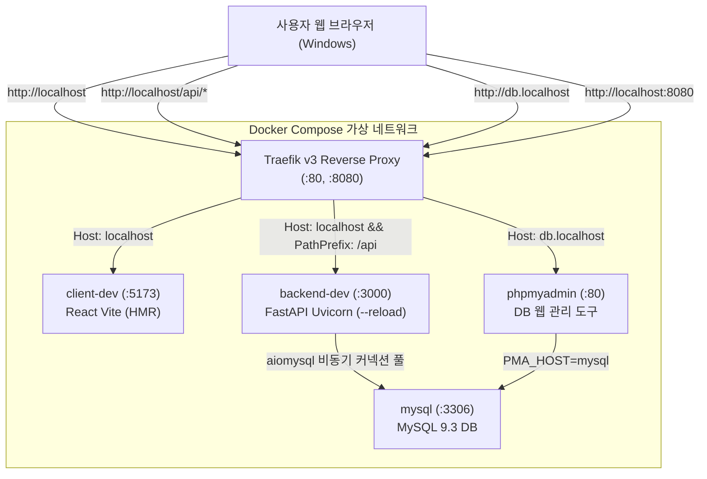
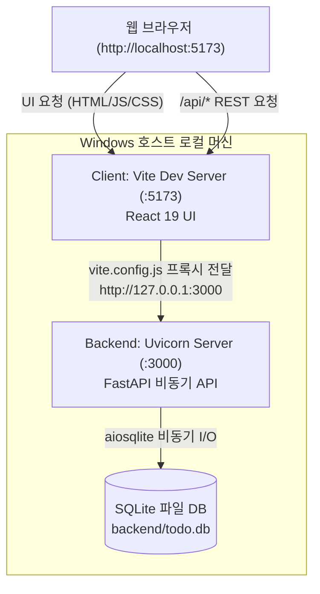

# Windows 환경에서의 Todo App (FastAPI & React) 실행 가이드

> **문서명**: `How to Execute.md`  
> **대상 프로젝트**: Getting Started Todo App (FastAPI + React + MySQL / SQLite)  
> **운영체제**: Windows 10 / Windows 11 (PowerShell & CMD)

본 문서는 **Windows 환경**에서 Python(FastAPI) 백엔드와 React(Vite) 프론트엔드로 구성된 Todo 애플리케이션을 실행하는 모든 방법(Docker Compose, 로컬 개발 모드, 로컬 프로덕션 빌드, 단일 컨테이너 실행)과 Windows 전용 팁 및 트러블슈팅을 정리한 종합 가이드입니다.

---

## 📌 목차
1. [시스템 아키텍처 및 Windows 포트 맵](#1-시스템-아키텍처-및-windows-포트-맵)
2. [사전 준비 사항 (Windows 환경)](#2-사전-준비-사항-windows-환경)
3. [방법 1. Docker Compose 기반 풀스택 실행 (권장)](#3-방법-1-docker-compose-기반-풀스택-실행-권장)
4. [방법 2. Windows 로컬 개발 모드 실행 (Docker 미사용)](#4-방법-2-windows-로컬-개발-모드-실행-docker-미사용)
5. [방법 3. Windows 로컬 프로덕션 빌드 모드 실행](#5-방법-3-windows-로컬-프로덕션-빌드-모드-실행)
6. [방법 4. Windows 원클릭 일괄 실행 (PowerShell 스크립트)](#6-방법-4-windows-원클릭-일괄-실행-powershell-스크립트)
7. [방법 5. 단일 Docker 이미지 빌드 및 실행](#7-방법-5-단일-docker-이미지-빌드-및-실행)
8. [백엔드 비동기 단위/통합 테스트 (Pytest)](#8-백엔드-비동기-단위통합-테스트-pytest)
9. [Windows 환경 전용 문제 해결 (Troubleshooting)](#9-windows-환경-전용-문제-해결-troubleshooting)

---

## 1. 시스템 아키텍처 및 Windows 포트 맵

### 1.1 Docker Compose 아키텍처 (Traefik v3 리버스 프록시 연동)


### 1.2 Windows 로컬 개발 모드 아키텍처 (Vite Proxy 연동)


### 1.3 서비스별 접속 URL 및 포트 요약

| 서비스 | 접속 주소 (URL) | 용도 및 설명 | 기본 계정 |
| :--- | :--- | :--- | :--- |
| **Todo App (메인 UI)** | [http://localhost](http://localhost) *(Docker)*<br/>[http://localhost:5173](http://localhost:5173) *(로컬)* | React 프론트엔드 + Todo CRUD 인터페이스 | - |
| **FastAPI Swagger 문서** | [http://localhost/api/docs](http://localhost/api/docs) *(Docker)*<br/>[http://localhost:3000/docs](http://localhost:3000/docs) *(로컬)* | 백엔드 OpenAPI 자동 생성 대화형 문서 | - |
| **phpMyAdmin (DB 관리)** | [http://db.localhost](http://db.localhost) | MySQL 9.3 웹 관리자 인터페이스 | ID: `root`<br/>PW: `secret` |
| **Traefik 대시보드** | [http://localhost:8080](http://localhost:8080) | 리버스 프록시 라우팅 및 헬스 상태 확인 | - |

---

## 2. 사전 준비 사항 (Windows 환경)

Windows에서 프로젝트를 실행하기 위해 필요한 기본 도구들을 확인합니다:

### 2.1 도구 설치 확인 (PowerShell 또는 CMD)
PowerShell을 열고 설치 상태와 버전을 확인합니다:
```powershell
# 1. Python 버전 확인 (3.10 이상 권장)
python --version

# 2. Node.js 및 npm 버전 확인 (Node 18 이상 권장)
node -v
npm.cmd -v

# 3. Docker 및 Docker Compose 버전 확인 (Docker 사용 시)
docker --version
docker compose version
```

### 2.2 Windows PowerShell 스크립트 실행 권한 부여 (필수)
Windows 기본 보안 정책으로 인해 가상환경 활성화(`Activate.ps1`)나 `npm` 실행 시 보안 에러가 발생할 수 있습니다.
PowerShell을 관리자 권한 또는 일반 창으로 열고 다음 명령을 실행합니다:
```powershell
Set-ExecutionPolicy -Scope Process -ExecutionPolicy Bypass
```
*(또는 영구 적용 시: `Set-ExecutionPolicy -Scope CurrentUser -ExecutionPolicy RemoteSigned`)*

---

## 3. 방법 1. Docker Compose 기반 풀스택 실행 (권장)

Windows Docker Desktop을 활용하여 **Traefik 리버스 프록시, React 프론트엔드, FastAPI 백엔드, MySQL 9.3, phpMyAdmin** 컨테이너 5종을 한 번에 실행합니다.

### 3.1 컨테이너 빌드 및 백그라운드 기동
PowerShell에서 프로젝트 루트 디렉터리로 이동한 후 실행합니다:
```powershell
# 이미지 빌드 및 모든 컨테이너 기동
docker compose up -d --build
```

### 3.2 상태 및 로그 확인
```powershell
# 컨테이너 상태 및 헬스체크 확인
docker compose ps

# 실시간 전체 로그 모니터링
docker compose logs -f

# 특정 서비스 로그만 모니터링 (예: backend 또는 client)
docker compose logs -f backend
```

### 3.3 코드 실시간 동기화 (Compose Watch)
`compose.yaml`의 `develop.watch` 기능이 활성화되어 있어 소스 코드 수정 시 컨테이너에 즉각 반영됩니다:
- `client/src/*` 파일 수정: 브라우저에서 React HMR(Hot Module Replacement)로 실시간 반영
- `backend/src/*` 파일 수정: 컨테이너 내부 Uvicorn 서버가 자동 리로드(Reload)

### 3.4 서비스 종료 및 데이터 초기화
```powershell
# 서비스 컨테이너 중지 (DB 볼륨 데이터 유지)
docker compose down

# 데이터베이스 볼륨(todo-mysql-data)까지 완전 삭제 초기화
docker compose down -v
```

---

## 4. 방법 2. Windows 로컬 개발 모드 실행 (Docker 미사용)

Docker 없이 윈도우 로컬에 설치된 Python과 Node.js로 실행합니다. 경량 파일 데이터베이스인 SQLite(`aiosqlite`)를 사용하므로 MySQL 설치가 필요 없습니다.

> [!IMPORTANT]
> 로컬 개발 모드는 **두 개의 PowerShell 창**이 필요합니다. (터미널 1: 백엔드, 터미널 2: 프론트엔드)

### 4.1 터미널 1: Backend (FastAPI) 기동
새 PowerShell 창을 열고 다음 명령어를 순서대로 실행합니다:

```powershell
# 1. backend 폴더로 이동
cd backend

# 2. Python 가상환경 생성 (최초 1회만)
python -m venv .venv

# 3. 가상환경 활성화 (Windows PowerShell)
.\.venv\Scripts\Activate.ps1

# 4. 백엔드 필수 패키지 설치
pip install -r requirements.txt

# 5. FastAPI 개발 서버 실행 (포트 3000, 핫 리로드 활성화)
uvicorn src.main:app --host 0.0.0.0 --port 3000 --reload
# (또는: python main.py)
```
- **실행 확인**: 터미널에 `Application startup complete.` 및 `Uvicorn running on http://0.0.0.0:3000` 문구가 출력됩니다.
- **API 문서 확인**: 웹 브라우저에서 [http://localhost:3000/docs](http://localhost:3000/docs) 접속

---

### 4.2 터미널 2: Client (React + Vite) 기동
새로운 PowerShell 창을 하나 더 열고 다음 명령어를 실행합니다:

```powershell
# 1. client 폴더로 이동
cd client

# 2. 프론트엔드 패키지 설치 (최초 1회만)
npm.cmd install

# 3. Vite 개발 서버 실행 (포트 5173)
npm.cmd run dev
```
- **실행 확인**: 터미널에 `➜ Local: http://localhost:5173/` 문구가 출력됩니다.

---

### 4.3 브라우저 접속 및 테스트
- **접속 주소**: 웹 브라우저에서 **[http://localhost:5173](http://localhost:5173)** 로 접속합니다.
- **동작 원리**: 
  - `client/vite.config.js`에 설정된 프록시가 브라우저의 `/api/*` 요청을 백엔드(`http://127.0.0.1:3000`)로 자동 전달합니다.
  - 상단 인사말 및 새 할 일 등록/체크/삭제가 실시간으로 동작합니다.

---

## 5. 방법 3. Windows 로컬 프로덕션 빌드 모드 실행

React 프론트엔드를 정적 에셋(HTML/CSS/JS)으로 빌드한 후, **단일 FastAPI 서버(포트 3000)** 로 프론트엔드 화면 서빙과 백엔드 API 처리를 모두 담당하게 하는 프로덕션 배포 방식입니다.

### 5.1 1단계: React 클라이언트 프로덕션 빌드
```powershell
cd client
npm.cmd run build
```
> 💡 `npm.cmd run build` 실행 시 내부적으로 `copy-build.js`가 동작하여 `client/dist/`의 산출물이 `backend/src/static/` 폴더로 자동 복사됩니다.

### 5.2 2단계: FastAPI 통합 서버 기동
```powershell
cd ..\backend
.\.venv\Scripts\Activate.ps1
uvicorn src.main:app --host 0.0.0.0 --port 3000
```

### 5.3 브라우저 접속
- **접속 주소**: **[http://localhost:3000](http://localhost:3000)**
- **동작 원리**: FastAPI가 루트 경로(`/`) 및 정적 파일을 `backend/src/static`에서 서빙하고, `/api/*` 엔드포인트 요청은 FastAPI 라우터가 처리합니다.

---

## 6. 방법 4. Windows 원클릭 일괄 실행 (PowerShell 스크립트)

매번 터미널 창을 2개 열고 명령어를 입력하는 번거로움을 줄이기 위해, 프로젝트 루트 폴더에서 아래의 **PowerShell 한 줄 명령**으로 백엔드와 프론트엔드를 동시에 새 창으로 띄울 수 있습니다:

```powershell
# 백엔드 서버 새 창으로 실행
Start-Process powershell -ArgumentList "-NoExit", "-Command", "cd backend; if (-not (Test-Path .venv)) { python -m venv .venv; .\.venv\Scripts\Activate.ps1; pip install -r requirements.txt } else { .\.venv\Scripts\Activate.ps1 }; uvicorn src.main:app --host 0.0.0.0 --port 3000 --reload"

# 프론트엔드 개발 서버 새 창으로 실행
Start-Process powershell -ArgumentList "-NoExit", "-Command", "cd client; if (-not (Test-Path node_modules)) { npm.cmd install }; npm.cmd run dev"
```

---

## 7. 방법 5. 단일 Docker 이미지 빌드 및 실행

멀티스테이지 [Dockerfile](file:///d:/Lecture%20Notes/2026-2CloudComputing/Hw/2week/getting-started-todo-app-FastAPI/Dockerfile)의 `final` 스테이지를 빌드하여, React 정적 빌드와 FastAPI가 통합된 단일 프로덕션 Docker 컨테이너를 실행합니다.

```powershell
# 1. 단일 프로덕션 이미지 빌드 (backend 테스트 자동 통과 후 생성)
docker build -t todo-fastapi-app:latest .

# 2. 컨테이너 백그라운드 실행 (호스트 3000번 포트 연결)
docker run -d -p 3000:3000 --name todo-app todo-fastapi-app:latest

# 3. 브라우저 접속
# http://localhost:3000

# 4. 컨테이너 종료 및 삭제
docker stop todo-app
docker rm todo-app
```

---

## 8. 백엔드 비동기 단위/통합 테스트 (Pytest)

SQLite 영속성 계층(CRUD) 및 FastAPI 라우터 엔드포인트에 대한 자동화 테스트 코드(`backend/spec`)를 실행합니다.

```powershell
cd backend
.\.venv\Scripts\Activate.ps1
pytest -v
```

---

## 9. Windows 환경 전용 문제 해결 (Troubleshooting)

### Q1. PowerShell에서 `.\.venv\Scripts\Activate.ps1` 실행 시 보안 오류 발생
* **에러 메시지**: `이 시스템에서 스크립트를 실행할 수 없으므로 ... PSSecurityException`
* **해결 방법**: PowerShell 창에서 일시적으로 실행 권한을 우회합니다:
  ```powershell
  Set-ExecutionPolicy -Scope Process -ExecutionPolicy Bypass
  .\.venv\Scripts\Activate.ps1
  ```

### Q2. PowerShell에서 `npm` 실행 시 `UnauthorizedAccess` 오류 발생
* **해결 방법**: `npm` 대신 Windows 실행 파일인 **`npm.cmd`** 로 명령어를 실행합니다:
  ```powershell
  npm.cmd install
  npm.cmd run dev
  ```

### Q3. Vite 프록시 통신 실패 (404 Not Found 또는 ECONNREFUSED)
* **원인**: Windows 환경에서 Node.js가 `localhost`를 IPv6 주소(`::1`)로 우선 해석하여 IPv4(`127.0.0.1`)로 실행 중인 Uvicorn 서버에 닿지 못하는 현상입니다.
* **해결 방법**: [client/vite.config.js](file:///d:/Lecture%20Notes/2026-2CloudComputing/Hw/2week/getting-started-todo-app-FastAPI/client/vite.config.js)의 proxy target이 `http://127.0.0.1:3000`으로 명시되어 있는지 확인합니다.

### Q4. 브라우저에서 JavaScript 파일 로드 시 MIME Type 에러 발생
* **에러 메시지**: `Failed to load module script: The server responded with a non-JavaScript MIME type of "text/plain".`
* **원인**: Windows 레지스트리의 `.js` 확장자 Content Type이 `text/plain`으로 잘못 등록된 경우 발생합니다.
* **해결 방법**: 본 프로젝트의 [backend/src/main.py](file:///d:/Lecture%20Notes/2026-2CloudComputing/Hw/2week/getting-started-todo-app-FastAPI/backend/src/main.py) 최상단에 Windows 레지스트리 보정 코드(`mimetypes.add_type("application/javascript", ".js")`)가 이미 적용되어 있어 정상 서빙됩니다.

### Q5. Docker Compose 실행 시 80번 포트 충돌 발생
* **원인**: Windows의 IIS(인터넷 정보 서비스)나 `World Wide Web Publishing Service`가 80번 포트를 선점하고 있을 수 있습니다.
* **해결 방법**:
  ```powershell
  # 80번 포트를 점유 중인 프로세스 확인
  netstat -ano | findstr :80

  # Windows 웹 서비스(W3SVC) 중지
  net stop w3svc
  ```

### Q6. `http://db.localhost` (phpMyAdmin) 접속 실패 (404/403 오류 등)
* **원인**:
  1. Windows `hosts` 파일에 과거 Minikube IP(`192.168.49.2 db.localhost`) 등이 잘못 매핑되어 로컬 Traefik 대신 엉뚱한 IP로 요청이 전달된 경우.
  2. 프로덕션 빌드 파일(`compose-prod-build.yml`)에 `phpmyadmin` 서비스가 누락되어 라우터가 등록되지 않은 경우.
* **해결 방법**:
  1. `C:\Windows\System32\drivers\etc\hosts` 파일에 `db.localhost`가 `127.0.0.1`로 올바르게 지정되어 있는지 확인합니다:
     ```text
     127.0.0.1 db.localhost
     ```
  2. PowerShell에서 DNS 캐시를 갱신합니다:
     ```powershell
     ipconfig /flushdns
     ```
  3. `compose.yaml` 및 [compose-prod-build.yml](file:///d:/Lecture%20Notes/2026-2CloudComputing/Hw/2week/getting-started-todo-app-FastAPI/compose-prod-build.yml) 모두 `phpmyadmin` 서비스가 정의되어 있는지 확인하고 컨테이너를 실행합니다:
     ```powershell
     docker compose up -d
     # 또는 프로덕션 빌드: docker compose -f compose-prod-build.yml up -d
     ```

### Q7. 코드 수정 후 브라우저 화면이 갱신되지 않을 때
* **해결 방법**: 브라우저 캐시 문제일 수 있으므로 **`Ctrl + F5`** (또는 `Shift + F5`)를 눌러 캐시를 강제 초기화 새로고침합니다.
