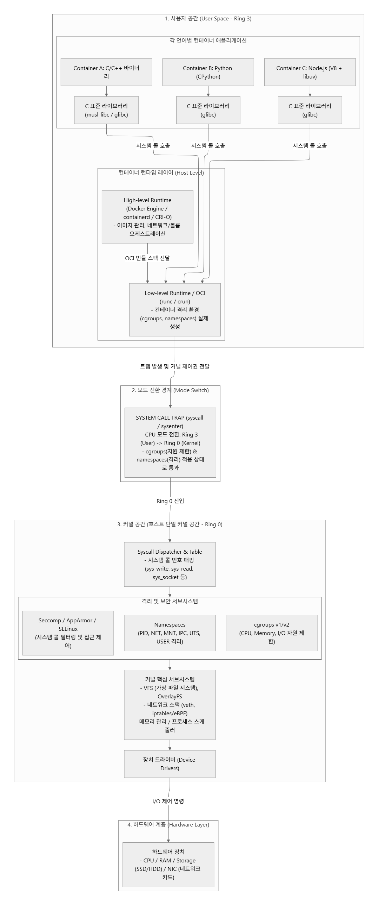

# 컨테이너 런타임 아키텍처 동작 구조 분석 

## 1. 컨테이너 런타임 아키텍처 시스템 동작 흐름

 핵심 아키텍처는 **사용자 공간(Ring 3)의 애플리케이션이 컨테이너 런타임과 시스템 콜 트랩을 거쳐 단일 호스트 커널(Ring 0) 및 하드웨어로 진입하는 전체 흐름**입니다.

## 2. 계층별 세부 동작 메커니즘

### 2.1 사용자 공간 (User Space - Ring 3)
1. **애플리케이션 및 언어 런타임**:
   - **C / C++ 애플리케이션**: 바이너리가 표준 라이브러리(`musl-libc`, `glibc`)의 POSIX 함수를 직접 호출합니다.
   - **Python 애플리케이션**: Python Script가 CPython 인터프리터(PVM)에 의해 실행되며, 내부 C API를 통해 `glibc`를 호출합니다.
   - **Node.js 애플리케이션**: V8 엔진과 비동기 I/O를 제어하는 `libuv` 이벤트 루프 라이브러리가 C++ 바인딩을 통해 `glibc`를 호출합니다.
2. **컨테이너 런타임 (Container Runtimes)**:
   - **High-level Runtime (Docker Engine, containerd, CRI-O)**:
     - 컨테이너 이미지 다운로드 및 압축 해제
     - 컨테이너 네트워크(CNI) 및 스토리지(CSI) 오케스트레이션
     - OCI 호환 컨테이너 명세서(`config.json` 번들)를 생성하여 Low-level 런타임에 전달
   - **Low-level Runtime (`runc`, `crun`)**:
     - OCI Runtime Specification을 구현한 경량 바이너리
     - 리눅스 커널 API를 호출하여 컨테이너의 실제 격리 네임스페이스와 cgroups를 셋업하고 프로세스 실행

### 2.2 하드웨어 / 소프트웨어 경계 (Trap & Mode Switch)
- **SYSTEM CALL TRAP**:
  - 사용자 공간 프로세스가 파일 읽기/쓰기, 소켓 통신 등을 위해 `syscall`(x86-64) 또는 `sysenter`(x86) CPU 명령어를 실행합니다.
  - CPU 하드웨어가 이를 감지하여 **Ring 3(사용자 모드)** 에서 **Ring 0(커널 모드)** 로 즉시 권한을 격상하고 CPU 제어권을 커널 엔트리 포인트로 전환합니다.
  - 이때 프로세스는 이미 `cgroups` 및 `namespaces`가 부여된 격리 컨텍스트 상태로 트랩을 통과합니다.

### 2.3 호스트 커널 공간 (Kernel Space - Ring 0)
모든 컨테이너는 별도의 독립된 커널을 가지지 않으며, **호스트의 단일 리눅스 커널을 공유**합니다.
1. **Syscall Dispatcher & Syscall Table**:
   - 트랩으로 전달된 시스템 콜 번호를 확인하여 대응하는 커널 내부 함수(예: `sys_read`, `sys_write`, `sys_socket`)로 디스패치합니다.
2. **격리 및 보안 서브시스템 (Isolation & Security)**:
   - **Namespaces**: 시스템 리소스 뷰를 컨테이너별로 격리 (PID, NET, MNT, IPC, UTS, USER).
   - **cgroups (Control Groups) v1/v2**: 컨테이너별 CPU 쿼터, 메모리 한도, 블록 I/O 대역폭을 강제 제한.
   - **Seccomp / AppArmor / SELinux**: 컨테이너가 호출 가능한 시스템 콜 화이트리스트를 검사하고 비인가 파일/장치 접근을 원천 차단.
3. **커널 핵심 서브시스템 (Kernel Subsystems)**:
   - **VFS & OverlayFS**: 컨테이너 이미지 레이어(Read-Only)와 컨테이너 쓰기 레이어(Read-Write)를 병합하는 계층형 파일 시스템 처리.
   - **네트워크 스택**: 컨테이너 네임스페이스와 호스트를 연결하는 `veth`(Virtual Ethernet) 페어 및 `iptables`/`eBPF` 패킷 포워딩 처리.
   - **메모리 관리자 및 CFS 스케줄러**: 메모리 매핑 및 CPU 코어 할당.
4. **장치 드라이버 (Device Drivers)**:
   - 커널 내부 요청을 물리 하드웨어 버스(PCIe, SATA, NVMe 등) 규격에 맞는 저수준 명령어로 변환.

### 2.4 하드웨어 계층 (Hardware Layer)
- CPU, RAM, 스토리지(SSD/HDD), NIC(네트워크 인터페이스 카드)가 물리적 연산, 데이터 영속화, 패킷 전송을 최종 수행합니다.
