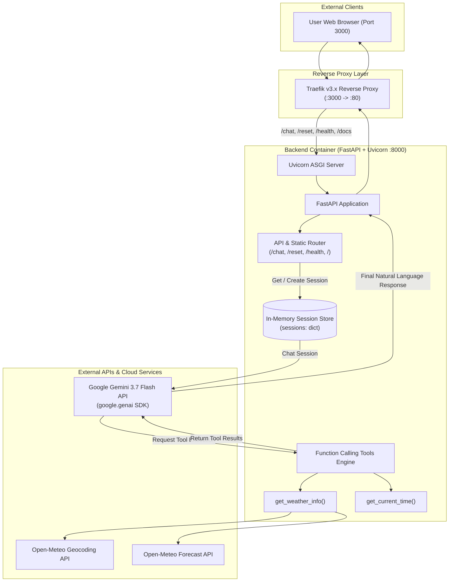
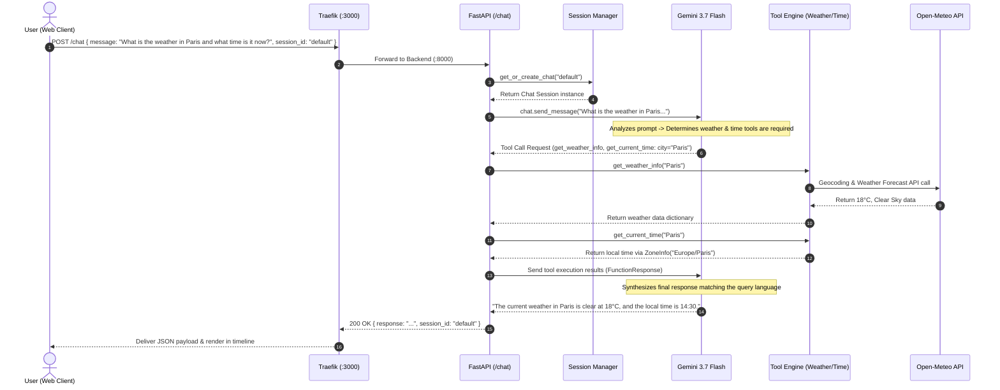
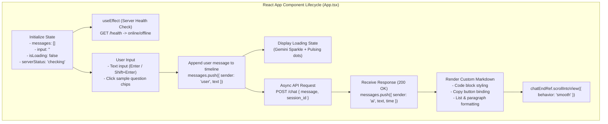
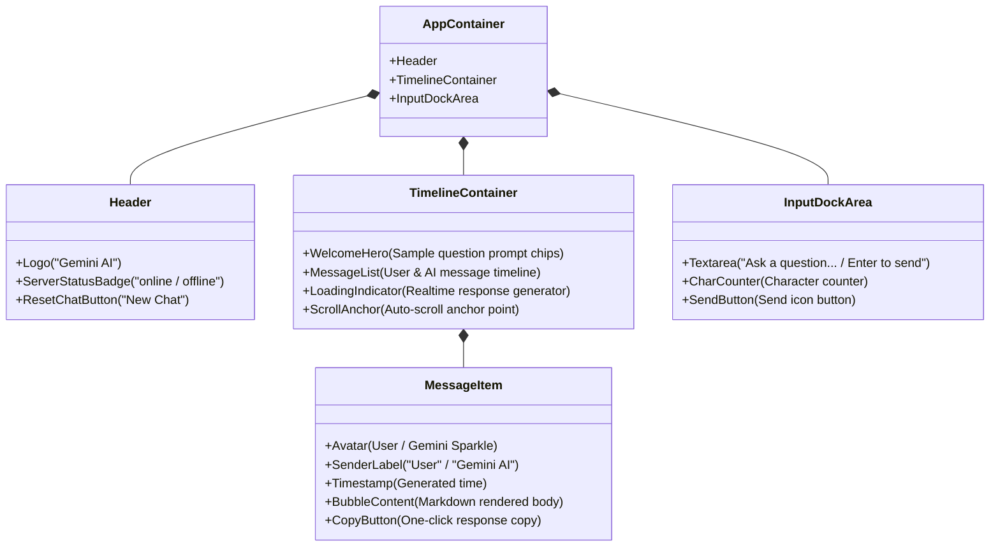
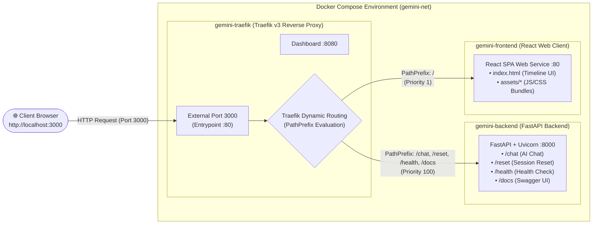

# Gemini AI Chat System - Architecture & Workflow Specification

This document provides a comprehensive technical overview of the conversational AI web service based on **Google Gemini 3.7 Flash**, detailing system architecture, project directory structure, backend/frontend operational workflows, and Mermaid diagrams.

---

## 1. Key Features

| Category | Feature | Description |
| :--- | :--- | :--- |
| **AI Model & Chat** | **Gemini 3.7 Flash** | High-performance multi-turn general Q&A powered by the official `google-genai` SDK |
| **Realtime Tools** | **Function Calling** | Automated retrieval of **real-time weather** (`Open-Meteo API`) and **local time** (`ZoneInfo`) for cities worldwide |
| **Language Consistency** | **Language Matching** | Automatically detects user input language (Korean, English, Japanese, French, etc.) and generates responses in the exact same language |
| **Session State** | **Multi-turn Sessions** | In-memory conversation context management keyed by `session_id`, with one-click reset (`New Chat / Reset`) |
| **UI/UX** | **Timeline Interface** | Gemini.ai-style clean white theme, sequential question-and-answer accumulation, markdown parser, code block syntax highlighting, and one-click copy |
| **Network & Deployment** | **Traefik Reverse Proxy** | Unified routing via port `3000` for both frontend static assets and backend API endpoints in a fully containerized `Docker Compose` environment |

---

## 2. Directory and File Structure

```plaintext
geminiAI-Sever/
├── compose.yaml                      # Docker Compose orchestration (Traefik, Backend, Frontend)
├── Architecture_Workflow-KR.md       # Architecture & Workflow documentation (Korean)
├── Architecture_Workflow-EN.md       # Architecture & Workflow documentation (English)
├── How-to-Execute(KR).md             # 3 execution workflows guide (Korean)
├── How-to-Execute(EN).md             # 3 execution workflows guide (English)
│
├── backend/                          # FastAPI backend application
│   ├── gemini-chat-server.py         # FastAPI main server (Uvicorn, Gemini SDK, Function Calling, Static routing)
│   ├── Dockerfile                    # Container build configuration (Python 3.11-slim + uv)
│   ├── .dockerignore                 # Docker build exclusions
│   ├── pyproject.toml                # uv package manager dependency manifest
│   ├── .python-version               # Python runtime version pin (3.11)
│   ├── .env                          # GEMINI_API_KEY environment variable file
│   ├── README.md                     # Backend setup and endpoint specifications
│   └── static/                       # Production frontend build distribution folder (optional serving)
│
└── frontend/                         # React + TypeScript + Vite web client
    ├── Dockerfile                    # Multi-stage container build (Node.js build -> Nginx serving)
    ├── .dockerignore                 # Docker build exclusions
    ├── nginx.conf                    # Nginx web server configuration (SPA routing & asset caching)
    ├── package.json                  # Frontend dependencies and npm build scripts
    ├── tsconfig.json                 # TypeScript base configuration
    ├── tsconfig.app.json             # Application TypeScript configuration
    ├── tsconfig.node.json            # Node/Vite TypeScript configuration
    ├── vite.config.ts                # Vite bundler & backend proxy configuration
    ├── index.html                    # Web application HTML entrypoint
    ├── src/
    │   ├── App.tsx                   # Main chat timeline component (state, API client, markdown renderer)
    │   ├── App.css                   # Gemini-inspired clean white theme and animations
    │   ├── main.tsx                  # React 18 DOM mount entrypoint
    │   ├── index.css                 # Global typography and CSS reset
    │   └── vite-env.d.ts             # Vite environment TypeScript declarations
    └── scripts/
        └── copy-to-backend.js        # Build script that automatically copies dist/ to backend/static/
```

---

## 3. Backend Architecture (`gemini-chat-server.py`)

### 3.1 Core Architecture Components

1. **Uvicorn (ASGI Web Server)**
   - Operates on an asynchronous event loop to handle concurrent client connections with high throughput.
   - Reads host environment variables (`HOST=0.0.0.0`, `PORT=8000`) for flexible deployment across bare-metal and container environments.

2. **FastAPI (Web Application Framework)**
   - **CORS Middleware**: Allows cross-origin requests from development servers (e.g. `http://localhost:5173`).
   - **Pydantic Validation**: Enforces strict request/response contracts via `ChatRequest`, `ChatResponse`, and `ResetRequest` schemas.
   - **Static Routing Handlers**: Serves frontend static assets (HTML, JS, CSS) with exact MIME types (`application/javascript`, `text/css`) through `@app.get("/")` and `@app.get("/{full_path:path}")` route handlers.

3. **Google GenAI SDK & Function Calling Engine**
   - **`client.chats.create`**: Maintains multi-turn conversation memory within an in-memory session pool (`sessions: dict[str, chats.Chat]`).
   - **Realtime Tool Functions**:
     - `get_weather_info(city)`: Calls Open-Meteo Geocoding and Weather Forecast APIs to fetch real-time temperature, humidity, wind speed, and meteorological condition.
     - `get_current_time(city)`: Resolves IANA timezone identifiers via geocoding and computes exact local time using Python's standard `ZoneInfo`.
   - **Automatic Tool Execution Loop**: When Gemini determines that external information is necessary to satisfy the prompt, the server executes the tool locally, feeds the result back to Gemini, and delivers the synthesized natural language response.

---

### 3.2 Backend System Architecture Diagram



---

### 3.3 Chat Request & Function Calling Sequence Diagram



---

## 4. Frontend Architecture (`frontend`)

### 4.1 Technology Stack & Structure

- **React 18 & TypeScript**: Component-driven UI architecture with complete compile-time type safety.
- **Vite Bundler**: Sub-second Hot Module Replacement (HMR) and optimized production rollup builds.
- **Nginx Web Server**: Serves production static files with gzip compression and client-side SPA routing fallback.
- **CSS Architecture (`App.css`)**:
  - Gemini.ai-inspired modern clean white theme.
  - Pulsing status indicators and typing animations.
  - Custom markdown parser (headings, bold, lists, backtick code blocks with one-click clipboard copy).
  - Smooth auto-scrolling to latest messages (`chatEndRef`).

---

### 4.2 Frontend State Management & Lifecycle Flow



---

### 4.3 UI Layout Component Hierarchy



---

## 5. Docker Compose & Routing Specification (`compose.yaml`)



### 5.1 Ports & Network Summary

- **Host Entrypoint Port**: `3000` (Handled by Traefik and dynamically routed)
- **Traefik Monitoring Dashboard**: `http://localhost:8080`
- **Internal Bridge Network**: `gemini-net`
- **Environment Ingestion**: Automatically passes `GEMINI_API_KEY` from `backend/.env` to the backend container

---

## 6. Service Management Commands

```bash
# 1. Build and start containers in the background
docker compose up --build -d

# 2. Check running container status
docker compose ps

# 3. View live aggregate logs
docker compose logs -f

# 4. Stop and remove containers and network
docker compose down
```
