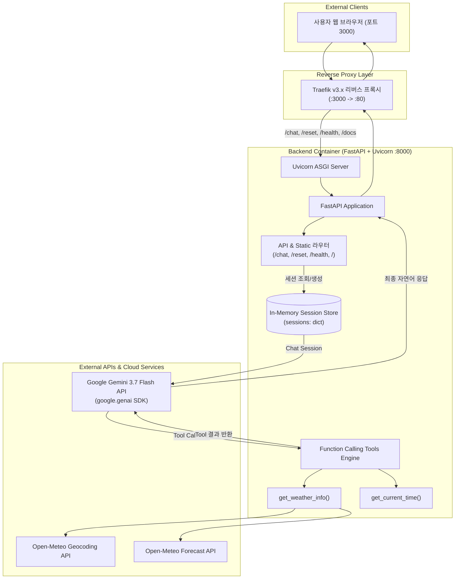
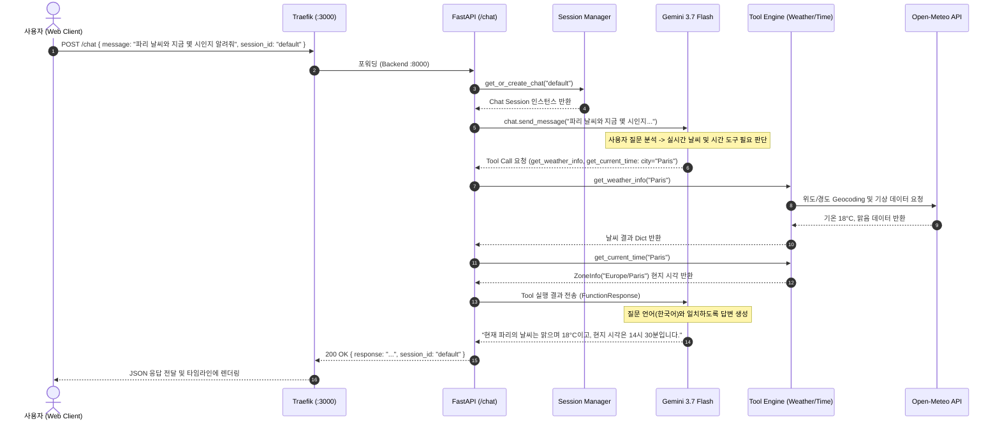
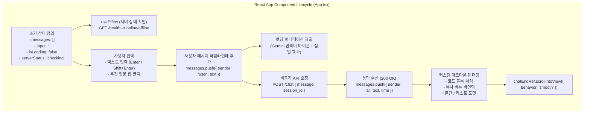
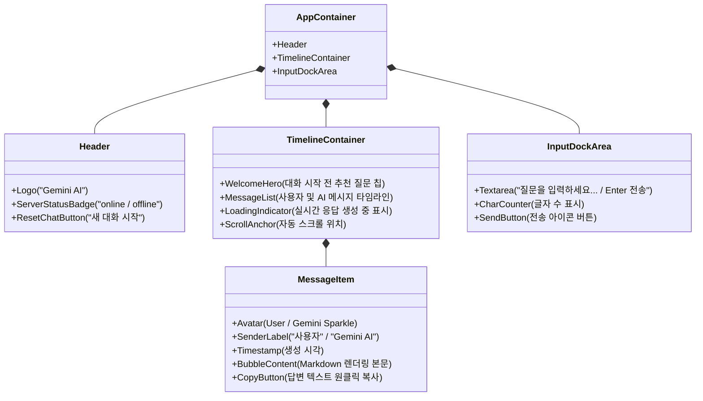
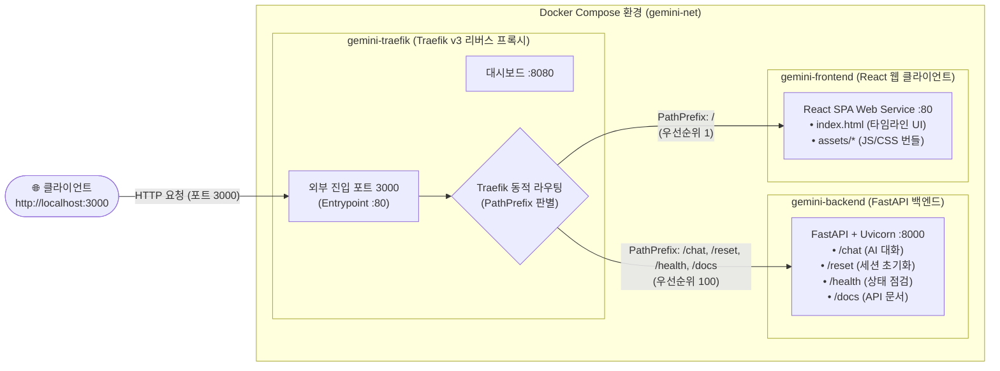

# Gemini AI Chat System - 아키텍처 및 워크플로우 명세서

본 문서는 **Google Gemini 3.7 Flash** 기반 대화형 AI 웹 서비스의 전체 아키텍처, 디렉토리 구조, 백엔드/프론트엔드 동작 원리 및 시퀀스 다이어그램을 상세히 기술합니다.

---

## 1. 프로젝트 주요 기능 (Features)

| 분류 | 주요 기능 | 설명 |
| :--- | :--- | :--- |
| **AI 모델 & 대화** | **Gemini 3.7 Flash** | 최신 `google-genai` SDK 기반의 고성능 멀티턴(Multi-turn) 일반적 질문 답변 대화 지원 |
| **실시간 도구 연동** | **Function Calling** | 전 세계 도시의 **실시간 날씨**(`Open-Meteo API`) 및 **현지 시각**(`ZoneInfo`) 자동 조회 |
| **언어 일관성** | **Language Consistency** | 사용자가 질문한 언어(한국어, 영어, 일본어 등)를 자동 감지하여 동일 언어로 일관된 답변 생성 |
| **세션 관리** | **Multi-turn Session** | `session_id` 기반 문맥(Context) 기억 및 원클릭 대화 초기화(`New Chat / Reset`) 지원 |
| **UI/UX** | **타임라인 방식 인터페이스** | Gemini.ai 스타일의 깔끔한 화이트 테마, 질문-답변 순차 누적 표출, 마크다운 렌더링, 코드 블록 복사 |
| **네트워크 & 배포** | **Traefik 리버스 프록시** | 포트 `3000` 단일 진입점을 통해 프론트엔드와 백엔드 API를 통합 라우팅하는 완전 컨테이너화(`Docker Compose`) 환경 |

---

## 2. 프로젝트 폴더 및 파일 구조 (Project Structure)

```plaintext
geminiAI-Sever/
├── compose.yaml                      # Docker Compose 오케스트레이션 (Traefik, Backend, Frontend)
├── Architecture_Workflow-KR.md       # 시스템 아키텍처 및 워크플로우 문서 (본 파일)
│
├── backend/                          # FastAPI 백엔드 애플리케이션
│   ├── gemini-chat-server.py         # FastAPI 서버 메인 (Uvicorn, Gemini SDK, Tool Calling, Static 서빙)
│   ├── Dockerfile                    # Python 3.11-slim + uv 기반 백엔드 컨테이너 빌드 파일
│   ├── .dockerignore                 # 도커 빌드 제외 설정
│   ├── pyproject.toml                # uv 패키지 매니저 의존성 정의 파일
│   ├── .python-version               # Python 버전 명시 (3.11)
│   ├── .env                          # GEMINI_API_KEY 환경변수 설정 파일
│   ├── README.md                     # 백엔드 실행 및 API 명세 안내
│   └── static/                       # 프론트엔드 빌드 결과물 배포 폴더 (선택적 서빙용)
│
└── frontend/                         # React + TypeScript + Vite 웹 클라이언트
    ├── Dockerfile                    # Multi-stage 빌드 (Node.js 빌드 -> Nginx 서빙)
    ├── .dockerignore                 # 도커 빌드 제외 설정
    ├── nginx.conf                    # Nginx 웹 서버 설정 (SPA 라우팅 및 정적 에셋 캐싱)
    ├── package.json                  # 프론트엔드 의존성 및 빌드 스크립트 정의
    ├── tsconfig.json                 # TypeScript 컴파일러 설정
    ├── tsconfig.app.json             # App용 TypeScript 설정
    ├── tsconfig.node.json            # Node/Vite용 TypeScript 설정
    ├── vite.config.ts                # Vite 번들러 및 프록시 설정
    ├── index.html                    # 웹 진입점 HTML 파일
    ├── src/
    │   ├── App.tsx                   # 메인 채팅 타임라인 컴포넌트 (상태 관리, API 연동, 마크다운 렌더러)
    │   ├── App.css                   # Gemini 스타일 화이트 테마 및 애니메이션 스타일시트
    │   ├── main.tsx                  # React 18 렌더링 진입점
    │   ├── index.css                 # 글로벌 폰트 및 기본 CSS 리셋
    │   └── vite-env.d.ts             # Vite 타입 정의
    └── scripts/
        └── copy-to-backend.js        # npm run build 시 dist 폴더를 backend/static으로 복사하는 스크립트
```

---

## 3. 서버(`gemini-chat-server.py`) 동작 구조 (Backend Architecture)

### 3.1 핵심 아키텍처 요소

1. **Uvicorn (ASGI Web Server)**
   - 비동기 이벤트 루프 기반으로 HTTP 요청을 수신하고, 다중 클라이언트 동시 접속을 효율적으로 처리합니다.
   - 호스트 환경변수(`HOST=0.0.0.0`, `PORT=8000`)를 기반으로 구동됩니다.

2. **FastAPI (Web Framework)**
   - **CORS 미들웨어**: 웹 클라이언트의 교차 출처 요청 허용
   - **Pydantic 데이터 검증**: `ChatRequest`, `ChatResponse`, `ResetRequest` 모델을 통한 엄격한 입출력 유효성 검사
   - **정적 파일 라우팅**: `@app.get("/")` 및 `@app.get("/{full_path:path}")` 라우트 핸들러를 통해 프론트엔드 정적 에셋(JS, CSS, HTML)을 적절한 MIME 타입(`application/javascript`, `text/css`)으로 서빙

3. **Google GenAI SDK & Function Calling Engine**
   - **`client.chats.create`**: `session_id`별로 대화 문맥(History)을 유지하는 인메모리 세션 풀 관리
   - **실시간 도구(Tool Functions)**:
     - `get_weather_info(city)`: Open-Meteo Geocoding 및 Weather Forecast API를 호출하여 실시간 기온, 습도, 풍속, 기상 상태 수집
     - `get_current_time(city)`: 도시별 IANA 타임존을 조회하여 `ZoneInfo` 기반의 정확한 현지 시각 계산
   - **자동 도구 실행 루프(Automatic Function Calling)**: Gemini가 사용자 의도에 따라 도구 호출이 필요하다고 판단하면 서버가 로컬 함수를 실행하고 결과를 Gemini에 재전달하여 최종 자연어 답변을 완성합니다.

---

### 3.2 백엔드 전체 시스템 아키텍처 다이어그램



---

### 3.3 대화 요청 및 Function Calling 처리 시퀀스 다이어그램



---

## 4. 프론트엔드(`frontend`) 구조 (Frontend Architecture)

### 4.1 핵심 기술 스택 및 구성

- **React 18 & TypeScript**: 안정적인 타입 안전성과 컴포넌트 기반 UI 개발
- **Vite 번들러**: 빠른 HMR(Hot Module Replacement) 및 최적화된 프로덕션 빌드
- **Nginx Web Server**: 프로덕션 배포 시 정적 번들 서빙 및 SPA 라우팅 지원
- **CSS Architecture (`App.css`)**:
  - Gemini.ai 고유의 모던 화이트 테마 및 미니멀리즘 디자인
  - 실시간 타이핑 인디케이터(Pulsing Dot)
  - 마크다운 파서 (제목, 볼드, 이탤릭, 리스트, 백틱 코드 블록 및 원클릭 복사 버튼)
  - 자동 하단 스크롤 제어 (`chatEndRef`)

---

### 4.2 프론트엔드 상태 관리 및 렌더링 흐름



---

### 4.3 UI 레이아웃 계층 구조



---

## 5. Docker Compose & 네트워크 라우팅 명세 (`compose.yaml`)



### 5.1 포트 및 네트워크 요약

- **호스트 진입 포트**: `3000` (Traefik 리버스 프록시가 수신하여 라우팅)
- **Traefik 대시보드**: `http://localhost:8080`
- **내부 브리지 네트워크**: `gemini-net`
- **환경 변수 연동**: `backend/.env` 파일의 `GEMINI_API_KEY`가 백엔드 컨테이너에 자동 주입되어 구동

---

## 6. 서비스 실행 및 유지보수 가이드

```bash
# 1. 컨테이너 빌드 및 백그라운드 실행
docker compose up --build -d

# 2. 서비스 동작 상태 확인
docker compose ps

# 3. 실시간 로그 모니터링
docker compose logs -f

# 4. 서비스 종료
docker compose down
```
