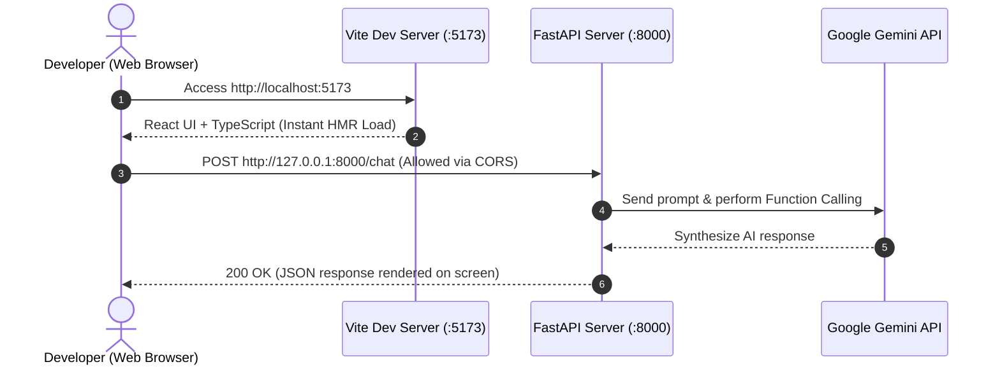
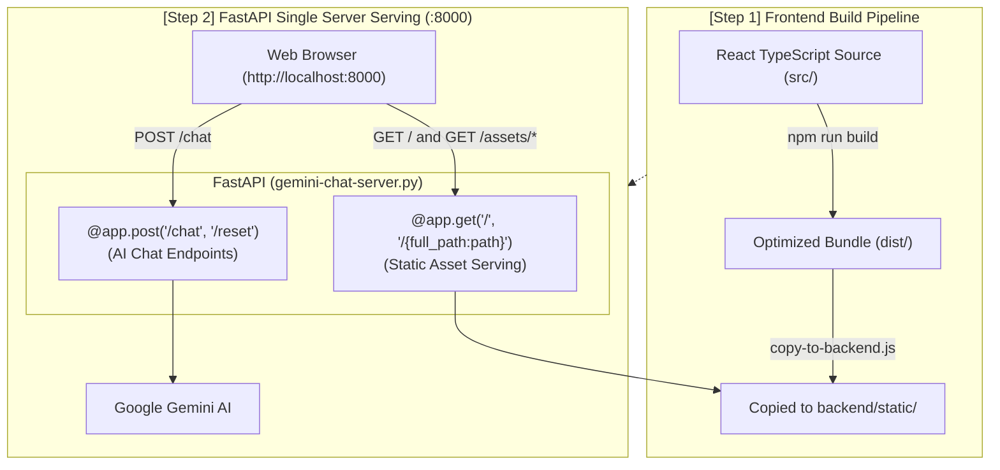
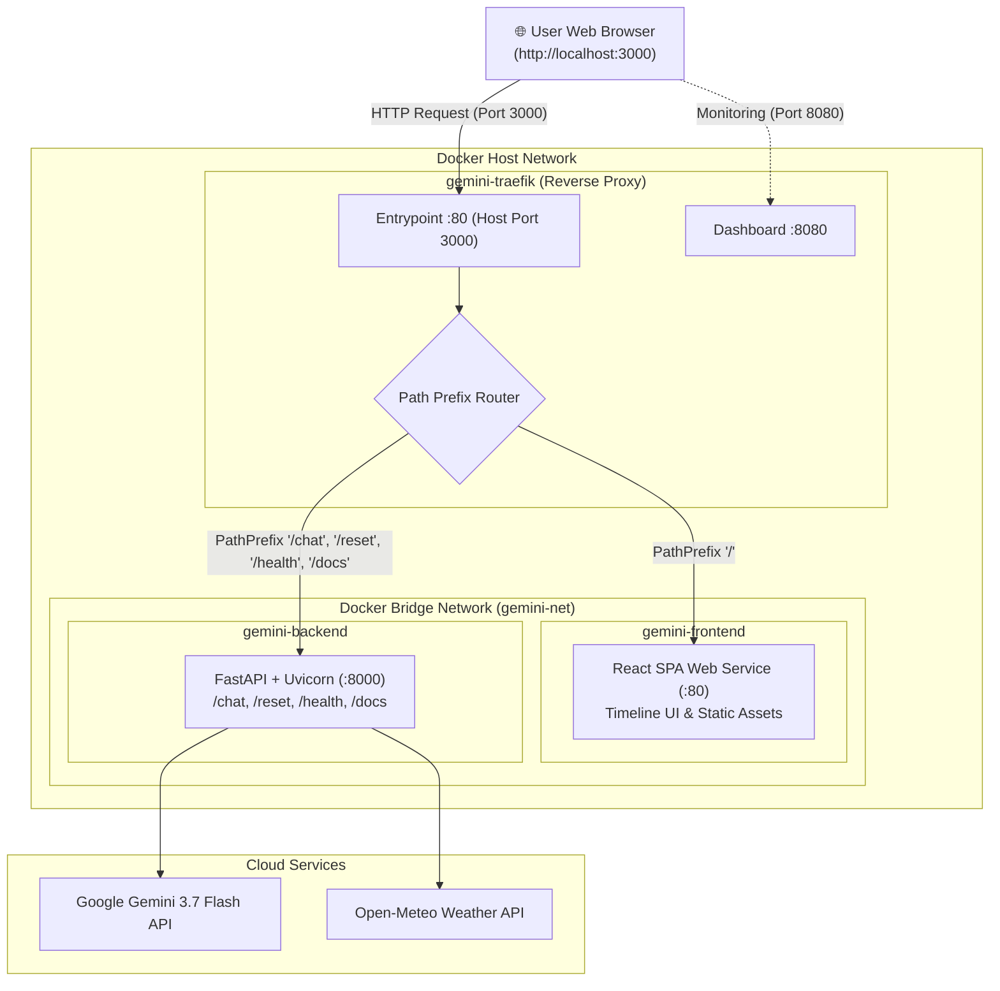

# Gemini AI Service Execution Guide (How to Execute)

This document provides a guide to the **3 different execution methods** for the Gemini AI conversational web service, explaining each method's **internal architecture**, **network dataflow**, and **Mermaid diagrams**.

---

## 📋 Summary Comparison of 3 Execution Methods

| Method | Execution Workflow | Client URL | Key Features & Target Use Case |
| :--- | :--- | :--- | :--- |
| **Method 1** | **Local Development Mode**<br>(Backend + `npm run dev`) | `http://localhost:5173` | • Instant updates on code change (Vite HMR)<br>• Ideal for rapid UI/feature development |
| **Method 2** | **Local Build & Integrated Serving**<br>(`npm run build` + Backend) | `http://localhost:8000` | • Vite bundles assets and copies to `backend/static`<br>• Single FastAPI server hosts both UI and API |
| **Method 3** | **Docker Compose Containerization**<br>(`docker compose up --build -d`) | `http://localhost:3000` | • Unified entrypoint via Traefik reverse proxy<br>• Isolated multi-container production environment |

---

## 1. Method 1: Local Development Mode (Backend + `npm run dev`)

This is the standard local development environment when making real-time code modifications to the React frontend.

### 1.1 Step-by-Step Instructions

#### [Terminal 1] Start the Backend FastAPI Server
```powershell
cd "d:\Lecture Notes\2026-2CloudComputing\practices\00week\geminiAI-Sever\backend"
uv run gemini-chat-server.py
```
> **Backend URL**: `http://127.0.0.1:8000` (Swagger Docs: `http://127.0.0.1:8000/docs`)

#### [Terminal 2] Start the Frontend Vite Development Server
```powershell
cd "d:\Lecture Notes\2026-2CloudComputing\practices\00week\geminiAI-Sever\frontend"
npm run dev
```
> **Web Client URL**: **`http://localhost:5173`**

---

### 1.2 Architecture & Operational Workflow
1. **Vite Dev Server (Port 5173)**: Serves React TypeScript modules on-demand without full bundling, providing sub-second **Hot Module Replacement (HMR)** when source code changes.
2. **CORS & Asynchronous Communication**: The browser renders the client from port `5173` and makes asynchronous `fetch` requests (`/chat`, `/health`, `/reset`) directly to `http://127.0.0.1:8000`. The backend's `CORSMiddleware` allows cross-origin requests from `http://localhost:5173`.



---

## 2. Method 2: Local Build & Integrated Backend Serving (`npm run build` + Backend)

In this mode, the frontend is compiled into optimized static production files (HTML, JS, CSS) and **served directly by a single FastAPI backend server on port 8000**.

### 2.1 Step-by-Step Instructions

#### [Step 1] Build Frontend (Automated Distribution Pipeline)
```powershell
cd "d:\Lecture Notes\2026-2CloudComputing\practices\00week\geminiAI-Sever\frontend"
npm run build
```
> **What happens**: TypeScript compilation (`tsc -b`) ➔ Vite static bundling (`vite build`) ➔ `scripts/copy-to-backend.js` automatically copies the output files from `dist/` into **`backend/static/`**.

#### [Step 2] Launch the Unified Backend Server
```powershell
cd "d:\Lecture Notes\2026-2CloudComputing\practices\00week\geminiAI-Sever\backend"
uv run gemini-chat-server.py
```
> **Unified Web & API URL**: **`http://localhost:8000`**

---

### 2.2 Architecture & Operational Workflow
1. **Single-Server Simplicity**: No external web server (Nginx or Node.js) is needed during runtime.
2. **Route Handling with MIME Type Detection**:
   - `GET /` ➔ Returns `backend/static/index.html`
   - `GET /assets/*` ➔ Delivers static assets with exact MIME types (`application/javascript`, `text/css`)
   - `POST /chat`, `POST /reset`, `GET /health` ➔ Executes FastAPI API handlers



---

## 3. Method 3: Docker Compose Containerization (`docker compose up --build -d`)

Runs the entire stack in isolated Docker containers with **Traefik v3** acting as the single reverse proxy gateway on port `3000`.

### 3.1 Step-by-Step Instructions

#### [Execution] Launch Containers from the Workspace Root
```powershell
cd "d:\Lecture Notes\2026-2CloudComputing\practices\00week\geminiAI-Sever"
docker compose up --build -d
```

#### [Inspection & Monitoring]
```powershell
# Check container health and status
docker compose ps

# View live aggregate logs
docker compose logs -f
```

#### [Teardown] Stop All Services
```powershell
docker compose down
```

---

### 3.2 Service URLs
- **Web Application (via Traefik)**: **`http://localhost:3000`**
- **FastAPI Swagger Docs**: **`http://localhost:3000/docs`**
- **FastAPI Health Check**: **`http://localhost:3000/health`**
- **Traefik Monitoring Dashboard**: **`http://localhost:8080`**

---

### 3.3 Architecture & Operational Workflow
1. **Traefik v3 Reverse Proxy (Port 3000)**:
   - Receives all incoming HTTP traffic on port `3000` and dynamically routes based on path prefix rules.
2. **`gemini-frontend` Container (Nginx :80)**:
   - Multi-stage Docker image serving React SPA assets with Nginx.
3. **`gemini-backend` Container (FastAPI + uv :8000)**:
   - Runs `python:3.11-slim` with `uv` to handle conversation sessions and Google Gemini API integration.
4. **`gemini-net` Bridge Network**:
   - Only Traefik ports (`3000`, `8080`) are exposed to the host machine. Frontend and Backend containers communicate securely inside the Docker internal network.



---

## 💡 Recommendation by Scenario

- **Active Development & UI Styling**: Use **Method 1 (`npm run dev`)** for real-time HMR updates.
- **Standalone Local Demo / Evaluation**: Use **Method 2 (`npm run build` + Backend)** for single-process simplicity.
- **Production Staging & Multi-Container Validation**: Use **Method 3 (`docker compose up`)** for production-grade proxy and container isolation.
