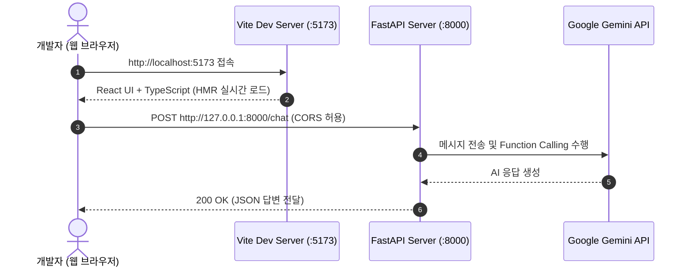
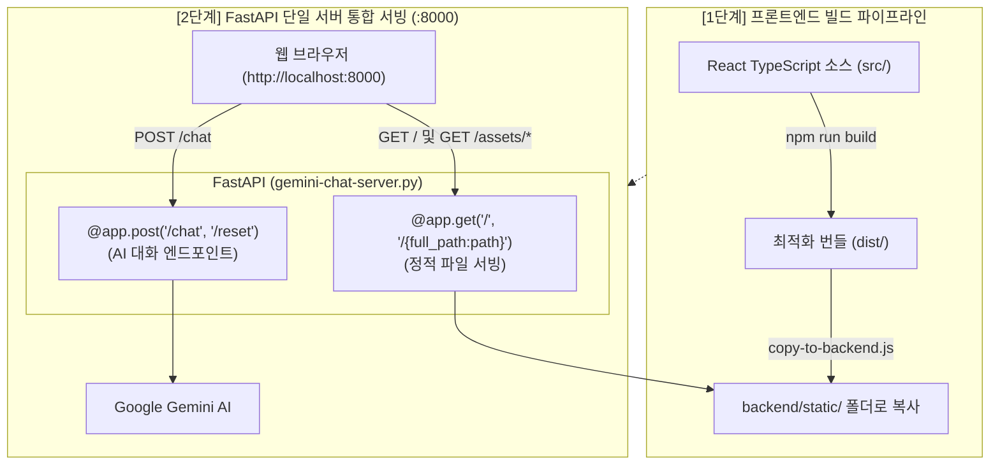
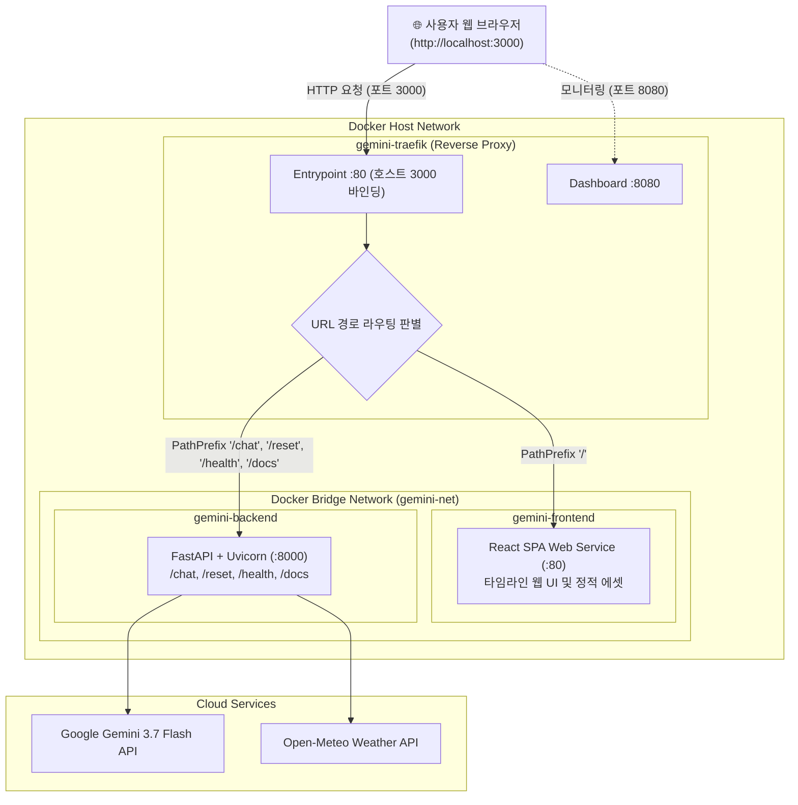

# Gemini AI 서비스 실행 가이드 (How to Execute)

본 문서는 Gemini AI 대화형 웹 서비스를 실행하는 **3가지 방법**과 각 실행 방식별 **내부 동작 구조**, **네트워크 흐름** 및 **Mermaid 다이어그램**을 정리한 가이드입니다.

---

## 📋 실행 방법 3가지 요약 비교

| 구분 | 실행 방식 | 클라이언트 접속 주소 | 특징 및 주요 용도 |
| :--- | :--- | :--- | :--- |
| **방법 1** | **로컬 개발 모드**<br>(Backend + `npm run dev`) | `http://localhost:5173` | • 코드 수정 시 즉시 반영 (Vite HMR)<br>• 프론트엔드 UI/기능 빠른 개발에 최적화 |
| **방법 2** | **로컬 빌드 & 백엔드 통합 서빙**<br>(`npm run build` + Backend) | `http://localhost:8000` | • Vite 정적 빌드 후 `backend/static` 자동 복사<br>• FastAPI 단일 서버에서 웹과 API를 함께 제공 |
| **방법 3** | **Docker Compose 컨테이너화**<br>(`docker compose up --build -d`) | `http://localhost:3000` | • Traefik 리버스 프록시 기반 단일 엔트리포인트<br>• 프로덕션 배포 및 격리된 멀티 컨테이너 환경 |

---

## 1. 방법 1: 로컬 개발 모드 (Backend + `npm run dev`)

프론트엔드 React 소스 코드를 실시간으로 수정하며 개발할 때 사용하는 가장 일반적인 개발 환경입니다.

### 1.1 실행 순서

#### [터미널 1] 백엔드 FastAPI 서버 실행
```powershell
cd "d:\Lecture Notes\2026-2CloudComputing\practices\00week\geminiAI-Sever\backend"
uv run gemini-chat-server.py
```
> **서버 주소**: `http://127.0.0.1:8000` (API 문서: `http://127.0.0.1:8000/docs`)

#### [터미널 2] 프론트엔드 Vite 개발 서버 실행
```powershell
cd "d:\Lecture Notes\2026-2CloudComputing\practices\00week\geminiAI-Sever\frontend"
npm run dev
```
> **웹 접속 주소**: **`http://localhost:5173`**

---

### 1.2 동작 구조 및 특징
1. **Vite Dev Server (Port 5173)**: React TypeScript 소스를 번들링 없이 즉각 브라우저에 제공하며, 코드 변경 시 브라우저 새로고침 없이 즉각 반영되는 **HMR(Hot Module Replacement)**을 지원합니다.
2. **CORS & 프록시 통신**: 브라우저는 `5173` 포트에서 UI를 로드하고, 대화 API 요청(`/chat`, `/health`, `/reset`)은 `http://127.0.0.1:8000`으로 비동기 통신(`fetch`)합니다. FastAPI 서버의 `CORSMiddleware`가 `5173` 출처의 요청을 안전하게 허용합니다.



---

## 2. 방법 2: 로컬 빌드 & 백엔드 통합 서빙 (`npm run build` + Backend)

프론트엔드를 정적 파일(HTML, JS, CSS)로 최적화 빌드한 후, **FastAPI 백엔드 서버 1개만으로 웹과 API를 모두 서비스**하는 방식입니다.

### 2.1 실행 순서

#### [단계 1] 프론트엔드 빌드 (자동 배포 스크립트 연동)
```powershell
cd "d:\Lecture Notes\2026-2CloudComputing\practices\00week\geminiAI-Sever\frontend"
npm run build
```
> **동작**: TypeScript 타입 검사(`tsc -b`) ➔ Vite 정적 번들링(`vite build`) ➔ `scripts/copy-to-backend.js`가 실행되어 `dist/` 결과물이 **`backend/static/`** 폴더로 자동 복사됩니다.

#### [단계 2] 백엔드 서버 구동
```powershell
cd "d:\Lecture Notes\2026-2CloudComputing\practices\00week\geminiAI-Sever\backend"
uv run gemini-chat-server.py
```
> **웹 및 API 통합 접속 주소**: **`http://localhost:8000`**

---

### 2.2 동작 구조 및 특징
1. **단일 서버 구조**: 별도의 프론트엔드 웹 서버(Nginx, Vite 등) 없이 FastAPI 백엔드 서버가 모든 역할을 전담합니다.
2. **`@app.get` 기반 정적 에셋 라우팅**:
   - `GET /` ➔ `backend/static/index.html` 반환
   - `GET /assets/*` ➔ 정확한 MIME 타입(`application/javascript`, `text/css`)으로 에셋 반환
   - `POST /chat`, `POST /reset`, `GET /health` ➔ FastAPI 백엔드 API 실행



---

## 3. 방법 3: Docker Compose 컨테이너화 (`docker compose up --build -d`)

프론트엔드, 백엔드, 리버스 프록시(Traefik)를 독립된 컨테이너로 격리하여 **실제 운영 환경과 동일하게 배포 및 실행**하는 방식입니다.

### 3.1 실행 순서

#### [실행] 프로젝트 루트 디렉토리에서 Compose 실행
```powershell
cd "d:\Lecture Notes\2026-2CloudComputing\practices\00week\geminiAI-Sever"
docker compose up --build -d
```

#### [상태 확인 및 모니터링]
```powershell
# 컨테이너 구동 상태 확인
docker compose ps

# 실시간 컨테이너 로그 확인
docker compose logs -f
```

#### [종료] 서비스 중지
```powershell
docker compose down
```

---

### 3.2 서비스 접속 주소
- **웹 서비스 (Traefik 리버스 프록시)**: **`http://localhost:3000`**
- **FastAPI Swagger 문서**: **`http://localhost:3000/docs`**
- **FastAPI 헬스체크**: **`http://localhost:3000/health`**
- **Traefik 모니터링 대시보드**: **`http://localhost:8080`**

---

### 3.3 동작 구조 및 특징
1. **Traefik v3 Reverse Proxy (Port 3000)**:
   - 모든 외부 트래픽을 호스트 포트 `3000`으로 단일 수신합니다.
   - 요청 URL 경로에 따라 내부 컨테이너로 지능적 라우팅을 수행합니다.
2. **`gemini-frontend` 컨테이너 (Nginx :80)**:
   - Multi-stage Dockerfile로 빌드된 가벼운 Nginx 서버가 React SPA 웹 페이지를 서빙합니다.
3. **`gemini-backend` 컨테이너 (FastAPI + uv :8000)**:
   - `python:3.11-slim` 환경에서 `uv`로 실행되며, API 요청 처리 및 Gemini AI 연동을 전담합니다.
4. **`gemini-net` 격리 네트워크**:
   - 외부에는 Traefik 포트(`3000`, `8080`)만 노출되며, 백엔드와 프론트엔드는 도커 브리지 네트워크 내부에서 안전하게 통신합니다.



---

## 💡 상황별 추천 실행 방법

- **기능 개발 및 화면 스타일 수정 시**: **방법 1 (`npm run dev`)** 사용 (코드 저장 즉시 화면 반영)
- **로컬에서 가볍게 단일 서버로 구동/시연 시**: **방법 2 (`npm run build` + Backend)** 사용
- **최종 배포 검증 및 컨테이너 환경 실행 시**: **방법 3 (`docker compose up`)** 사용
