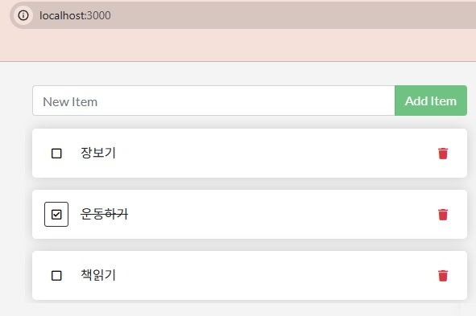
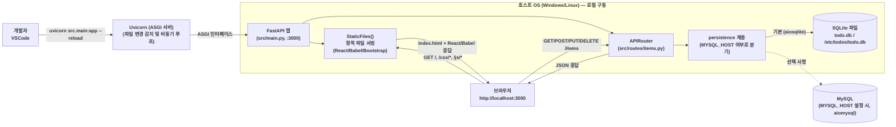

# Docker Getting Started App (FastAPI) — 프로젝트 구조 및 동작 설명

---

## 0. 프로젝트 개요 및 사용자 사용법

### 0.1 이 프로젝트는 무엇인가?

**getting-started-app**은 **할일(Todo) 관리 웹 애플리케이션**입니다.

사용자가 브라우저에서 할 일 목록을 작성·관리할 수 있으며, Docker 컨테이너 기술 및 클라우드 컴퓨팅을 학습하기 위한 프로젝트입니다. 백엔드는 **FastAPI + Uvicorn(Python)** 비동기 아키텍처로 구현되어 있습니다.

| 항목 | 내용 |
|---|---|
| **애플리케이션 종류** | 싱글 페이지 Todo 웹앱 (SPA) |
| **핵심 기능** | 할일 추가 / 완료 체크 / 삭제 / API 대화형 문서(Swagger) |
| **접속 방법** | 웹 브라우저에서 `http://localhost:3000` 접속 |
| **API 문서** | `http://localhost:3000/docs` (Swagger UI), `http://localhost:3000/redoc` |
| **데이터 저장** | 서버의 SQLite 파일(`todo.db` 또는 `/etc/todos/todo.db`) 또는 MySQL DB |
| **학습 목적** | 클라이언트-서버 동작 구조 이해 및 Docker 이미지 빌드·컨테이너 실행 실습 |

본 실습에서는 컨테이너 기반 배포 전, 호스트(Windows/Linux) 환경에서 **FastAPI + Uvicorn** 구조를 파악하고 직접 구동하는 전통적 방식(Traditional Deployment)과 Docker 컨테이너 배포 방식을 함께 학습합니다.

---

### 0.2 사용자가 할 수 있는 기능

  

| 기능 | 동작 방법 | 내부 API |
|---|---|---|
| **할일 추가** | 입력창에 텍스트 입력 후 `Add Item` 버튼 클릭 | `POST /items` |
| **완료 체크** | 항목 왼쪽 체크박스(□) 클릭 → ☑ 체크/취소 선 표시 | `PUT /items/{id}` |
| **할일 삭제** | 항목 오른쪽 🗑 버튼 클릭 | `DELETE /items/{id}` |
| **목록 조회** | 페이지 접속 시 자동으로 기존 목록 불러옴 | `GET /items` |
| **API 문서** | Swagger UI를 통해 브라우저에서 실시간 API 테스트 | `GET /docs` |

---

### 0.3 전체 동작 흐름 한눈에 보기 (호스트 직접 구동)



---

## 1. 프로젝트 디렉토리 및 파일 구성

```
getting-started-app-FastAPI/
├── Dockerfile                  # FastAPI 앱 컨테이너 빌드 정의서
├── .dockerignore               # Docker 빌드 제외 파일 목록
├── requirements.txt            # Python 패키지 의존성 목록
├── pytest.ini                  # pytest 테스트 설정 파일
├── README.md                   # 프로젝트 영문 가이드
├── development_readme.md       # 개발 및 로컬 실행 가이드
├── workflow.md                 # 프로젝트 상세 구조 및 워크플로우 문서
├── src/
│   ├── main.py                 # FastAPI 애플리케이션 메인 진입점 (Lifespan, Static 마운트)
│   ├── models.py               # Pydantic 데이터 모델 (Item, ItemCreate, ItemUpdate)
│   ├── persistence/
│   │   ├── __init__.py         # DB 선택 로직 (SQLite vs MySQL)
│   │   ├── sqlite.py           # aiosqlite 비동기 SQLite 드라이버
│   │   └── mysql.py            # aiomysql 비동기 MySQL 드라이버
│   ├── routes/
│   │   ├── __init__.py         # routes 패키지 초기화
│   │   └── items.py            # /items 엔드포인트 APIRouter
│   └── static/                 # 정적 파일 (프론트엔드 SPA)
│       ├── index.html          # SPA 마운트 HTML
│       ├── css/
│       │   ├── bootstrap.min.css
│       │   ├── styles.css
│       │   └── font-awesome/
│       └── js/
│           ├── app.js                    # React 앱 (JSX, Babel 트랜스파일)
│           ├── react.production.min.js   # React 코어
│           ├── react-dom.production.min.js
│           ├── react-bootstrap.js        # React Bootstrap UI 컴포넌트
│           └── babel.min.js             # 브라우저 내 Babel 트랜스파일러
└── spec/
    ├── __init__.py             # spec 패키지 초기화
    ├── persistence/            # DB 계층 단위 테스트
    │   ├── test_sqlite.py      # SQLite 비동기 CRUD 테스트
    │   └── sqlite.spec.py      # 별칭 참조 파일
    └── routes/                 # API 라우트 단위 테스트
        ├── test_getItems.py    # getItems Mocking 테스트
        ├── test_addItem.py     # addItem Mocking 테스트
        ├── test_updateItem.py  # updateItem Mocking 테스트
        ├── test_deleteItem.py  # deleteItem Mocking 테스트
        └── *.spec.py           # 별칭 참조 파일들
```

### 주요 파일 요약표

| 파일/디렉토리 | 역할 | 비고 |
|---|---|---|
| `requirements.txt` | Python 라이브러리 목록 | `fastapi`, `uvicorn`, `pydantic`, `aiosqlite`, `pytest` 등 |
| `Dockerfile` | Docker 컨테이너 이미지 빌드 스크립트 | `python:3.11-slim` 기반 |
| `src/main.py` | FastAPI 앱 생성, Lifespan(DB 생명주기), Static 마운트 | 진입점 |
| `src/models.py` | Pydantic 스키마 정의 | 데이터 유효성 검증 및 Swagger 스키마 |
| `src/persistence/__init__.py` | `MYSQL_HOST` 환경변수로 DB 분기 | SQLite / MySQL 선택 |
| `src/persistence/sqlite.py` | `aiosqlite` 비동기 SQLite CRUD 구현 | 기본 DB |
| `src/persistence/mysql.py` | `aiomysql` Connection Pool 비동기 CRUD | 외부 DB |
| `src/routes/items.py` | REST API 엔드포인트 4종 정의 | `APIRouter(prefix="/items")` |
| `src/static/index.html` | React 앱 마운트 HTML | `<div id="root">` |
| `src/static/js/app.js` | React 컴포넌트 (JSX, Babel 런타임) | 프론트엔드 UI |
| `spec/**/*.py` | `pytest` 기반 비동기 단위 테스트 스위트 | `pytest` 로 실행 |

---

## 2. 개발 환경 요약

| 항목 | 내용 |
|---|---|
| **런타임** | Python 3.9+ (권장: Python 3.11) |
| **웹 프레임워크** | FastAPI (비동기 ASGI 기반) |
| **ASGI 웹 서버** | Uvicorn (`uvicorn src.main:app --port 3000`) |
| **데이터 검증** | Pydantic v2 |
| **프론트엔드** | React (CDN + Babel 런타임, 빌드 없음) |
| **UI 라이브러리** | React Bootstrap + Bootstrap CSS + Font Awesome |
| **패키지 관리** | `pip` (`requirements.txt`), `venv` |
| **개발 도구** | `uvicorn --reload` (핫 리로딩), `pytest` / `pytest-asyncio` (테스트) |
| **데이터베이스** | SQLite3 (`aiosqlite`, 기본) / MySQL (`aiomysql`, 환경변수 설정 시) |
| **컨테이너** | Docker (`python:3.11-slim` 기반) |
| **포트** | 3000 (FastAPI/Uvicorn) / 80·443 (Nginx 프록시 시) |
| **API 문서** | Swagger UI (`/docs`), ReDoc (`/redoc`) 기본 내장 |

---

## 3. 웹 응용 환경 (프론트엔드 구성)

### 3.1 프론트엔드 아키텍처

프론트엔드는 **별도의 빌드 단계(Webpack/Vite 등) 없이, React·Babel 라이브러리 파일을 `src/static/js/`에 정적으로 보관하고 그대로 브라우저에 서빙**하는 방식입니다.  
FastAPI의 `app.mount("/", StaticFiles(directory="src/static", html=True))`를 통해 백엔드 서버 하나로 정적 프론트엔드 자산과 REST API를 동시에 서비스합니다.

```
브라우저가 index.html 로드
    │
    ├─ ①~④ 스크립트 순차 로드 (React/ReactDOM/Bootstrap/Babel 전역 등록)
    │
    └─ ⑤ app.js 로드 (type="text/babel")
            │
            └─ babel.min.js가 JSX를 브라우저에서 즉시 JS로 변환
                    │
                    └─ ReactDOM이 <div id="root">에 App 컴포넌트 렌더링
```

### 3.2 React 컴포넌트 구조

```
App
└── TodoListCard          (useState, useEffect로 GET /items 조회)
    ├── AddItemForm        (POST /items 호출)
    └── ItemDisplay[]      (PUT /items/{id}, DELETE /items/{id} 호출)
```

---

## 4. 백엔드 구성 (ASGI — FastAPI + Uvicorn)

### 4.1 FastAPI 메인 진입점 (`src/main.py`)

```python
from contextlib import asynccontextmanager
from pathlib import Path
from fastapi import FastAPI
from fastapi.middleware.cors import CORSMiddleware
from fastapi.staticfiles import StaticFiles
from src.persistence import db
from src.routes.items import router as items_router

@asynccontextmanager
async def lifespan(app: FastAPI):
    await db.init()       # 서버 시작 시 DB 초기화 및 테이블 생성
    yield
    await db.teardown()   # 서버 종료 시 DB 연결 해제

app = FastAPI(title="Getting Started Todo App (FastAPI)", lifespan=lifespan)

app.add_middleware(
    CORSMiddleware,
    allow_origins=["*"],
    allow_methods=["*"],
    allow_headers=["*"],
)

app.include_router(items_router)

# 정적 파일 마운트 (Express app.use(express.static(...)) 대체)
static_dir = Path(__file__).resolve().parent / "static"
if static_dir.exists():
    app.mount("/", StaticFiles(directory=str(static_dir), html=True), name="static")
```

### 4.2 FastAPI의 역할
1. **ASGI 비동기 처리**: `async`/`await` 기반으로 논블로킹 I/O 처리
2. **Pydantic 스키마 검증**: 클라이언트 요청의 형식을 자동 검증하고 에러 시 422 응답 반환
3. **정적 파일 서빙**: `StaticFiles`를 통해 `src/static/` 디렉터리의 파일을 브라우저로 직접 제공
4. **자동 문서화**: `/docs` (Swagger UI) 및 `/redoc` 자동 생성

### 4.3 Nginx + Uvicorn 구성 (프로덕션 Reverse Proxy 구조)

```
클라이언트 (Browser)
       │  HTTP :80 / HTTPS :443
       ▼
   [Nginx] ─── Reverse Proxy ───► [Uvicorn + FastAPI :3000]
       │                                   │
       │ /static/* 직접 서빙               ▼
       │ (정적 파일 캐싱)             [DB: SQLite / MySQL]
```

---

## 5. 데이터베이스 계층 (Persistence)

### 5.1 DB 선택 로직 (`src/persistence/__init__.py`)

```python
import os

if os.getenv("MYSQL_HOST"):
    from . import mysql as db
else:
    from . import sqlite as db

__all__ = ["db"]
```

### 5.2 SQLite (`src/persistence/sqlite.py`)
- **드라이버**: `aiosqlite` (비동기 SQLite 드라이버)
- **기본 경로**: 로컬 `todo.db` 또는 Linux 환경의 `/etc/todos/todo.db` (`SQLITE_DB_LOCATION` 환경변수로 변경 가능)
- **테이블**: `todo_items (id varchar(36), name varchar(255), completed boolean)`

### 5.3 MySQL (`src/persistence/mysql.py`)
- **드라이버**: `aiomysql` (비동기 MySQL 커넥션 풀)
- **환경변수**: `MYSQL_HOST`, `MYSQL_USER`, `MYSQL_PASSWORD`, `MYSQL_DB`

---

## 6. 서버 라우팅 및 REST API

### 6.1 엔드포인트 목록

| 메서드 | URL | 설명 | 요청 본문 | 응답 본문 |
|---|---|---|---|---|
| `GET` | `/items` | 전체 할 일 목록 조회 | 없음 | `Item[]` |
| `POST` | `/items` | 새 할 일 등록 | `ItemCreate` (`{"name": "..."}`) | `Item` |
| `PUT` | `/items/{id}` | 할 일 수정 (체크 토글/이름 변경) | `ItemUpdate` (`{"name": "...", "completed": true}`) | `Item` |
| `DELETE` | `/items/{id}` | 할 일 삭제 | 없음 | `{"status": "ok"}` |
| `GET` | `/docs` | Swagger 대화형 API 문서 | 없음 | HTML (Swagger UI) |

---

## 7. 실행 및 테스트 방법

### 7.1 로컬 실행 (호스트)
```powershell
# 1. 패키지 설치
pip install -r requirements.txt

# 2. Uvicorn 서버 실행
uvicorn src.main:app --host 0.0.0.0 --port 3000 --reload
```

### 7.2 Docker 실행
```bash
# 1. Docker 이미지 빌드
docker build -t getting-started-fastapi .

# 2. 컨테이너 실행 (볼륨 마운트)
docker run -dp 3000:3000 --name todo-app -v todo-db:/etc/todos getting-started-fastapi
```

### 7.3 단위 테스트 실행
```bash
pytest
```
