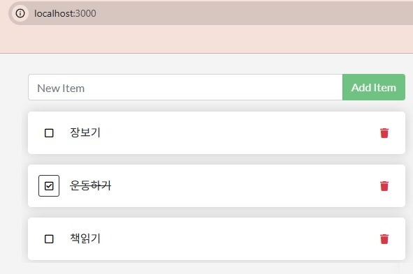
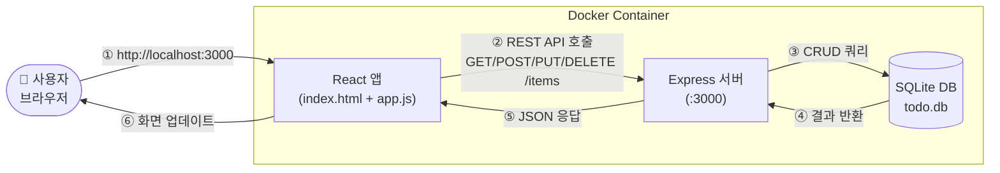
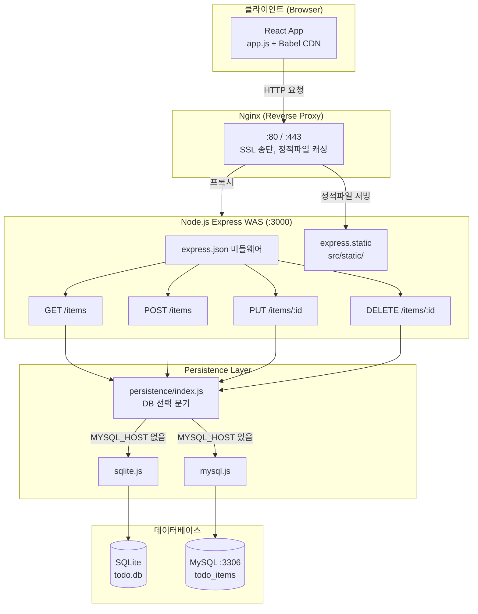
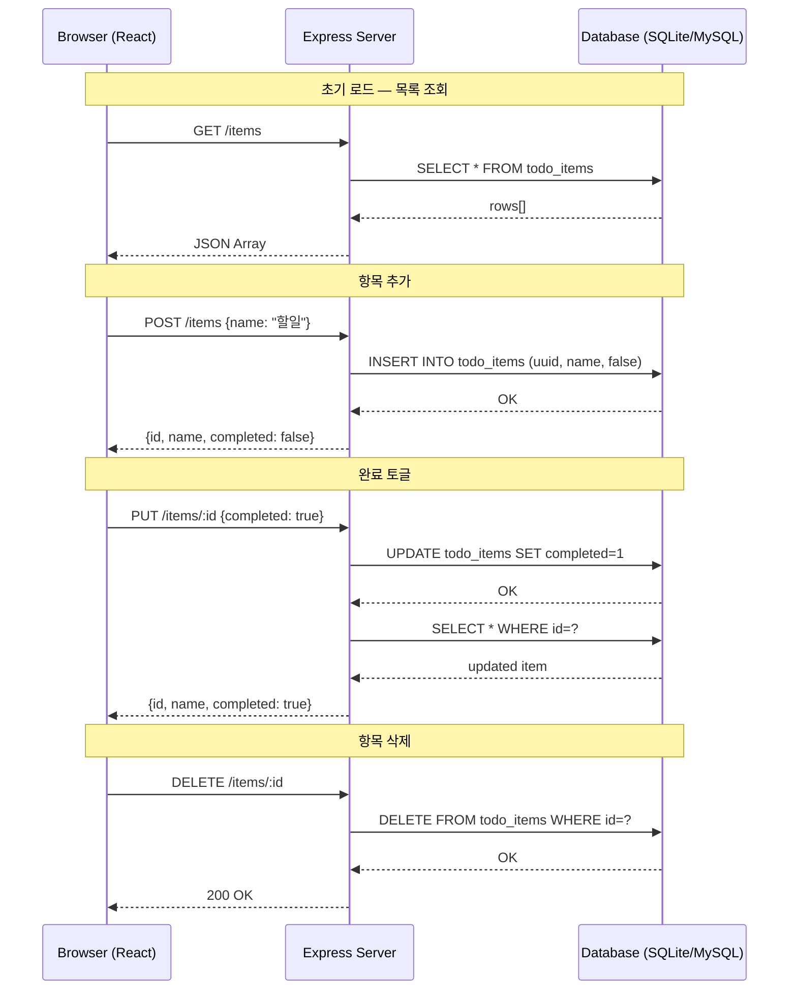
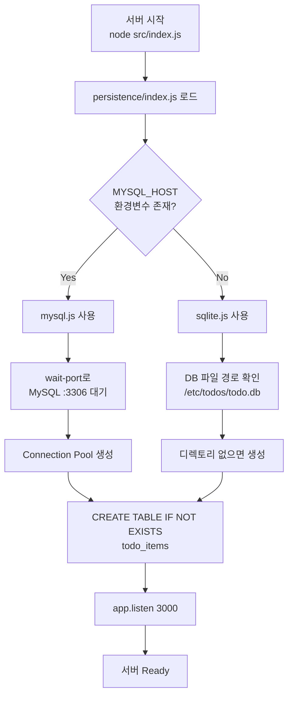
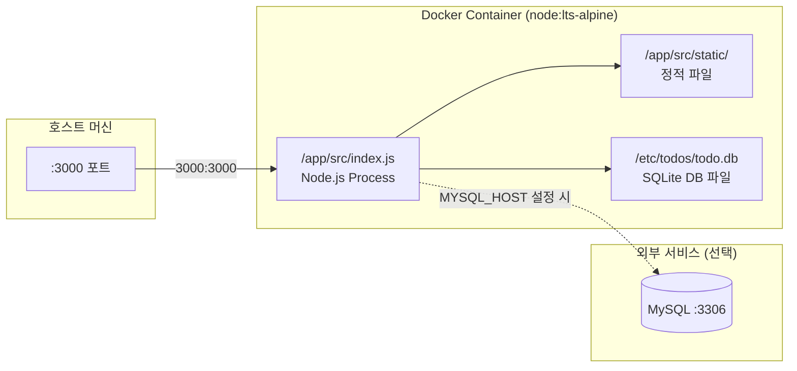
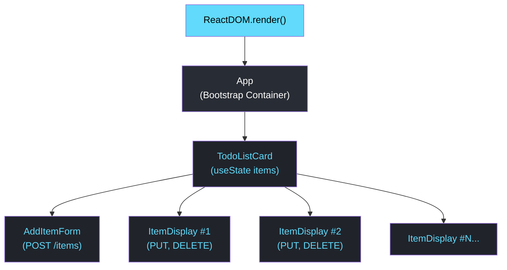

# Docker Getting Started App — 프로젝트 구조 및 동작 설명

---

## 0. 프로젝트 개요 및 사용자 사용법

### 0.1 이 프로젝트는 무엇인가?

**(Docker) Getting Started App**은 **할일(Todo) 관리 웹 애플리케이션**입니다.

사용자가 브라우저에서 할 일 목록을 작성·관리할 수 있으며, Docker 컨테이너 기술을 학습하기 위한 [공식 예제 프로젝트](https://docs.docker.com/get-started/workshop/02_our_app/)입니다. 

| 항목 | 내용 |
|---|---|
| **애플리케이션 종류** | 싱글 페이지 Todo 웹앱 (SPA) |
| **핵심 기능** | 할일 추가 / 완료 체크 / 삭제 |
| **접속 방법** | 웹 브라우저에서 `http://localhost:3000` 접속 |
| **데이터 저장** | 서버의 SQLite 파일 또는 MySQL DB에 영구 저장 |
| **학습 목적** | Docker 이미지 빌드, 컨테이너 실행, 볼륨, 네트워크, Compose 실습 |

---

### 0.2 사용자가 할 수 있는 기능


  


| 기능 | 동작 방법 | 내부 API |
|---|---|---|
| **할일 추가** | 입력창에 텍스트 입력 후 `Add Item` 버튼 클릭 | `POST /items` |
| **완료 체크** | 항목 왼쪽 체크박스(□) 클릭 → ☑ 체크/취소 선 표시 | `PUT /items/:id` |
| **할일 삭제** | 항목 오른쪽 🗑 버튼 클릭 | `DELETE /items/:id` |
| **목록 조회** | 페이지 접속 시 자동으로 기존 목록 불러옴 | `GET /items` |

---

### 0.3 사용자 입장에서 SW 사용 방법

#### ① 사전 준비 — Docker 설치
```bash
# Docker Desktop 설치 후 확인
docker --version
# Docker version 24.x.x, build ...
```

#### ② 프로젝트 다운로드 (처음 한 번)
```bash
git clone https://github.com/docker/getting-started-app.git
cd getting-started-app
```

#### ③ Docker 이미지 빌드 (처음 한 번)
```bash
docker build -t getting-started .
# Dockerfile을 기반으로 Node.js + 앱이 포함된 이미지 생성
```

#### ④ 앱 실행
```bash
docker run -dp 3000:3000 getting-started
# -d : 백그라운드 실행
# -p 3000:3000 : 호스트 3000포트 → 컨테이너 3000포트 연결
```

#### ⑤ 브라우저에서 접속
```
http://localhost:3000
```
→ Todo 앱 화면이 표시됩니다.

#### ⑥ 할일 관리 사용
1. 입력창에 할일 텍스트 입력 → **Add Item** 버튼 클릭하여 추가
2. 항목 왼쪽 **체크박스** 클릭 → 완료/미완료 토글
3. 항목 오른쪽 **휴지통 아이콘** 클릭 → 삭제

#### ⑦ 앱 종료
```bash
# 실행 중인 컨테이너 확인
docker ps

# 컨테이너 중지 및 삭제
docker stop <container-id>
docker rm <container-id>
```

> [!NOTE]
> **데이터 영속성**: 기본 설정에서는 컨테이너를 삭제하면 할일 데이터도 함께 사라집니다.  
> 데이터를 유지하려면 Docker **볼륨(Volume)** 을 사용해야 합니다:
> ```bash
> docker run -dp 3000:3000 -v todo-db:/etc/todos getting-started
> ```

> [!TIP]
> **Node.js 개발 환경에서 직접 실행** (Docker 없이):
> ```bash
> npm install        # 의존성 설치
> npm run dev        # nodemon으로 개발 서버 시작 (파일 변경 시 자동 재시작)
> # → http://localhost:3000 접속
> ```

---

### 0.4 전체 동작 흐름 한눈에 보기



---


## 1. 프로젝트 디렉토리 및 파일 구성

```
getting-started-app/
├── Dockerfile                  # Docker 이미지 빌드 명세
├── .dockerignore               # Docker 빌드 제외 파일 목록
├── package.json                # Node.js 프로젝트 설정 및 의존성
├── README.md                   # 프로젝트 소개
├── src/
│   ├── index.js                # Express 서버 진입점 (메인)
│   ├── persistence/
│   │   ├── index.js            # DB 선택 로직 (SQLite vs MySQL)
│   │   ├── sqlite.js           # SQLite 데이터 접근 계층
│   │   └── mysql.js            # MySQL 데이터 접근 계층
│   ├── routes/
│   │   ├── getItems.js         # GET /items 핸들러
│   │   ├── addItem.js          # POST /items 핸들러
│   │   ├── updateItem.js       # PUT /items/:id 핸들러
│   │   └── deleteItem.js       # DELETE /items/:id 핸들러
│   └── static/                 # 정적 파일 (프론트엔드)
│       ├── index.html          # SPA 진입 HTML
│       ├── css/
│       │   ├── bootstrap.min.css
│       │   ├── styles.css
│       │   └── font-awesome/
│       └── js/
│           ├── app.js                    # React 앱 (JSX, Babel 트랜스파일)
│           ├── react.production.min.js   # React 라이브러리 (CDN 로컬 사본)
│           ├── react-dom.production.min.js
│           ├── react-bootstrap.js        # React Bootstrap 컴포넌트
│           └── babel.min.js             # 브라우저 내 Babel 트랜스파일러
└── spec/
    ├── persistence/            # persistence 계층 단위 테스트
    └── routes/                 # 라우트 단위 테스트
```

### 주요 파일 요약표

| 파일/디렉토리 | 역할 | 비고 |
|---|---|---|
| `Dockerfile` | Alpine 기반 Node 이미지, 포트 3000 노출 | `node:lts-alpine` |
| `package.json` | 의존성, 스크립트, Prettier 설정 | name: `101-app` |
| `src/index.js` | Express 앱 초기화, 라우트 등록, DB init | 진입점 |
| `src/persistence/index.js` | `MYSQL_HOST` 환경변수로 DB 분기 | 조건부 require |
| `src/persistence/sqlite.js` | SQLite3 CRUD 구현 | 기본 DB |
| `src/persistence/mysql.js` | MySQL2 Connection Pool CRUD | 외부 DB |
| `src/routes/*.js` | REST API 라우트 핸들러 4종 | async/await |
| `src/static/index.html` | React 앱 마운트 HTML | `<div id="root">` |
| `src/static/js/app.js` | React 컴포넌트 (JSX, Babel 런타임) | CDN 방식 |

---

## 2. 웹 응용 환경 (프론트엔드 구성)

### 2.1 프론트엔드 아키텍처

이 프로젝트의 프론트엔드는 **빌드 단계 없는 CDN 방식 React**를 사용합니다.  
일반적인 Create React App / Vite 방식과 달리, `babel.min.js`를 브라우저에 로드하여 JSX를 런타임에 트랜스파일합니다.

| 구분 | 이 프로젝트 (CDN 방식) | 일반 React 방식 (Vite/CRA) |
|---|---|---|
| JSX 변환 | 브라우저 내 Babel 런타임 | 빌드 타임 컴파일 |
| 번들링 | 없음 (파일 개별 로드) | Webpack / Vite |
| 개발 서버 | Express 정적 파일 서빙 | Vite dev server |
| 배포 | 정적 파일 복사 | `npm run build` 후 dist/ |
| 성능 | 개발/학습용 | 프로덕션 최적화 |

### 2.2 프론트엔드 주요 라이브러리 (로컬 번들)

| 파일 | 라이브러리 | 버전/역할 |
|---|---|---|
| `react.production.min.js` | React | 컴포넌트 상태 관리 |
| `react-dom.production.min.js` | ReactDOM | DOM 렌더링 |
| `react-bootstrap.js` | React Bootstrap | UI 컴포넌트 |
| `babel.min.js` | Babel Standalone | JSX → JS 런타임 변환 |
| `bootstrap.min.css` | Bootstrap CSS | 반응형 레이아웃 |
| `font-awesome/` | Font Awesome | 아이콘 |

### 2.3 React 컴포넌트 구조

```
App
└── TodoListCard          (useState, useEffect로 /items 조회)
    ├── AddItemForm        (POST /items 호출)
    └── ItemDisplay[]      (PUT /items/:id, DELETE /items/:id 호출)
```

- `App`: 최상위 레이아웃 (Bootstrap Container/Row/Col)
- `TodoListCard`: Todo 목록 상태 관리, API 호출 후 상태 업데이트
- `AddItemForm`: 새 항목 입력 폼, 제출 시 POST 요청
- `ItemDisplay`: 완료 토글(PUT) 및 삭제(DELETE) 기능

---

## 3. 백엔드 구성 (WAS — Express.js)

### 3.1 Express.js 서버 (`src/index.js`)

```js
const express = require('express');
const app = express();
app.use(express.json());                         // JSON 파싱 미들웨어
app.use(express.static(__dirname + '/static'));  // 정적 파일 서빙

app.get('/items', getItems);         // 목록 조회
app.post('/items', addItem);         // 항목 추가
app.put('/items/:id', updateItem);   // 항목 수정
app.delete('/items/:id', deleteItem);// 항목 삭제

db.init().then(() => app.listen(3000));
```

Express.js는 **WAS(Web Application Server)** 역할을 수행하며:
- JSON 미들웨어로 요청 바디 파싱
- 정적 파일(`/static`)을 직접 서빙 (개발 환경)
- REST API 라우팅 처리
- DB 초기화 완료 후 포트 3000 Listen

### 3.2 Nginx + WAS 구성 (프로덕션 Reverse Proxy 구조)

프로덕션 환경에서는 **Nginx를 Reverse Proxy**로 앞에 두어 다음과 같이 구성합니다:

```
클라이언트 (Browser)
       │  HTTP :80 / HTTPS :443
       ▼
  [Nginx] ─── Reverse Proxy ───► [Node.js Express :3000]
       │                                   │
       │ /static/* 직접 서빙               ▼
       │ (정적 파일 캐싱)             [DB: SQLite / MySQL]
```

**Nginx 역할:**
- 정적 파일(CSS, JS, 이미지) 직접 서빙 → Express 부하 감소
- SSL/TLS 종단 (HTTPS 처리)
- 로드 밸런싱 (다중 Node 프로세스)
- 요청 버퍼링 및 압축(gzip)
- 보안 헤더 설정

**Nginx 설정 예시 (`nginx.conf`):**
```nginx
server {
    listen 80;
    server_name example.com;

    # 정적 파일 직접 서빙
    location /static/ {
        alias /app/src/static/;
        expires 1d;
    }

    # API 요청은 Node.js로 전달
    location / {
        proxy_pass http://localhost:3000;
        proxy_http_version 1.1;
        proxy_set_header Host $host;
        proxy_set_header X-Real-IP $remote_addr;
        proxy_set_header X-Forwarded-For $proxy_add_x_forwarded_for;
    }
}
```

---

## 4. Node.js 기반 개발 환경

### 4.1 Node.js / npm / yarn / tsc 개요

| 도구 | 설명 | 설치 방법 |
|---|---|---|
| **Node.js** | JavaScript 런타임 (V8 엔진 기반, 서버 실행) | [nodejs.org](https://nodejs.org) 또는 `nvm install --lts` |
| **npm** | Node.js 기본 패키지 관리자 | Node.js 설치 시 자동 포함 |
| **yarn** | Facebook의 패키지 관리자 (npm 대체, 속도 향상) | `npm install -g yarn` |
| **tsc** | TypeScript 컴파일러 | `npm install -g typescript` |
| **nodemon** | 파일 변경 감지 후 서버 자동 재시작 (개발용) | `npm install -g nodemon` |

### 4.2 프로젝트 구동 방법

```bash
# 의존성 설치 (npm 사용)
npm install

# 의존성 설치 (yarn 사용, Dockerfile과 동일)
yarn install --production

# 개발 서버 실행 (nodemon — 파일 변경 시 자동 재시작)
npm run dev
# 내부적으로: nodemon -L src/index.js

# 프로덕션 실행
node src/index.js

# 테스트 실행
npm test
# 내부적으로: jest

# 코드 포맷팅
npm run prettify
# 내부적으로: prettier -l --write "**/*.js"
```

### 4.3 TypeScript (tsc) 사용 예시

이 프로젝트는 순수 JavaScript이나, TypeScript로 전환 시:

```bash
# TypeScript 설치
npm install -D typescript @types/node @types/express

# tsconfig.json 생성
npx tsc --init

# 컴파일 (ts → js)
npx tsc

# 감시 모드 (파일 변경 시 자동 컴파일)
npx tsc --watch
```

### 4.4 Express.js 설명

**Express.js**는 Node.js의 대표적인 **미니멀 웹 프레임워크**입니다.

| 개념 | 설명 |
|---|---|
| **미들웨어** | `app.use(fn)` — 요청/응답 파이프라인에 함수 삽입 |
| **라우팅** | `app.get/post/put/delete(path, handler)` — HTTP 메서드별 경로 처리 |
| **정적 서빙** | `express.static(dir)` — 디렉토리를 정적 파일 서버로 제공 |
| **JSON 파싱** | `express.json()` — req.body를 JSON으로 자동 파싱 |
| **비동기 처리** | async/await 핸들러 지원 |

### 4.5 프론트엔드 프레임워크 비교 (React.js / Vite)

| 항목 | 이 프로젝트 (Babel CDN) | React + Vite | Next.js |
|---|---|---|---|
| 설정 복잡도 | 없음 | 낮음 | 중간 |
| 빌드 속도 | 없음 (런타임) | 매우 빠름 (ESM) | 빠름 |
| HMR | 없음 | 지원 | 지원 |
| SSR | 없음 | 없음 | 지원 |
| 용도 | 학습/데모 | SPA 개발 | 풀스택 웹앱 |

**Vite 프로젝트 시작 예시:**
```bash
npx -y create-vite@latest my-app -- --template react
cd my-app
npm install
npm run dev
```

---

## 5. 개발 라이브러리 (의존성 표)

### 5.1 프로덕션 Dependencies

| 패키지 | 버전 | 역할 |
|---|---|---|
| `express` | ^4.18.2 | Node.js 웹 프레임워크, HTTP 서버/라우팅 |
| `mysql2` | ^2.3.3 | MySQL 데이터베이스 드라이버 (Promise 지원) |
| `sqlite3` | ^5.1.2 | SQLite 임베디드 DB 드라이버 |
| `uuid` | ^9.0.0 | UUID v4 고유 ID 생성 |
| `wait-port` | ^1.0.4 | 지정 포트가 열릴 때까지 대기 (MySQL 연결 대기용) |

### 5.2 개발 DevDependencies

| 패키지 | 버전 | 역할 |
|---|---|---|
| `jest` | ^29.3.1 | JavaScript 테스트 프레임워크 |
| `nodemon` | ^2.0.20 | 파일 변경 감지 자동 서버 재시작 |
| `prettier` | ^2.7.1 | 코드 자동 포맷터 |

### 5.3 프론트엔드 라이브러리 (로컬 번들, CDN 사본)

| 파일 | 역할 |
|---|---|
| `react.production.min.js` | React 코어 (컴포넌트, 훅) |
| `react-dom.production.min.js` | React DOM 렌더러 |
| `react-bootstrap.js` | Bootstrap UI 컴포넌트 for React |
| `babel.min.js` | 브라우저 내 JSX 트랜스파일러 |
| `bootstrap.min.css` | CSS 프레임워크 |

---

## 6. 데이터베이스

### 6.1 DB 선택 로직 (`src/persistence/index.js`)

```js
// MYSQL_HOST 환경변수 존재 시 MySQL, 없으면 SQLite 사용
if (process.env.MYSQL_HOST) module.exports = require('./mysql');
else module.exports = require('./sqlite');
```

### 6.2 SQLite

| 항목 | 내용 |
|---|---|
| 특징 | 파일 기반 임베디드 DB, 별도 서버 불필요 |
| 사용 시점 | 개발 환경, 단일 컨테이너 배포 |
| 파일 위치 | `/etc/todos/todo.db` (환경변수 `SQLITE_DB_LOCATION` 변경 가능) |
| 드라이버 | `sqlite3` npm 패키지 |
| 테이블 | `todo_items (id VARCHAR(36), name VARCHAR(255), completed BOOLEAN)` |
| 초기화 | `CREATE TABLE IF NOT EXISTS` — 앱 시작 시 자동 생성 |

### 6.3 MySQL

| 항목 | 내용 |
|---|---|
| 특징 | 클라이언트-서버 RDBMS, 다중 연결 지원 |
| 사용 시점 | 프로덕션, 멀티 컨테이너 (Docker Compose) |
| 드라이버 | `mysql2` npm 패키지 (Connection Pool) |
| Connection Pool | `connectionLimit: 5` |
| 문자셋 | `utf8mb4` |
| 환경변수 | `MYSQL_HOST`, `MYSQL_USER`, `MYSQL_PASSWORD`, `MYSQL_DB` |
| 시크릿 지원 | `*_FILE` 환경변수로 Docker Secret 파일 경로 지정 가능 |
| 연결 대기 | `wait-port`로 MySQL 포트(3306) 열릴 때까지 대기(최대 10초) |

### 6.4 공통 DB API (persistence 인터페이스)

| 함수 | SQL | 설명 |
|---|---|---|
| `init()` | `CREATE TABLE IF NOT EXISTS` | DB 초기화 및 테이블 생성 |
| `teardown()` | — | DB 연결 종료 (Graceful Shutdown) |
| `getItems()` | `SELECT * FROM todo_items` | 전체 목록 조회 |
| `getItem(id)` | `SELECT * WHERE id=?` | 단건 조회 |
| `storeItem(item)` | `INSERT INTO todo_items` | 항목 추가 |
| `updateItem(id, item)` | `UPDATE todo_items SET ... WHERE id=?` | 항목 수정 |
| `removeItem(id)` | `DELETE FROM todo_items WHERE id=?` | 항목 삭제 |

---

## 7. 서버 동작 구조 (라우팅)

### 7.1 REST API 엔드포인트

| HTTP 메서드 | URL | 핸들러 파일 | 동작 |
|---|---|---|---|
| `GET` | `/items` | `getItems.js` | 전체 할일 목록 반환 (JSON Array) |
| `POST` | `/items` | `addItem.js` | 새 할일 추가 (UUID 생성, DB 저장) |
| `PUT` | `/items/:id` | `updateItem.js` | 특정 할일 수정 (이름/완료 상태) |
| `DELETE` | `/items/:id` | `deleteItem.js` | 특정 할일 삭제 |
| `GET` | `/*` (정적) | Express static | HTML/CSS/JS 파일 서빙 |

### 7.2 요청 처리 흐름

```
클라이언트 요청
    │
    ├─ 정적 파일 (/, /css/*, /js/*)
    │       └─ express.static() → src/static/ 파일 반환
    │
    └─ API 요청 (/items, /items/:id)
            │
            ├─ express.json() 미들웨어 (body 파싱)
            │
            ├─ 라우트 핸들러 (routes/*.js)
            │       │
            │       └─ persistence 계층 (async/await)
            │               │
            │               ├─ sqlite.js (SQLITE_DB_LOCATION)
            │               └─ mysql.js  (MYSQL_HOST 환경변수)
            │
            └─ res.send(JSON) 응답
```

### 7.3 Graceful Shutdown 처리

```js
const gracefulShutdown = () => {
    db.teardown()
        .catch(() => {})
        .then(() => process.exit());
};
process.on('SIGINT', gracefulShutdown);   // Ctrl+C
process.on('SIGTERM', gracefulShutdown);  // Docker stop
process.on('SIGUSR2', gracefulShutdown);  // nodemon restart
```

### 7.4 `http://localhost:3000` 접속 시 `index.html` 전달 과정

#### 핵심 코드 — `src/index.js` 10번째 줄

```js
app.use(express.static(__dirname + '/static'));
//                     ^^^^^^^^^^^^^^^^^^^^
//  src/static/ 폴더를 웹 루트(/)로 지정
```

이 한 줄이 정적 파일 서빙 전체를 담당합니다.

---

#### ① 브라우저가 요청을 보냄

```
GET http://localhost:3000/
```

경로가 `/`(루트)이므로 파일명이 명시되지 않은 디렉토리 요청입니다.

---

#### ② Express 미들웨어 파이프라인 — 위에서 아래로 순서 처리

```
요청: GET /

① app.use(express.json())             → 정적 파일 요청엔 해당 없음, 통과
② app.use(express.static('/static'))  → ✅ 여기서 처리됨
③ app.get('/items', ...)              → 여기까지 오지 않음
```

미들웨어는 **등록 순서대로** 실행되며, `express.static()`이 먼저 처리합니다.

---

#### ③ `express.static()` 내부 동작 규칙

`express.static()`은 내부적으로 **serve-static** 패키지를 사용하며,  
경로가 디렉토리(`/`)이면 **`index.html`을 자동으로 탐색**하는 규칙이 있습니다.

```
요청 경로  /
         ↓
  루트 = 디렉토리 요청으로 판단
         ↓
  src/static/ 에서 index.html 탐색
         ↓
  src/static/index.html 발견!
         ↓
  HTTP 200  Content-Type: text/html  파일 내용 전송
```

---

#### ④ 전체 흐름 시각화

```
브라우저                    Express 서버 (Node.js)            파일 시스템
   │                              │                              │
   │── GET http://localhost:3000/ ▶│                             │
   │                              │                              │
   │                  express.static() 미들웨어 실행             │
   │                              │── 요청 경로: "/"             │
   │                              │── 디렉토리 요청 판단         │
   │                              │── index.html 탐색 ─────────▶│
   │                              │           src/static/index.html
   │                              │◀─ 파일 내용 반환 ────────────│
   │                              │                              │
   │  HTTP 200 OK                 │                              │
   │  Content-Type: text/html     │                              │
   │◀─ index.html 내용 전송 ──────│                              │
```

---

#### ⑤ index.html 수신 후 — 브라우저의 추가 파일 요청

브라우저가 `index.html`을 받으면 내부의 `<link>`, `<script>` 태그를 파싱하여 추가 파일을 자동 요청합니다.  
이 요청들도 **동일한 `express.static()` 미들웨어**가 처리합니다.

```html
<!-- index.html 안의 참조 태그들 -->
<link rel="stylesheet" href="css/bootstrap.min.css" />
<link rel="stylesheet" href="css/styles.css" />
<script src="js/react.production.min.js"></script>
<script src="js/react-dom.production.min.js"></script>
<script src="js/babel.min.js"></script>
<script type="text/babel" src="js/app.js"></script>
```

```
GET /css/bootstrap.min.css  →  src/static/css/bootstrap.min.css
GET /css/styles.css         →  src/static/css/styles.css
GET /js/react.production.min.js  →  src/static/js/react.production.min.js
GET /js/app.js              →  src/static/js/app.js
```

---

#### ⑥ 경로 매핑 규칙 요약표

| 브라우저 요청 URL | `express.static`이 읽는 실제 파일 | 결과 |
|---|---|---|
| `GET /` | `src/static/index.html` | ✅ index.html 자동 탐색 반환 |
| `GET /css/bootstrap.min.css` | `src/static/css/bootstrap.min.css` | ✅ CSS 반환 |
| `GET /js/app.js` | `src/static/js/app.js` | ✅ JS 반환 |
| `GET /items` | 파일 없음 → 다음 미들웨어로 전달 | ➡️ `app.get('/items')` 처리 |

> **핵심 한 줄 요약**  
> `express.static(__dirname + '/static')` 은 `src/static/` 폴더를 웹 루트(`/`)로 지정하며,  
> 경로가 `/`이면 **`index.html`을 자동으로 찾아 응답**합니다.  
> `/items` 처럼 파일이 없는 경로는 그대로 다음 라우트 핸들러로 넘어갑니다.

---

## 8. Docker 동작 구조

### 8.1 Dockerfile 분석

```dockerfile
FROM node:lts-alpine        # 경량 Alpine Linux 기반 Node.js LTS 이미지
WORKDIR /app                # 컨테이너 내 작업 디렉토리
COPY . .                    # 현재 디렉토리 전체를 /app으로 복사
RUN yarn install --production  # 프로덕션 의존성만 설치
CMD ["node", "src/index.js"]   # 컨테이너 시작 시 서버 실행
EXPOSE 3000                    # 포트 3000 노출 (문서화 목적)
```

### 8.2 Docker 빌드 및 실행

```bash
# 이미지 빌드
docker build -t getting-started .

# 단독 실행 (SQLite)
docker run -dp 3000:3000 getting-started

# MySQL 연동 실행
docker run -dp 3000:3000 \
  -e MYSQL_HOST=db \
  -e MYSQL_USER=root \
  -e MYSQL_PASSWORD=secret \
  -e MYSQL_DB=todos \
  getting-started
```

### 8.3 Docker Compose 구성 예시 (MySQL 연동)

```yaml
version: "3.8"
services:
  app:
    build: .
    ports:
      - "3000:3000"
    environment:
      MYSQL_HOST: db
      MYSQL_USER: root
      MYSQL_PASSWORD: secret
      MYSQL_DB: todos
    depends_on:
      - db

  db:
    image: mysql:8.0
    environment:
      MYSQL_ROOT_PASSWORD: secret
      MYSQL_DATABASE: todos
    volumes:
      - todo-mysql-data:/var/lib/mysql

volumes:
  todo-mysql-data:
```

---

## 9. 프로젝트 동작 구조 — Mermaid 다이어그램

### 9.1 전체 시스템 아키텍처



### 9.2 API 요청 흐름 (Sequence Diagram)



### 9.3 DB 선택 분기 흐름



### 9.4 Docker 컨테이너 구조



### 9.5 프론트엔드 컴포넌트 트리



---

## 10. 개발 환경 요약

| 항목 | 내용 |
|---|---|
| **런타임** | Node.js LTS (Alpine) |
| **웹 프레임워크** | Express.js 4.x |
| **프론트엔드** | React (CDN + Babel 런타임, 빌드 없음) |
| **UI 라이브러리** | React Bootstrap + Bootstrap CSS + Font Awesome |
| **패키지 관리** | yarn (프로덕션), npm (개발) |
| **개발 도구** | nodemon (자동 재시작), prettier (포맷터), jest (테스트) |
| **데이터베이스** | SQLite3 (기본) / MySQL2 (환경변수 설정 시) |
| **컨테이너** | Docker (node:lts-alpine 기반) |
| **포트** | 3000 (Express) / 80·443 (Nginx 프록시 시) |
| **API 스타일** | REST (JSON 요청/응답) |
