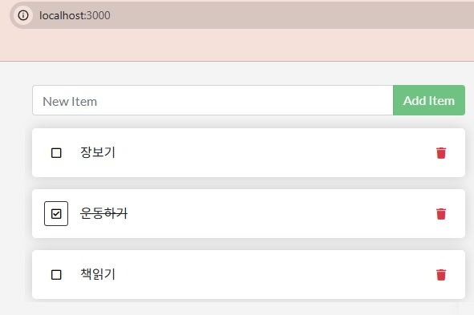
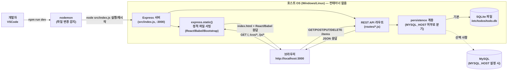

# Docker Getting Started App — 프로젝트 구조 및 동작 설명

---

## 0. 프로젝트 개요 및 사용자 사용법

### 0.1 이 프로젝트는 무엇인가?

**getting-started-app**은 **할일(Todo) 관리 웹 애플리케이션**입니다.

사용자가 브라우저에서 할 일 목록을 작성·관리할 수 있으며, Docker 컨테이너 기술을 학습하기 위한 [공식 예제 프로젝트](https://docs.docker.com/get-started/workshop/02_our_app/)입니다. 

| 항목 | 내용 |
|---|---|
| **애플리케이션 종류** | 싱글 페이지 Todo 웹앱 (SPA) |
| **핵심 기능** | 할일 추가 / 완료 체크 / 삭제 |
| **접속 방법** | 웹 브라우저에서 `http://localhost:3000` 접속 |
| **데이터 저장** | 서버의 SQLite 파일 또는 MySQL DB에 영구 저장 |
| **학습 목적** | 'Docker 이미지 빌드, 컨테이너 실행' 의 실습에 사용하는 프로그램 구조 이해 및 구동 실습 |

본 실습에서는 추후 이 간단한 웹응용 프로그램에 대해 Docker 이미지 빌드, 컨테이너 실행 등을 학습하기 전에,  해당 웹응용 프로그램의 클라이언트-서버 동작 구조를 파악하고 컨테이너를 이용하지 않고  윈도우즈/리눅스 에서의 전통적인 방식 (Traditional / Legacy Deployment)으로 호스트에서 윈도우즈 또는 리눅스 에서의 개발 및 구동하는 것을 학습합니다.     

---

### 0.2 사용자가 할 수 있는 기능


  


| 기능 | 동작 방법 | 내부 API |
|---|---|---|
| **할일 추가** | 입력창에 텍스트 입력 후 `Add Item` 버튼 클릭 | `POST /items` |
| **완료 체크** | 항목 왼쪽 체크박스(□) 클릭 → ☑ 체크/취소 선 표시 | `PUT /items/:id` |
| **할일 삭제** | 항목 오른쪽 🗑 버튼 클릭 | `DELETE /items/:id` |
| **목록 조회** | 페이지 접속 시 자동으로 기존 목록 불러옴 | `GET /items` |

---

### 0.3 전체 동작 흐름 한눈에 보기 (Docker 미사용, 호스트 직접 구동)



> Docker 이미지 빌드·컨테이너 실행 없이, 호스트에 설치된 Node.js로 `npm run dev`(nodemon)를 실행해 Express 서버를 직접 구동하는 현재 실습 환경의 동작 구조입니다.

---


## 1. 프로젝트 디렉토리 및 파일 구성

```
getting-started-app/
├── .dockerignore               # Docker 빌드 제외 파일 목록
├── package.json                # Node.js 프로젝트 설정 및 의존성
├── package-lock.json           # 의존성 버전 잠금 파일 (정확한 트리 기록)
├── README.md                   # 프로젝트 소개
├── src/
│   ├── index.js                # Express 서버 진입점 (메인)
│   ├── persistence/
│   │   ├── index.js            # DB 선택 로직 (SQLite vs MySQL)
│   │   ├── sqlite.js           # SQLite 데이터 접근 계층
│   │   └── mysql.js            # MySQL 데이터 접근 계층
│   ├── routes/
│   │   ├── getItems.js         # GET /items 핸들러
│   │   ├── addItem.js          # POST /items 핸들러
│   │   ├── updateItem.js       # PUT /items/:id 핸들러
│   │   └── deleteItem.js       # DELETE /items/:id 핸들러
│   └── static/                 # 정적 파일 (프론트엔드)
│       ├── index.html          # SPA 진입 HTML
│       ├── css/
│       │   ├── bootstrap.min.css
│       │   ├── styles.css
│       │   └── font-awesome/
│       └── js/
│           ├── app.js                    # React 앱 (JSX, Babel 트랜스파일)
│           ├── react.production.min.js   # React 라이브러리 (CDN 로컬 사본)
│           ├── react-dom.production.min.js
│           ├── react-bootstrap.js        # React Bootstrap 컴포넌트
│           └── babel.min.js             # 브라우저 내 Babel 트랜스파일러
└── spec/
    ├── persistence/            # persistence 계층 단위 테스트
    └── routes/                 # 라우트 단위 테스트
```

### 주요 파일 요약표

| 파일/디렉토리 | 역할 | 비고 |
|---|---|---|
| `package.json` | 의존성, 스크립트, Prettier 설정 | name: `101-app` |
| `package-lock.json` | 설치된 전체 의존성 트리의 정확한 버전 기록 | `npm install` 시 자동 생성/갱신 |
| `src/index.js` | Express 앱 초기화, 라우트 등록, DB init | 진입점 |
| `src/persistence/index.js` | `MYSQL_HOST` 환경변수로 DB 분기 | 조건부 require |
| `src/persistence/sqlite.js` | SQLite3 CRUD 구현 | 기본 DB |
| `src/persistence/mysql.js` | MySQL2 Connection Pool CRUD | 외부 DB |
| `src/routes/*.js` | REST API 라우트 핸들러 4종 | async/await |
| `src/static/index.html` | React 앱 마운트 HTML | `<div id="root">` |
| `src/static/js/app.js` | React 컴포넌트 (JSX, Babel 런타임) | CDN 방식 |

---

## 2. 개발 환경 요약

| 항목 | 내용 |
|---|---|
| **런타임** | Node.js LTS (Alpine) |
| **웹 프레임워크** | Express.js 4.x |
| **프론트엔드** | React (CDN + Babel 런타임, 빌드 없음) |
| **UI 라이브러리** | React Bootstrap + Bootstrap CSS + Font Awesome |
| **패키지 관리** | yarn (프로덕션), npm (개발) |
| **개발 도구** | nodemon (자동 재시작), prettier (포맷터), jest (테스트) |
| **데이터베이스** | SQLite3 (기본) / MySQL2 (환경변수 설정 시) |
| **컨테이너** | Docker (node:lts-alpine 기반) |
| **포트** | 3000 (Express) / 80·443 (Nginx 프록시 시) |
| **API 스타일** | REST (JSON 요청/응답) |


---

## 3 웹 응용 환경 (프론트엔드 구성)

### 3.1 프론트엔드 아키텍처

이 프로젝트의 프론트엔드는 **빌드 단계(webpack/vite 등) 없이, React·Babel 라이브러리 파일을 `src/static/js/`에 로컬로 미리 받아두고 그대로 서빙**하는 방식입니다.  
`npm install`로 설치되는 `node_modules` 의존성이 아니라, `index.html`에서 `<script>` 태그로 각 라이브러리 파일을 순서대로 로드하며, `app.js`의 JSX는 브라우저에 로드된 `babel.min.js`가 런타임에 변환합니다.

**`src/static/index.html`의 스크립트 로드 순서:**
```html
<script src="js/react.production.min.js"></script>       <!-- ① React 코어 -->
<script src="js/react-dom.production.min.js"></script>   <!-- ② React DOM 렌더러 -->
<script src="js/react-bootstrap.js"></script>             <!-- ③ Bootstrap UI 컴포넌트 -->
<script src="js/babel.min.js"></script>                   <!-- ④ Babel 런타임 트랜스파일러 -->
<script type="text/babel" src="js/app.js"></script>       <!-- ⑤ 실제 앱 코드 (JSX) -->
```

**동작 흐름:**
```
브라우저가 index.html 로드
    │
    ├─ ①~④ 스크립트 순차 로드 (React/ReactDOM/Bootstrap/Babel 전역 등록)
    │
    └─ ⑤ app.js 로드 (type="text/babel")
            │
            └─ babel.min.js가 JSX를 브라우저에서 즉시 JS로 변환
                    │
                    └─ ReactDOM이 <div id="root">에 App 컴포넌트 렌더링
```

이 파일들은 `express.static(__dirname + '/static')`([src/index.js](src/index.js))에 의해 정적 파일로 그대로 서빙되므로, 별도의 프론트엔드 빌드/배포 파이프라인 없이 Express 서버 하나로 백엔드(API)와 프론트엔드(정적 자산)를 동시에 제공합니다.

| 구분 | 이 프로젝트 | 일반 React 방식 (Vite/CRA) |
|---|---|---|
| 의존성 관리 | `src/static/js/`에 파일로 직접 보관 (npm 패키지 아님) | `node_modules` (npm/yarn) |
| JSX 변환 | 브라우저 내 Babel 런타임 (`babel.min.js`) | 빌드 타임 컴파일 |
| 번들링 | 없음 (`<script>` 태그로 개별 로드) | Webpack / Vite |
| 정적 파일 서빙 | Express `express.static()` | Vite dev server / Nginx |
| 배포 | `src/static/` 폴더 그대로 배포 | `npm run build` 후 `dist/` |
| 성능 | 개발/학습용 | 프로덕션 최적화 |

### 3.2 프론트엔드 주요 라이브러리 (로컬 번들)

| 파일 | 라이브러리 | 버전/역할 |
|---|---|---|
| `react.production.min.js` | React | 컴포넌트 상태 관리 |
| `react-dom.production.min.js` | ReactDOM | DOM 렌더링 |
| `react-bootstrap.js` | React Bootstrap | UI 컴포넌트 |
| `babel.min.js` | Babel Standalone | JSX → JS 런타임 변환 |
| `bootstrap.min.css` | Bootstrap CSS | 반응형 레이아웃 |
| `font-awesome/` | Font Awesome | 아이콘 |

### 3.3 React 컴포넌트 구조

```
App
└── TodoListCard          (useState, useEffect로 /items 조회)
    ├── AddItemForm        (POST /items 호출)
    └── ItemDisplay[]      (PUT /items/:id, DELETE /items/:id 호출)
```

- `App`: 최상위 레이아웃 (Bootstrap Container/Row/Col)
- `TodoListCard`: Todo 목록 상태 관리, API 호출 후 상태 업데이트
- `AddItemForm`: 새 항목 입력 폼, 제출 시 POST 요청
- `ItemDisplay`: 완료 토글(PUT) 및 삭제(DELETE) 기능

### 3.4 프론트엔드 핵심 개념 — fetch / React Fragment / React Hooks

[src/static/js/app.js](src/static/js/app.js)에서 실제로 사용된 코드를 기준으로 설명합니다. 이 프로젝트는 build 과정이 없으므로 `fetch`, `React.Fragment`, Hook 모두 별도 라이브러리 설치 없이 브라우저 내장 기능 / React 코어 API를 그대로 사용합니다.

#### ① fetch — 서버 API 호출

`fetch()`는 브라우저 내장 HTTP 클라이언트로, Promise를 반환합니다. 이 앱은 axios 같은 별도 라이브러리 없이 `fetch`만으로 4가지 REST API를 모두 호출합니다.

| 호출 위치 | 메서드 | 코드 |
|---|---|---|
| [app.js:18](src/static/js/app.js#L18) | `GET /items` | `fetch('/items').then(r => r.json()).then(setItems)` |
| [app.js:79](src/static/js/app.js#L79) | `POST /items` | `fetch('/items', { method: 'POST', body: JSON.stringify(...) })` |
| [app.js:121](src/static/js/app.js#L121) | `PUT /items/:id` | ``fetch(`/items/${item.id}`, { method: 'PUT', body: ... })`` |
| [app.js:134](src/static/js/app.js#L134) | `DELETE /items/:id` | ``fetch(`/items/${item.id}`, { method: 'DELETE' })`` |

공통 패턴: `fetch(url, options) → r.json() → 상태 업데이트 함수(setItems/onNewItem 등)`. 응답이 JSON이므로 `r.json()`으로 한 번 더 파싱한 뒤 `.then()`으로 후속 처리를 이어갑니다.

#### ② React Fragment — 불필요한 DOM 래퍼 제거

[app.js:53](src/static/js/app.js#L53)의 `TodoListCard`는 `<AddItemForm>`, 안내 문구, `<ItemDisplay>` 목록을 한 번에 반환해야 하는데, React 컴포넌트는 최상위 요소가 하나여야 합니다. 이때 `<div>` 같은 실제 DOM 요소를 추가하면 Bootstrap `<Row>/<Col>` 레이아웃 구조가 깨질 수 있으므로, DOM에 흔적을 남기지 않는 `<React.Fragment>`로 여러 요소를 감쌉니다.

```jsx
return (
    <React.Fragment>
        <AddItemForm onNewItem={onNewItem} />
        {items.length === 0 && <p className="text-center">No items yet! Add one above!</p>}
        {items.map(item => <ItemDisplay item={item} key={item.id} ... />)}
    </React.Fragment>
);
```

#### ③ React Hooks 개요

Hook은 클래스 컴포넌트 없이 함수 컴포넌트에서 상태(state)와 생명주기(lifecycle) 기능을 사용할 수 있게 해주는 React API입니다. 모두 `React.` 접두사로 호출되는 이유는 이 프로젝트가 `import`문 없는 CDN 방식([3.1](#31-프론트엔드-아키텍처))이라, `React` 전역 객체를 통해서만 접근할 수 있기 때문입니다.

| Hook | 역할 | 이 프로젝트에서의 사용 위치 |
|---|---|---|
| `useState` | 컴포넌트가 리렌더링되어도 유지되는 상태값 관리 | [app.js:15](src/static/js/app.js#L15) `items`, [app.js:73](src/static/js/app.js#L73) `newItem`, [app.js:74](src/static/js/app.js#L74) `submitting` |
| `useEffect` | 렌더링 이후 부수효과(side effect) 실행 (API 호출, 구독 등) | [app.js:17-21](src/static/js/app.js#L17-L21) 최초 마운트 시 `/items` 목록 조회 |
| `useCallback` | 함수를 메모이제이션해 매 렌더링마다 새로 생성되지 않도록 함 | [app.js:23-48](src/static/js/app.js#L23-L48) `onNewItem`, `onItemUpdate`, `onItemRemoval` |

**`useState` — [app.js:15](src/static/js/app.js#L15)**
```js
const [items, setItems] = React.useState(null);
```
- `items`: 현재 상태값 (초기값 `null` → "아직 로딩 전"을 의미)
- `setItems`: 상태를 갱신하는 함수. 호출 시 `TodoListCard`가 리렌더링됨
- [app.js:50](src/static/js/app.js#L50)에서 `items === null`일 때 `'Loading...'`을 보여주는 것도 이 초기값을 이용한 로딩 상태 처리

**`useEffect` — [app.js:17-21](src/static/js/app.js#L17-L21)**
```js
React.useEffect(() => {
    fetch('/items')
        .then(r => r.json())
        .then(setItems);
}, []);
```
- 두 번째 인자 `[]`(빈 의존성 배열)는 "컴포넌트가 처음 마운트될 때 한 번만 실행"을 의미
- 서버 API를 호출하는 부수효과이므로, 렌더링 함수 본문이 아닌 `useEffect` 안에서 수행 (렌더링 중 직접 `fetch`를 호출하면 렌더링마다 반복 호출되는 문제가 생김)

**`useCallback` — [app.js:23-48](src/static/js/app.js#L23-L48)**
```js
const onNewItem = React.useCallback(
    newItem => {
        setItems([...items, newItem]);
    },
    [items],
);
```
- 의존성 배열 `[items]`: `items`가 바뀔 때만 함수를 새로 만들고, 그렇지 않으면 이전 렌더링에서 만든 함수를 재사용
- 이렇게 메모이제이션된 함수(`onNewItem`, `onItemUpdate`, `onItemRemoval`)를 `AddItemForm`/`ItemDisplay`에 `props`로 내려 자식 컴포넌트가 불필요하게 새 함수 참조를 매번 받지 않도록 함
- `onItemUpdate`/`onItemRemoval`은 `items` 배열에서 `findIndex`로 대상을 찾은 뒤, 배열을 직접 변형(mutate)하지 않고 `slice()`로 새 배열을 만들어 `setItems`에 전달 (React 상태는 불변성을 지켜야 리렌더링이 정확히 감지됨)

---

## 4. 백엔드 구성 (WAS — Express.js)

### 4.1 Express.js 서버 (`src/index.js`)

```js
const express = require('express');
const app = express();
app.use(express.json());                         // JSON 파싱 미들웨어
app.use(express.static(__dirname + '/static'));  // 정적 파일 서빙

app.get('/items', getItems);         // 목록 조회
app.post('/items', addItem);         // 항목 추가
app.put('/items/:id', updateItem);   // 항목 수정
app.delete('/items/:id', deleteItem);// 항목 삭제

db.init().then(() => app.listen(3000));
```

Express.js는 **WAS(Web Application Server)** 역할을 수행하며:
- JSON 미들웨어로 요청 바디 파싱
- 정적 파일(`/static`)을 직접 서빙 (개발 환경)
- REST API 라우팅 처리
- DB 초기화 완료 후 포트 3000 Listen

### 4.2 Nginx + WAS 구성 (프로덕션 Reverse Proxy 구조)

프로덕션 환경에서는 **Nginx를 Reverse Proxy**로 앞에 두어 다음과 같이 구성합니다:

```
클라이언트 (Browser)
       │  HTTP :80 / HTTPS :443
       ▼
  [Nginx] ─── Reverse Proxy ───► [Node.js Express :3000]
       │                                   │
       │ /static/* 직접 서빙               ▼
       │ (정적 파일 캐싱)             [DB: SQLite / MySQL]
```

**Nginx 역할:**
- 정적 파일(CSS, JS, 이미지) 직접 서빙 → Express 부하 감소
- SSL/TLS 종단 (HTTPS 처리)
- 로드 밸런싱 (다중 Node 프로세스)
- 요청 버퍼링 및 압축(gzip)
- 보안 헤더 설정

**Nginx 설정 예시 (`nginx.conf`):**
```nginx
server {
    listen 80;
    server_name example.com;

    # 정적 파일 직접 서빙
    location /static/ {
        alias /app/src/static/;
        expires 1d;
    }

    # API 요청은 Node.js로 전달
    location / {
        proxy_pass http://localhost:3000;
        proxy_http_version 1.1;
        proxy_set_header Host $host;
        proxy_set_header X-Real-IP $remote_addr;
        proxy_set_header X-Forwarded-For $proxy_add_x_forwarded_for;
    }
}
```

---

## 5. Node.js 기반 개발 환경

### 5.1 Node.js / npm / yarn / tsc 개요

| 도구 | 설명 | 설치 방법 |
|---|---|---|
| **Node.js** | JavaScript 런타임 (V8 엔진 기반, 서버 실행) | [nodejs.org](https://nodejs.org) 또는 `nvm install --lts` |
| **npm** | Node.js 기본 패키지 관리자 | Node.js 설치 시 자동 포함 |
| **yarn** | Facebook의 패키지 관리자 (npm 대체, 속도 향상) | `npm install -g yarn` |
| **tsc** | TypeScript 컴파일러 | `npm install -g typescript` |
| **nodemon** | 파일 변경 감지 후 서버 자동 재시작 (개발용) | `npm install -g nodemon` |

### 5.2 TypeScript (tsc) 사용 예시

이 프로젝트는 순수 JavaScript이나, TypeScript로 전환 시:

```bash
# TypeScript 설치
npm install -D typescript @types/node @types/express

# tsconfig.json 생성
npx tsc --init

# 컴파일 (ts → js)
npx tsc

# 감시 모드 (파일 변경 시 자동 컴파일)
npx tsc --watch
```

### 5.3 Express.js 설명

**Express.js**는 Node.js의 대표적인 **미니멀 웹 프레임워크**입니다.

| 개념 | 설명 |
|---|---|
| **미들웨어** | `app.use(fn)` — 요청/응답 파이프라인에 함수 삽입 |
| **라우팅** | `app.get/post/put/delete(path, handler)` — HTTP 메서드별 경로 처리 |
| **정적 서빙** | `express.static(dir)` — 디렉토리를 정적 파일 서버로 제공 |
| **JSON 파싱** | `express.json()` — req.body를 JSON으로 자동 파싱 |
| **비동기 처리** | async/await 핸들러 지원 |


## 6. 개발 라이브러리 (의존성 표)

> 아래 표는 `package.json`에 명시된 패키지를 기준으로 작성되었습니다.

### 6.1 프로덕션 Dependencies (`dependencies`)

| 패키지 | 버전 | 역할 |
|---|---|---|
| `express` | ^5.2.1 | Node.js 웹 프레임워크, HTTP 서버/라우팅 |
| `mysql2` | ^3.16.1 | MySQL 데이터베이스 드라이버 (Promise 지원) |
| `sqlite3` | ^5.1.7 | SQLite 임베디드 DB 드라이버 |
| `uuid` | ^13.0.0 | UUID 고유 ID 생성 |
| `wait-port` | ^1.1.0 | 지정 포트가 열릴 때까지 대기 (MySQL 연결 대기용) |

### 6.2 개발 DevDependencies (`devDependencies`)

| 패키지 | 버전 | 역할 |
|---|---|---|
| `nodemon` | ^3.1.9 | 파일 변경 감지 후 서버 자동 재시작 (개발용, `npm run dev`에서 사용) |

### 6.3 간접 의존성 버전 고정 (`overrides`)

보안 취약점 패치를 위해 하위 의존성 패키지의 버전을 강제로 고정합니다.

| 패키지 | 고정 버전 |
|---|---|
| `tar` | 7.5.4 |
| `glob` | 11.1.0 |
| `semver` | 7.5.2 |
| `cross-spawn` | 7.0.5 |
| `braces` | 3.0.3 |
| `http-cache-semantics` | 4.1.1 |
| `socks` | 2.8.1 |

### 6.4 프론트엔드 라이브러리 (로컬 번들, CDN 사본)

| 파일 | 역할 |
|---|---|
| `react.production.min.js` | React 코어 (컴포넌트, 훅) |
| `react-dom.production.min.js` | React DOM 렌더러 |
| `react-bootstrap.js` | Bootstrap UI 컴포넌트 for React |
| `babel.min.js` | 브라우저 내 JSX 트랜스파일러 |
| `bootstrap.min.css` | CSS 프레임워크 |

---

## 7. 데이터베이스

### 7.1 DB 선택 로직 (`src/persistence/index.js`)

```js
// MYSQL_HOST 환경변수 존재 시 MySQL, 없으면 SQLite 사용
if (process.env.MYSQL_HOST) module.exports = require('./mysql');
else module.exports = require('./sqlite');
```

### 7.2 SQLite

| 항목 | 내용 |
|---|---|
| 특징 | 파일 기반 임베디드 DB, 별도 서버 불필요 |
| 사용 시점 | 개발 환경, 단일 컨테이너 배포 |
| 파일 위치 | `/etc/todos/todo.db` (환경변수 `SQLITE_DB_LOCATION` 변경 가능) |
| 드라이버 | `sqlite3` npm 패키지 |
| 테이블 | `todo_items (id VARCHAR(36), name VARCHAR(255), completed BOOLEAN)` |
| 초기화 | `CREATE TABLE IF NOT EXISTS` — 앱 시작 시 자동 생성 |

**초기화 SQL — [src/persistence/sqlite.js:21](src/persistence/sqlite.js#L21)**
```sql
CREATE TABLE IF NOT EXISTS todo_items (
    id varchar(36),
    name varchar(255),
    completed boolean
)
```
SQLite는 컬럼 타입을 엄격히 강제하지 않는 **동적 타입(Type Affinity)** 시스템이므로, 위 `varchar(36)`/`boolean` 선언은 실제로는 타입 힌트일 뿐이며 내부적으로는 각각 TEXT/NUMERIC 계열로 저장됩니다.

### 7.3 MySQL

| 항목 | 내용 |
|---|---|
| 특징 | 클라이언트-서버 RDBMS, 다중 연결 지원 |
| 사용 시점 | 프로덕션, 멀티 컨테이너 (Docker Compose) |
| 드라이버 | `mysql2` npm 패키지 (Connection Pool) |
| Connection Pool | `connectionLimit: 5` |
| 문자셋 | `utf8mb4` |
| 환경변수 | `MYSQL_HOST`, `MYSQL_USER`, `MYSQL_PASSWORD`, `MYSQL_DB` |
| 시크릿 지원 | `*_FILE` 환경변수로 Docker Secret 파일 경로 지정 가능 |
| 연결 대기 | `wait-port`로 MySQL 포트(3306) 열릴 때까지 대기(최대 10초) |

**초기화 SQL — [src/persistence/mysql.js:42](src/persistence/mysql.js#L42)**
```sql
CREATE TABLE IF NOT EXISTS todo_items (
    id varchar(36),
    name varchar(255),
    completed boolean
) DEFAULT CHARSET utf8mb4
```
MySQL에서 `boolean`은 실제로는 `TINYINT(1)`의 별칭(alias)으로 저장됩니다. `DEFAULT CHARSET utf8mb4`는 한글·이모지 등 4바이트 문자까지 손실 없이 저장하기 위한 문자셋 지정입니다.

### 7.4 테이블 및 필드 상세 — `todo_items`

SQLite와 MySQL 양쪽 모두 **테이블 이름과 컬럼 구성이 완전히 동일**합니다. `persistence` 계층이 어떤 DB든 동일한 SQL 문자열([7.6](#76-공통-db-api-persistence-인터페이스))로 접근하도록 만들어졌기 때문입니다.

| 컬럼명 | 타입 (SQLite/MySQL) | 설명 | 값 예시 |
|---|---|---|---|
| `id` | `varchar(36)` | 할일 항목의 고유 식별자. `uuid` 패키지로 생성된 UUID v4 문자열 (36자, 하이픈 포함) | `"3b1f6e2a-...-9f0c"` |
| `name` | `varchar(255)` | 할일 내용 텍스트 (사용자가 입력창에 작성한 문자열) | `"우유 사기"` |
| `completed` | `boolean` | 완료 여부. DB에는 `0`/`1`(정수)로 저장되며, JS 애플리케이션 레벨에서 `true`/`false`로 변환 | `0`(미완료) / `1`(완료) |

**애플리케이션 코드와 DB 컬럼의 매핑:**
- [addItem.js](src/routes/addItem.js): 새 항목 생성 시 `uuid.v4()`로 `id`를 만들고, 사용자가 입력한 텍스트를 `name`에, `completed`는 `false`(0)로 초기화해 `storeItem()`을 호출 → `INSERT INTO todo_items (id, name, completed) VALUES (?, ?, ?)`
- [updateItem.js](src/routes/updateItem.js): 체크박스 토글 시 `completed`를, 이름 변경 시 `name`을 갱신 → `UPDATE todo_items SET name=?, completed=? WHERE id=?`
- SQLite/MySQL 모두 `completed`는 DB 저장 시 `item.completed ? 1 : 0`으로 변환하고, 조회(`getItems`/`getItem`) 시 `item.completed === 1`로 다시 boolean으로 변환합니다 — DB 드라이버가 boolean 타입을 그대로 지원하지 않기 때문에 애플리케이션 코드에서 직접 변환을 담당합니다 ([sqlite.js:47](src/persistence/sqlite.js#L47), [mysql.js:69](src/persistence/mysql.js#L69)).
- 별도의 `PRIMARY KEY`나 인덱스 제약은 코드상 선언되어 있지 않으며, `id` 값의 유일성은 UUID 생성 로직에 의존합니다 (학습용 예제 수준의 단순화).

### 7.5 언제 SQLite를 사용하고, 언제 MySQL을 사용하는가

DB 종류는 코드 수정 없이 **환경변수 `MYSQL_HOST`의 존재 여부만으로 결정**됩니다 ([src/persistence/index.js](src/persistence/index.js)).

```js
if (process.env.MYSQL_HOST) module.exports = require('./mysql');
else module.exports = require('./sqlite');
```

| 상황 | 사용되는 DB | 이유 |
|---|---|---|
| `MYSQL_HOST` 환경변수를 설정하지 않고 `npm run dev`로 로컬 실행 | **SQLite** | 별도 DB 서버 설치/구동 없이 파일 하나로 즉시 실행 가능 → 이번 실습(호스트에서 직접 구동)의 기본 경로 |
| 단일 Docker 컨테이너로 이 앱만 실행 | **SQLite** | 컨테이너 하나만으로 완결되므로 볼륨(`/etc/todos`)만 마운트하면 데이터 보존 가능, MySQL 컨테이너를 추가로 띄울 필요 없음 |
| `docker compose`로 앱 컨테이너 + MySQL 컨테이너를 함께 구성하고 `MYSQL_HOST` 등 환경변수를 주입 | **MySQL** | 여러 컨테이너/서버 인스턴스가 하나의 DB를 공유해야 하는 프로덕션·확장 시나리오에 적합 |
| 테스트 실행 (`spec/persistence/*`) | 테스트 대상에 따라 SQLite 또는 MySQL 모킹 | 각 persistence 모듈을 독립적으로 단위 테스트 |

**정리:**
- **SQLite = "설정 없이 바로 되는 기본값"** — 이 프로젝트를 처음 클론해서 `npm run dev`로 띄우면 `MYSQL_HOST`가 없으므로 항상 SQLite가 선택되고, `/etc/todos/todo.db` 파일이 자동 생성됩니다.
- **MySQL = "명시적으로 환경을 구성했을 때"** — Docker Compose 등에서 별도 MySQL 서비스를 함께 띄우고 `MYSQL_HOST`(및 `MYSQL_USER`/`MYSQL_PASSWORD`/`MYSQL_DB`)를 컨테이너 환경변수로 주입해야만 활성화됩니다. 컨테이너 재시작/스케일아웃 시에도 데이터가 한 곳(MySQL 서버)에 유지되어야 하는 경우에 필요합니다.
- 즉 "어떤 DB를 쓸지"는 코드가 아니라 **배포 환경(환경변수 설정)** 이 결정하며, 두 구현체는 [7.6](#76-공통-db-api-persistence-인터페이스)의 동일한 함수 시그니처(`init/teardown/getItems/getItem/storeItem/updateItem/removeItem`)를 따르므로 라우트 핸들러(`routes/*.js`) 코드는 어떤 DB가 선택되었는지 전혀 알 필요가 없습니다.

### 7.6 공통 DB API (persistence 인터페이스)

| 함수 | SQL | 설명 |
|---|---|---|
| `init()` | `CREATE TABLE IF NOT EXISTS` | DB 초기화 및 테이블 생성 |
| `teardown()` | — | DB 연결 종료 (Graceful Shutdown) |
| `getItems()` | `SELECT * FROM todo_items` | 전체 목록 조회 |
| `getItem(id)` | `SELECT * WHERE id=?` | 단건 조회 |
| `storeItem(item)` | `INSERT INTO todo_items` | 항목 추가 |
| `updateItem(id, item)` | `UPDATE todo_items SET ... WHERE id=?` | 항목 수정 |
| `removeItem(id)` | `DELETE FROM todo_items WHERE id=?` | 항목 삭제 |

---

## 8. 서버 동작 구조 (라우팅)

### 8.1 REST API 엔드포인트

| HTTP 메서드 | URL | 핸들러 파일 | 동작 |
|---|---|---|---|
| `GET` | `/items` | `getItems.js` | 전체 할일 목록 반환 (JSON Array) |
| `POST` | `/items` | `addItem.js` | 새 할일 추가 (UUID 생성, DB 저장) |
| `PUT` | `/items/:id` | `updateItem.js` | 특정 할일 수정 (이름/완료 상태) |
| `DELETE` | `/items/:id` | `deleteItem.js` | 특정 할일 삭제 |
| `GET` | `/*` (정적) | Express static | HTML/CSS/JS 파일 서빙 |

### 8.2 요청 처리 흐름

```
클라이언트 요청
    │
    ├─ 정적 파일 (/, /css/*, /js/*)
    │       └─ express.static() → src/static/ 파일 반환
    │
    └─ API 요청 (/items, /items/:id)
            │
            ├─ express.json() 미들웨어 (body 파싱)
            │
            ├─ 라우트 핸들러 (routes/*.js)
            │       │
            │       └─ persistence 계층 (async/await)
            │               │
            │               ├─ sqlite.js (SQLITE_DB_LOCATION)
            │               └─ mysql.js  (MYSQL_HOST 환경변수)
            │
            └─ res.send(JSON) 응답
```

### 8.3 Graceful Shutdown 처리

```js
const gracefulShutdown = () => {
    db.teardown()
        .catch(() => {})
        .then(() => process.exit());
};
process.on('SIGINT', gracefulShutdown);   // Ctrl+C
process.on('SIGTERM', gracefulShutdown);  // Docker stop
process.on('SIGUSR2', gracefulShutdown);  // nodemon restart
```

### 8.4 `http://localhost:3000` 접속 시 `index.html` 전달 과정

#### 핵심 코드 — `src/index.js` 10번째 줄

```js
app.use(express.static(__dirname + '/static'));
//                     ^^^^^^^^^^^^^^^^^^^^
//  src/static/ 폴더를 웹 루트(/)로 지정
```

이 한 줄이 정적 파일 서빙 전체를 담당합니다.

---

#### ① 브라우저가 요청을 보냄

```
GET http://localhost:3000/
```

경로가 `/`(루트)이므로 파일명이 명시되지 않은 디렉토리 요청입니다.

---

#### ② Express 미들웨어 파이프라인 — 위에서 아래로 순서 처리

```
요청: GET /

① app.use(express.json())             → 정적 파일 요청엔 해당 없음, 통과
② app.use(express.static('/static'))  → ✅ 여기서 처리됨
③ app.get('/items', ...)              → 여기까지 오지 않음
```

미들웨어는 **등록 순서대로** 실행되며, `express.static()`이 먼저 처리합니다.

---

#### ③ `express.static()` 내부 동작 규칙

`express.static()`은 내부적으로 **serve-static** 패키지를 사용하며,  
경로가 디렉토리(`/`)이면 **`index.html`을 자동으로 탐색**하는 규칙이 있습니다.

```
요청 경로  /
         ↓
  루트 = 디렉토리 요청으로 판단
         ↓
  src/static/ 에서 index.html 탐색
         ↓
  src/static/index.html 발견!
         ↓
  HTTP 200  Content-Type: text/html  파일 내용 전송
```

---

#### ④ 전체 흐름 시각화

```
브라우저                    Express 서버 (Node.js)            파일 시스템
   │                                 │                             │
   │── GET http://localhost:3000/ ▶ │                             │
   │                                │                              │
   │                  express.static() 미들웨어 실행                 │
   │                                │── 요청 경로: "/"              │
   │                                │── 디렉토리 요청 판단           │
   │                                │── index.html 탐색 ────────▶ │
   │                                │         src/static/index.html
   │                                │◀─ 파일 내용 반환  ────────────│
   │                                │                              │
   │  HTTP 200 OK                   │                              │
   │  Content-Type: text/html       │                              │
   │◀─ index.html 내용 전송 ───────  │                              │
```

---

#### ⑤ index.html 수신 후 — 브라우저의 추가 파일 요청

브라우저가 `index.html`을 받으면 내부의 `<link>`, `<script>` 태그를 파싱하여 추가 파일을 자동 요청합니다.  
이 요청들도 **동일한 `express.static()` 미들웨어**가 처리합니다.

```html
<!-- index.html 안의 참조 태그들 -->
<link rel="stylesheet" href="css/bootstrap.min.css" />
<link rel="stylesheet" href="css/styles.css" />
<script src="js/react.production.min.js"></script>
<script src="js/react-dom.production.min.js"></script>
<script src="js/babel.min.js"></script>
<script type="text/babel" src="js/app.js"></script>
```

```
GET /css/bootstrap.min.css  →  src/static/css/bootstrap.min.css
GET /css/styles.css         →  src/static/css/styles.css
GET /js/react.production.min.js  →  src/static/js/react.production.min.js
GET /js/app.js              →  src/static/js/app.js
```

---

#### ⑥ 경로 매핑 규칙 요약표

| 브라우저 요청 URL | `express.static`이 읽는 실제 파일 | 결과 |
|---|---|---|
| `GET /` | `src/static/index.html` | ✅ index.html 자동 탐색 반환 |
| `GET /css/bootstrap.min.css` | `src/static/css/bootstrap.min.css` | ✅ CSS 반환 |
| `GET /js/app.js` | `src/static/js/app.js` | ✅ JS 반환 |
| `GET /items` | 파일 없음 → 다음 미들웨어로 전달 | ➡️ `app.get('/items')` 처리 |

> **핵심 한 줄 요약**  
> `express.static(__dirname + '/static')` 은 `src/static/` 폴더를 웹 루트(`/`)로 지정하며,  
> 경로가 `/`이면 **`index.html`을 자동으로 찾아 응답**합니다.  
> `/items` 처럼 파일이 없는 경로는 그대로 다음 라우트 핸들러로 넘어갑니다.


