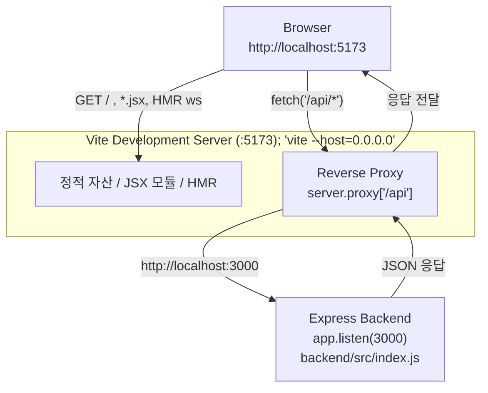
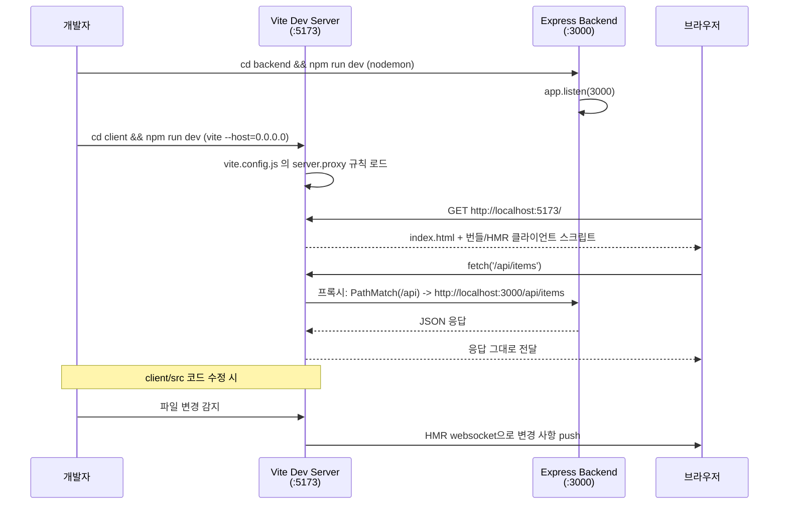
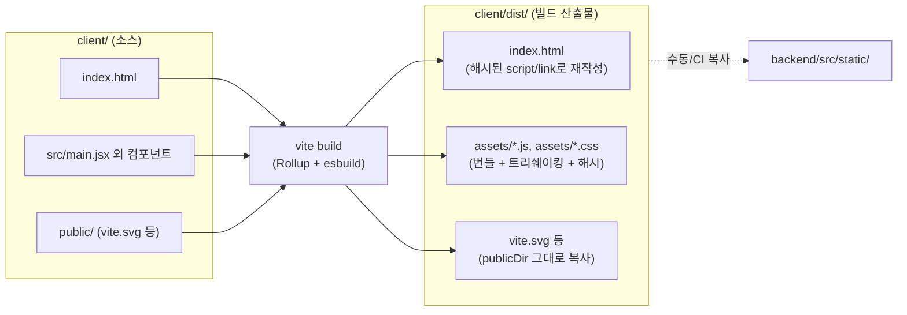
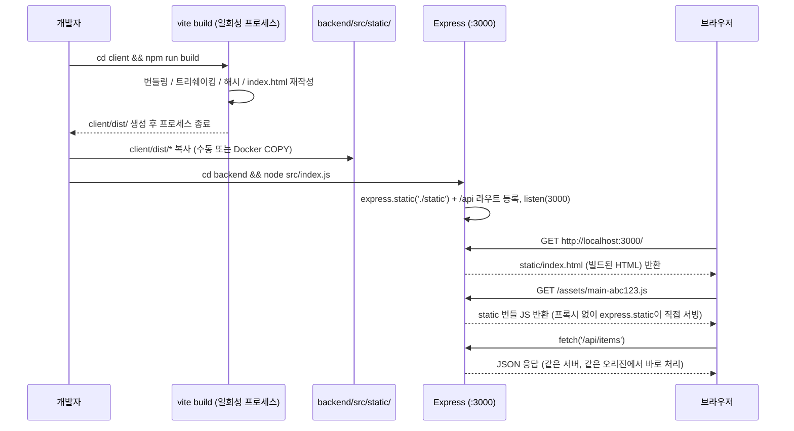

# 프론트엔드 
## 개발 모드 (`npm run dev`) 동작 구조

`client/package.json`의 `dev` 스크립트와 `client/vite.config.js`는 다음과 같이 구성되어 있다.

```json
"dev": "vite --host=0.0.0.0"
```

```js
import { defineConfig } from 'vite';
import react from '@vitejs/plugin-react';

export default defineConfig({
    plugins: [react()],
    server: {
        proxy: {
            '/api': {
                target: 'http://localhost:3000',
                changeOrigin: true,
            },
        },
    },
});
```

이 문서는 개발 모드에서 Vite Development Server가 **Reverse Proxy**로 동작하여 백엔드(Express, `:3000`)와 통신하는 구조를 설명한다.

### 1. 왜 프록시가 필요한가

`client/src` 코드는 API 호출 시 절대 URL이 아니라 `/api/...` **상대 경로**를 사용한다.

- `TodoListCard.jsx` → `fetch('/api/items')`
- `AddNewItemForm.jsx` → `fetch('/api/items', options)`
- `ItemDisplay.jsx` → `fetch('/api/items/${item.id}', ...)`
- `Greeting.jsx` → `fetch('/api/greeting')`

Vite Dev Server는 `:5173`에서 정적 자산과 HMR만 서비스할 뿐, `/api` 라우트를 직접 처리하지 않는다. 프록시 설정이 없으면 `fetch('/api/items')` 요청은 Vite 서버 자신에게 가서 404가 된다.

`server.proxy`에 `/api` 규칙을 등록하면 Vite Dev Server가 `/api`로 시작하는 요청만 골라 `http://localhost:3000`(Express 백엔드, `backend/src/index.js`)으로 전달하고 응답을 그대로 브라우저에 돌려준다. 그 결과 브라우저 입장에서는 프론트/백엔드가 하나의 오리진(`:5173`)에서 동작하는 것처럼 보여, 별도 CORS 설정 없이 상대 경로 `fetch`가 그대로 동작한다.

`changeOrigin: true`는 프록시가 백엔드로 요청을 전달할 때 `Host` 헤더를 대상 서버(`localhost:3000`) 기준으로 바꿔주는 옵션이다.

### 2. `--host=0.0.0.0`의 역할

Vite Dev Server는 기본적으로 `localhost`(127.0.0.1)에만 바인딩되어 같은 머신에서만 접근 가능하다. `--host=0.0.0.0`을 주면 모든 네트워크 인터페이스에 바인딩되어 같은 네트워크의 다른 기기(예: 같은 Wi-Fi의 휴대폰, 다른 PC)에서도 `http://<내PC의 IP>:5173`으로 접속해 개발 서버를 확인할 수 있다.

### 3. 전체 동작 순서

1. 백엔드 실행: `backend` 디렉터리에서 `npm run dev`(nodemon) → Express가 `:3000`에서 리스닝 (`app.listen(3000, ...)`)
2. 프론트엔드 실행: `client` 디렉터리에서 `npm run dev`(`vite --host=0.0.0.0`) → Vite Dev Server가 `:5173`에서 리스닝, `vite.config.js`의 `server.proxy` 규칙을 로드
3. 브라우저가 `http://localhost:5173`에 접속
4. Vite Dev Server가 요청 경로를 확인
   - `/api/*` → `http://localhost:3000`(Express 백엔드)으로 프록시
   - 그 외 (`index.html`, JSX 모듈, HMR websocket 등) → Vite 자신이 직접 서빙(온더플라이 번들링 + HMR)
5. 프론트엔드 코드의 `fetch('/api/items')` 등 상대 경로 호출은 브라우저 기준 origin(`:5173`)으로 나가고, Vite가 이를 가로채 백엔드(`:3000`)로 전달 → 백엔드 응답을 그대로 브라우저에 반환
6. 소스 코드 수정 시 Vite가 감지하여 HMR websocket으로 변경 사항을 브라우저에 즉시 반영(이 경로는 프록시 대상이 아니라 Vite 자신이 처리)

### 4. Mermaid 다이어그램

#### 4.1 구성 요소 구조



#### 4.2 요청 처리 시퀀스



### 5. `http://localhost:5173` 요청에 `client/index.html`이 반환되는 과정

Vite의 **project root**는 `vite.config.js`가 위치한 디렉터리다(`root` 옵션을 따로 지정하지 않았으므로 기본값은 cwd, 즉 `client/`). Vite Dev Server는 이 root 바로 아래의 `index.html`을 개발 서버의 진입점(entry HTML)으로 취급한다.

1. 브라우저가 `http://localhost:5173/`로 요청을 보낸다.
2. Vite Dev Server 내부의 HTML 처리 미들웨어가 디스크에서 `client/index.html`을 읽는다.
3. 파일을 그대로 반환하지 않고, Vite와 플러그인들의 `transformIndexHtml` 훅을 거쳐 변형한다.
   - HMR 클라이언트 스크립트(`/@vite/client`)를 `<head>`에 주입 — 브라우저가 이 스크립트로 Vite 서버와 websocket을 맺어야 코드 변경을 실시간으로 반영받을 수 있다.
   - `@vitejs/plugin-react`가 React Fast Refresh용 프리앰블을 주입.
4. 변형된 HTML을 응답으로 반환한다. 이 HTML에는 `<script type="module" src="/src/main.jsx"></script>`가 포함되어 있다.
5. 브라우저는 받은 HTML을 파싱하다가 이 `<script type="module">` 태그를 보고 `/src/main.jsx`를 네이티브 ESM `import`로 다시 요청한다.
6. Vite는 이 요청을 받아 `main.jsx`(및 그 안에서 import하는 모든 파일)를 그때그때(on-demand) esbuild로 변환해 개별 모듈로 응답한다. 이렇게 브라우저가 import 그래프를 따라가며 파일을 하나씩 요청 → 변환 → 응답받는 방식이 Vite 개발 서버의 "no-bundle" 동작 원리다(사전에 하나의 큰 번들 파일을 만들어 두지 않는다).

즉 `index.html`은 정적으로 저장된 파일을 그대로 내려주는 게 아니라, 매 요청마다 Vite가 읽어서 가공(주입) 후 응답하는 **템플릿**에 가깝다.

### 6. Vite Dev Server의 "홈 디렉토리" — Nginx의 static 디렉토리 같은 것이 있는가

Nginx처럼 "이 폴더의 파일을 URL에 그대로 매핑해서 반환"하는 고정된 정적 디렉토리 개념이 부분적으로는 있지만, Nginx와 동작 방식이 다르다.

- **`root` (project root, 기본값 `client/`)**: `index.html`과 `src/` 등 소스 코드 해석의 기준 경로다. 하지만 이 디렉터리의 파일이 URL에 1:1로 매핑되어 그대로 반환되는 게 아니라, 요청이 들어올 때마다 Vite의 변환 파이프라인(플러그인, esbuild 등)을 거쳐 응답된다는 점에서 Nginx의 정적 root와는 다르다.
- **`publicDir`(기본값 `public/`, 이 프로젝트에서는 `client/public/`)**: 이 디렉토리만이 Nginx의 static 디렉토리와 가장 유사하게 동작한다. 여기 있는 파일(`client/public/vite.svg`)은 아무 변환 없이 그대로 URL 루트에 매핑되어 서비스된다(`client/public/vite.svg` → `http://localhost:5173/vite.svg`, `index.html`의 `<link rel="icon" href="/vite.svg">`가 이 파일을 참조). `vite build` 시에도 이 디렉토리의 파일들은 변환 없이 `dist/`로 그대로 복사된다.
- 정리하면, Vite Dev Server는 Nginx 같은 "파일 시스템 → URL 1:1 정적 서빙" 서버가 아니라 요청받은 리소스를 그때그때 변환해서 응답하는 **Node.js 기반 미들웨어 서버**다. 그중 `publicDir`만 예외적으로 Nginx의 static root처럼(변환 없이 그대로 전달) 동작하고, 나머지(HTML, JS/JSX, CSS 등)는 모두 요청 시점에 변환을 거친다.
- 개발 모드에는 미리 만들어진 "빌드 산출물 디렉토리"(Nginx가 서빙할 법한 `dist/` 같은 것)가 없다 — 그건 `vite build` 실행 후에만 생성된다. 개발 모드에서 정적 디렉토리에 가장 가까운 건 `public/`뿐이고, 나머지는 전부 온더플라이(on-the-fly) 처리다.

## 프로덕션 빌드 (`vite build`) 동작 구조

`client` 디렉터리에서 `npm run build`(= `vite build`)를 실행하면, 지금까지 설명한 **개발 서버(dev server) 동작과는 완전히 다른 경로**로 동작한다. 서버가 뜨는 게 아니라, 명령어가 실행되는 동안 파일을 생성하고 종료하는 **빌드 프로세스**다. `server.proxy` 설정은 Vite Dev Server 미들웨어에만 적용되는 옵션이므로 빌드 결과물에는 아무 영향을 주지 않는다.

1. `client/index.html`을 빌드 진입점(entry)으로 읽는다.
2. `<script type="module" src="/src/main.jsx">`부터 시작해 import 그래프를 전부 정적으로 분석한다(`main.jsx` → `App.jsx` → 각 컴포넌트/SCSS 등).
3. Rollup(내부적으로 esbuild로 JSX/TS 변환)이 이 그래프를 하나 또는 여러 개의 번들 청크로 묶는다 — 트리쉐이킹(사용하지 않는 코드 제거), 코드 스플리팅, 압축(minify)을 수행한다.
4. `sass`로 컴파일되는 `.scss`를 포함한 CSS를 추출해 별도의 해시된 `.css` 파일로 만든다.
5. 결과 파일명에 콘텐츠 해시를 붙인다(`assets/main-abc123.js`, `assets/index-def456.css`) — 내용이 바뀌지 않으면 해시도 바뀌지 않아 브라우저/CDN 캐시를 오래 활용할 수 있다(cache busting).
6. `index.html`을 다시 써서, 개발 모드 전용 스크립트(`/@vite/client`)는 제거하고 위에서 생성된 해시된 번들 `<script>`/`<link rel="stylesheet">` 태그로 교체한다.
7. `publicDir`(`client/public/*`, 예: `vite.svg`)의 파일은 변환 없이 그대로 출력 디렉터리로 복사한다.
8. 이 모든 결과물을 `outDir`(기본값 `dist`, 즉 `client/dist/`)에 기록하고 프로세스를 종료한다.

빌드가 끝나면 `client/dist/`에는 순수한 정적 파일(HTML/CSS/JS/이미지)만 남는다 — Node.js도, Vite도, `/api` 프록시도 더 이상 관여하지 않는다.

### 프로덕션 실행과의 연결

백엔드(`backend/src/index.js`)는 `app.use(express.static(__dirname + '/static'))`로 `backend/src/static` 디렉터리를 정적으로 서빙하도록 되어 있다. 즉, `vite build`로 만들어진 `client/dist/`의 내용을 `backend/src/static/`으로 복사하면, Express 프로세스 하나가 `:3000`에서 정적 파일(`index.html`, JS/CSS 번들)과 `/api/*` API를 **같은 오리진에서 동시에** 서빙할 수 있다. (이 저장소에서는 과거 `Dockerfile`의 `client-build` → `final` 스테이지가 `COPY --from=client-build .../dist ./src/static`로 이 복사를 자동화했었다. 현재 `Dockerfile`이 삭제되어 있으므로, 로컬에서 프로덕션 모드를 재현하려면 `client/dist/*`를 `backend/src/static/`으로 수동 복사해야 한다.)

이 구조에서는 개발 모드처럼 "Vite가 reverse proxy로 `/api`를 백엔드에 포워딩"할 필요가 없다 — 애초에 정적 파일과 API가 같은 서버(같은 포트)에서 나오기 때문이다.

### Mermaid: 빌드 타임 흐름



### Mermaid: 프로덕션 실행 시퀀스 (빌드 후)



## 핵심 정리

- `vite.config.js`의 `server.proxy['/api']`가 Vite Dev Server를 **Reverse Proxy**로 동작시켜, `/api`로 시작하는 요청만 백엔드(`http://localhost:3000`)로 전달한다.
- 이 덕분에 프론트엔드 코드는 `fetch('/api/items')`처럼 상대 경로만으로 백엔드를 호출할 수 있고, 브라우저 입장에서는 프론트/백엔드가 하나의 오리진(`:5173`)에서 서비스되는 것처럼 보여 별도 CORS 설정이 필요 없다.
- 개발 시에는 백엔드(`backend`, `:3000`)와 프론트엔드(`client`, `:5173`) 두 프로세스를 각각 `npm run dev`로 띄워야 하며, 백엔드가 3000번 포트에서 떠 있지 않으면 `/api` 프록시 요청은 연결 거부로 실패한다.
- `--host=0.0.0.0`은 같은 네트워크의 다른 기기에서도 개발 서버에 접속할 수 있게 해주는 옵션으로, 프록시 동작 자체와는 무관하다.
- 운영 빌드(`vite build`)에서는 이 프록시가 적용되지 않는다 — 프로덕션에서는 Express(`backend/src/index.js`)가 `express.static`으로 빌드된 정적 파일을 직접 서빙하므로, 프론트/백엔드가 물리적으로 같은 오리진에서 동작해 프록시가 필요 없다.
