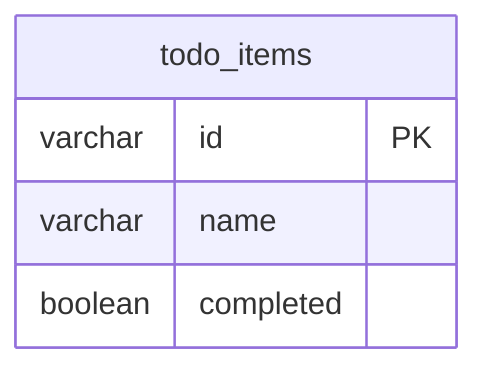
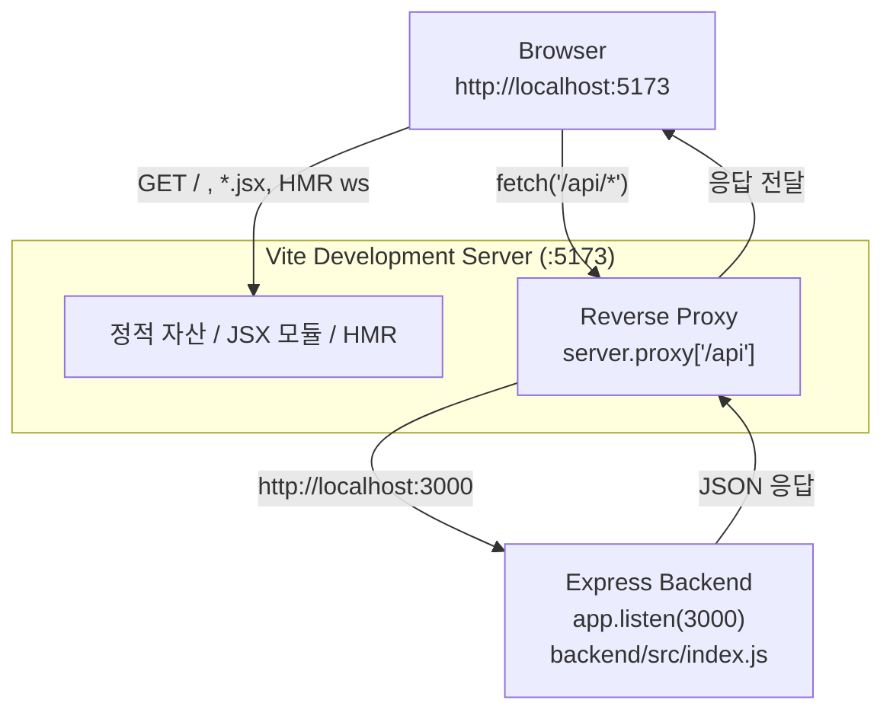
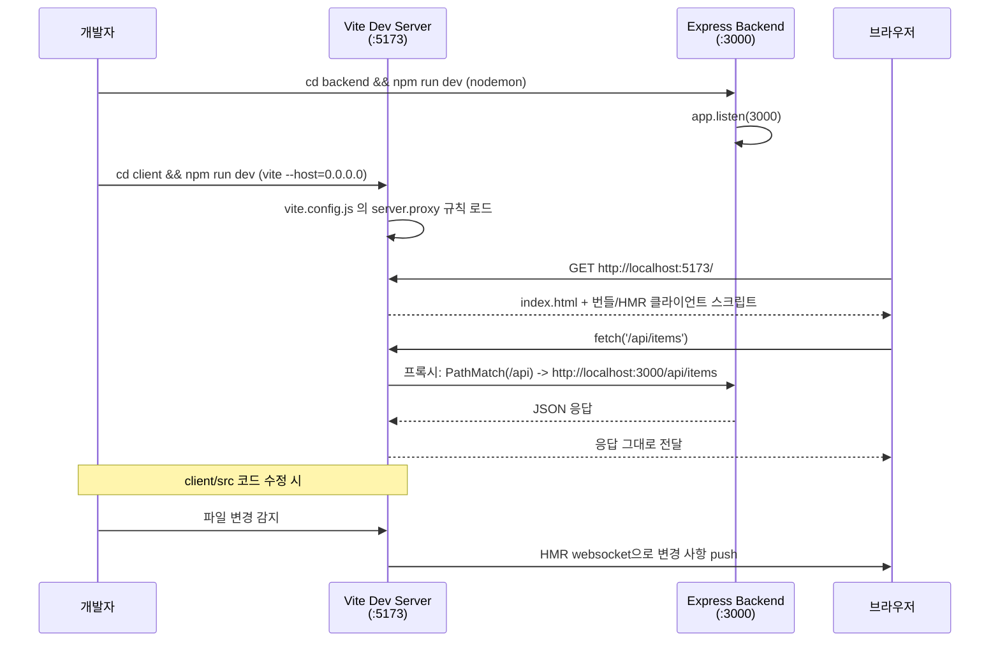
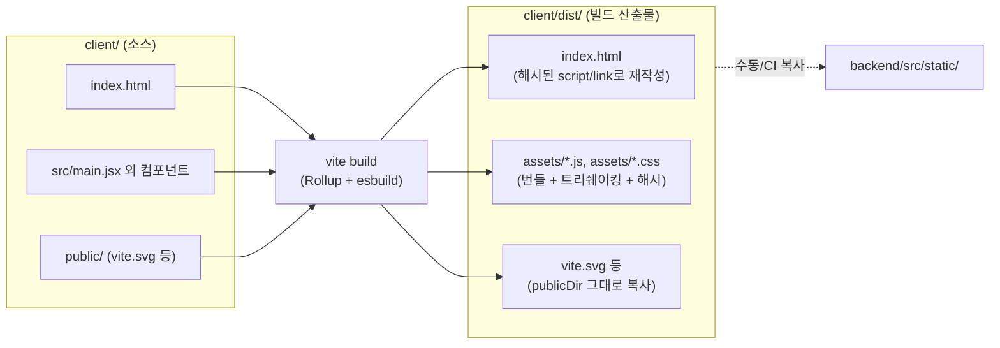
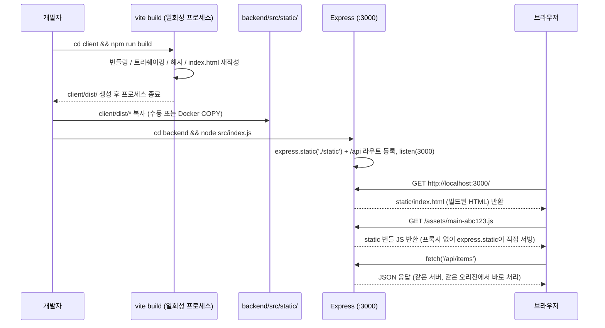
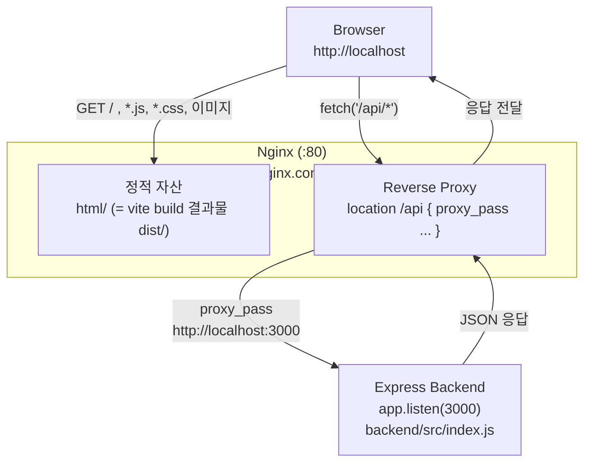
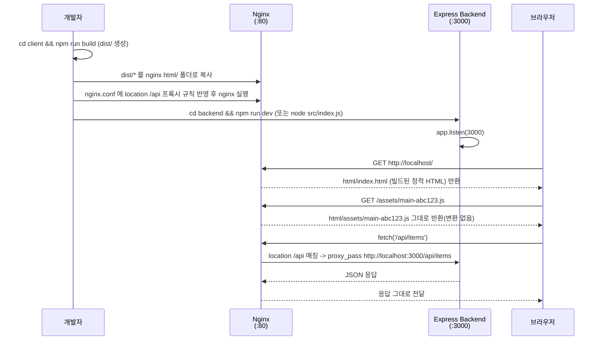
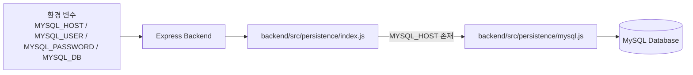
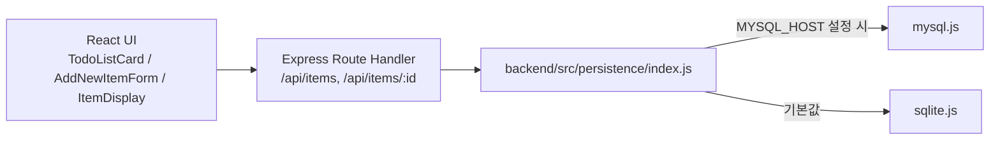

# 'Getting-Started-Todo-App' 프로젝트 동작 구조

## 0. 프로젝트 디렉토리 및 파일 구조

`node_modules`, `.git`을 제외한 주요 구조는 다음과 같다.

```text
getting-started-todo-app/
├─ backend/                      # Node.js/Express 백엔드
│  ├─ package.json               # 백엔드 의존성/스크립트 (npm run dev, npm test)
│  ├─ spec/                      # Jest 테스트 코드
│  │  ├─ persistence/sqlite.spec.js
│  │  └─ routes/                 # addItem, deleteItem, getItems, updateItem 라우트 테스트
│  └─ src/
│     ├─ index.js                # Express 앱 진입점 — app.listen(3000), 라우트/정적 파일 등록
│     ├─ persistence/
│     │  ├─ index.js             # MYSQL_HOST 환경변수 유무로 mysql.js / sqlite.js 중 선택
│     │  ├─ mysql.js              # MySQL(mysql2) 기반 저장소 구현
│     │  └─ sqlite.js             # SQLite(sqlite3) 기반 저장소 구현(기본값)
│     ├─ routes/                 # /api/* 각 라우트 핸들러
│     │  ├─ addItem.js / deleteItem.js / getItems.js / updateItem.js / getGreeting.js
│     └─ static/                 # 프로덕션 시 client 빌드 산출물(dist)이 위치할 자리 (express.static)
│
├─ client/                       # React + Vite 프론트엔드
│  ├─ package.json               # 클라이언트 의존성/스크립트 (dev, build, lint, preview)
│  ├─ vite.config.js             # React 플러그인 + /api reverse proxy 설정
│  ├─ index.html                 # Vite dev/build의 entry HTML
│  ├─ public/vite.svg            # publicDir — 변환 없이 그대로 서빙/복사되는 정적 자산
│  ├─ src/
│  │  ├─ main.jsx                # React 진입점 (ReactDOM.createRoot 등)
│  │  ├─ App.jsx                 # 최상위 컴포넌트
│  │  ├─ index.scss              # 전역 스타일(SCSS)
│  │  └─ components/             # Greeting, TodoListCard, AddNewItemForm, ItemDisplay 등
│  └─ dist/                      # `vite build` 산출물 (index.html, assets/*.js, *.css)
│
├─ nginx -GettingStarted-App-todo.conf   # 프로덕션에서 Nginx가 사용할 커스텀 설정(= /api reverse proxy 포함)
├─ workflow.md / client_workflow.md      # 개발/빌드/배포 동작 구조 문서(이 문서)
└─ _getting-started-todo-app_ 를 윈도우즈에서 동작 시키기 위한-README.md   # 윈도우즈 로컬 실행 가이드
```

## 1. 프로젝트에 사용된 패키지(라이브러리)

### 1.1 `client/package.json`

| 구분 | 패키지 | 버전 | 용도 |
|---|---|---|---|
| dependencies | `react` | ^19.1.0 | UI를 구성하는 핵심 React 라이브러리 |
| dependencies | `react-dom` | ^19.1.0 | React 컴포넌트를 실제 DOM에 렌더링 |
| dependencies | `bootstrap` | ^5.3.6 | Bootstrap CSS 프레임워크(레이아웃/스타일) |
| dependencies | `react-bootstrap` | ^2.10.10 | Bootstrap 컴포넌트를 React 컴포넌트로 감싼 바인딩 |
| dependencies | `sass` | ^1.70.0 | `.scss`(예: `ItemDisplay.scss`, `index.scss`)를 CSS로 컴파일 (Vite가 내부적으로 사용) |
| dependencies | `@fortawesome/fontawesome-svg-core` | ^6.5.1 | Font Awesome 아이콘 SVG 렌더링 코어 엔진 |
| dependencies | `@fortawesome/free-solid-svg-icons` | ^6.5.1 | Font Awesome Solid 스타일 아이콘 세트 |
| dependencies | `@fortawesome/fontawesome-free-regular` | ^5.0.13 | Font Awesome Regular 스타일 아이콘/폰트 |
| dependencies | `@fortawesome/react-fontawesome` | ^0.2.2 | Font Awesome 아이콘을 위한 React 컴포넌트(`<FontAwesomeIcon>`) |
| devDependencies | `vite` | ^6.3.5 | 개발 서버 + 프로덕션 번들러(이 문서에서 설명한 dev/build 전체를 담당) |
| devDependencies | `@vitejs/plugin-react` | ^4.5.1 | Vite에서 JSX 변환과 React Fast Refresh(HMR)를 지원하는 공식 플러그인 |
| devDependencies | `eslint` | ^8.55.0 | JS/JSX 정적 분석(린트) 도구 |
| devDependencies | `eslint-plugin-react` | ^7.33.2 | React 관련 ESLint 규칙 세트 |
| devDependencies | `eslint-plugin-react-hooks` | ^4.6.0 | React Hooks 사용 규칙(의존성 배열 등) 검사 |
| devDependencies | `eslint-plugin-react-refresh` | ^0.4.5 | Fast Refresh와 호환되지 않는 코드 패턴 검사 |
| devDependencies | `prettier` | ^3.2.4 | 코드 포맷터 |
| devDependencies | `@types/react`, `@types/react-dom` | ^19.1.6 | React/ReactDOM 타입 정의(에디터 자동완성·타입 체크용, 프로젝트 자체는 순수 JS) |

### 1.2 `backend/package.json`

| 구분 | 패키지 | 버전 | 용도 |
|---|---|---|---|
| dependencies | `express` | ^5.1.0 | Node.js 웹 프레임워크 — `/api/*` 라우팅, 미들웨어, 정적 파일 서빙(`express.static`) 담당 |
| dependencies | `sqlite3` | ^5.1.7 | SQLite 데이터베이스 드라이버(`persistence/sqlite.js`) — `MYSQL_HOST` 미설정 시 기본 저장소 |
| dependencies | `mysql2` | ^3.14.1 | MySQL 데이터베이스 드라이버(`persistence/mysql.js`) — `MYSQL_HOST` 설정 시 사용 |
| dependencies | `uuid` | ^11.1.0 | 새 할 일(item) 생성 시 고유 ID 발급 |
| dependencies | `wait-port` | ^1.1.0 | 지정한 포트(DB 등)가 열릴 때까지 대기 — 컨테이너 기동 순서 보장용 |
| devDependencies | `nodemon` | ^3.0.3 | 소스 변경 감지 후 서버 자동 재시작(`npm run dev`) |
| devDependencies | `jest` | ^29.7.0 | 단위/통합 테스트 프레임워크(`spec/` 디렉터리, `npm test`) |
| devDependencies | `prettier` | ^3.2.4 | 코드 포맷터 |

## 2. `vite.config.js` Reverse Proxy 구조

`npm run dev`(Vite Development Server)로 프론트엔드를 실행할 때, 백엔드(Express, `:3000`)로 API 요청을 포워딩하도록 `client/vite.config.js`에 `server.proxy` 설정을 추가했다.

```js
import { defineConfig } from 'vite';
import react from '@vitejs/plugin-react';

// https://vitejs.dev/config/
export default defineConfig({
    plugins: [react()],
    server: {
        proxy: {
            '/api': {
                target: 'http://localhost:3000',
                changeOrigin: true,
            },
        },
    },
});
```

## 3. 왜 필요한가

`client/src` 코드는 API 호출 시 절대 URL이 아니라 `/api/...` **상대 경로**를 사용한다.

- `TodoListCard.jsx` → `fetch('/api/items')`
- `AddNewItemForm.jsx` → `fetch('/api/items', options)`
- `ItemDisplay.jsx` → `fetch('/api/items/${item.id}', ...)`
- `Greeting.jsx` → `fetch('/api/greeting')`

`vite --host=0.0.0.0`로 뜨는 개발 서버는 기본적으로 `:5173`에서 정적 파일과 HMR만 서비스하고, `/api`로 오는 요청을 처리할 백엔드 로직은 갖고 있지 않다. 프록시 설정이 없으면 브라우저가 `fetch('/api/items')`를 호출할 때 요청이 Vite 서버(`:5173`) 자신에게 가고, 거기에는 `/api/items` 라우트가 없으므로 404가 발생한다.

`server.proxy`에 `/api` 규칙을 등록하면, Vite Dev Server가 **Reverse Proxy**로 동작하여 `/api`로 시작하는 요청만 내부적으로 `http://localhost:3000`(Express 백엔드, `backend/src/index.js`)으로 전달하고, 응답을 그대로 브라우저에 돌려준다. 그 결과 브라우저 입장에서는 프론트엔드와 백엔드가 마치 하나의 오리진(`http://localhost:5173`)에서 서비스되는 것처럼 보이고, 별도의 CORS 설정 없이 상대 경로 `fetch`가 그대로 동작한다.

`changeOrigin: true`는 프록시가 백엔드로 요청을 전달할 때 `Host` 헤더를 대상 서버(`localhost:3000`) 기준으로 바꿔주는 옵션으로, 일부 서버가 `Host` 헤더를 검사하는 경우를 대비한 안전장치다.

## 4. 전체 동작 순서

1. 백엔드 실행: `backend` 디렉터리에서 `npm run dev`(nodemon) → Express 서버가 `:3000`에서 리스닝 (`app.listen(3000, ...)`)
2. 프론트엔드 실행: `client` 디렉터리에서 `npm run dev`(`vite --host=0.0.0.0`) → Vite Dev Server가 `:5173`에서 리스닝, `vite.config.js`의 `server.proxy` 규칙을 로드
3. 브라우저가 `http://localhost:5173`(또는 `--host=0.0.0.0`으로 열린 다른 인터페이스)에 접속
4. Vite Dev Server가 요청 경로를 확인
   - `/api/*` → `http://localhost:3000`(Express 백엔드)으로 프록시
   - 그 외(정적 리소스, `index.html`, JSX 모듈, HMR websocket 등) → Vite 자신이 직접 서빙(온더플라이 번들링 + HMR)
5. 프론트엔드 코드의 `fetch('/api/items')` 등 상대 경로 호출은 브라우저 기준 origin(`:5173`)으로 나가고, Vite가 이를 가로채 백엔드(`:3000`)로 전달 → 백엔드 응답을 그대로 브라우저에 반환
6. 소스 코드 수정 시 Vite가 감지하여 HMR websocket으로 변경 사항을 브라우저에 즉시 반영(이 경로는 프록시 대상이 아니라 Vite 자신이 처리)

## 5. 데이터베이스 스키마 (SQLite/MySQL 공통)

이 프로젝트의 백엔드는 SQLite와 MySQL 모두 동일한 논리적 스키마를 사용한다. 즉, 할 일 목록을 저장하는 단일 테이블인 `todo_items`를 공통으로 사용하며, 저장소 구현체만 서로 다르다.

### 5.1 테이블 구조

- `todo_items` 테이블
  - `id`: 할 일 항목의 고유 식별자. 코드에서는 UUID 문자열로 생성한다.
  - `name`: 할 일 내용 텍스트.
  - `completed`: 완료 여부. SQLite에서는 `0/1` 정수로 저장하고, MySQL에서는 `BOOLEAN`/`TINYINT(1)`로 처리된다.

실제 SQL 초기화문은 다음과 같다.

```sql
-- SQLite
CREATE TABLE IF NOT EXISTS todo_items (
  id varchar(36),
  name varchar(255),
  completed boolean
);

-- MySQL
CREATE TABLE IF NOT EXISTS todo_items (
  id varchar(36),
  name varchar(255),
  completed boolean
) DEFAULT CHARSET utf8mb4;
```

이 구조는 간단한 Todo 앱에 적합하며, CRUD 작업(`추가 / 조회 / 수정 / 삭제`)이 모두 이 하나의 테이블을 중심으로 동작한다.

### 5.2 ERD(Mermaid)



## 6. Mermaid 다이어그램

### 6.1 구성 요소 구조



### 6.2 요청 처리 시퀀스



## 7. `http://localhost:5173` 요청에 `client/index.html`이 반환되는 과정

Vite의 **project root**는 `vite.config.js`가 위치한 디렉터리다(`root` 옵션을 따로 지정하지 않았으므로 기본값은 cwd, 즉 `client/`). Vite Dev Server는 이 root 바로 아래의 `index.html`을 개발 서버의 진입점(entry HTML)으로 취급한다.

1. 브라우저가 `http://localhost:5173/`로 요청을 보낸다.
2. Vite Dev Server 내부의 HTML 처리 미들웨어가 디스크에서 `client/index.html`을 읽는다.
3. 파일을 그대로 반환하지 않고, Vite와 플러그인들의 `transformIndexHtml` 훅을 거쳐 변형한다.
   - HMR 클라이언트 스크립트(`/@vite/client`)를 `<head>`에 주입 — 브라우저가 이 스크립트로 Vite 서버와 websocket을 맺어야 코드 변경을 실시간으로 반영받을 수 있다.
   - `@vitejs/plugin-react`가 React Fast Refresh용 프리앰블을 주입.
4. 변형된 HTML을 응답으로 반환한다. 이 HTML에는 `<script type="module" src="/src/main.jsx"></script>`가 포함되어 있다.
5. 브라우저는 받은 HTML을 파싱하다가 이 `<script type="module">` 태그를 보고 `/src/main.jsx`를 네이티브 ESM `import`로 다시 요청한다.
6. Vite는 이 요청을 받아 `main.jsx`(및 그 안에서 import하는 모든 파일)를 그때그때(on-demand) esbuild로 변환해 개별 모듈로 응답한다. 이렇게 브라우저가 import 그래프를 따라가며 파일을 하나씩 요청 → 변환 → 응답받는 방식이 Vite 개발 서버의 "no-bundle" 동작 원리다(사전에 하나의 큰 번들 파일을 만들어 두지 않는다).

즉 `index.html`은 정적으로 저장된 파일을 그대로 내려주는 게 아니라, 매 요청마다 Vite가 읽어서 가공(주입) 후 응답하는 **템플릿**에 가깝다.

## 8. Vite (개발모드 빌드) 동작 구조

Vite는 React/Vue 같은 프론트엔드 앱을 개발할 때 사용하는 빌드 도구이자 개발 서버다. 이 프로젝트에서 `client/package.json`의 `scripts.dev`는 `vite`를 실행하도록 되어 있고, 따라서 `npm run dev`(= `vite --host=0.0.0.0`)를 실행하면 Vite CLI가 즉시 개발 서버를 띄운다.

### 8.1 Vite Dev Server가 무엇인가

Vite Dev Server는 다음 역할을 하는 서버다.

- `client/index.html`을 개발 진입점으로 읽어들인다.
- 브라우저가 요청한 모듈(`/src/main.jsx`, 컴포넌트, CSS, 이미지 등)을 그때그때 변환해서 제공한다.
- JSX/TS/SCSS 같은 파일을 즉시 처리해 브라우저가 바로 실행할 수 있는 형태로 바꾼다.
- Hot Module Replacement(HMR)를 통해 코드 변경 사항을 브라우저에 즉시 반영한다.
- `/api/*` 요청은 `vite.config.js`의 `server.proxy` 설정에 따라 백엔드(`localhost:3000`)로 전달한다.

즉, Vite는 단순히 정적 파일을 나르는 서버가 아니라, “개발 중에 필요한 모듈을 실시간으로 변환하고 전달하는 프런트엔드 개발 전용 서버”다.

### 8.2 `npm run dev`가 실제로 하는 일

`client` 디렉터리에서 `npm run dev`를 실행하면, 내부적으로 다음 순서로 동작한다.

1. `client/package.json`의 `dev` 스크립트가 `vite`를 호출한다.
2. Vite CLI가 `client/`를 기준으로 개발 서버를 시작한다.
3. 기본적으로 `http://localhost:5173`에서 서버가 열리고, `index.html`을 진입점으로 사용한다.
4. 브라우저가 `main.jsx`와 그 하위 import들을 요청하면, Vite가 그때그때 esbuild로 변환해 응답한다.
5. `/api/*` 요청은 프록시 설정을 통해 백엔드로 포워딩된다.

이 과정에서 Vite는 미리 전체 앱을 하나의 큰 번들로 묶어두는 방식이 아니라, “필요한 파일만 요청할 때마다 변환해서 보내는” 동작을 한다. 그래서 개발 단계에서는 빠르게 반응하고, 수정한 코드도 즉시 반영된다.

### 8.3 실제 동작 구조

브라우저가 `http://localhost:5173/`에 접속하면, Vite는 다음처럼 동작한다.

1. Vite Dev Server가 `client/index.html`을 읽는다.
2. HTML을 그대로 보내는 것이 아니라, HMR 클라이언트 스크립트(`/@vite/client`)와 React Fast Refresh용 코드 등을 주입한다.
3. 브라우저가 `src/main.jsx`를 로드하면, Vite는 그 파일과 import된 모듈을 실시간으로 변환해 응답한다.
4. CSS, JSX, SCSS는 필요할 때 즉시 컴파일되어 브라우저로 전달된다.
5. `/api/*` 요청은 프록시를 통해 백엔드 `localhost:3000`으로 전달된다.

이 구조는 개발 모드의 핵심이며, 개발자 입장에서는 “한 번에 다 빌드된 결과물”이 아니라 “실시간으로 변환되는 앱”처럼 보인다.

### 8.4 Vite Dev Server의 "홈 디렉토리" — Nginx의 static 디렉토리 같은 것이 있는가

Nginx처럼 "이 폴더의 파일을 URL에 그대로 매핑해서 반환"하는 고정된 정적 디렉토리 개념이 부분적으로는 있지만, Nginx와 동작 방식이 다르다.

- **`root` (project root, 기본값 `client/`)**: `index.html`과 `src/` 등 소스 코드 해석의 기준 경로다. 하지만 이 디렉터리의 파일이 URL에 1:1로 매핑되어 그대로 반환되는 게 아니라, 요청이 들어올 때마다 Vite의 변환 파이프라인(플러그인, esbuild 등)을 거쳐 응답된다는 점에서 Nginx의 정적 root와는 다르다.
- **`publicDir`(기본값 `public/`, 이 프로젝트에서는 `client/public/`)**: 이 디렉토리만이 Nginx의 static 디렉토리와 가장 유사하게 동작한다. 여기 있는 파일(`client/public/vite.svg`)은 아무 변환 없이 그대로 URL 루트에 매핑되어 서비스된다(`client/public/vite.svg` → `http://localhost:5173/vite.svg`, `index.html`의 `<link rel="icon" href="/vite.svg">`가 이 파일을 참조). `vite build` 시에도 이 디렉토리의 파일들은 변환 없이 `dist/`로 그대로 복사된다.
- 정리하면, Vite Dev Server는 Nginx 같은 "파일 시스템 → URL 1:1 정적 서빙" 서버가 아니라 요청받은 리소스를 그때그때 변환해서 응답하는 **Node.js 기반 미들웨어 서버**다. 그중 `publicDir`만 예외적으로 Nginx의 static root처럼(변환 없이 그대로 전달) 동작하고, 나머지(HTML, JS/JSX, CSS 등)는 모두 요청 시점에 변환을 거친다.
- 개발 모드에는 미리 만들어진 "빌드 산출물 디렉토리"(Nginx가 서빙할 법한 `dist/` 같은 것)가 없다 — 그건 `vite build` 실행 후에만 생성된다. 개발 모드에서 정적 디렉토리에 가장 가까운 건 `public/`뿐이고, 나머지는 전부 온더플라이(on-the-fly) 처리다.

## 9. `vite build`(프로덕션 빌드) 동작 구조

`client` 디렉터리에서 `npm run build`(= `vite build`)를 실행하면, 지금까지 설명한 **개발 서버(dev server) 동작과는 완전히 다른 경로**로 동작한다. 서버가 뜨는 게 아니라, 명령어가 실행되는 동안 파일을 생성하고 종료하는 **빌드 프로세스**다. `server.proxy` 설정은 Vite Dev Server 미들웨어에만 적용되는 옵션이므로 빌드 결과물에는 아무 영향을 주지 않는다.

1. `client/index.html`을 빌드 진입점(entry)으로 읽는다.
2. `<script type="module" src="/src/main.jsx">`부터 시작해 import 그래프를 전부 정적으로 분석한다(`main.jsx` → `App.jsx` → 각 컴포넌트/SCSS 등).
3. Rollup(내부적으로 esbuild로 JSX/TS 변환)이 이 그래프를 하나 또는 여러 개의 번들 청크로 묶는다 — 트리쉐이킹(사용하지 않는 코드 제거), 코드 스플리팅, 압축(minify)을 수행한다.
4. `sass`로 컴파일되는 `.scss`를 포함한 CSS를 추출해 별도의 해시된 `.css` 파일로 만든다.
5. 결과 파일명에 콘텐츠 해시를 붙인다(`assets/main-abc123.js`, `assets/index-def456.css`) — 내용이 바뀌지 않으면 해시도 바뀌지 않아 브라우저/CDN 캐시를 오래 활용할 수 있다(cache busting).
6. `index.html`을 다시 써서, 개발 모드 전용 스크립트(`/@vite/client`)는 제거하고 위에서 생성된 해시된 번들 `<script>`/`<link rel="stylesheet">` 태그로 교체한다.
7. `publicDir`(`client/public/*`, 예: `vite.svg`)의 파일은 변환 없이 그대로 출력 디렉터리로 복사한다.
8. 이 모든 결과물을 `outDir`(기본값 `dist`, 즉 `client/dist/`)에 기록하고 프로세스를 종료한다.

빌드가 끝나면 `client/dist/`에는 순수한 정적 파일(HTML/CSS/JS/이미지)만 남는다 — Node.js도, Vite도, `/api` 프록시도 더 이상 관여하지 않는다.

### 프로덕션 실행과의 연결

백엔드(`backend/src/index.js`)는 `app.use(express.static(__dirname + '/static'))`로 `backend/src/static` 디렉터리를 정적으로 서빙하도록 되어 있다. 즉, `vite build`로 만들어진 `client/dist/`의 내용을 `backend/src/static/`으로 복사하면, Express 프로세스 하나가 `:3000`에서 정적 파일(`index.html`, JS/CSS 번들)과 `/api/*` API를 **같은 오리진에서 동시에** 서빙할 수 있다. (이 저장소에서는 과거 `Dockerfile`의 `client-build` → `final` 스테이지가 `COPY --from=client-build .../dist ./src/static`로 이 복사를 자동화했었다. 현재 `Dockerfile`이 삭제되어 있으므로, 로컬에서 프로덕션 모드를 재현하려면 `client/dist/*`를 `backend/src/static/`으로 수동 복사해야 한다.)

이 구조에서는 개발 모드처럼 "Vite가 reverse proxy로 `/api`를 백엔드에 포워딩"할 필요가 없다 — 애초에 정적 파일과 API가 같은 서버(같은 포트)에서 나오기 때문이다.

### Mermaid: 빌드 타임 흐름



### Mermaid: 프로덕션 실행 시퀀스 (빌드 후)



## 10. Nginx를 Reverse Proxy로 사용하는 경우의 동작 구조

`vite build`로 만든 `client/dist/`를 Node.js/Express가 아니라 **Nginx**로 서비스하는 프로덕션 배포 방식도 있다(`_getting-started-todo-app_ 를 윈도우즈에서 동작 시키기 위한-README.md` 참고). 이 경우 `dist/`의 내용을 Nginx의 `html` 폴더에 복사하고, `nginx.conf`에 `/api`를 백엔드로 넘겨주는 `location /api { proxy_pass http://localhost:3000; ... }` 블록을 추가한다(`nginx -GettingStarted-App-todo.conf`).

이 구조는 위 3~5절에서 설명한 "Vite Dev Server가 reverse proxy 역할을 하는" 개발 모드 구조와 **개념적으로 동일**하다 — 다만 프록시 주체가 Vite Dev Server(`:5173`, 개발용)에서 Nginx(`:80`, 프로덕션용)로 바뀌고, 정적 자산도 온더플라이 변환이 아니라 `vite build`로 미리 만들어진 파일을 그대로 서빙한다는 점이 다르다.

- Nginx가 정적 리소스(`/`, `index.html`, 해시된 JS/CSS 번들 등) 요청은 `html` 폴더(`dist/`가 복사된 곳)에서 직접 서빙한다.
- Nginx가 `/api`로 시작하는 요청만 `location /api`의 `proxy_pass`로 백엔드 Express(`http://localhost:3000`)에 전달하고, 응답을 그대로 브라우저에 돌려준다.
- 백엔드(`backend/src/index.js`)는 `/api/*` 라우트만 처리하면 되고, 정적 파일 서빙(`express.static`)은 이 구조에서는 사실상 사용되지 않는다(Nginx가 대신 서빙하므로).

### 10.1 구성 요소 구조



### 10.2 요청 처리 시퀀스



이 구조에서도 브라우저는 `fetch('/api/items')`처럼 상대 경로만 사용하고, 프론트/백엔드가 하나의 오리진(`http://localhost`)에서 서비스되는 것처럼 보이는 결과는 개발 모드·`express.static` 기반 프로덕션 모드와 동일하다. 다만 그 "하나의 오리진처럼 보이게 해주는" 주체가 Vite Dev Server → Express → Nginx로, 배포 방식에 따라 달라질 뿐이다.

## 11. MySQL 사용 방법

이 프로젝트는 기본적으로 SQLite를 사용하지만, 환경 변수만 적절히 설정하면 MySQL로 손쉽게 전환할 수 있다. 핵심은 백엔드의 [backend/src/persistence/index.js](backend/src/persistence/index.js)가 `MYSQL_HOST` 환경 변수가 있으면 [backend/src/persistence/mysql.js](backend/src/persistence/mysql.js)를 사용하도록 되어 있다는 점이다.

### 11.1 MySQL 설치 (Windows)

Windows 환경에서 가장 흔한 방법은 공식 MySQL Installer를 사용하는 방식이다.

1. MySQL Community Downloads에서 MySQL Installer Community를 다운로드한다.
2. 설치 과정에서 MySQL Server(예: 8.0 계열)와 MySQL Workbench를 선택한다.
3. 설치가 끝나면 MySQL Service가 자동으로 실행되도록 설정한다.
4. 설치 중 설정한 root 비밀번호를 기억해 둔다.

Docker를 쓰는 경우에도 간단히 실행할 수 있다.

```bash
docker run --name mysql8 \
  -e MYSQL_ROOT_PASSWORD=1234 \
  -e MYSQL_DATABASE=todos \
  -p 3306:3306 \
  -d mysql:8.0
```

### 11.2 MySQL 데이터베이스 및 사용자 생성

MySQL 서버에 접속한 뒤, 애플리케이션용 데이터베이스와 사용자를 만든다.

```sql
CREATE DATABASE todos;
CREATE USER 'todo_user'@'localhost' IDENTIFIED BY 'your_password';
GRANT ALL PRIVILEGES ON todos.* TO 'todo_user'@'localhost';
FLUSH PRIVILEGES;
```

이후 애플리케이션은 `todos` 데이터베이스를 사용하게 되며, 테이블은 백엔드가 시작될 때 자동으로 생성된다.

### 11.3 백엔드와 MySQL 연동하기

백엔드 실행 전에 다음 환경 변수를 설정하면 된다.

#### PowerShell 예시

```powershell
$env:MYSQL_HOST = "127.0.0.1"
$env:MYSQL_USER = "todo_user"
$env:MYSQL_PASSWORD = "your_password"
$env:MYSQL_DB = "todos"
```

#### CMD 예시

```bat
set MYSQL_HOST=127.0.0.1
set MYSQL_USER=todo_user
set MYSQL_PASSWORD=your_password
set MYSQL_DB=todos
```

그다음 백엔드를 실행한다.

```bash
cd backend
npm run dev
```

이때 `MYSQL_HOST`가 존재하면 [backend/src/persistence/index.js](backend/src/persistence/index.js)가 [backend/src/persistence/mysql.js](backend/src/persistence/mysql.js)로 연결되므로, SQLite 대신 MySQL을 사용하게 된다.

### 11.4 연동 흐름(Mermaid)



### 11.5 주의사항

- `MYSQL_HOST`가 없으면 앱은 계속 SQLite를 사용한다.
- MySQL 서버가 실행 중이지 않으면 연결이 실패하므로, 먼저 MySQL Service를 실행해야 한다.
- 비밀번호나 사용자명은 실제 환경에 맞게 바꿔서 사용해야 한다.

## 12. CRUD 동작과 DB 접근 흐름

이 프로젝트는 프론트엔드에서 발생한 사용자의 액션을 백엔드의 라우트 핸들러가 받아서, 다시 공통 persistence 계층을 통해 SQLite 또는 MySQL에 접근하는 구조로 동작한다.

### 11.1 요청 흐름 개요



### 11.2 CRUD별 동작

#### 1) Create: 새 할 일 추가

- 프론트엔드의 `AddNewItemForm`이 `POST /api/items` 요청을 보낸다.
- 백엔드의 [backend/src/routes/addItem.js](backend/src/routes/addItem.js)가 요청 body의 `name`을 읽는다.
- UUID를 생성해 `{ id, name, completed: false }` 형태의 객체를 만든다.
- `db.storeItem(item)`를 호출하고, persistence 계층이 SQLite/MySQL 중 선택된 구현체로 전달한다.
- 저장이 끝나면 생성된 항목을 응답으로 돌려준다.

#### 2) Read: 할 일 목록 조회

- 프론트엔드의 `TodoListCard`가 `GET /api/items` 요청을 보낸다.
- [backend/src/routes/getItems.js](backend/src/routes/getItems.js)가 `db.getItems()`를 호출한다.
- persistence 계층이 `SELECT * FROM todo_items`를 실행하고, 결과를 JSON 배열로 반환한다.
- 화면에 목록이 렌더링된다.

#### 3) Update: 할 일 수정

- 프론트엔드의 `ItemDisplay` 또는 관련 UI가 `PUT /api/items/:id` 요청을 보낸다.
- [backend/src/routes/updateItem.js](backend/src/routes/updateItem.js)가 요청 body의 `name`, `completed` 값을 받아 `db.updateItem(...)`를 호출한다.
- 이후 `db.getItem(id)`로 최신 상태를 다시 조회해 응답한다.

#### 4) Delete: 할 일 삭제

- 프론트엔드가 `DELETE /api/items/:id` 요청을 보낸다.
- [backend/src/routes/deleteItem.js](backend/src/routes/deleteItem.js)가 `db.removeItem(id)`를 호출한다.
- 삭제 성공 후 `200 OK`를 반환한다.

### 11.3 persistence 계층의 역할

[backend/src/persistence/index.js](backend/src/persistence/index.js)는 실제로는 저장소 구현체를 선택하는 진입점이다.

- 환경 변수 `MYSQL_HOST`가 있으면 [backend/src/persistence/mysql.js](backend/src/persistence/mysql.js)를 사용한다.
- 그렇지 않으면 [backend/src/persistence/sqlite.js](backend/src/persistence/sqlite.js)를 사용한다.

즉, 라우트 코드는 `db.getItems()`, `db.storeItem()` 같은 공통 메서드만 호출하고, 실제 구현은 뒤쪽 저장소에 위임한다. 이 구조 덕분에 애플리케이션 로직은 그대로 유지하면서 SQLite에서 MySQL로 쉽게 전환할 수 있다.

### 11.4 DB 접근 포인트

- `sqlite.js`는 `sqlite3` 드라이버를 사용해 `todo_items` 테이블에 직접 쿼리를 실행한다.
- `mysql.js`는 `mysql2` 풀(connection pool)을 사용해 같은 테이블에 쿼리를 실행한다.
- 두 구현체는 모두 동일한 SQL 의미(INSERT / SELECT / UPDATE / DELETE)를 사용한다.

### 11.5 정리

CRUD는 다음 순서로 연결된다.

1. 프론트엔드 UI가 `/api/*` 요청을 보낸다.
2. Express 라우트가 요청을 받아 처리한다.
3. 라우트가 persistence 계층의 메서드를 호출한다.
4. persistence는 SQLite 또는 MySQL 구현체로 작업을 위임한다.
5. 결과를 JSON 또는 상태 코드로 다시 응답한다.

## 13. 핵심 정리

- `vite.config.js`의 `server.proxy['/api']`는 Vite Dev Server를 **Reverse Proxy**로 동작시켜, `/api`로 시작하는 요청만 백엔드(`http://localhost:3000`)로 전달한다.
- 이 덕분에 프론트엔드 코드는 `fetch('/api/items')`처럼 상대 경로만으로 백엔드를 호출할 수 있고, 브라우저 입장에서는 프론트/백엔드가 하나의 오리진(`:5173`)에서 서비스되는 것처럼 보여 별도 CORS 설정이 필요 없다.
- 개발 시에는 백엔드(`backend`, `:3000`)와 프론트엔드(`client`, `:5173`) 두 프로세스를 각각 `npm run dev`로 띄워야 하며, 백엔드가 3000번 포트에서 떠 있지 않으면 `/api` 프록시 요청은 실패한다(연결 거부).
- 운영 빌드(`vite build`)에서는 이 프록시가 적용되지 않는다 — 프로덕션에서는 Express(`backend/src/index.js`)가 `express.static`으로 빌드된 정적 파일을 직접 서빙하므로, 프론트/백엔드가 물리적으로 같은 오리진에서 동작해 프록시가 필요 없다.
- Nginx로 배포하는 경우에는 Express의 `express.static` 대신 Nginx가 `dist/` 정적 파일을 직접 서빙하고, `nginx.conf`의 `location /api { proxy_pass ...; }`가 Vite `server.proxy`와 같은 역할(=/api를 백엔드로 포워딩)을 대신 수행한다.
