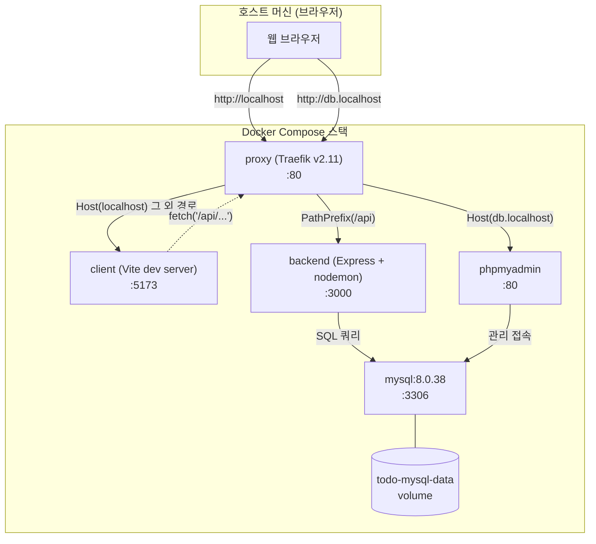
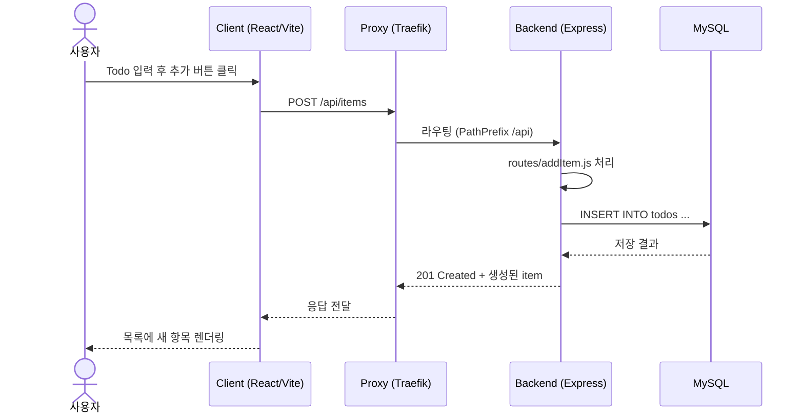
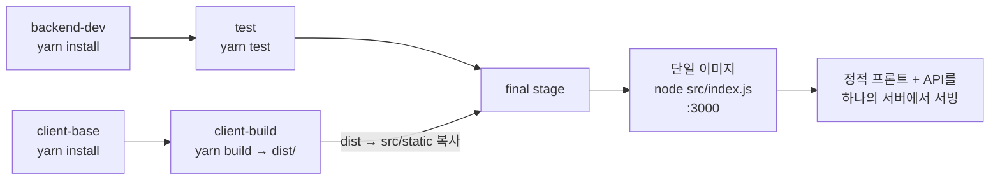

# Getting Started Todo App — 동작 구조

## 1. 개요

이 프로젝트는 **React(Vite) 프론트엔드**와 **Node.js(Express) 백엔드**로 구성된 샘플 Todo 앱이며,
Docker Compose 기반의 개발 환경을 통해 여러 컨테이너를 하나의 스택으로 묶어 동작합니다.

- 실제 배포(프로덕션) 시에는 프론트엔드가 정적 파일(HTML/CSS/JS)로 빌드되어 백엔드에 번들되고,
  백엔드가 이를 정적 자원으로 서빙합니다. (SSR 없음)
- 개발 시에는 프론트/백엔드가 서로 다른 개발 도구(Vite, nodemon)를 쓰기 때문에 **별도 컨테이너**로 분리되어 있고,
  Traefik이 리버스 프록시 역할을 하며 하나의 서비스처럼 보이도록 라우팅해줍니다.

## 2. 구성 요소 (compose.yml 기준)

| 서비스 | 이미지/빌드 | 역할 | 라우팅 규칙 (Traefik) |
|---|---|---|---|
| `proxy` | `traefik:v2.11` | 리버스 프록시. 요청을 client/backend/phpmyadmin으로 분기 | `:80` 수신 |
| `client` | Dockerfile `client-dev` stage | Vite 개발 서버 (React 앱) | `Host(localhost)` → 5173 |
| `backend` | Dockerfile `backend-dev` stage | Express API 서버 (nodemon) | `Host(localhost) && PathPrefix(/api)` → 3000 |
| `mysql` | `mysql:8.0.38` | 데이터 저장소 (todos 테이블) | - |
| `phpmyadmin` | `phpmyadmin` | MySQL 관리 웹 UI | `Host(db.localhost)` → 80 |

- `backend`, `client` 서비스는 **Compose Watch**(`develop.watch`)로 호스트의 소스 변경을
  컨테이너로 동기화(`sync`)하거나, `package.json` 변경 시 이미지를 재빌드(`rebuild`)합니다.
- MySQL 데이터는 `todo-mysql-data` 볼륨에 영속 저장됩니다.

## 3. Dockerfile 멀티스테이지 빌드

```
base → client-base → client-dev   (개발용: yarn dev, Vite 서버)
                    → client-build (yarn build → 정적 파일 dist/)

base → backend-dev  (개발용: yarn dev, nodemon)
                    → test        (yarn test 실행)
                    → final       (프로덕션: backend-dev의 의존성 + client-build의 dist를
                                    src/static 으로 복사 → node src/index.js 로 단일 이미지 실행)
```

## 4. 백엔드 라우트 구조 (`backend/src`)

- `index.js` — Express 앱 진입점, DB 연결 대기(wait-port) 후 라우트 등록
- `persistence/` — `mysql.js`, `sqlite.js` 중 환경에 맞는 저장소 구현 선택 (`index.js`가 스위칭)
- `routes/`
  - `getGreeting.js` — 인사말 반환 (GET)
  - `getItems.js` — 할 일 목록 조회 (GET)
  - `addItem.js` — 할 일 추가 (POST)
  - `updateItem.js` — 할 일 상태 수정 (PUT)
  - `deleteItem.js` — 할 일 삭제 (DELETE)

## 5. 프론트엔드 구조 (`client/src`)

- `main.jsx` → `App.jsx` (최상위 컴포넌트)
- `components/`
  - `Greeting.jsx` — 백엔드 인사말 표시
  - `TodoListCard.jsx` — Todo 리스트 카드 컨테이너
  - `ItemDisplay.jsx` — 개별 항목 표시/토글/삭제
  - `AddNewItemForm.jsx` — 항목 추가 폼

프론트는 `fetch`로 `/api/...` 엔드포인트를 호출하며, 개발 환경에서는 Traefik이
`/api` 경로를 backend 컨테이너(3000)로, 그 외 경로를 client 컨테이너(5173)로 라우팅합니다.

## 6. 전체 아키텍처 다이어그램



## 7. Todo 요청 처리 흐름 (예: 항목 추가)



## 8. 빌드/배포(프로덕션) 흐름



## 9. 개발 시작/종료 명령

```bash
# 시작 (백그라운드, watch 포함)
docker compose watch
# 또는
docker compose up -d

# 종료
docker compose down
```

- 접속: [http://localhost](http://localhost) (앱), [http://db.localhost](http://db.localhost) (phpMyAdmin)
