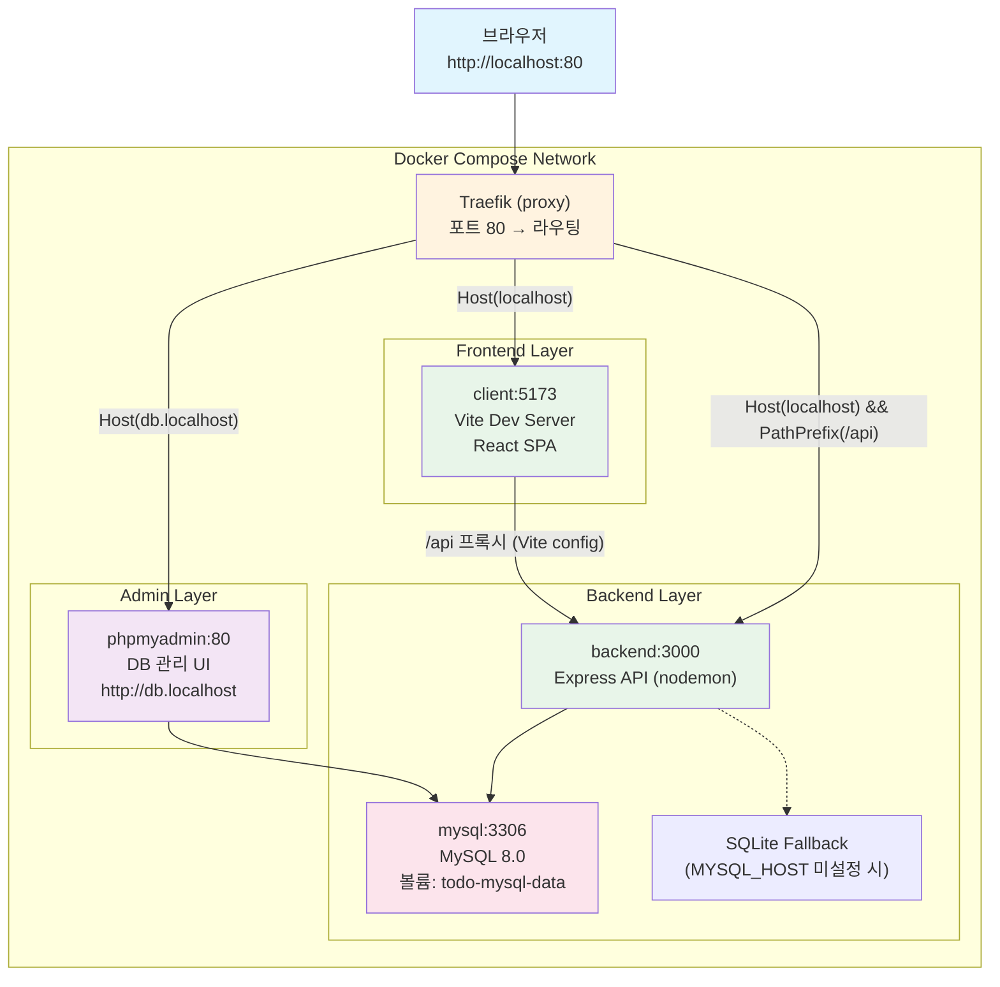
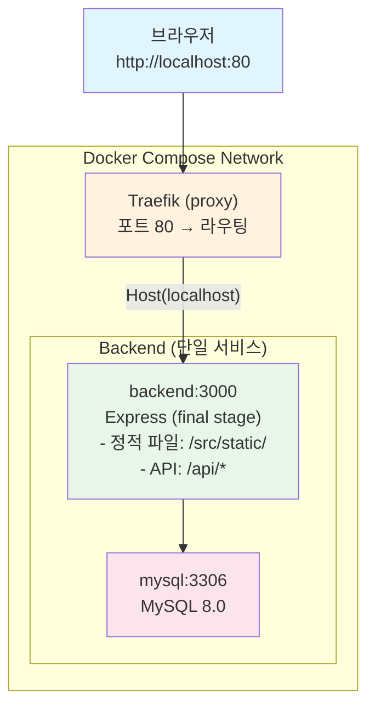
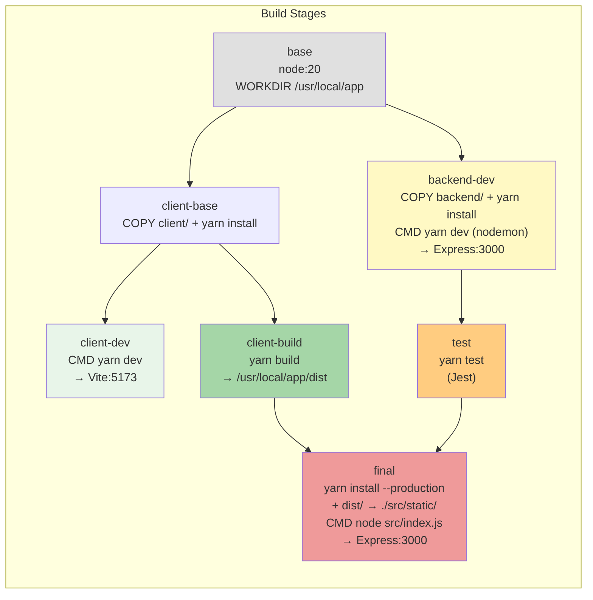
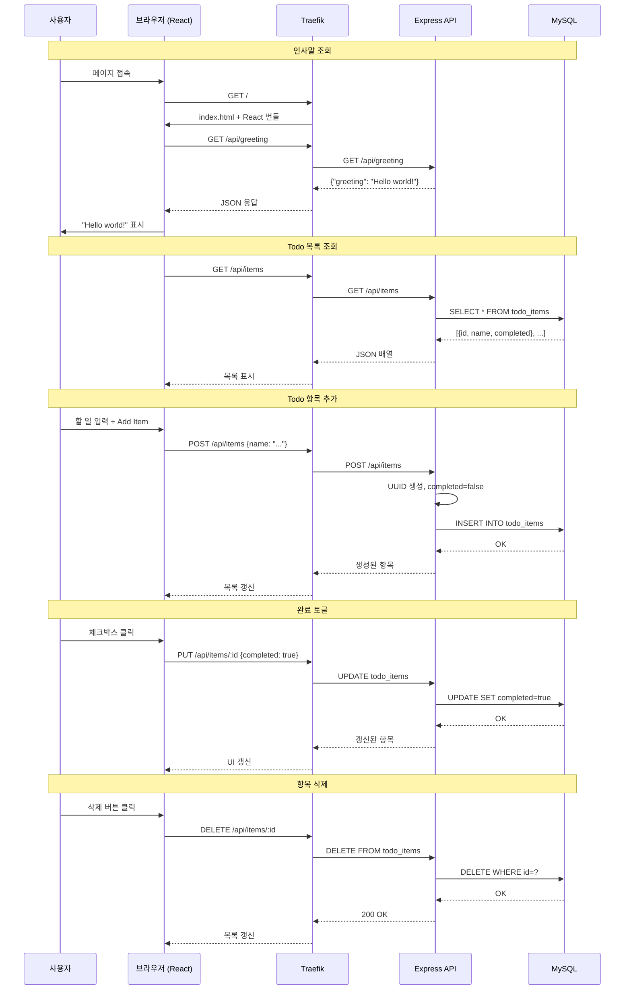
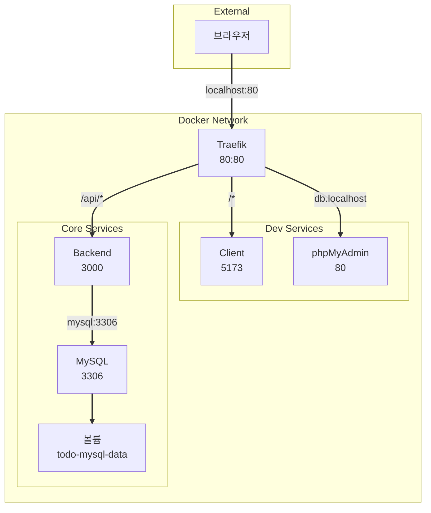

# Getting Started Todo App — 동작 구조

## 개요

React + Vite 프론트엔드, Node.js/Express 백엔드, MySQL 데이터베이스로 구성된 간단한 Todo 애플리케이션.
Docker 모범 사례를 시연하기 위한 샘플 프로젝트.

---

## 1. 개발 모드 (compose.yml / compose-dev-build.yml)

---

## 2. 프로덕션 모드 (compose-prod-build.yml)

> **프로덕션**에서는 프론트엔드가 정적 파일로 빌드되어 백엔드 이미지에 포함됨 (`client` 서비스 없음, phpMyAdmin 제거)

---

## 3. Dockerfile 멀티-스테이지 빌드

---

## 4. API 요청 생명주기

---

## 5. 전체 서비스 관계 및 포트

---

## 환경 변수

| 변수 | 용도 | 기본값 |
|------|------|--------|
| `MYSQL_HOST` | MySQL 호스트명 | `mysql` |
| `MYSQL_USER` | MySQL 사용자명 | `root` |
| `MYSQL_PASSWORD` | MySQL 비밀번호 | `secret` |
| `MYSQL_DB` | MySQL 데이터베이스명 | `todos` |
| `SQLITE_DB_LOCATION` | SQLite 파일 경로 | `/etc/todos/todo.db` |
| `MYSQL_ROOT_PASSWORD` | MySQL root 비밀번호 | `secret` |
| `PMA_HOST` | phpMyAdmin 연결 대상 | `mysql` |

> `MYSQL_HOST` 환경 변수가 설정되면 MySQL, 없으면 SQLite를 사용합니다.
> 모든 `*_FILE` 접미사 변수는 Docker Secret을 지원합니다.
