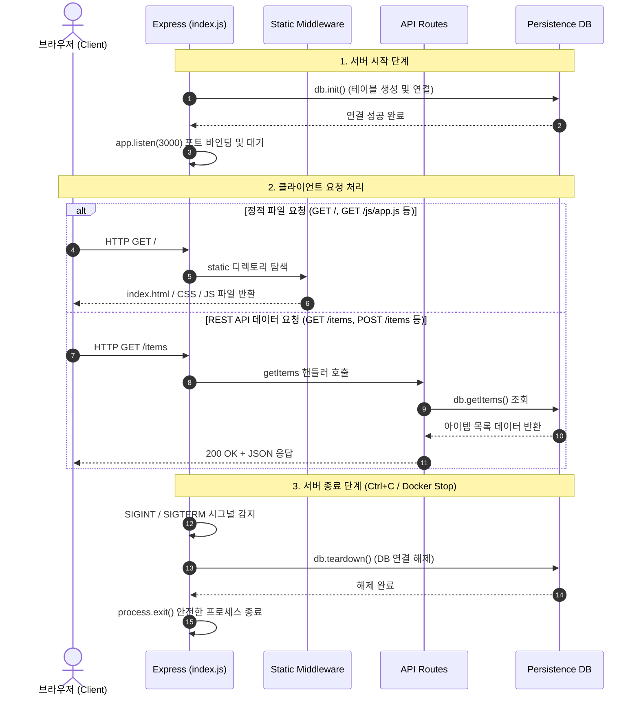
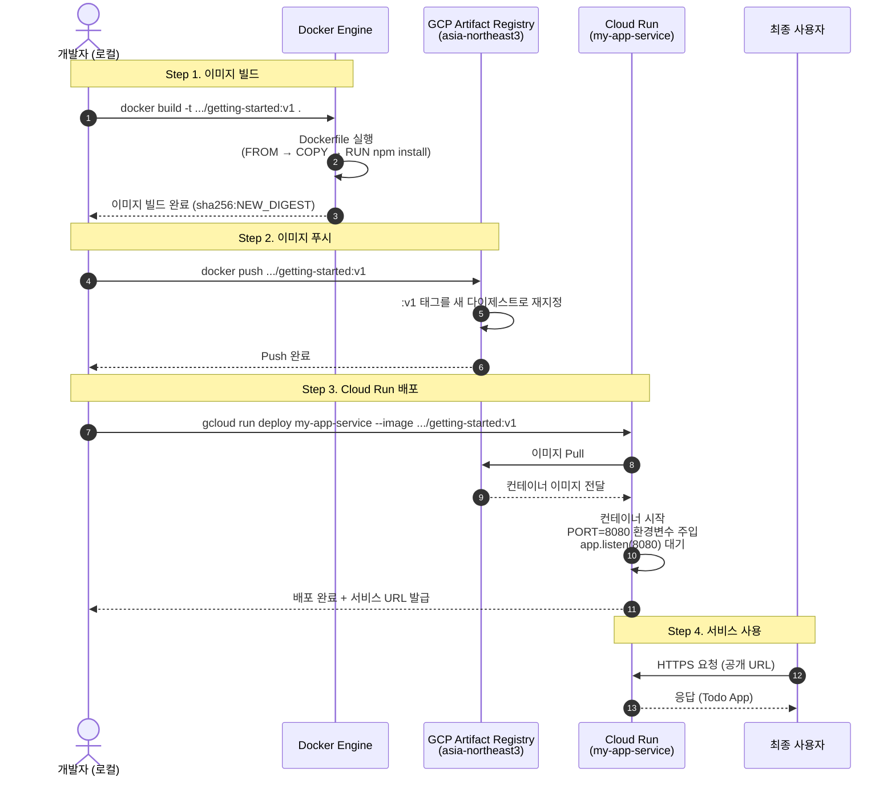

# Todo App - 백엔드 서버(`src/index.js`) 아키텍처 및 워크플로우 분석

이 문서는 프로젝트의 백엔드 진입점인 [`src/index.js`](file:///d:/Lecture%20Notes/2026-2CloudComputing/practices/03week/getting-started-app/src/index.js)의 구조, 핵심 코드 라인별 분석, 미들웨어 동작 원리, 데이터베이스 연동 및 서버 라이프사이클을 한국어로 정리한 문서입니다.

---

## 1. 개요 (Overview)

`src/index.js`는 Node.js 환경에서 **Express 프레임워크**를 기반으로 동작하는 웹 애플리케이션의 **메인 서버 파일(Entry Point)**입니다.

주요 역할은 다음과 같습니다:
1. **정적 파일 서빙**: 프론트엔드 리소스(`src/static/` 내 HTML, CSS, JS)를 클라이언트에 제공
2. **RESTful API 제공**: Todo 아이템의 생성, 조회, 수정, 삭제(CRUD)를 처리하는 엔드포인트 라우팅
3. **데이터베이스 초기화 및 서버 바인딩**: DB 연결(`sqlite` 또는 `mysql`)을 완료한 후 포트 3000번에서 HTTP 요청 대기
4. **Graceful Shutdown (정상 종료)**: 서버 종료 시그널 수신 시 안전하게 DB 연결을 해제하고 프로세스 종료

---

## 2. 전체 코드 구조 (Code Overview)

```javascript
const express = require('express');
const app = express();
const db = require('./persistence');
const getItems = require('./routes/getItems');
const addItem = require('./routes/addItem');
const updateItem = require('./routes/updateItem');
const deleteItem = require('./routes/deleteItem');

// [1] 미들웨어 설정
app.use(express.json());
app.use(express.static(__dirname + '/static'));

// [2] REST API 라우팅
app.get('/items', getItems);
app.post('/items', addItem);
app.put('/items/:id', updateItem);
app.delete('/items/:id', deleteItem);

// [3] DB 초기화 및 서버 실행
db.init().then(() => {
    app.listen(3000, () => console.log('Listening on port 3000'));
}).catch((err) => {
    console.error(err);
    process.exit(1);
});

// [4] Graceful Shutdown (정상 종료)
const gracefulShutdown = () => {
    db.teardown()
        .catch(() => {})
        .then(() => process.exit());
};

process.on('SIGINT', gracefulShutdown);
process.on('SIGTERM', gracefulShutdown);
process.on('SIGUSR2', gracefulShutdown); // Sent by nodemon
```

---

## 3. 핵심 코드 라인별 상세 분석

### 3.1 모듈 및 의존성 로드 (Lines 1~7)
* `const express = require('express');`: 경량 웹 프레임워크인 Express 모듈을 가져옵니다.
* `const app = express();`: Express 인스턴스를 생성하여 애플리케이션 객체 `app`을 정의합니다.
* `const db = require('./persistence');`: 데이터베이스 영속성 계층(Persistence Layer)을 불러옵니다. 환경 설정에 따라 SQLite 또는 MySQL 어댑터가 선택됩니다.
* `const getItems ... deleteItem`: Todo 아이템의 CRUD 작업을 각각 처리하는 컨트롤러 라우트 핸들러 함수들을 가져옵니다.

---

### 3.2 미들웨어 설정 (Lines 9~10)

#### ① `app.use(express.json());`
* **역할**: 클라이언트가 전송한 HTTP 요청 본문(Request Body) 중 `Content-Type: application/json` 형식의 JSON 데이터를 자동으로 파싱하여 `req.body` 객체에 넣어주는 내장 미들웨어입니다.
* **사용처**: `POST /items`, `PUT /items/:id` 요청 시 `{ "name": "...", "completed": true }` 데이터를 추출할 때 사용됩니다.

#### ② `app.use(express.static(__dirname + '/static'));`
* **역할**: 지정된 디렉토리(`src/static`) 내의 파일들을 웹 상에서 브라우저가 직접 접근할 수 있도록 **정적 파일 서빙 미들웨어**로 등록합니다.
* **`__dirname`의 의미와 역할**:
  * Node.js(CommonJS)에서 기본 제공하는 전역 변수로, **현재 실행 중인 파일(`src/index.js`)이 위치한 디렉토리의 절대 경로**를 반환합니다.
  * 예: `d:\Lecture Notes\...\getting-started-app\src`
  * `__dirname + '/static'`을 통해 현재 실행 파일 위치 기준 `.../src/static`의 절대 경로를 안전하게 가리킵니다. (터미널 실행 위치에 영향받지 않음)
* **동작 원리**:
  * `GET http://localhost:3000/` 요청 시 $\rightarrow$ `src/static/index.html` 자동 응답
  * `GET http://localhost:3000/css/styles.css` 요청 시 $\rightarrow$ `src/static/css/styles.css` 응답
  * `GET http://localhost:3000/js/app.js` 요청 시 $\rightarrow$ `src/static/js/app.js` 응답

---

### 3.3 RESTful API 라우팅 (Lines 12~15)

클라이언트의 데이터 요청을 처리하기 위한 REST API 엔드포인트 목록입니다:

| HTTP 메서드 | 엔드포인트 | 라우트 핸들러 | 역할 |
| :--- | :--- | :--- | :--- |
| `GET` | `/items` | `routes/getItems.js` | 저장된 전체 할 일 목록 조회 |
| `POST` | `/items` | `routes/addItem.js` | 새 할 일 항목 추가 |
| `PUT` | `/items/:id` | `routes/updateItem.js` | 특정 할 일 항목 수정 (완료 상태 토글) |
| `DELETE` | `/items/:id` | `routes/deleteItem.js` | 특정 할 일 항목 삭제 |

---

### 3.4 데이터베이스 초기화 및 서버 리슨 (Lines 17~22)

```javascript
db.init().then(() => {
    app.listen(3000, () => console.log('Listening on port 3000'));
}).catch((err) => {
    console.error(err);
    process.exit(1);
});
```

* **동작 순서**:
  1. `db.init()`을 호출하여 테이블 생성 및 DB 연결을 비동기적으로 수행합니다.
  2. DB 초기화가 **성공(resolved)**하면, `app.listen(3000, ...)`을 실행하여 포트 3000번에서 클라이언트의 HTTP 요청 수신을 시작합니다.
  3. 만약 DB 초기화 중 오류가 발생하면 `catch` 블록으로 이동하여 에러를 출력하고 프로세스를 비정상 종료(`process.exit(1)`)합니다.
* **특징**: DB가 준비되기 전에 들어온 요청으로 인한 오류를 방지하기 위해 반드시 DB 연결 완료 후 서버를 개방하는 안전한 패턴을 사용합니다.

---

### 3.5 Graceful Shutdown (정상 종료) 처리 (Lines 24~32)

```javascript
const gracefulShutdown = () => {
    db.teardown()
        .catch(() => {})
        .then(() => process.exit());
};

process.on('SIGINT', gracefulShutdown);
process.on('SIGTERM', gracefulShutdown);
process.on('SIGUSR2', gracefulShutdown); // Sent by nodemon
```

* **역할**: 운영체제 또는 개발 도구로부터 종료 시그널이 전달되었을 때, 프로세스가 갑자기 강제 종료되어 데이터가 손상되는 것을 방지합니다.
* **수신 시그널**:
  * `SIGINT`: 사용자가 터미널에서 `Ctrl + C`를 눌러 프로세스를 인터럽트할 때 발생
  * `SIGTERM`: 도커(Docker) 컨테이너 중지(`docker stop`) 또는 프로세스 관리자에 의해 종료될 때 발생
  * `SIGUSR2`: `nodemon`과 같은 개발 도구가 파일 변경을 감지하고 서버를 재시작할 때 전송
* **종료 절차**: `db.teardown()`을 호출하여 데이터베이스 커넥션 풀을 정상적으로 닫고 파일 잠금을 해제한 후 `process.exit()`로 안전하게 종료합니다.

---

## 4. 전체 서버 라이프사이클 및 워크플로우



---

## 5. GCP Artifact Registry & Cloud Run 배포 워크플로우

이 섹션에서는 로컬에서 빌드한 Docker 이미지를 **GCP Artifact Registry**에 저장하고, 이를 **Cloud Run**으로 배포하는 전체 과정을 정리합니다.

---

### 5.1 Dockerfile 구조 분석

```dockerfile
# syntax=docker/dockerfile:1

FROM node:24-alpine        # 경량 Alpine Linux 기반 Node.js 24 이미지 사용
WORKDIR /app               # 컨테이너 내 작업 디렉토리 설정
COPY . .                   # 로컬 소스코드 전체를 컨테이너로 복사
RUN npm install --omit=dev # devDependencies 제외하고 프로덕션 패키지만 설치
CMD ["node", "src/index.js"] # 컨테이너 시작 시 실행할 기본 명령
EXPOSE 3000                # 컨테이너가 사용하는 포트 명시 (문서화 목적)
```

| 명령 | 설명 |
|------|------|
| `FROM node:24-alpine` | 베이스 이미지. Alpine은 ~5MB의 초경량 Linux로 보안 공격 면적을 최소화 |
| `WORKDIR /app` | 이후 모든 명령의 기준 경로. `cd /app`과 동일 효과 |
| `COPY . .` | 호스트의 현재 디렉토리를 컨테이너의 `/app`으로 복사 (`.dockerignore` 적용) |
| `RUN npm install --omit=dev` | 빌드 단계에서 프로덕션 의존성만 설치하여 이미지 크기 최소화 |
| `CMD` | 컨테이너 런타임에 실행되는 기본 진입점 (`docker run` 시 자동 실행) |
| `EXPOSE` | 포트 사용 선언 (실제 포트 바인딩은 `docker run -p` 또는 Cloud Run이 담당) |

---

### 5.2 Cloud Run 배포 시 포트 설정 문제 및 해결

Cloud Run은 컨테이너 실행 시 `PORT` 환경변수를 **자동으로 주입**합니다 (기본값: `8080`).  
앱이 해당 포트를 리슨하지 않으면 헬스체크 타임아웃으로 배포가 실패합니다.

#### ❌ 문제 코드 (포트 하드코딩)

```javascript
// src/index.js - 포트가 3000으로 고정되어 Cloud Run의 PORT=8080을 무시
db.init().then(() => {
    app.listen(3000, () => console.log('Listening on port 3000'));
});
```

**발생 오류:**
```
ERROR: The user-provided container failed to start and listen on the port
defined by the PORT=8080 environment variable within the allocated timeout.
```

#### ✅ 수정 코드 (환경변수로 포트 동적 설정)

```javascript
// src/index.js - Cloud Run: PORT=8080, 로컬 개발: PORT=3000 (폴백)
db.init().then(() => {
    const PORT = process.env.PORT || 3000;
    app.listen(PORT, () => console.log(`Listening on port ${PORT}`));
});
```

| 실행 환경 | `PORT` 값 | 동작 |
|-----------|-----------|------|
| 로컬 (`node src/index.js`) | 미설정 → `3000` 폴백 | `http://localhost:3000` |
| Cloud Run | `8080` 자동 주입 | Cloud Run 내부 라우팅 |

---

### 5.3 GCP Artifact Registry 이미지 저장 및 Cloud Run 배포 절차

#### Step 1 — GCP 인증 및 Docker 자격증명 구성

```bash
# GCP 계정 로그인
gcloud auth login

# Docker가 Artifact Registry에 이미지를 push할 수 있도록 자격증명 설정
gcloud auth configure-docker asia-northeast3-docker.pkg.dev
```

#### Step 2 — Docker 이미지 빌드

```bash
# 이미지 태그 규칙: <REGION>-docker.pkg.dev/<PROJECT_ID>/<REPO>/<IMAGE>:<TAG>
docker build -t asia-northeast3-docker.pkg.dev/ssu-agent-vertex/my-repo/getting-started:v1 .
```

| 구성 요소 | 값 | 설명 |
|-----------|----|------|
| Region | `asia-northeast3` | 서울 리전 |
| Project ID | `ssu-agent-vertex` | GCP 프로젝트 ID |
| Repository | `my-repo` | Artifact Registry 저장소 이름 |
| Image | `getting-started` | 이미지 이름 |
| Tag | `v1` | 버전 태그 |

#### Step 3 — Artifact Registry에 이미지 푸시

```bash
docker push asia-northeast3-docker.pkg.dev/ssu-agent-vertex/my-repo/getting-started:v1
```

> **⚠️ 같은 태그로 재푸시 시 동작:**  
> `:v1` 태그가 새 이미지 다이제스트(`sha256:...`)를 가리키도록 **재지정(덮어쓰기)**됩니다.  
> 기존 이미지 레이어 데이터는 레지스트리에 남지만 태그를 잃고 **untagged** 상태가 됩니다.

#### Step 4 — Cloud Run 서비스 배포

```bash
gcloud run deploy my-app-service \
  --image asia-northeast3-docker.pkg.dev/ssu-agent-vertex/my-repo/getting-started:v1 \
  --region asia-northeast3 \
  --allow-unauthenticated
```

| 옵션 | 설명 |
|------|------|
| `my-app-service` | Cloud Run 서비스 이름 (신규 생성 또는 업데이트) |
| `--image` | 배포할 컨테이너 이미지 전체 경로 |
| `--region` | 서비스가 실행될 GCP 리전 (서울: `asia-northeast3`) |
| `--allow-unauthenticated` | 인증 없이 공개 URL로 접근 허용 (퍼블릭 서비스) |

---

### 5.4 전체 배포 파이프라인 다이어그램



---

### 5.5 로컬 vs Cloud Run 실행 환경 비교

| 항목 | 로컬 실행 (`node src/index.js`) | Cloud Run |
|------|---------------------------------|-----------|
| **포트** | `3000` (하드코딩 또는 폴백) | `8080` (`PORT` 환경변수 자동 주입) |
| **DB** | SQLite (로컬 파일) | 환경변수로 MySQL 등 외부 DB 연결 |
| **스케일링** | 단일 프로세스 | 요청량에 따라 자동 수평 확장 |
| **URL** | `http://localhost:3000` | `https://<hash>-an.a.run.app` |
| **종료 시그널** | `SIGINT` (Ctrl+C) | `SIGTERM` (Cloud Run이 전송) |
