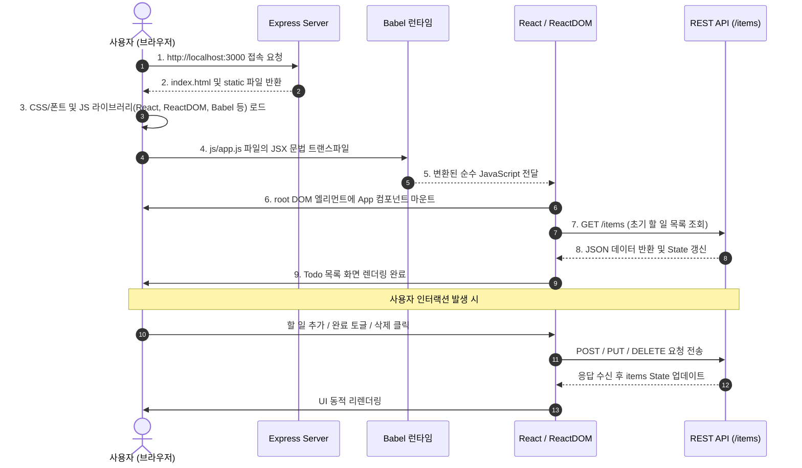

# Todo App - `static` 디렉토리 파일 역할 및 워크플로우 분석

이 문서는 `src/static/` 디렉토리에 포함된 프론트엔드 정적 파일들의 구조와 각 파일의 역할, 그리고 애플리케이션의 동작 흐름(Workflow)을 한국어로 정리한 문서입니다.

---

## 1. 개요 (Overview)

`static/` 디렉토리는 Node.js Express 백엔드 서버(`src/index.js`)에서 `express.static()`을 통해 클라이언트(웹 브라우저)에 서빙되는 **정적 웹 리소스(HTML, CSS, JavaScript, 웹 폰트/아이콘)**가 위치한 곳입니다.

별도의 복잡한 번들러(Webpack, Vite 등)나 빌드 파이프라인 없이, **브라우저에서 직접 React 및 Babel 스크립트를 로드하여 실시간으로 JSX를 트랜스파일해 실행하는 Standalone React SPA(Single Page Application)** 구조를 갖추고 있습니다.

---

## 2. 디렉토리 구조 (Directory Structure)

```text
src/static/
├── index.html                  # 애플리케이션의 진입점(Entry Point) HTML
├── css/
│   ├── bootstrap.min.css       # Bootstrap 4 UI 프레임워크 스타일시트
│   ├── styles.css              # 커스텀 애플리케이션 스타일
│   └── font-awesome/           # Font Awesome 아이콘 라이브러리 및 폰트 파일
│       ├── all.min.css         # Font Awesome 아이콘 스타일 정의
│       └── fa-* (woff2, ttf 등)# 아이콘 폰트 에셋 파일
└── js/
    ├── app.js                  # Todo 앱 React 메인 로직 및 컴포넌트 코드
    ├── react.production.min.js # React 코어 라이브러리
    ├── react-dom.production.min.js # ReactDOM 렌더링 라이브러리
    ├── react-bootstrap.js      # React용 Bootstrap 컴포넌트 라이브러리
    └── babel.min.js            # 브라우저용 실시간 JSX/JS 트랜스파일러
```

---

## 3. 파일별 상세 역할 (File Roles)

### 3.1 루트 파일

* [index.html](file:///d:/Lecture%20Notes/2026-2CloudComputing/practices/03week/getting-started-app/src/static/index.html)
  * **역할**: 애플리케이션의 메인 HTML 문서이자 클라이언트 진입점입니다.
  * **주요 내용**:
    * 뷰포트 설정 및 반응형 웹 메타 태그 지정
    * CSS 파일 로드 (Bootstrap, Font Awesome, Google Fonts, styles.css)
    * React 컴포넌트가 마운트될 컨테이너 DOM 요소 (`<div id="root"></div>`) 제공
    * 의존성 JavaScript 라이브러리 및 `app.js` 스크립트 로드 (`type="text/babel"` 속성 지정)

---

### 3.2 `js/` 디렉토리 (스크립트 파일)

* [js/app.js](file:///d:/Lecture%20Notes/2026-2CloudComputing/practices/03week/getting-started-app/src/static/js/app.js)
  * **역할**: Todo 애플리케이션의 프론트엔드 핵심 UI 및 비즈니스 로직을 담당하는 React 컴포넌트 파일입니다.
  * **주요 컴포넌트 구성**:
    * `App`: 최상위 래퍼 컴포넌트로 화면 중앙 그리드 레이아웃 구성
    * `TodoListCard`: Todo 리스트 상태(`items`) 관리, 초기 데이터 fetch 및 상태 갱신 로직 관리
    * `AddItemForm`: 새로운 Todo 항목을 입력받아 백엔드로 전송하는 폼 컴포넌트
    * `ItemDisplay`: 개별 Todo 항목의 표시, 완료/미완료 토글, 삭제 버튼 처리 컴포넌트
  * **백엔드 API 통신**:
    * `GET /items`: 전체 할 일 목록 조회
    * `POST /items`: 새 할 일 항목 추가
    * `PUT /items/:id`: 할 일 항목 상태(완료 여부) 수정
    * `DELETE /items/:id`: 할 일 항목 삭제

* [js/react.production.min.js](file:///d:/Lecture%20Notes/2026-2CloudComputing/practices/03week/getting-started-app/src/static/js/react.production.min.js)
  * **역할**: React 코어 라이브러리입니다.
  * **설명**: 컴포넌트 정의, 상태 관리(`useState`, `useCallback`, `useEffect`), 가상 DOM(Virtual DOM) 알고리즘을 지원합니다.

* [js/react-dom.production.min.js](file:///d:/Lecture%20Notes/2026-2CloudComputing/practices/03week/getting-started-app/src/static/js/react-dom.production.min.js)
  * **역할**: React와 실제 브라우저 DOM을 연결해주는 렌더러 라이브러리입니다.
  * **설명**: `ReactDOM.render(<App />, document.getElementById('root'))`를 통해 가상 DOM 트리를 실제 HTML DOM에 렌더링합니다.

* [js/react-bootstrap.js](file:///d:/Lecture%20Notes/2026-2CloudComputing/practices/03week/getting-started-app/src/static/js/react-bootstrap.js)
  * **역할**: Bootstrap UI 컴포넌트를 React 컴포넌트로 래핑한 라이브러리입니다.
  * **설명**: `Container`, `Row`, `Col`, `Form`, `Button`, `InputGroup` 등 일관된 UI 요소를 간편하게 사용할 수 있도록 지원합니다.

* [js/babel.min.js](file:///d:/Lecture%20Notes/2026-2CloudComputing/practices/03week/getting-started-app/src/static/js/babel.min.js)
  * **역할**: 브라우저 런타임 Babel 컴파일러입니다.
  * **설명**: `<script type="text/babel">`로 로드된 `app.js` 내의 JSX 문법 및 최신 JS 문법을 브라우저가 해석할 수 있는 일반 JavaScript 코드로 실시간 변환(Transpile)합니다.

---

### 3.3 `css/` 디렉토리 (스타일 및 에셋)

* [css/styles.css](file:///d:/Lecture%20Notes/2026-2CloudComputing/practices/03week/getting-started-app/src/static/css/styles.css)
  * **역할**: 애플리케이션의 세부 커스텀 스타일시트입니다.
  * **주요 스타일**:
    * 배경색상(`#f4f4f4`) 및 기본 폰트('Lato') 지정
    * Todo 항목 카드 디자인(둥근 모서리, 그림자 `box-shadow`, 마우스 호버 효과)
    * 완료된 항목에 대한 취소선(`text-decoration: line-through`) 효과

* [css/bootstrap.min.css](file:///d:/Lecture%20Notes/2026-2CloudComputing/practices/03week/getting-started-app/src/static/css/bootstrap.min.css)
  * **역할**: Bootstrap UI 프레임워크의 핵심 CSS 파일입니다.
  * **설명**: 그리드 시스템, 입력 폼, 버튼, 반응형 레이아웃 등의 기본 스타일을 제공합니다.

* `css/font-awesome/`
  * **역할**: 웹 아이콘 폰트 패키지(Font Awesome)입니다.
  * **주요 파일**:
    * `all.min.css`: 아이콘 클래스 정의
    * `fa-*` 파일들: `.woff2`, `.woff`, `.ttf`, `.svg`, `.eot` 등 다양한 브라우저 호환성을 위한 폰트 파일
  * **사용처**:
    * 체크박스 아이콘 (`fa-square`, `fa-check-square`)
    * 삭제 휴지통 아이콘 (`fa-trash`)

---

## 4. 전체 동작 워크플로우 (Application Workflow)



1. **초기 페이지 로드 (Page Load)**:
   * 사용자가 브라우저로 서버에 접속하면 Express 서버가 `static/index.html`을 서빙합니다.
2. **정적 리소스 로드 (Asset Loading)**:
   * 브라우저가 CSS(Bootstrap, Font Awesome, Custom CSS)와 JS(React, ReactDOM, React-Bootstrap, Babel)를 순차적으로 로드합니다.
3. **실시간 트랜스파일 (In-Browser Transpilation)**:
   * `babel.min.js`가 `<script type="text/babel" src="js/app.js">`를 읽어 브라우저가 실행할 수 있는 JavaScript로 실시간 변환합니다.
4. **React DOM 마운트 & 초기 렌더링 (Mount & Initial Render)**:
   * `ReactDOM.render`가 호출되어 `<div id="root"></div>`에 React `App` 컴포넌트를 마운트합니다.
   * `TodoListCard`의 `useEffect` 훅이 트리거되어 백엔드 `GET /items` API를 호출하고 초기 목록을 받아와 화면에 표시합니다.
5. **사용자 인터랙션 (User Interactions)**:
   * **추가 (Create)**: `AddItemForm`에서 텍스트 입력 후 제출 시 `POST /items` 호출 및 리스트 상태 추가.
   * **수정 (Update)**: `ItemDisplay`의 체크박스 클릭 시 `PUT /items/:id` 호출 및 완료 상태(`completed`) 토글.
   * **삭제 (Delete)**: `ItemDisplay`의 휴지통 버튼 클릭 시 `DELETE /items/:id` 호출 및 리스트에서 제거.

---

## 5. `app.js`에서 `import` 없이 라이브러리를 사용할 수 있는 이유

`js/app.js` 코드를 보면 `import React from 'react'` 또는 `import { Container } from 'react-bootstrap'` 같은 ES Module `import` 구문이 전혀 없음에도 불구하고 `React.useState`, `ReactDOM.render`, `ReactBootstrap.Container` 등을 정상적으로 사용할 수 있습니다.

이는 다음과 같은 브라우저 런타임 및 스크립트 로드 메커니즘 덕분입니다.

### 1) UMD (Universal Module Definition) 빌드와 전역 객체(`window`) 바인딩
* `react.production.min.js`, `react-dom.production.min.js`, `react-bootstrap.js` 파일들은 브라우저 환경에서 직접 로드될 수 있는 **UMD/글로벌 번들** 형태로 제작되어 있습니다.
* 이 라이브러리들은 브라우저에서 실행될 때 자신의 핵심 API를 브라우저의 최상위 전역 객체인 `window`에 특정 네임스페이스(이름)로 자동 등록합니다.
  * `react.production.min.js` $\rightarrow$ `window.React` 등록
  * `react-dom.production.min.js` $\rightarrow$ `window.ReactDOM` 등록
  * `react-bootstrap.js` $\rightarrow$ `window.ReactBootstrap` 등록

### 2) `index.html`에서의 스크립트 로드 순서 (동기적 평가)
`src/static/index.html`을 확인하면 스크립트들이 아래 순서대로 정의되어 있습니다:
```html
<script src="js/react.production.min.js"></script>
<script src="js/react-dom.production.min.js"></script>
<script src="js/react-bootstrap.js"></script>
<script src="js/babel.min.js"></script>
<script type="text/babel" src="js/app.js"></script>
```
* 브라우저는 HTML 문서를 위에서 아래로 순차적으로 파싱하고 실행합니다.
* `app.js`가 파싱 및 실행되는 시점에는 이미 선행 스크립트들에 의해 브라우저 전역 스코프에 `React`, `ReactDOM`, `ReactBootstrap` 객체가 준비(할당)되어 있습니다.

### 3) 전역 스코프(Global Scope) 식별자 직접 접근
* 자바스크립트에서는 `window.React`처럼 `window.`을 명시하지 않아도, 현재 로컬/블록 스코프에 해당 이름의 변수가 없으면 **스코프 체인(Scope Chain)**을 따라 최상위 전역 스코프(`window`)에서 식별자를 찾습니다.
* 따라서 `app.js`에서 별도의 import 없이도 곧바로 식별자를 호출할 수 있습니다:
  * `React.useState(...)` $\rightarrow$ `window.React.useState(...)`
  * `const { Container, Row, Col } = ReactBootstrap;` $\rightarrow$ `window.ReactBootstrap`에서 구조 분해 할당
  * `ReactDOM.render(...)` $\rightarrow$ `window.ReactDOM.render(...)`

### 💡 모던 모듈 번들러 방식과의 비교
| 구분 | 현재 프로젝트 방식 (스크립트 태그 로드) | 일반적인 모던 React 방식 (Webpack/Vite 등) |
| :--- | :--- | :--- |
| **모듈 로드 방식** | `<script src="...">`로 브라우저에 직접 로드 | `import React from 'react'` ES Module 구문 사용 |
| **변수 스코프** | 전역 스코프(`window`)에 노출 | 모듈 스코프(파일 단위 격리, 번들러가 결합) |
| **빌드 과정** | 브라우저 런타임에서 Babel이 실시간 트랜스파일 | 개발/배포 시점에 번들러가 사전 빌드(Pre-bundle) |
| **장단점** | 설정이 없고 파일만으로 즉시 실행 가능하나 전역 오염 가능 | 번들 최적화/트리쉐이킹 가능하나 번들 빌드 환경 필요 |
