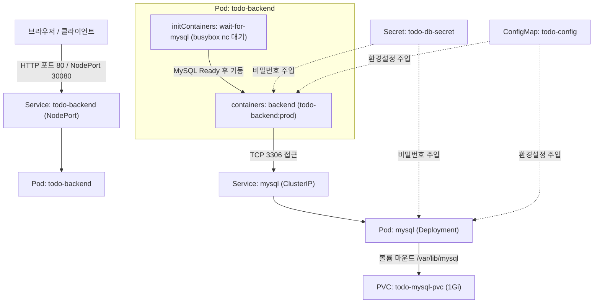

# 과제 1: Windows kind 멀티노드 클러스터 구축 및 Todo 앱 전개 보고서

**주의** : 아래, Kind 클러스터 이름, manifest 파일 이름 들은 강사의 개인 이름들이므로, 각자의 개인 이름으로 변경되어야 함.  

> **과제 목표**: Windows 환경에서 kind 멀티노드(Control-plane 1개, Worker 노드 2개) 클러스터를 `suntaechung-k8s` 이름으로 생성하고, `getting-started-todo-app`의 다단계(multi-stage) Dockerfile로부터 프로덕션 컨테이너 이미지를 빌드하여 적재한 후, 쿠버네티스 매니페스트(`deployment-suntaechung-kind.yml`)를 작성·배포하고 웹 브라우저를 통해 최종 동작을 검증합니다.

---

## 목차
1. [kind 를 Windows 에 설치](#1-kind-를-windows-에-설치)
2. [‘suntaechung-k8s' kind 멀티노드 클러스터 생성](#2-suntaechung-k8s-kind-멀티노드-클러스터-생성)
3. ['getting-started-todo' 프로젝트 Dockerfile 타겟(final) 빌드](#3-getting-started-todo-프로젝트-dockerfile-타겟final-빌드)
4. [생성된 컨테이너 이미지를 'todo-backend:prod' 로 태깅](#4-생성된-컨테이너-이미지를-todo-backendprod-로-태깅)
5. [생성된 컨테이너 이미지를 kind 클러스터 ‘suntaechung-k8s’ 에 적재](#5-생성된-컨테이너-이미지를-kind-클러스터-suntaechung-k8s-에-적재)
6. [컨테이너 이미지가 kind 클러스터에 적재된 것을 확인하는 방법](#6-컨테이너-이미지가-kind-클러스터에-적재된-것을-확인하는-방법)
7. ['deployment-suntaechung-kind.yml' 매니페스트 작성 및 구조 설명](#7-deployment-suntaechung-kindyml-매니페스트-작성-및-구조-설명)
8. [kubectl config 를 통한 'suntaechung-k8s' 클러스터 컨텍스트 설정 및 확인](#8-kubectl-config-를-통한-suntaechung-k8s-클러스터-컨텍스트-설정-및-확인)
9. [매니페스트 배포 및 Pod 2개, Service 2개 실행 상태 확인](#9-매니페스트-배포-및-pod-2개-service-2개-실행-상태-확인)
10. [웹 브라우저를 통한 서비스 접근 및 기능 동작 검증 (Port-Forwarding)](#10-웹-브라우저를-통한-서비스-접근-및-기능-동작-검증-port-forwarding)

---

## 1. kind 를 Windows 에 설치

`kind`(Kubernetes in Docker)는 로컬 Docker 컨테이너를 쿠버네티스 노드로 실행하여 가볍고 빠르게 로컬 K8s 클러스터를 구성할 수 있도록 지원하는 도구입니다.

### 1.1 설치 방법

#### 방법 A: 패키지 관리자(Winget / Chocolatey) 사용 (권장)
Windows PowerShell(관리자 권한)에서 다음 명령어 중 하나를 실행합니다.

```powershell
# Winget 사용 시
winget install Kubernetes.kind

# Chocolatey 사용 시
choco install kind
```

#### 방법 B: 바이너리 직접 다운로드 및 PATH 등록
PowerShell에서 공식 릴리스 바이너리를 다운로드하여 환경 변수 PATH에 등록된 경로에 배치합니다.

```powershell
# 1) 바이너리 저장 폴더 생성 (예: C:\k8s-tools)
New-Item -ItemType Directory -Force -Path "C:\k8s-tools"

# 2) kind 바이너리 다운로드
curl.exe -Lo "C:\k8s-tools\kind.exe" "https://kind.sigs.k8s.io/dl/v0.27.0/kind-windows-amd64"

# 3) 시스템 환경 변수 PATH에 디렉터리 추가
$env:Path += ";C:\k8s-tools"
[Environment]::SetEnvironmentVariable("Path", $env:Path + ";C:\k8s-tools", [EnvironmentVariableTarget]::User)
```

### 1.2 설치 확인
PowerShell 터미널을 열고 설치 버전과 도커 실행 상태를 확인합니다.

```powershell
kind --version
docker --version
```
* **정상 결과 예시**: `kind version 0.27.0` (또는 최신 버전)

---

## 2. ‘suntaechung-k8s' kind 멀티노드 클러스터 생성

과제 요구사항에 따라 **Control-plane 1개와 Worker 노드 2개**로 구성된 멀티노드 클러스터를 구성합니다.

### 2.1 멀티노드 클러스터 설정 파일 작성 (`kind-config.yaml`)
작업 디렉터리에 `kind-config.yaml`을 생성하고 다음과 같이 노드 역할을 정의합니다. (강의 실습 표준: Ingress 지원 라벨 및 포트포워딩 설정 포함)

```yaml
kind: Cluster
apiVersion: kind.x-k8s.io/v1alpha4
nodes:
# 1. Control Plane 마스터 노드 (표준 L7 Ingress 및 HTTP/HTTPS 포트 매핑)
- role: control-plane
  kubeadmConfigPatches:
  - |
    kind: InitConfiguration
    nodeRegistration:
      kubeletExtraArgs:
        node-labels: "ingress-ready=true"
  extraPortMappings:
  # HTTP 표준 포트: 호스트 PC 80번 ➔ NGINX Ingress Controller 수신 포트 80
  - containerPort: 80
    hostPort: 80
    protocol: TCP
  # HTTPS 보안 포트: 호스트 PC 443번 ➔ NGINX Ingress Controller 수신 포트 443
  - containerPort: 443
    hostPort: 443
    protocol: TCP
  # [참고: 과거 단일 NodePort 고정 방식 (비권장)]
  # - containerPort: 30080   # kind-service-np.yaml 전용 고정 포트 (다수 서비스 확장 불가)
  #   hostPort: 80
  #   protocol: TCP

# 2. Worker 노드 1
- role: worker

# 3. Worker 노드 2
- role: worker
```

> [!TIP]
> **포트 충돌(`port is already allocated`) 해결 안내**:
> 만약 기존에 생성한 다른 kind 클러스터(예: `my-k8s`)가 호스트의 80/443 포트를 이미 점유하고 있다면 새 클러스터 생성 시 포트 바인딩 에러가 발생합니다.
> 기존 클러스터를 삭제한 후 새로 생성하거나 점유 중인 컨테이너를 종료해야 합니다.
> ```powershell
> # 기존 실습 클러스터 삭제 (필요 시)
> kind delete cluster --name my-k8s
> ```

### 2.2 클러스터 생성 명령어 실행

```powershell
kind create cluster --name suntaechung-k8s --config kind-config.yaml
```

### 2.3 노드 구성 확인
3개의 노드가 모두 `Ready` 상태인지 확인합니다.

```powershell
kubectl get nodes -o wide
```

* **출력 예시**:
```text
NAME                           STATUS   ROLES           AGE   VERSION   INTERNAL-IP
suntaechung-k8s-control-plane   Ready    control-plane   1m    v1.32.0   172.18.0.4
suntaechung-k8s-worker          Ready    <none>          1m    v1.32.0   172.18.0.3
suntaechung-k8s-worker2         Ready    <none>          1m    v1.32.0   172.18.0.2
```

---

## 3. 'getting-started-todo' 프로젝트 Dockerfile 타겟(final) 빌드

프로젝트 루트의 `Dockerfile`은 다단계 빌드(Multi-stage build) 방식을 채택하고 있습니다.

### 3.1 Dockerfile 멀티스테이지 구조
* **`base`**: `node:22` 기본 환경 설정
* **`client-base` / `client-build`**: React/Vite 프론트엔드 종속성 설치 및 정적 빌드(`npm run build` -> `dist/`)
* **`backend-dev` / `test`**: 백엔드 소스 복사 및 단위 테스트(`npm run test`) 실행
* **`final`**: 프로덕션 타겟 단계. `test` 단계를 통과한 패키지 정의만 복사하여 운영 종속성(`npm ci --production`)만 설치하고, `client-build` 산출물을 정적 서빙 경로(`src/static`)로 통합하여 불필요한 개발 도구를 배제한 콤팩트한 프로덕션 이미지를 생성합니다.

### 3.2 타겟 `final` 빌드 명령어

```powershell
# getting-started-todo-app 디렉터리에서 실행
docker build --target final -t todo-backend:prod .
```

* `--target final`: Dockerfile의 마지막 스테이지인 `final`을 빌드 타겟으로 명시하여 클라이언트 빌드, 백엔드 테스트를 순서대로 거친 최종 산출물을 생성합니다.

---

## 4. 생성된 컨테이너 이미지를 'todo-backend:prod' 로 태깅

빌드 시 지정하지 않았거나 다른 태그명을 추가로 부여할 때 `docker tag` 명령어를 사용합니다.

### 4.1 이미지 태깅 명령어

```powershell
docker tag todo-backend:prod todo-backend:prod
```

### 4.2 로컬 Docker 이미지 목록 확인

```powershell
docker images | Select-String "todo-backend"
```

* **출력 예시**:
```text
todo-backend   prod      c7520bf2ce11   10 minutes ago   421MB
```

---

## 5. 생성된 컨테이너 이미지를 kind 클러스터 ‘suntaechung-k8s’ 에 적재

kind는 로컬 도커 컨테이너 내부에서 별도의 컨테이너 런타임(`containerd`)을 실행합니다. 따라서 호스트의 Docker 데몬에만 이미지가 존재하면 쿠버네티스가 이미지를 찾지 못하고 `ImagePullBackOff` 에러를 일으킵니다. 외부 레지스트리(Docker Hub 등)에 Push하지 않고 로컬 이미지를 직접 클러스터 노드로 복사하기 위해 `kind load` 명령어를 사용합니다.

### 5.1 이미지 적재 명령어

```powershell
kind load docker-image todo-backend:prod --name suntaechung-k8s
```

* 내부적으로 호스트 도커에서 `todo-backend:prod` 이미지를 tar 스트림으로 추출하여 `suntaechung-k8s`의 control-plane 및 worker 노드들의 containerd 네임스페이스(`k8s.io`)로 전송합니다.

---

## 6. 컨테이너 이미지가 kind 클러스터에 적재된 것을 확인하는 방법

kind 노드는 Docker 컨테이너 형태로 실행되고 있으므로, `docker exec`를 통해 노드 내부로 진입하여 쿠버네티스 CRI(Container Runtime Interface) CLI 도구인 `crictl`을 실행하면 이미지가 정상 적재되었는지 확인할 수 있습니다.

### 6.1 노드 내부 컨테이너 이미지 목록 조회 명령어

```powershell
# 1) worker 노드에 적재된 이미지 확인
docker exec -it suntaechung-k8s-worker crictl images

# 2) worker2 노드에 적재된 이미지 확인
docker exec -it suntaechung-k8s-worker2 crictl images

# 3) PowerShell에서 특정 이미지 필터링 조회
docker exec -it suntaechung-k8s-worker crictl images | Select-String "todo-backend"
```

* **출력 예시**:
```text
IMAGE                                      TAG                  IMAGE ID            SIZE
docker.io/library/todo-backend             prod                 c7520bf2ce111       421MB
```
> 노드 내부 `crictl images` 출력에서 `docker.io/library/todo-backend:prod`가 정상적으로 표시되면 파드 기동 시 로컬 노드에서 이미지를 즉시 가져올 수 있습니다.

---

## 7. 'deployment-suntaechung-kind.yml' 매니페스트 작성 및 구조 설명

`deployment-kind.yaml`을 복사하여 작성한 [deployment-suntaechung-kind.yml](file:///d:/Lecture%20Notes/2026-2CloudComputing/practices/05week/getting-started-todo-app/deployment-suntaechung-kind.yml) 파일은 Todo 애플리케이션의 데이터 영속성, 보안, 가용성을 위해 7개의 핵심 K8s 리소스로 구성되어 있습니다.

### 7.1 매니페스트 전체 구조도



### 7.2 리소스별 세부 명세 설명

#### ① `Secret (todo-db-secret)`
* **역할**: 데이터베이스 루트 패스워드 및 접속 패스워드(`MYSQL_ROOT_PASSWORD`, `MYSQL_PASSWORD`)를 암호화 보관하여 Pod 환경 변수로 안전하게 주입합니다.

#### ② `ConfigMap (todo-config)`
* **역할**: 비민감 설정값인 `MYSQL_HOST: "mysql"`, `MYSQL_USER: "root"`, `MYSQL_DB: "todos"`, `PORT: "3000"`을 중앙에서 관리합니다.

#### ③ `PersistentVolumeClaim (todo-mysql-pvc)`
* **역할**: MySQL 데이터 파일(`/var/lib/mysql`)의 영속성을 보장하기 위해 1Gi 크기의 스토리지를 요청합니다. Pod가 재생성되거나 다른 노드로 재스케줄링되어도 Todo 데이터가 보존됩니다.

#### ④ `Deployment (mysql)`
* **역할**: MySQL 9.3(또는 8.0) 데이터베이스 파드를 단일 인스턴스(`replicas: 1`)로 배포합니다.
* **배포 전략**: 볼륨 충돌을 방지하기 위해 `strategy.type: Recreate`로 설정되어 기존 Pod 종료 후 새 Pod가 실행됩니다.
* **프로브**: `mysqladmin ping` 명령어로 Readiness 및 Liveness 헬스체크를 수행합니다.

#### ⑤ `Service (mysql)`
* **역할**: `type: ClusterIP`로 지정하여 클러스터 내부에서만 고정 DNS 이름(`mysql:3306`)으로 접속할 수 있도록 서비스 엔드포인트를 노출합니다.

#### ⑥ `Deployment (todo-backend)`
* **역할**: 프론트엔드 정적 파일 서빙과 백엔드 REST API를 통합 서비스하는 애플리케이션 파드입니다.
* **`imagePullPolicy: IfNotPresent`**: 앞서 `kind load`로 노드에 주입한 로컬 이미지를 우선 사용하도록 보장합니다.
* **`initContainers (wait-for-mysql)`**:
  ```yaml
  initContainers:
    - name: wait-for-mysql
      image: busybox:1.36
      command: ['sh', '-c', 'until nc -z -v -w3 mysql 3306; do sleep 2; done;']
  ```
  MySQL 데이터베이스가 포트 3306으로 완전히 수신 대기 상태가 될 때까지 백엔드 컨테이너 기동을 안전하게 지연시켜 CrashLoopBackOff 에러를 방지합니다.
* **헬스체크 프로브**: `/api/items` 엔드포인트를 정기 조회하여 정상 동작 여부를 모니터링합니다.

#### ⑦ `Service (todo-backend)`
* **역할**: `type: NodePort`로 설정하여 외부 트래픽을 파드로 라우팅합니다. 외부 포트 `80`을 타깃 컨테이너 포트 `3000`에 매핑하며, `nodePort: 30080`을 함께 지정하여 호스트 포트 접근도 지원합니다.

---

## 8. kubectl config 를 통한 'suntaechung-k8s' 클러스터 컨텍스트 설정 및 확인

`kubectl` 명령어가 여러 클러스터 중 방금 생성한 `suntaechung-k8s` 클러스터를 정확히 바라보도록 컨텍스트를 조회하고 설정합니다.

### 8.1 등록된 Kubeconfig 컨텍스트 목록 조회

```powershell
kubectl config get-contexts
```

* **출력 예시**:
```text
CURRENT   NAME                   CLUSTER                AUTHINFO               NAMESPACE
*         kind-suntaechung-k8s   kind-suntaechung-k8s   kind-suntaechung-k8s   
          kind-my-k8s            kind-my-k8s            kind-my-k8s            
```
> `CURRENT` 열에 `*`가 붙어 있는 컨텍스트가 현재 활성화된 클러스터입니다.

### 8.2 현재 활성 컨텍스트 확인

```powershell
kubectl config current-context
```
* **결과**: `kind-suntaechung-k8s`

### 8.3 컨텍스트 변경 (필요 시)
만약 다른 클러스터가 활성화되어 있는 경우 아래 명령어로 전환합니다.

```powershell
kubectl config use-context kind-suntaechung-k8s
```

### 8.4 클러스터 통신 상태 최종 확인

```powershell
kubectl cluster-info
```

---

## 9. 매니페스트 배포 및 Pod 2개, Service 2개 실행 상태 확인

### 9.1 매니페스트 적용 명령어

```powershell
kubectl apply -f deployment-suntaechung-kind.yml
```

* **출력 예시**:
```text
secret/todo-db-secret created
configmap/todo-config created
persistentvolumeclaim/todo-mysql-pvc created
deployment.apps/mysql created
service/mysql created
deployment.apps/todo-backend created
service/todo-backend created
```

---

### 9.2 Pod 및 Service 실행 상태 확인

```powershell
kubectl get pods,svc,pvc -o wide
```

* **출력 예시**:
```text
NAME                                READY   STATUS    RESTARTS   AGE   IP           NODE                      NOMINATED NODE   READINESS GATES
pod/mysql-754bc4f9b8-x9p2q          1/1     Running   0          50s   10.244.1.2   suntaechung-k8s-worker    <none>           <none>
pod/todo-backend-56f8fbbd4-kz7m8    1/1     Running   0          30s   10.244.2.2   suntaechung-k8s-worker2   <none>           <none>

NAME                   TYPE        CLUSTER-IP      EXTERNAL-IP   PORT(S)        AGE   SELECTOR
service/kubernetes     ClusterIP   10.96.0.1       <none>        443/TCP        10m   <none>
service/mysql          ClusterIP   10.96.120.45    <none>        3306/TCP       50s   app=mysql
service/todo-backend   NodePort    10.96.210.88    <none>        80:30080/TCP   50s   app=todo-backend

NAME                                   STATUS   VOLUME                                     CAPACITY   ACCESS MODES   STORAGECLASS   AGE
persistentvolumeclaim/todo-mysql-pvc   Bound    pvc-12345678-abcd-ef01-2345-6789abcdef01   1Gi        RWO            standard       50s
```

### 9.3 Pod 및 Service 이름 분석
1. **Pod (2개)**:
   * **`mysql-754bc4f9b8-x9p2q`**: MySQL DB 파드 (Deployment 이름 + ReplicaSet 해시 + Pod 고유 해시)
   * **`todo-backend-56f8fbbd4-kz7m8`**: 웹/API 통합 백엔드 파드
   * 두 파드가 서로 다른 워커 노드(`suntaechung-k8s-worker`, `suntaechung-k8s-worker2`)에 균등하게 분산 스케줄링되었음을 확인합니다.
2. **Service (2개 + 기본 K8s 서비스 1개)**:
   * **`mysql`**: 클러스터 내부용 `ClusterIP` (3306/TCP)
   * **`todo-backend`**: 외부 공개용 `NodePort` (80:30080/TCP)

---

## 10. 웹 브라우저를 통한 서비스 접근 및 기능 동작 검증 (Port-Forwarding)

### 10.1 `kubectl port-forward`를 통한 서비스 포워딩

로컬 개발 PC의 웹 브라우저에서 클러스터 내부의 Service로 트래픽을 안전하게 중계하기 위해 포트포워딩을 실행합니다.

```powershell
kubectl port-forward svc/todo-backend 80:80
```

> **포트 충돌 시 팁**: 만약 Windows 호스트에서 IIS, Skype, 기타 로컬 웹 서버가 이미 80 포트를 사용 중인 경우(`bind: address already in use`), 호스트 포트를 `3000`번으로 변경하여 포워딩할 수 있습니다.
> ```powershell
> kubectl port-forward svc/todo-backend 3000:80
> ```

---

### 10.2 웹 브라우저 접속 및 기능 동작 테스트

1. **브라우저 접속**:
   * 포트포워딩 `80:80` 실행 시: `http://localhost`
   * 포트포워딩 `3000:80` 실행 시: `http://localhost:3000`
   * kind의 NodePort 매핑 사용 시: `http://localhost:30080`

2. **기능 검증 시나리오**:
   * **할 일 등록**: 입력창에 `클라우드컴퓨팅 5주차 과제 수행`, `K8s kind 멀티노드 클러스터 구축` 등의 항목을 추가합니다.
   * **상태 변경**: 완료 체크박스를 클릭하여 상태를 업데이트합니다.
   * **데이터 영속성 테스트**: 브라우저를 새로고침(`F5`)하거나 파드를 재시작해도 MySQL PVC에 저장된 할 일 데이터가 그대로 유지되는 것을 확인합니다.

---

## 요약: 과제 제출 압축 파일 구성 안내 (`학번-이름-5week1.zip`)

| 순번 | 파일명 | 설명 |
| :--- | :--- | :--- |
| 1 | **`deployment-suntaechung-kind.yml`** | 과제 요건에 맞게 작성된 K8s 통합 배포 매니페스트 |
| 2 | **`hw5-1.pdf`** | 본 마크다운 문서를 기반으로 1)~10) 전개 과정 및 명령어/설명을 정리한 PDF 보고서 |
| 3 | **결과 화면 캡처 파일 (이미지)** | <ul><li>`kubectl get nodes -o wide` (워커노드 2개 확인)</li><li>`crictl images` 또는 `kind load` 적재 화면</li><li>`kubectl get all,pvc -o wide` (Pod 2개, Service 2개 정상 상태)</li><li>웹 브라우저 접속 및 Todo 등록 완료 화면</li></ul> |
