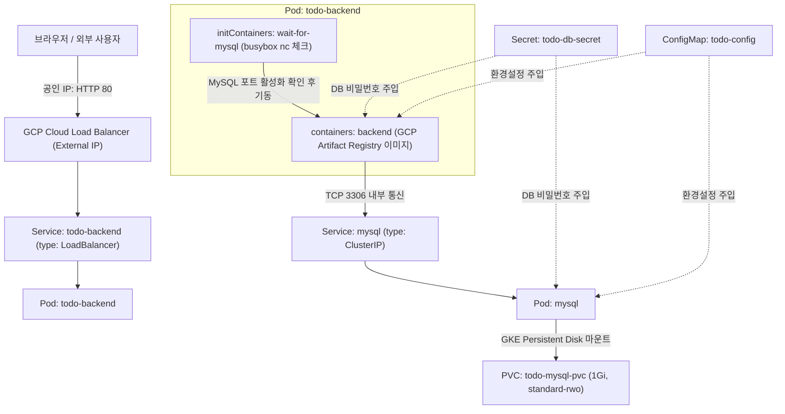

# 과제 2: Google Kubernetes Engine (GKE) 멀티노드 클러스터 구축 및 Todo 앱 전개 보고서

**주의** : 아래, GCP Project ID, GKE 클러스터 이름, GCP Artifact Registry 저장소 이름 등은 강사의 개인 GCP Project ID, GKE 클러스터 이름, GCP Artifact Registry 이름이므로 각자의 개인 계정 및 이름으로 변경되어야 함.  

> **과제 목표**: Google Cloud Platform(GCP) 환경에서 Google Kubernetes Engine(GKE) 멀티노드(워커 노드 2개) 클러스터를 `suntaechung-k8s-cluster` 이름으로 생성하고, `getting-started-todo-app`의 다단계 Dockerfile로부터 빌드한 컨테이너 이미지를 GCP Artifact Registry(`suntaechung-repo`)에 푸시한 후, 클라우드 환경에 최적화된 매니페스트(`deployment-suntaechung-gke.yml`)를 작성·배포하여 LoadBalancer 외부 공인 IP를 통해 웹 브라우저에서 최종 동작을 검증합니다.

---

## 📌 실습 환경 및 GCP 기본 설정 파라미터

| 구분 | 설정 파라미터 / 리소스명 | 비고 |
| :--- | :--- | :--- |
| **GCP Project ID** | `ssu-agent-vertex-509708` | 콘솔 프로젝트 식별자 |
| **Region (Location)** | `asia-northeast3` | 대한민국 서울 리전 |
| **Zone** | `asia-northeast3-a` | 서울 리전 a 영역 |
| **Artifact Registry** | `suntaechung-repo` | Docker 형식 저장소 (소문자, 숫자, 하이픈 규격) |
| **GKE Cluster Name** | `suntaechung-k8s-cluster` | 워커 노드 2개 클러스터 |
| **Container Image** | `asia-northeast3-docker.pkg.dev/ssu-agent-vertex-509708/suntaechung-repo/todo-backend:prod` | Artifact Registry 원격 이미지 URI |
| **Manifest File** | `deployment-suntaechung-gke.yml` | GKE 전용 K8s 매니페스트 |

> [!NOTE]
> **Artifact Registry 이름 명명 규칙 안내**:
> GCP Artifact Registry 저장소 ID는 영문 소문자, 숫자, 하이픈(`-`)만 지원하며 마침표(`.`)는 사용할 수 없습니다. GCP 표준 규격에 부합하는 `suntaechung-repo`를 저장소 이름으로 채택합니다.

---

## 목차
1. [Google Cloud SDK (gcloud CLI) 및 kubectl 설치](#1-google-cloud-sdk-gcloud-cli-및-kubectl-설치)
2. [gcloud CLI 로그인 인증 및 기본 프로젝트/리전 설정](#2-gcloud-cli-로그인-인증-및-기본-프로젝트리전-설정)
3. [필수 GCP API 활성화 (GKE 및 Artifact Registry)](#3-필수-gcp-api-활성화-gke-및-artifact-registry)
4. [GCP Artifact Registry 저장소 생성](#4-gcp-artifact-registry-저장소-생성)
5. [Docker의 GCP Artifact Registry 인증 설정](#5-docker의-gcp-artifact-registry-인증-설정)
6. ['getting-started-todo' 컨테이너 이미지 빌드 및 태깅](#6-getting-started-todo-컨테이너-이미지-빌드-및-태깅)
7. [컨테이너 이미지를 GCP Artifact Registry에 Push](#7-컨테이너-이미지를-gcp-artifact-registry에-push)
8. [GKE 멀티노드(워커 노드 2개) 클러스터 생성](#8-gke-멀티노드워커-노드-2개-클러스터-생성)
9. [GKE 클러스터 자격증명(kubeconfig) 연동 및 노드 상태 확인](#9-gke-클러스터-자격증명kubeconfig-연동-및-노드-상태-확인)
10. ['deployment-suntaechung-gke.yml' 매니페스트 작성 및 구조 설명](#10-deployment-suntaechung-gkeyml-매니페스트-작성-및-구조-설명)
11. [GKE 매니페스트 배포 및 Pod, Service, PVC 실행 상태 확인](#11-gke-매니페스트-배포-및-pod-service-pvc-실행-상태-확인)
12. [LoadBalancer External IP를 통한 웹 브라우저 접속 및 기능 동작 검증](#12-loadbalancer-external-ip를-통한-웹-브라우저-접속-및-기능-동작-검증)
13. [실습 종료 후 클라우드 리소스 정리 (비용 발생 방지)](#13-실습-종료-후-클라우드-리소스-정리-비용-발생-방지)

---

## 1. Google Cloud SDK (gcloud CLI) 및 kubectl 설치

GCP 자원을 제어하고 GKE 클러스터와 통신하기 위해 Google Cloud SDK(`gcloud`)와 쿠버네티스 명령줄 도구(`kubectl`), 그리고 GKE 인증 플러그인(`gke-gcloud-auth-plugin`)이 필요합니다.

### 1.1 gcloud CLI 설치
- **공식 웹 설치**: [Google Cloud CLI 공식 다운로드 페이지](https://cloud.google.com/sdk/docs/install)에서 Windows용 설치 프로그램(`GoogleCloudSDKInstaller.exe`)을 다운로드하여 실행합니다.
- **PowerShell (Windows Winget)**:
  ```powershell
  winget install Google.CloudSDK
  ```
- **Bash (Linux Ubuntu/Debian)**:
  ```bash
  sudo apt-get update && sudo apt-get install apt-transport-https ca-certificates gnupg curl
  curl https://packages.cloud.google.com/apt/doc/apt-key.gpg | sudo gpg --dearmor -o /usr/share/keyrings/cloud.google.gpg
  echo "deb [signed-by=/usr/share/keyrings/cloud.google.gpg] https://packages.cloud.google.com/apt cloud-sdk main" | sudo tee -a /etc/apt/sources.list.d/google-cloud-sdk.list
  sudo apt-get update && sudo apt-get install google-cloud-cli
  ```

### 1.2 kubectl 및 GKE 인증 플러그인 설치
`gcloud` 컴포넌트 관리자를 통해 `kubectl`과 GKE 인증에 필수적인 `gke-gcloud-auth-plugin`을 설치합니다.

```powershell
gcloud components install kubectl gke-gcloud-auth-plugin
```

### 1.3 설치 확인
```powershell
gcloud version
kubectl version --client
```
* **정상 결과 예시**:
  ```text
  Google Cloud SDK 591.0.0
  beta 2026.10.26
  bq 2.1.41
  cloud-run-proxy 0.5.2
  core 2026.10.26
  gcloud-crc32c 1.0.0
  gke-gcloud-auth-plugin 0.5.20
  gsutil 5.38
  kubectl 1.35.3
  ```

---

## 2. gcloud CLI 로그인 인증 및 기본 프로젝트/리전 설정

`gcloud` 도구가 사용자의 Google 계정 및 과제용 프로젝트에 접근할 수 있도록 인증을 수행하고 기본값을 설정합니다.

### 2.1 Google 계정 로그인
```powershell
gcloud auth login
```
* 웹 브라우저가 자동으로 열리며, GCP 과제 프로젝트의 권한이 있는 Google 계정으로 로그인하고 액세스를 승인합니다.

### 2.2 기본 프로젝트(Project ID) 설정
과제에서 지정된 프로젝트 ID인 `ssu-agent-vertex-509708`로 기본 작업 대상을 설정합니다.

```powershell
gcloud config set project ssu-agent-vertex-509708
```

### 2.3 기본 리전(Region) 및 영역(Zone) 설정
```powershell
# 리전 설정: asia-northeast3 (서울)
gcloud config set compute/region asia-northeast3

# 영역 설정: asia-northeast3-a
gcloud config set compute/zone asia-northeast3-a
```

### 2.4 설정 정보 확인
```powershell
gcloud config list
```
* **출력 예시**:
  ```text
  [compute]
  region = asia-northeast3
  zone = asia-northeast3-a
  [core]
  account = ssu.cloud.agent@gmail.com
  project = ssu-agent-vertex-509708
  ```

---

## 3. 필수 GCP API 활성화 (GKE 및 Artifact Registry)

새로운 GCP 프로젝트에서 쿠버네티스 엔진(GKE)과 아티팩트 레지스트리(Artifact Registry)를 사용하기 위해 관련 API 서비스를 활성화해야 합니다.

### 3.1 서비스 API 활성화 명령어
```powershell
gcloud services enable container.googleapis.com artifactregistry.googleapis.com
```

* `container.googleapis.com`: Google Kubernetes Engine API
* `artifactregistry.googleapis.com`: Artifact Registry API

### 3.2 활성화 상태 확인

#### PowerShell
```powershell
gcloud services list --enabled | Select-String "container|artifactregistry"
```

#### Bash
```bash
gcloud services list --enabled | grep -E "container|artifactregistry"
```
* **출력 예시**:
  ```text
  artifactregistry.googleapis.com  Artifact Registry API
  container.googleapis.com         Kubernetes Engine API
  ```

---

## 4. GCP Artifact Registry 저장소 생성

과제 요구사항에 맞춰 도커 컨테이너 이미지를 저장할 Artifact Registry 저장소를 서울 리전(`asia-northeast3`)에 생성합니다.

### 4.1 저장소 생성 명령어

#### PowerShell
```powershell
gcloud artifacts repositories create suntaechung-repo `
    --repository-format=docker `
    --location=asia-northeast3 `
    --description="Cloud Computing HW5-2 Docker Repository"
```

#### Bash
```bash
gcloud artifacts repositories create suntaechung-repo \
    --repository-format=docker \
    --location=asia-northeast3 \
    --description="Cloud Computing HW5-2 Docker Repository"
```

### 4.2 생성된 저장소 확인
```powershell
gcloud artifacts repositories list --location=asia-northeast3
```
* **출력 예시**:
  ```text
  REPOSITORY        FORMAT  MODE                 LOCATION          DESCRIPTION
  suntaechung-repo  DOCKER  STANDARD_REPOSITORY  asia-northeast3   Cloud Computing HW5-2 Docker Repository
  ```

---

## 5. Docker의 GCP Artifact Registry 인증 설정

로컬 도커 데몬(`docker push`, `docker pull`)이 GCP Artifact Registry에 안전하게 접근할 수 있도록 `gcloud` 자격 증명 헬퍼(Credential Helper)를 Docker 구성 파일에 등록합니다.

### 5.1 Docker 자격 증명 헬퍼 등록
```powershell
gcloud auth configure-docker asia-northeast3-docker.pkg.dev
```

* 실행 시 로컬의 `~/.docker/config.json`에 `asia-northeast3-docker.pkg.dev` 레지스트리 엔드포인트에 대한 gcloud 인증 헬퍼가 자동 추가됩니다.
* **출력 메시지**: `Docker configuration file updated.`

---

## 6. 'getting-started-todo' 컨테이너 이미지 빌드 및 태깅

프로젝트 루트의 멀티스테이지 `Dockerfile`에서 프로덕션 타깃인 `final` 스테이지를 빌드하고, Artifact Registry 주소에 맞게 태깅합니다.

### 6.1 프로덕션 이미지 빌드 (`final` 타깃)
```powershell
# getting-started-todo-app 디렉터리에서 실행
docker build --target final -t todo-backend:prod .
```

### 6.2 Artifact Registry 전용 URI로 이미지 태깅
GCP Artifact Registry의 표준 이미지 URL 구조는 다음과 같습니다:
`[REGION]-docker.pkg.dev/[PROJECT_ID]/[REPOSITORY_NAME]/[IMAGE_NAME]:[TAG]`

```powershell
docker tag todo-backend:prod asia-northeast3-docker.pkg.dev/ssu-agent-vertex-509708/suntaechung-repo/todo-backend:prod
```

### 6.3 로컬 이미지 태그 목록 확인

#### PowerShell
```powershell
docker images | Select-String "suntaechung-repo"
```

#### Bash
```bash
docker images | grep "suntaechung-repo"
```
* **출력 예시**:
  ```text
  asia-northeast3-docker.pkg.dev/ssu-agent-vertex-509708/suntaechung-repo/todo-backend   prod   c7520bf2ce11   15 minutes ago   421MB
  ```

---

## 7. 컨테이너 이미지를 GCP Artifact Registry에 Push

태깅된 컨테이너 이미지를 GCP Artifact Registry 원격 저장소로 업로드합니다.

### 7.1 Docker Push 실행
```powershell
docker push asia-northeast3-docker.pkg.dev/ssu-agent-vertex-509708/suntaechung-repo/todo-backend:prod
```

* 각 레이어가 `asia-northeast3-docker.pkg.dev`로 업로드되며, 업로드가 완료되면 이미지 다이제스트(`sha256:...`)가 출력됩니다.

### 7.2 Artifact Registry 저장소의 이미지 확인
```powershell
gcloud artifacts docker images list asia-northeast3-docker.pkg.dev/ssu-agent-vertex-509708/suntaechung-repo
```
* **출력 예시**:
  ```text
  IMAGE                                                                          DIGEST       CREATE_TIME          UPDATE_TIME
  asia-northeast3-docker.pkg.dev/ssu-agent-vertex-509708/suntaechung-repo/todo-backend  sha256:...   2026-11-10T03:20:00  2026-11-10T03:20:00
  ```

---

## 8. GKE 멀티노드(워커 노드 2개) 클러스터 생성

과제 요구사항에 따라 클러스터 이름을 본인 이름으로 하여 `suntaechung-k8s-cluster`로 지정하고, **워커 노드 2개(`--num-nodes=2`)**를 갖는 GKE 표준(Standard) 클러스터를 생성합니다.

### 8.1 GKE 클러스터 생성 명령어

#### PowerShell
```powershell
gcloud container clusters create suntaechung-k8s-cluster `
    --zone asia-northeast3-a `
    --num-nodes 2 `
    --machine-type e2-medium `
    --disk-size 30GB `
    --release-channel regular
```

#### Bash
```bash
gcloud container clusters create suntaechung-k8s-cluster \
    --zone asia-northeast3-a \
    --num-nodes 2 \
    --machine-type e2-medium \
    --disk-size 30GB \
    --release-channel regular
```

* `--zone asia-northeast3-a`: 단일 존 클러스터 생성 (노드 수 총 2개)
* `--num-nodes 2`: 존당 워커 노드 2개 프로비저닝
* `--machine-type e2-medium`: 실습용 범용 VM (2 vCPU, 4GB RAM)
* `--disk-size 30GB`: 각 노드의 부팅 디스크 크기

> [!NOTE]
> 클러스터 프로비저닝에는 보통 3~5분 정도 소요됩니다. 완료 시 `status: RUNNING` 메시지가 표시됩니다.

---

## 9. GKE 클러스터 자격증명(kubeconfig) 연동 및 노드 상태 확인

생성된 GKE 클러스터를 로컬 `kubectl` 도구와 연결하기 위해 인증 자격 증명을 다운로드합니다.

### 9.1 kubeconfig 자격증명 획득

#### PowerShell
```powershell
gcloud container clusters get-credentials suntaechung-k8s-cluster `
    --zone asia-northeast3-a `
    --project ssu-agent-vertex-509708
```

#### Bash
```bash
gcloud container clusters get-credentials suntaechung-k8s-cluster \
    --zone asia-northeast3-a \
    --project ssu-agent-vertex-509708
```

### 9.2 현재 컨텍스트 확인
```powershell
kubectl config current-context
```
* **출력 예시**: `gke_ssu-agent-vertex-509708_asia-northeast3-a_suntaechung-k8s-cluster`

### 9.3 노드 2개 정상 작동 상태(Ready) 확인
```powershell
kubectl get nodes -o wide
```
* **출력 예시**:
  ```text
  NAME                                                  STATUS   ROLES    AGE   VERSION               INTERNAL-IP     EXTERNAL-IP    OS-IMAGE
  gke-suntaechung-k8s-clus-default-pool-9fb19c75-3f5c   Ready    <none>   8h    v1.36.4-gke.2377000   10.178.0.4      34.47.121.94   Container-Optimized OS from Google
  gke-suntaechung-k8s-clus-default-pool-9fb19c75-wvwm   Ready    <none>   8h    v1.36.4-gke.2377000   10.178.15.232   34.50.44.88    Container-Optimized OS from Google
  ```
  > 워커 노드 2개가 모두 `Ready` 상태임을 확인합니다.

---

## 10. 'deployment-suntaechung-gke.yml' 매니페스트 작성 및 구조 설명

`deployment-gke.yaml`을 기반으로 과제 파라미터를 적용하여 작성한 [deployment-suntaechung-gke.yml](file:///d:/Lecture%20Notes/2026-2CloudComputing/practices/05week/getting-started-todo-app/deployment-suntaechung-gke.yml) 파일은 GKE 환경에 최적화된 7개의 K8s 리소스로 구성되어 있습니다.

### 10.1 매니페스트 전체 아키텍처 다이어그램



### 10.2 리소스별 세부 명세 및 kind 대비 GKE 차이점

| 순번 | 리소스 종류 | 이름 | GKE 환경에서의 특성 및 kind 대비 주요 차이점 |
| :---: | :--- | :--- | :--- |
| **①** | **Secret** | `todo-db-secret` | DB 암호(`MYSQL_ROOT_PASSWORD`, `MYSQL_PASSWORD`)를 Base64/Opaque 방식으로 안전하게 주입 |
| **②** | **ConfigMap** | `todo-config` | `MYSQL_HOST("mysql")`, `MYSQL_DB("todos")`, `PORT("3000")` 비민감 환경변수 관리 |
| **③** | **PersistentVolumeClaim** | `todo-mysql-pvc` | GKE의 기본 CSI 드라이버(`standard-rwo`)와 연동되어 **Google Compute Engine Persistent Disk(영구 디스크)**가 동적 프로비저닝(Dynamic Provisioning)됨 |
| **④** | **Deployment** | `mysql` | MySQL 9.3 컨테이너를 단일 파드로 실행하며, 데이터 무결성을 위해 `Recreate` 롤아웃 전략 사용 |
| **⑤** | **Service** | `mysql` | 클러스터 내부 통신 전용 `ClusterIP` (포트 3306). 외부 노출 방지 |
| **⑥** | **Deployment** | `todo-backend` | **Artifact Registry 원격 이미지**(`asia-northeast3-docker.pkg.dev/...`) 지정 및 `imagePullPolicy: Always` 적용. `initContainers`로 MySQL 준비 완료를 능동적으로 대기 |
| **⑦** | **Service** | `todo-backend` | **`type: LoadBalancer`** 지정. GKE가 Google Cloud의 외부 TCP 부하분산기를 자동 생성하고 **실제 공인 IP(External IP)**를 할당 |

### 10.3 매니페스트 핵심 설정 코드 발췌

```yaml
# Backend 배포 정의 중 컨테이너 이미지 경로
      containers:
        - name: backend
          image: asia-northeast3-docker.pkg.dev/ssu-agent-vertex-509708/suntaechung-repo/todo-backend:prod
          imagePullPolicy: Always
          ports:
            - containerPort: 3000
              name: http
```

```yaml
# 외부 서비스 노출 정의 (LoadBalancer)
apiVersion: v1
kind: Service
metadata:
  name: todo-backend
spec:
  type: LoadBalancer
  selector:
    app: todo-backend
  ports:
    - name: http
      port: 80
      targetPort: 3000
```

---

## 11. GKE 매니페스트 배포 및 Pod, Service, PVC 실행 상태 확인

작성한 매니페스트를 GKE 클러스터에 배포하고 모든 리소스가 정상 상태인지 확인합니다.

### 11.1 매니페스트 배포 명령어
```powershell
kubectl apply -f deployment-suntaechung-gke.yml
```

* **출력 예시**:
  ```text
  secret/todo-db-secret created
  configmap/todo-config created
  persistentvolumeclaim/todo-mysql-pvc created
  deployment.apps/mysql created
  service/mysql created
  deployment.apps/todo-backend created
  service/todo-backend created
  ```

---

### 11.2 Pod, Service, PVC 상태 전체 조회
```powershell
kubectl get pods,svc,pvc -o wide
```

* **출력 예시**:
  ```text
  NAME                                READY   STATUS    RESTARTS   AGE   IP          NODE                                                  NOMINATED NODE   READINESS GATES
  pod/mysql-69d94599d8-7tn5f          1/1     Running   0          8h    10.80.0.6   gke-suntaechung-k8s-clus-default-pool-9fb19c75-3f5c   <none>           <none>
  pod/todo-backend-5fc7b56947-gsfts   1/1     Running   0          8h    10.80.0.5   gke-suntaechung-k8s-clus-default-pool-9fb19c75-3f5c   <none>           <none>

  NAME                   TYPE           CLUSTER-IP       EXTERNAL-IP   PORT(S)        AGE   SELECTOR
  service/kubernetes     ClusterIP      34.118.224.1     <none>        443/TCP        8h    <none>
  service/mysql          ClusterIP      34.118.227.251   <none>        3306/TCP       8h    app=mysql
  service/todo-backend   LoadBalancer   34.118.226.219   34.47.82.7    80:32654/TCP   8h    app=todo-backend

  NAME                                   STATUS   VOLUME                                     CAPACITY   ACCESS MODES   STORAGECLASS   VOLUMEATTRIBUTESCLASS   AGE   VOLUMEMODE
  persistentvolumeclaim/todo-mysql-pvc   Bound    pvc-67b5e155-8b97-4c43-9607-b3c7856f67ba   1Gi        RWO            standard-rwo   <unset>                 8h    Filesystem
  ```

> [!IMPORTANT]
> **External IP 생성 대기**:
> Service 생성 직후에는 `EXTERNAL-IP`가 `<pending>`으로 표시될 수 있습니다. GCP의 네트워크 부하분산기(Network Load Balancer)가 프로비저닝되는 데 약 1~2분이 소요되며, 완료 후 실제 공인 IP(예: `34.47.82.7`)가 할당됩니다.

---

### 11.3 Pod, Service 및 PVC 리소스 세부 분석

1. **Pod 실행 상태 (2개)**:
   * **`mysql-69d94599d8-7tn5f`**: 상태 `1/1 Running`, 가상 IP `10.80.0.6`. MySQL 9.3 컨테이너가 정상 구동 중입니다.
   * **`todo-backend-5fc7b56947-gsfts`**: 상태 `1/1 Running`, 가상 IP `10.80.0.5`. `wait-for-mysql` 초기화 컨테이너가 DB 통신을 확인한 후 백엔드 웹 애플리케이션 컨테이너가 성공적으로 기동되었습니다.
2. **Service 노출 상태 (2개 + 기본 K8s 클러스터 IP 1개)**:
   * **`mysql`**: `ClusterIP` 타입(`34.118.227.251:3306`), 클러스터 내부에서만 안전하게 접근 가능합니다.
   * **`todo-backend`**: `LoadBalancer` 타입. 외부 공인 IP **`34.47.82.7`**이 GCP Cloud Load Balancing을 통해 자동 할당되어 인터넷에서 포트 80으로 직접 서비스에 접속할 수 있습니다.
3. **PVC 스토리지 바인딩 상태 (1개)**:
   * **`todo-mysql-pvc`**: 상태 `Bound`. GKE의 Persistent Disk 드라이버(`standard-rwo`)를 통해 1Gi 볼륨(`pvc-67b5e155-...`)이 동적으로 프로비저닝되어 MySQL 파드에 안정적으로 마운트되었습니다.

---

## 12. LoadBalancer External IP를 통한 웹 브라우저 접속 및 기능 동작 검증

GKE의 LoadBalancer 서비스를 통해 공인 IP가 할당되었으므로, 별도의 포트포워딩 없이 브라우저에서 인터넷을 통해 곧바로 Todo 애플리케이션에 접속할 수 있습니다.

### 12.1 웹 브라우저 접속
1. 웹 브라우저 주소창에 Service의 `EXTERNAL-IP`를 입력합니다.
   - 예시: `http://34.47.82.7` (표준 HTTP 80번 포트이므로 포트 번호 생략 가능)

### 12.2 기능 동작 및 데이터 영속성 검증
1. **Todo 항목 등록**:
   - `GKE 멀티노드 클러스터 구축 완료`
   - `Artifact Registry 연동 이미지 배포 성공`
   - `GCP Cloud Load Balancer 연동 확인`
2. **완료 상태 체크**:
   - 체크박스를 클릭하여 상태가 실시간으로 변경되는지 확인
3. **데이터 영속성(Persistence) 검증**:
   - 브라우저를 새로고침(`F5`)하거나 다른 PC/모바일 브라우저에서 동일한 External IP로 접속해도 등록된 Todo 리스트가 그대로 유지되는 것을 확인합니다. 이는 GKE의 Persistent Volume(`standard-rwo`)에 MySQL 데이터가 안전하게 저장되어 있기 때문입니다.

---

## 13. 실습 종료 후 클라우드 리소스 정리 (비용 발생 방지)

실습 및 과제 제출용 캡처가 모두 완료된 후에는 지속적인 클라우드 요금 청구를 방지하기 위해 사용한 리소스를 반드시 삭제해야 합니다.

### 13.1 배포된 K8s 애플리케이션 및 부하분산기(LoadBalancer) 삭제
```powershell
kubectl delete -f deployment-suntaechung-gke.yml
```
* LoadBalancer 서비스가 삭제되면 GCP 부하분산기와 외부 공인 IP 자원이 먼저 정리됩니다.

### 13.2 GKE 클러스터 삭제

#### PowerShell
```powershell
gcloud container clusters delete suntaechung-k8s-cluster `
    --zone asia-northeast3-a `
    --quiet
```

#### Bash
```bash
gcloud container clusters delete suntaechung-k8s-cluster \
    --zone asia-northeast3-a \
    --quiet
```

### 13.3 (선택) Artifact Registry 저장소 삭제

#### PowerShell
```powershell
gcloud artifacts repositories delete suntaechung-repo `
    --location=asia-northeast3 `
    --quiet
```

#### Bash
```bash
gcloud artifacts repositories delete suntaechung-repo \
    --location=asia-northeast3 \
    --quiet
```

---

## 요약: 과제 제출 압축 파일 구성 안내 (`학번-이름-5week2.zip`)

| 순번 | 파일명 | 설명 |
| :---: | :--- | :--- |
| **1** | **`deployment-suntaechung-gke.yml`** | GKE 및 Artifact Registry 이미지 경로가 반영된 K8s 통합 배포 매니페스트 |
| **2** | **`hw5-2.pdf`** | 본 마크다운 문서를 기반으로 1)~13) 전개 과정 및 명령어/설명을 정리한 PDF 보고서 |
| **3** | **결과 화면 캡처 파일 (이미지)** | <ul><li>`gcloud artifacts docker images list` (Artifact Registry 푸시 확인 화면)</li><li>`kubectl get nodes -o wide` (GKE 워커 노드 2개 확인 화면)</li><li>`kubectl get all,pvc -o wide` (Pod 2개 Running 및 Service External-IP 확인 화면)</li><li>웹 브라우저에서 `http://<EXTERNAL-IP>` 접속 및 Todo 등록 완료 화면</li></ul> |
