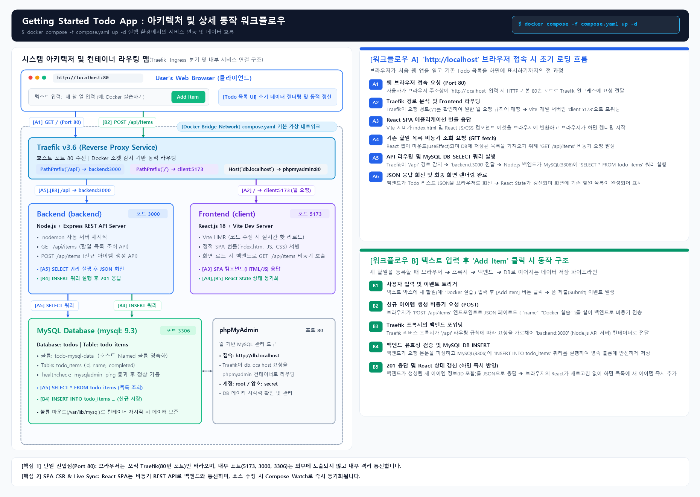
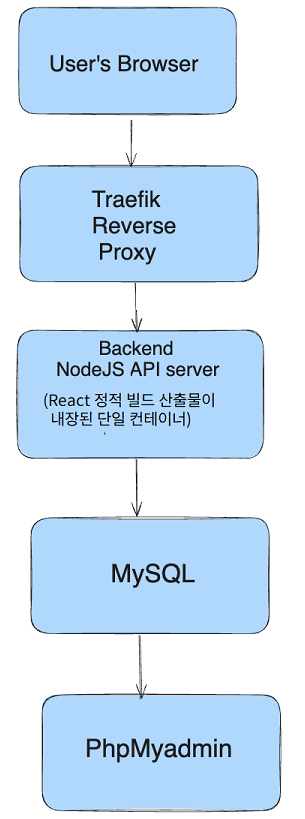

# Getting Started Todo App (Docker 개발 & 배포 가이드)

이 프로젝트는 Docker의 최신 모범 사례(Best Practices)를 종합적으로 시연하는 공식 샘플 Todo 리스트 애플리케이션입니다.
Compose 파일 구성부터 Dockerfile 멀티스테이지 빌드, GitHub Actions를 활용한 CI(지속적 통합), 테스트 자동화 실행, Traefik 리버스 프록시 라우팅, Compose Watch를 활용한 실시간 동기화(Hot Reload), GCP Cloud Run 서버리스 배포, 그리고 Google Kubernetes Engine(GKE) 클라우드 오케스트레이션 배포에 이르기까지 누구나 쉽게 접근하여 학습할 수 있도록 체계적으로 정리한 가이드 문서입니다.

---

## 1. 애플리케이션 동작 구조 ('$docker compose up -d(='$docker compose -f compose.yml') 수행시에 동작하는 응용)



본 샘플 애플리케이션은 **Node.js 백엔드**로부터 데이터를 수신하는 직관적인 **React 프론트엔드**, 영속 데이터를 저장하는 **MySQL 데이터베이스**, 그리고 유입되는 트래픽을 각 서비스로 스마트하게 분기하는 **Traefik 리버스 프록시**로 구성됩니다.

* **개발 환경 (Development Architecture)**:
  * 개발 단계에서는 프론트엔드와 백엔드가 서로 다른 개발 툴체인을 필요로 하므로 두 개의 독립된 서비스로 분리되어 구동됩니다.
  * **React 앱**은 [Vite](https://vitejs.dev/)가 관리하고, **Node.js 백엔드**는 [nodemon](https://nodemon.io/)이 관리합니다. 컨테이너 기술을 활용하면 호스트 환경을 오염시키지 않고 개발 요구사항을 완벽하게 분리할 수 있습니다.
  * **Docker Compose Watch**를 통해 호스트의 소스 코드 변경 사항이 컨테이너 내부로 즉시 동기화(Sync & Rebuild)되어 컨테이너 재빌드 없이 수정 사항이 즉각 반영됩니다.
  * **Traefik 프록시**가 `localhost` 및 `127.0.0.1`로 유입되는 요청 중 `/api`는 백엔드(포트 3000)로, 일반 웹 요청은 클라이언트(포트 5173)로 자동 라우팅합니다.
  * 데이터베이스의 직관적인 시각적 관리를 위해 **phpMyAdmin**(`http://db.localhost`) 도구가 기본 제공됩니다.

* **패키징 및 프로덕션 환경 (Packaging & Shipping Architecture)**:
  * 애플리케이션을 패키징하여 배포할 때는 프론트엔드가 정적 HTML, CSS, JavaScript로 컴파일된 후 백엔드 내부(`src/static`)로 번들링됩니다.
  * 번들링된 정적 에셋은 Express 백엔드에서 직접 서빙되므로, **본 애플리케이션에는 서버 사이드 렌더링(SSR, Server-Side Rendering)이 일절 발생하지 않는 순수 SPA(Single Page Application) / CSR 구조**입니다.
  * Dockerfile의 멀티스테이지 빌드를 통해 단위 테스트(`test`)를 자동으로 거치며, 단일 백엔드 컨테이너에서 정적 프론트엔드 에셋 서빙과 REST API 처리를 동시에 수행하여 리소스 사용을 최소화하고 배포 구성을 극대화합니다.

---

## 2. Docker 기반 공식 빠른 시작 가이드 (Quick Start)

로컬 머신에 Node.js나 데이터베이스 등 별도의 개발 도구를 설치하거나 복잡한 설정을 거칠 필요 없이, **Docker Desktop**만 설치되어 있다면 단 몇 줄의 명령어로 즉시 전체 스택을 구동할 수 있습니다.

### 2.1 프로젝트 실행 (Spinning up the project)

터미널에서 아래 명령어를 순서대로 실행합니다:

```bash
# 1) 리포지토리 복제
git clone https://github.com/docker/getting-started-todo-app

# 2) 프로젝트 디렉터리로 이동
cd getting-started-todo-app

# 3) Docker Compose Watch 모드로 실행
docker compose up --watch
```

* **동작 과정**:
  * 명령어를 실행하면 Docker Hub로부터 사전 빌드된 공식 컨테이너 이미지들이 자동으로 다운로드됩니다.
  * 다운로드가 완료되면 잠시 후 백엔드, 프론트엔드, 데이터베이스, 프록시, phpMyAdmin 컨테이너가 유기적으로 연결되어 즉시 기동됩니다.
  * 로컬 컴퓨터에 아무것도 추가 설치하거나 설정할 필요가 없습니다.

### 2.2 실시간 코드 반영 (Live Code Reloading)
* `docker compose up --watch`가 실행 중인 상태에서는 백엔드나 프론트엔드 소스 코드를 수정하더라도 **컨테이너를 다시 빌드하거나 재시작할 필요 없이 변경 사항이 즉시 웹 화면과 서버에 반영**됩니다.

### 2.3 웹 브라우저 접속 확인
* **Todo 애플리케이션**: 브라우저에서 [http://localhost](http://localhost) 접속 시 앱이 정상 구동되는 것을 바로 확인할 수 있습니다.
* **데이터베이스 관리 (phpMyAdmin)**: [http://db.localhost](http://db.localhost) 접속
  * *팁*: 최신 웹 브라우저들은 `*.localhost` 서브도메인을 로컬 루프백 IP(`127.0.0.1`)로 자동 해석(resolve)하므로 로컬 `hosts` 파일을 별도로 수정할 필요가 없습니다. (기본 계정: `root` / 암호: `secret`)

### 2.4 환경 종료 및 리소스 정리 (Tearing it down)
실습이나 개발을 마친 후 컨테이너들을 깔끔하게 정리하고 종료하려면 아래 명령어를 실행합니다:

```bash
docker compose down
```

> 💡 **참고 (기본 `compose.yaml` vs 로컬 빌드용 `compose-build.yml`)**:
> * `docker compose up` 기본 명령은 사전 빌드된 Docker Hub 공식 이미지를 사용하여 빠르게 실행하는 모드입니다.
> * 로컬에서 직접 수정한 소스 코드를 바탕으로 이미지를 자체 빌드하며 개발하려면 후술할 [5. Docker Compose 개발 환경 가이드 (`compose-build.yml`)](#5-docker-compose-개발-환경-가이드-compose-buildyml)를 참조하세요.

### 2.5 Docker Compose 프로젝트(Project) 그룹화 및 컨테이너 명명 원리

`docker compose up -d` (또는 `docker compose up --watch`)를 실행한 뒤 Docker Desktop의 **Containers** 대시보드나 터미널을 확인하면, **`getting-started-todo-app`**이라는 이름이 최상위 항목으로 표시되고 그 아래에 여러 컨테이너들이 묶여서(트리 구조로) 나열되는 것을 볼 수 있습니다. 이러한 구조가 나타나는 기술적 원리와 이유는 다음과 같습니다.

#### 1) Docker Compose의 "프로젝트(Project)" 단위 그룹화 메커니즘
* **단일 컨테이너(`docker run`) vs 다중 컨테이너(`docker compose`)**: 
  * `docker run` 명령어로 실행한 컨테이너는 개별 독립 컨테이너로 리스트에 평면적으로 나열됩니다.
  * 반면 Docker Compose는 프론트엔드, 백엔드, 데이터베이스, 리버스 프록시 등 애플리케이션 스택 전체를 이루는 컨테이너들을 하나의 논리적 단위인 **`프로젝트(Project)`**로 묶어서 관리합니다.
* **Docker Desktop UI의 트리 계층 표현**:
  * Docker Desktop의 Containers 목록에서 가장 상위에 표시되는 `getting-started-todo-app`은 단일 컨테이너가 아니라, Compose 파일에 정의된 서비스 컨테이너들을 묶어둔 **"Docker Compose Project Group(프로젝트 스택 그룹)"**입니다.
  * 좌측 펼치기(V) 아이콘을 클릭하여 그룹 전체를 한 번에 시작(Start), 정지(Stop), 삭제(Delete)할 수 있습니다.

#### 2) 프로젝트 이름이 `getting-started-todo-app`으로 결정되는 이유 (결정 우선순위)
Compose가 프로젝트 이름을 결정할 때 아래의 우선순위 규칙을 따릅니다:
1. **최상위 명시 (`name:` 속성)**: `compose.yaml` 최상단에 `name: my-project` 속성이 정의되어 있다면 해당 이름을 사용합니다.
2. **명령행 옵션 (`-p` / `--project-name`)**: `docker compose -p my-app up -d`와 같이 실행 옵션으로 지정한 이름을 사용합니다.
3. **환경 변수 (`COMPOSE_PROJECT_NAME`)**: `.env` 파일이나 OS 환경 변수에 정의된 이름을 사용합니다.
4. **기본값 (작업 디렉터리 폴더명, Default Fallback)**: 위의 설정이 모두 없는 경우, **Compose 파일이 위치한 현재 작업 디렉터리(폴더)의 이름**을 소문자/특수문자 규칙에 맞춰 프로젝트 이름으로 자동 채택합니다.
   * 현재 소스코드가 위치한 폴더명이 `getting-started-todo-app`이므로, 별도 지정 없이도 프로젝트 이름이 자동으로 `getting-started-todo-app`이 된 것입니다.

#### 3) 그 아래에 많은 컨테이너(5개)가 나열되는 이유
`compose.yaml` 파일 내부를 살펴보면 `services:` 블록 아래에 다음과 같이 **총 5개의 독립된 마이크로서비스**가 정의되어 있습니다:

| 서비스명 (`services:`) | 사용 이미지 / 역할 | 네트워크 포트 매핑 |
| :--- | :--- | :--- |
| **`proxy`** | `traefik:v3.1` (트래픽 분기 및 리버스 프록시 라우터) | `80:80`, `8080:8080` (호스트 노출) |
| **`client`** | `getting-started-todo-app-client` (React 개발 웹 프론트엔드 Vite 서버) | `5173` (내부 가상 네트워크 전용) |
| **`backend`** | `getting-started-todo-app-backend` (Node.js/Express REST API 서버) | `3000` (내부 가상 네트워크 전용) |
| **`mysql`** | `mysql:8.0` (할 일 데이터 영속성 저장 RDBMS) | `3306` (내부 가상 네트워크 전용) |
| **`db`** | `phpmyadmin` (MySQL 데이터베이스 웹 GUI 관리 도구) | `80` (내부 가상 네트워크 전용) |

`docker compose up -d`는 이 5개 서비스를 읽어 들여 각각 전용 격리 컨테이너로 동시에 생성 및 실행하므로, 하나의 프로젝트 그룹 아래에 5개의 컨테이너가 줄지어 나타나게 됩니다.  
*(참고: 프로덕션용 `compose-prod-build.yml`로 실행 시에는 프론트엔드가 백엔드에 통합 서빙되므로 `proxy`, `backend`, `mysql` 3개의 컨테이너만 리스트됩니다.)*

#### 4) 각 개별 컨테이너의 자동 명명 규칙 (Container Naming Convention)
Docker Compose는 컨테이너 이름의 충돌을 방지하고 손쉽게 식별할 수 있도록 아래와 같은 표준 네이밍 포맷을 컨테이너 이름으로 자동 지정합니다:

$$\text{컨테이너 이름} = \mathbf{<프로젝트명>} - \mathbf{<서비스명>} - \mathbf{<인스턴스 번호>}$$

* **실제 생성된 개별 컨테이너 이름 목록**:
  * `getting-started-todo-app-proxy-1`
  * `getting-started-todo-app-client-1`
  * `getting-started-todo-app-backend-1`
  * `getting-started-todo-app-mysql-1`
  * `getting-started-todo-app-db-1`
* **설계 장점**:
  * 서로 다른 프로젝트에서 똑같이 `backend`나 `mysql`이라는 일반적인 서비스 이름을 사용하더라도, 프로젝트명이 접두사(Prefix)로 붙기 때문에 컨테이너 이름 충돌이 전혀 발생하지 않습니다.
  * 서비스 스케일 아웃(`docker compose up -d --scale backend=3`)을 수행할 경우, `backend-2`, `backend-3`과 같이 번호가 자동으로 부여되어 여러 인스턴스를 직관적으로 식별 및 관리할 수 있습니다.

---

## 3. Windows 로컬 개발 환경 직접 실행 가이드 (Node.js 기반)

Docker 컨테이너를 사용하지 않고 로컬 Windows 머신에서 Node.js 환경으로 백엔드와 프론트엔드를 직접 구동하고 개발/빌드하는 방법입니다.

### 3.1 의존성 패키지 설치
각 폴더로 이동하여 필요한 패키지를 설치합니다:
```bash
# 백엔드 의존성 설치
cd backend
npm install

# 프론트엔드 의존성 설치
cd ../client
npm install
```

---

### 3.2 백엔드 서버 실행 (`backend` ➔ `npm run dev`)
터미널 #1에서 백엔드 서버를 구동합니다:
```bash
cd backend
npm run dev
```
* `nodemon`을 통해 구동되며, 파일 변경 시 자동으로 서버가 재시작됩니다.
* 기본적으로 **포트 3000**(`http://localhost:3000`)에서 REST API 및 정적 파일 서빙 대기 상태가 됩니다.

---

### 3.3 프론트엔드 개발 모드 실행 (`client` ➔ `npm run dev`)

터미널 #2에서 Vite 개발 서버를 구동합니다:
```bash
cd client
npm run dev
```

#### 💡 Vite Development Server의 역할과 Backend Forward (API Proxy)
1. **Vite Development Server의 역할**:
   * 초고속 HMR(Hot Module Replacement)을 제공하여 코드 수정 시 브라우저 새로고침 없이 변경 사항을 즉시 반영합니다.
   * 기본적으로 **포트 5173**(`http://localhost:5173`)에서 프론트엔드 개발 페이지를 서빙합니다.

2. **Backend Forward를 위한 `vite.config.js` 프록시 설정**:
   * 브라우저가 `http://localhost:5173`에서 실행되는 React 앱에서 백엔드 API(`/api/items` 등)를 호출하면 포트가 달라 **CORS(Cross-Origin Resource Sharing)** 문제가 발생할 수 있습니다.
   * 이를 해결하기 위해 Vite 개발 서버에 프록시(Proxy) 규칙을 설정하여, `/api`로 시작하는 모든 요청을 백엔드(`http://localhost:3000`)로 투명하게 포워딩(Forward)해줍니다.

```javascript
// client/vite.config.js
import { defineConfig } from 'vite';
import react from '@vitejs/plugin-react';

// https://vitejs.dev/config/
export default defineConfig({
    plugins: [react()],
    server: {
        proxy: {
            // '/api'로 시작하는 요청을 백엔드 포트 3000으로 포워딩
            '/api': 'http://localhost:3000'
        }
    }
});
```
* **개발 중 접속 주소**: [http://localhost:5173](http://localhost:5173)

---

### 3.4 프론트엔드 정적 빌드 및 백엔드 통합 서빙 (`client` ➔ `npm run build`)

개발 완료 후 프론트엔드를 빌드하여 백엔드 단일 서버(`3000`)에서 한 번에 서비스할 때 사용하는 방법입니다.

```bash
cd client
npm run build
```

#### 🔄 빌드 및 자동 복사 동작 흐름:
1. **`vite build`**: React 소스 코드를 번들링하여 최적화된 HTML/CSS/JS 정적 에셋을 `client/dist` 디렉토리에 생성합니다.
2. **`postbuild` 자동 트리거**: `client/package.json`의 `postbuild` 라이프사이클 스크립트에 의해 `client/dist`의 내용물이 `backend/src/static` 디렉토리로 자동 복사됩니다.
   ```json
   // client/package.json
   "scripts": {
     "dev": "vite --host=0.0.0.0",
     "build": "vite build",
     "postbuild": "node -e \"require('fs').cpSync('dist', '../backend/src/static', {recursive: true})\"",
     ...
   }
   ```
3. **통합 서빙 확인**: 백엔드 서버(`backend`)가 실행 중인 상태(`npm run dev` 또는 `npm start`)라면, 브라우저에서 [http://localhost:3000](http://localhost:3000)에 접속했을 때 Express가 `/backend/src/static`의 정적 파일을 서빙하므로 별도의 Vite 서버 없이도 완전한 Todo 앱이 동작합니다.

> 💡 **Windows PowerShell 팁**: PowerShell 실행 정책으로 인해 `npm` 명령 실행 시 권한 에러(`PSSecurityException`)가 발생할 경우 `npm.cmd run dev` 또는 `npm.cmd run build`를 사용하세요.

---

## 4. Dockerfile 멀티스테이지 구조

`Dockerfile`은 단계별로 캐싱을 최적화하고 최종 산출물의 크기를 최소화하도록 설계되어 있습니다.

```
base (Node.js 22)
├── client-base
│   ├── client-dev (개발용 Vite 서버 실행: npm run dev)
│   └── client-build (정적 에셋 빌드: npm run build -> dist/)
└── backend-dev (개발용 nodemon 서버 실행: npm run dev)
    └── test (백엔드 단위 테스트 실행: npm run test)
        └── final (프로덕션 최종 이미지: 클라이언트 dist 산출물을 src/static 으로 복사)
```

### 4.1 프로덕션 스테이지(`final`)와 포트 설정: `EXPOSE 3000` ➔ `8080` 변경 이유

`Dockerfile`의 `final` 스테이지(Line 82~90)는 운영 환경에 배포되는 최종 단일 컨테이너 이미지를 생성합니다:

```dockerfile
FROM base AS final
ENV NODE_ENV=production
COPY --from=test /usr/local/app/package.json /usr/local/app/package-lock.json ./
RUN npm ci --production && \
    npm cache clean --force
COPY backend/src ./src
COPY --from=client-build /usr/local/app/dist ./src/static
EXPOSE 8080
CMD ["node", "src/index.js"]
```

기존 로컬 개발 환경에서는 백엔드가 3000번 포트를 사용하여 `EXPOSE 3000`으로 작성되어 있었으나, 이를 **`EXPOSE 8080`으로 변경해야 하는 핵심 이유**는 **GCP Cloud Run의 컨테이너 런타임 규약(Container Runtime Contract)** 때문입니다.

#### 1) GCP Cloud Run의 포트 계약(Port Contract)과 `PORT` 환경 변수
* **기본 수신 포트 `8080` 규약**: GCP Cloud Run은 컨테이너 인스턴스로 유입되는 외부 HTTP 인그레스(Ingress) 요청을 컨테이너 내부의 **`8080` 포트**로 라우팅하는 것을 기본 표준으로 채택하고 있습니다.
* **`PORT` 환경 변수 자동 주입**: Cloud Run 인스턴스가 기동될 때, 플랫폼 내부에서 자동으로 `PORT=8080` 환경 변수를 컨테이너 프로세스에 주입합니다.

#### 2) `const PORT = process.env.PORT || 3000;` 구문의 설계 의도와 필요성
서버 코드([backend/src/index.js](file:///d:/Lecture%20Notes/2026-2CloudComputing/practices/03week/getting-started-todo-app/backend/src/index.js))에서 포트를 `app.listen(3000)`으로 하드코딩하지 않고 환경 변수와 기본값 연산자(`||`)를 조합한 이유는 다음과 같습니다:

1. **클라우드-네이티브 및 The Twelve-Factor App (포트 바인딩) 원칙 준수**:
   - 현대 웹 애플리케이션 설계 방법론인 **Twelve-Factor App (III. Config & VII. Port binding)**에 따르면, 애플리케이션은 실행 포트를 소스 코드에 하드코딩하지 않고 **실행 환경(Environment Variable)으로부터 주입받아 자체 포트에 바인딩**해야 합니다.
2. **다양한 클라우드 플랫폼(GCP Cloud Run, Heroku, AWS 등)의 동적 포트 수용**:
   - **GCP Cloud Run**은 인스턴스 시작 시 `PORT=8080`을 자동 주입합니다.
   - **Heroku, AWS Elastic Beanstalk, Azure App Service** 등 다양한 클라우드/PaaS 환경에서도 각 시스템의 라우터가 지정한 포트 번호를 `PORT` 환경 변수로 동적 전달합니다.
   - 만약 코드가 `3000`으로 고정되어 있으면 Cloud Run은 8080 포트에서 응답이 없어 컨테이너를 비정상(Crash/Timeout) 종료 처리하게 됩니다.
3. **로컬 개발 환경의 개발자 경험(DX) 및 Fallback 기본값 제공**:
   - 환경 변수 `PORT`가 지정되지 않은 일반 로컬 개발 환경(`npm run dev`)에서는 논리 OR 연산자(`||`) 뒤의 기본값 `3000`이 적용됩니다.
   - 따라서 로컬 개발자가 매번 번거롭게 `PORT=3000`을 명시하지 않아도 [http://localhost:3000](http://localhost:3000)으로 바로 접속할 수 있습니다.
4. **포트 충돌 회피 및 소스 코드 무수정 배포**:
   - 로컬 머신에서 이미 3000번 포트를 다른 프로그램이 사용 중일 때, 소스 코드를 단 한 줄도 수정하지 않고 `PORT=4000 npm run dev`와 같이 실행하여 즉시 포트 충돌을 회피할 수 있습니다.

#### 3) `EXPOSE 8080` 선언이 필요한 핵심 이유
1. **Cloud Run 배포 도구의 포트 자동 감지 메타데이터**:
   - `gcloud run deploy`, Cloud Build, 또는 GCP 콘솔을 통해 이미지를 배포할 때, 배포 시스템은 Dockerfile의 `EXPOSE` 메타데이터를 검사하여 컨테이너가 수신 대기할 포트를 자동으로 인식합니다.
   - 만약 `EXPOSE 3000`으로 설정된 이미지를 배포하면 Cloud Run이 트래픽을 3000번으로 잘못 전달하거나 포트 불일치로 판단하여, 헬스체크(Startup Probe) 실패 에러(`Container failed to start and listen on the port`)가 발생할 수 있습니다.
2. **컨테이너 이미지의 자체 완결성과 표준화**:
   - `EXPOSE 8080`을 명시적으로 선언함으로써 해당 이미지가 GCP Cloud Run 표준 환경 규약을 완벽히 준수함을 명시하고, 협업 개발자 및 CI/CD 파이프라인에 일관된 포트 계약 정보를 제공합니다.

---

### 4.2 Dockerfile 타깃 지정 동작 원리와 특정 스테이지 컨테이너라이제이션

#### 1) `docker build -t getting-started-todo-app .` 실행 시 기본 타깃은 `final`인가?
**네, 맞습니다.** Docker Multi-Stage Build 환경에서 `--target` 옵션을 명시하지 않고 `docker build`를 실행하면, Dockerfile 내에 정의된 **가장 마지막 스테이지(stage)**가 최종 타깃으로 자동 지정됩니다.

* **동작 메커니즘**:
  * [Dockerfile](file:///d:/Lecture%20Notes/2026-2CloudComputing/practices/03week/getting-started-todo-app/Dockerfile#L82)의 맨 마지막에 정의된 스테이지는 `FROM base AS final`입니다.
  * 따라서 `--target` 플래그를 생략한 일반 빌드 명령어는 `final` 스테이지를 최종 결과 이미지로 만듭니다.
* **의존성 스테이지 자동 실행 (선행 빌드 체인)**:
  * `final` 스테이지는 내부적으로 `COPY --from=test ...`와 `COPY --from=client-build ...`를 포함하고 있습니다.
  * 이에 따라 Docker BuildKit은 `final` 이미지를 생성하기 위해 필요한 선행 의존 단계인 **백엔드 단위 테스트(`test`)**와 **프론트엔드 정적 번들 빌드(`client-build`)**를 자동으로 실행(또는 기존 캐시 유효성 검사)한 뒤 최종 `final` 이미지를 완성합니다.

#### 2) `client-base` 등 특정 중간 스테이지만 컨테이너라이제이션(빌드 및 실행)하는 방법
전체 프로덕션 이미지가 아닌, 프론트엔드 공통 베이스 단계인 `client-base`([Dockerfile:18](file:///d:/Lecture%20Notes/2026-2CloudComputing/practices/03week/getting-started-todo-app/Dockerfile#L18))만을 격리하여 빌드하고 컨테이너화하려면 **`--target`** 옵션을 명시합니다.

* **① CLI를 통한 특정 타깃 빌드**:
  ```bash
  docker build --target client-base -t todo-client-base .
  ```
  * `--target client-base`를 지정하면 `client-base`까지만 빌드하고, 그 이후에 선언된 스테이지(`client-dev`, `client-build`, `backend-dev`, `test`, `final` 등)는 완전히 생략(Skip)됩니다.

* **② 빌드된 `client-base` 컨테이너 실행**:
  * `client-base` 스테이지에는 별도의 실행 명령어(`CMD`)가 정의되어 있지 않으므로(베이스 Node 이미지 기본값 유지), 컨테이너 내부 셸(sh)을 직접 실행하거나 명령어를 전달하여 확인합니다:
  ```bash
  # 컨테이너 내부 셸로 진입하여 패키지 설치 상태 및 소스 파일 확인
  docker run -it --rm todo-client-base sh
  ```

* **③ Docker Compose(`compose.yaml`)에서 특정 타깃 지정**:
  ```yaml
  services:
    client-base-service:
      build:
        context: ./
        target: client-base
      command: npm run dev
      ports:
        - "5173:5173"
  ```

---

## 5. Docker Compose 개발 환경 가이드 (`compose-build.yml(=compose.yaml)`)

`compose-build.yml`은 빠른 코드 수정과 디버깅을 위해 로컬 소스 코드를 직접 빌드하는 개발자 전용 Compose 파일입니다.
`
### 5.1 서비스 구성 요약
* **`proxy` (Traefik v3.6)**: 80번 포트 진입점
  * `localhost`, `127.0.0.1` ➔ 프론트엔드(`client:5173`)
  * `localhost/api`, `127.0.0.1/api` ➔ 백엔드(`backend:3000`)
  * `db.localhost` ➔ phpMyAdmin(`phpmyadmin:80`)
* **`backend`**: `backend-dev` 타깃 빌드, 소스 코드 실시간 동기화(`watch`)
* **`client`**: `client-dev` 타깃 빌드, 소스 코드 실시간 동기화(`watch`)
* **`mysql`**: MySQL 9.3 (헬스체크 및 `todo-mysql-data` 볼륨 영속화)
* **`phpmyadmin`**: 웹 DB 관리 도구

### 5.2 실행 명령어

```bash
# 실시간 파일 감지 및 자동 동기화 모드로 실행 (권장)
docker compose -f compose-build.yml up --watch

# 또는 백그라운드 빌드 및 실행
docker compose -f compose-build.yml up -d --build
```

### 5.3 접속 URL
* **Todo 애플리케이션**: [http://localhost](http://localhost) 또는 [http://127.0.0.1](http://127.0.0.1)
* **phpMyAdmin (DB 관리자)**: [http://db.localhost](http://db.localhost) (계정: `root` / 암호: `secret`)

### 5.4 개발 환경 종료
```bash
docker compose -f compose-build.yaml down
```

---

## 6. Docker Compose 기반 프로덕션 빌드 및 실행 가이드 (`compose-prod-build.yml`)

`compose-prod-build.yml`은 배포용 단일 번들 이미지를 빌드하여 운영 환경과 동일하게 실행합니다.

### 6.1 서비스 동작 구조


### 6.2 서비스 구성 요약
* **`proxy` (Traefik v3.6)**: 80번 포트 진입점으로 외부 모든 요청(`PathPrefix('/')`)을 백엔드로 프록시 라우팅
* **`backend`**: Dockerfile의 `final` 타깃 빌드 (React 정적 빌드 산출물이 내장된 단일 컨테이너로, Express가 정적 자산과 REST API를 동시 처리)
* **`mysql`**: MySQL 9.3 데이터베이스 (헬스체크 적용 및 `todo-mysql-data` 볼륨 영속화)
*(개발 서버(Vite, nodemon) 및 phpMyAdmin 컨테이너를 제외하여 보안성과 안정성을 극대화합니다)*

### 6.3 실행 명령어

```bash
# 프로덕션 이미지 빌드 및 백그라운드 실행
docker compose -f compose-prod-build.yml up -d --build
```

### 6.4 접속 및 확인
* **Todo 웹 애플리케이션**: [http://localhost](http://localhost) 또는 [http://127.0.0.1](http://127.0.0.1)
* **실행 로그 실시간 확인**:
  ```bash
  docker compose -f compose-prod-build.yml logs -f
  ```

### 6.5 프로덕션 환경 종료
```bash
docker compose -f compose-prod-build.yml down
```

---

### 6.6 Docker CLI 직접 실행 가이드 (Compose 없이 `docker build` & `docker run` 순차 실행)

`docker compose -f compose-prod-build.yml up -d` 명령어는 네트워크 생성, 볼륨 생성, 이미지 빌드, 컨테이너 실행 및 의존성 제어를 단 한 줄로 자동화합니다. 
이를 Docker의 기본 동작 원리를 이해하기 위해 **순수 Docker CLI 명령어(`docker build`, `docker run`)**로 분해하여 동일하게 순차 실행하는 절차는 다음과 같습니다.

#### 1) 전체 실행 순서 다이어그램
```
[Step 1: 인프라 준비]
 ├── docker network create todo-net (컨테이너 간 이름 기반 통신망)
 └── docker volume create todo-mysql-data (DB 데이터 영속화 저장소)
        │
[Step 2: 이미지 빌드]
 └── docker build --target final -t todo-backend . (final 스테이지까지 멀티스테이지 빌드)
        │
[Step 3: 의존성에 따른 컨테이너 순차 실행 (mysql ➔ backend ➔ proxy)]
 ├── ① MySQL 컨테이너 (백엔드 의존 대상이므로 최우선 실행)
 ├── ② Backend 컨테이너 (MySQL 정상 연결 대기 후 실행, Traefik 라우팅 라벨 부여)
 └── ③ Traefik Proxy 컨테이너 (호스트 80 포트 바인딩 및 Docker 소켓 감시)
```

---

#### 2) 단계별 명령어 상세

##### Step 1. 사전 인프라 준비 (네트워크 및 볼륨 생성)
컨테이너들이 `mysql`, `backend` 등의 컨테이너 이름(내장 DNS)으로 상호 통신할 수 있도록 사용자 정의 브리지 네트워크를 만들고, 데이터 영속화용 Named 볼륨을 생성합니다.

```bash
# 1. 컨테이너 간 통신용 브리지 네트워크 생성
docker network create todo-net

# 2. MySQL 데이터 보존용 볼륨 생성
docker volume create todo-mysql-data
```

---

##### Step 2. 백엔드 프로덕션 이미지 빌드 (`docker build`)
Dockerfile의 `final` 스테이지를 타깃으로 지정하여 클라이언트 정적 번들 빌드와 백엔드가 결합된 단일 프로덕션 이미지를 빌드합니다.

```bash
docker build --target final -t todo-backend .
```
*(참고: `--target final`을 생략하고 `docker build -t todo-backend .`로 실행해도 Dockerfile의 마지막 스테이지가 `final`이므로 동일하게 빌드됩니다.)*

---

##### Step 3. 컨테이너 순차 실행 (`docker run`)

###### ① MySQL 컨테이너 실행 (1순위)
> 백엔드 컨테이너가 MySQL 연결에 의존(`depends_on`)하므로 MySQL을 가장 먼저 실행합니다.

```bash
docker run -d \
  --name mysql \
  --network todo-net \
  -v todo-mysql-data:/var/lib/mysql \
  -e MYSQL_ROOT_PASSWORD=secret \
  -e MYSQL_DATABASE=todos \
  mysql:9.3
```
* **대기 시간 필요**: MySQL 엔진이 초기화되어 연결을 수락할 준비가 될 때까지 **약 5~10초 정도 대기**합니다. (Compose의 `condition: service_healthy` 역할을 수동으로 대체)

###### ② Backend 컨테이너 실행 (2순위)
> MySQL 초기화 완료 후 실행합니다. Traefik 리버스 프록시가 컨테이너를 감지하고 80번 포트 요청을 라우팅할 수 있도록 레이블(`-l`)과 환경 변수(`-e`)를 부여합니다.

```bash
docker run -d \
  --name backend \
  --network todo-net \
  -e MYSQL_HOST=mysql \
  -e MYSQL_USER=root \
  -e MYSQL_PASSWORD=secret \
  -e MYSQL_DB=todos \
  -l traefik.enable="true" \
  -l traefik.http.routers.backend.entrypoints="web" \
  -l traefik.http.routers.backend.rule="PathPrefix(`/`)" \
  -l traefik.http.services.backend.loadbalancer.server.port="3000" \
  todo-backend
```

###### ③ Traefik Proxy 컨테이너 실행 (3순위)
> 호스트의 80번 포트를 컨테이너 80번 포트에 바인딩하고, Docker 이벤트를 실시간 감시할 수 있도록 Docker 데몬 소켓(`/var/run/docker.sock`)을 마운트하여 기동합니다.

```bash
docker run -d \
  --name proxy \
  --network todo-net \
  -p 80:80 \
  -v /var/run/docker.sock:/var/run/docker.sock \
  traefik:v3.6 \
  --providers.docker=true \
  --providers.docker.exposedbydefault=true \
  --entrypoints.web.address=:80
```

---

#### 3) 동작 확인 및 리소스 정리

* **실행 중인 컨테이너 확인**:
  ```bash
  docker ps
  ```
* **웹 브라우저 접속**:
  * [http://localhost](http://localhost) 접속 시 Traefik(80) ➔ Backend(3000) ➔ MySQL(3306) 연동 앱이 정상 작동합니다.
* **환경 종료 및 리소스 정리 (Tear Down)**:
  ```bash
  # 컨테이너 중지 및 삭제
  docker stop proxy backend mysql
  docker rm proxy backend mysql

  # 네트워크 삭제 (필요 시)
  docker network rm todo-net

  # 볼륨까지 완전히 삭제하려면 (주의: DB 데이터 삭제됨)
  # docker volume rm todo-mysql-data
  ```

---

### 6.7 Docker Compose 빌드 이미지 자동 명명 원리와 커스텀 태그 지정

#### 1) 왜 빌드된 이미지 이름이 `getting-started-todo-app-backend`가 되는가?
Docker Compose 파일([compose-prod-build.yml](.../03week/getting-started-todo-app/compose-prod-build.yml))에서 특정 서비스에 `build:` 옵션만 작성하고 별도의 `image:` 속성을 선언하지 않은 경우, Docker Compose는 아래와 같은 **표준 기본 명명 규칙(Default Naming Convention)**을 자동으로 적용합니다:

$$\mathbf{<프로젝트명>} - \mathbf{<서비스명>} : \mathbf{latest}$$

* **프로젝트명 (`getting-started-todo-app`)**: 별도 프로젝트명을 지정하지 않았으므로 Compose 파일이 위치한 현재 작업 디렉터리 폴더명인 `getting-started-todo-app`이 자동 채택됩니다.
* **서비스명 (`backend`)**: `compose-prod-build.yml`의 `services:` 블록 아래에 정의된 서비스 키 이름인 `backend`가 사용됩니다.
* **결과**: 두 식별자가 하이픈(`-`)으로 결합되어 **`getting-started-todo-app-backend:latest`**라는 이미지 이름으로 빌드 및 로컬 Docker 이미지 저장소에 태깅됩니다.

#### 2) 원하는 커스텀 이미지 이름으로 빌드하는 방법
Kubernetes 배포 매니페스트([deployment.yaml](.../03week/getting-started-todo-app/deployment.yaml))와의 연계나 배포 관리의 편의를 위해 고유한 이미지 이름(예: `todo-backend:prod`)을 부여하고 싶다면, `build:` 항목과 함께 **`image:` 속성을 명시**하면 됩니다.

* **`compose-prod-build.yml` 작성 예시**:
  ```yaml
  backend:
    image: todo-backend:prod     # 👈 원하는 이미지 이름 및 태그를 직접 명시
    build:
      context: ./
      target: final
  ```
* **빌드 명령어 실행**:
  ```bash
  docker compose -f compose-prod-build.yml build
  ```
  위 명령을 실행하면 `getting-started-todo-app-backend` 대신 지정된 **`todo-backend:prod`**라는 명확한 식별자로 이미지가 빌드됩니다.

---

### 6.8 Kubernetes (KIND) 클러스터 프로덕션 배포 가이드 (`deployment.yaml`)

[compose-prod-build.yml](file:///d:/Lecture%20Notes/2026-2CloudComputing/practices/03week/getting-started-todo-app/compose-prod-build.yml)을 기반으로 로컬 쿠버네티스 환경인 **KIND (Kubernetes in Docker)** 클러스터에 동일한 프로덕션 스택을 배포하기 위한 쿠버네티스 아키텍처 변환 및 실행 절차입니다.

#### 1) Compose ➔ Kubernetes 오브젝트 매핑 구조
* **DB 비밀번호 및 환경 설정**: `Secret` (`todo-db-secret`) 및 `ConfigMap` (`todo-config`)으로 분리 관리
* **데이터베이스 볼륨**: `todo-mysql-data` 볼륨을 `PersistentVolumeClaim` (`todo-mysql-pvc`, 1Gi)으로 정의
* **MySQL 서비스**: 단일 파드 `Deployment` (`mysql:9.3`, `strategy: Recreate`) 및 내부 전용 `ClusterIP Service` (`mysql:3306`)
* **백엔드 애플리케이션**: `Deployment` (`todo-backend:prod`)
  * `initContainers`를 내장하여 MySQL 포트(3306)가 완전히 오픈될 때까지 대기한 후 백엔드를 시작하므로 기동 순서 보장
* **트래픽 라우팅**: 별도의 Traefik 컨테이너 없이 쿠버네티스 네이티브 `Service` (`type: NodePort`, 포트 80 ➔ 3000)로 자동 라우팅

#### 2) KIND 클러스터 빌드 및 배포 명령어
```bash
# 1) 백엔드 프로덕션 이미지 로컬 빌드 (Dockerfile target: final)
docker build -t todo-backend:prod .

# 2) 빌드한 이미지를 KIND 노드로 로드 (ErrImagePull 방지 필수 단계)
kind load docker-image todo-backend:prod

# 3) 쿠버네티스 매니페스트 일괄 배포
kubectl apply -f deployment.yaml

# 4) 배포 상태 및 파드 구동 확인
kubectl get pods,pvc,svc

# 5) 로컬 브라우저 접속을 위한 포트포워딩
kubectl port-forward svc/todo-backend 8080:80
```
* **웹 브라우저 접속**: 브라우저에서 [http://localhost:8080](http://localhost:8080) 접속

---

## 7. GCP VM에서의 실행 방법 (Compute Engine)

GCP Compute Engine(가상 머신, IaaS) 환경에서 독립된 Linux VM을 생성하고, Docker를 설치한 뒤 `compose-prod-build.yml`(또는 `compose-VM-prod-build.yml`)을 통해 프로덕션 컨테이너 스택을 백그라운드로 안정적으로 배포 및 구동하는 전체 절차와 내부 동작 구조입니다.

---

### 7.1 GCP VM 환경에서의 전체 동작 구조 및 아키텍처

```
[외부 사용자 브라우저] 
       │ (HTTP 요청: http://<VM_외부_IP>)
       ▼
[GCP VPC 방화벽 (TCP 80 포트 인그레스 허용)]
       │
       ▼
[GCP Compute Engine VM (Host: 포트 80)]
       │
       ▼
┌────────────────── Docker Bridge Network ──────────────────┐
│                                                           │
│  [Traefik v3.6 리버스 프록시 (proxy)]                      │
│   - 포트 매핑: 80:80                                      │
│   - 라우팅 규칙: PathPrefix(`/`) (모든 IP/도메인 수용)      │
│   - Docker 데몬 소켓(/var/run/docker.sock) 감시           │
│       │                                                   │
│       ▼ 내부 프록시 포워딩 (포트 3000)                     │
│  [백엔드 컨테이너 (backend:final)]                        │
│   - Express REST API (/api/todos 등)                      │
│   - React 정적 에셋 서빙 (client/dist -> src/static)      │
│       │                                                   │
│       ▼ 내부 DB 쿼리 (포트 3306)                          │
│  [데이터베이스 컨테이너 (mysql:9.3)]                       │
│   - 헬스체크: mysqladmin ping 통과 후 백엔드 기동          │
│       │                                                   │
└───────┼───────────────────────────────────────────────────┘
        ▼
   [호스트 Named 볼륨 (todo-mysql-data)]
   - 컨테이너가 중지/삭제되어도 데이터 영속성 유지
```

1. **GCP VPC 방화벽**: 외부 인터넷으로부터 인입되는 HTTP(포트 80) 인바운드 트래픽을 VM 인스턴스로 전달합니다.
2. **Traefik 리버스 프록시**: 호스트 80번 포트를 직접 수신 대기하며, `PathPrefix('/')` 규칙을 통해 VM의 외부 공인 IP로 들어오는 모든 요청을 백엔드 컨테이너의 3000번 포트로 안전하게 전달합니다.
3. **단일 번들 백엔드 (`final`)**: Dockerfile의 멀티스테이지 빌드를 통해 컴파일된 React 프론트엔드 에셋과 Node.js Express 백엔드가 하나의 컨테이너로 합쳐져 구동되므로, 외부 연결 포트가 80번 하나로 깔끔하게 단일화됩니다.
4. **격리된 DB 통신 및 볼륨 영속화**: MySQL은 외부로 노출되지 않고 오직 Docker 내부 브리지 네트워크를 통해서만 백엔드와 통신하며, 호스트 디스크의 `todo-mysql-data` 볼륨을 통해 데이터를 안전하게 보존합니다.

---

### 7.2 GCP VM 생성 및 방화벽 설정 (사전 준비)

1. **GCP Console ➔ Compute Engine ➔ VM 인스턴스 생성**:
   * **운영체제(부팅 디스크)**: Ubuntu 22.04 LTS 또는 Ubuntu 24.04 LTS (x86/64) 권장
   * **머신 유형**: `e2-medium` (2 vCPU, 4GB 메모리 이상 권장 - 이미지 빌드 시 메모리 안정성 확보)
2. **방화벽(Firewall) 설정 (필수)**:
   * **"HTTP 트래픽 허용 (Allow HTTP traffic)"** 체크박스를 반드시 체크합니다.
   * *(체크 시 GCP 방화벽에 `tcp:80` 포트를 개방하는 `default-allow-http` 규칙이 자동 적용됩니다)*
3. **VM 생성 후 외부 IP 확인**:
   * 인스턴스 목록에서 생성된 VM의 **외부 IP(External IP)** 주소(예: `34.64.xxx.xxx`)를 메모해 둡니다.

---

### 7.3 GCP VM에 Docker 및 Docker Compose 설치

GCP 콘솔의 **SSH** 버튼을 클릭하여 VM 터미널에 접속한 후, 아래 명령어를 순서대로 실행하여 최신 Docker Engine과 Docker Compose 플러그인을 설치합니다:

```bash
# 1) 시스템 패키지 목록 갱신 및 필수 의존 패키지 설치
sudo apt-get update
sudo apt-get install -y ca-certificates curl gnupg lsb-release

# 2) Docker 공식 GPG 키 등록
sudo install -m 0755 -d /etc/apt/keyrings
curl -fsSL https://download.docker.com/linux/ubuntu/gpg | sudo gpg --dearmor -o /etc/apt/keyrings/docker.gpg
sudo chmod a+r /etc/apt/keyrings/docker.gpg

# 3) Docker 공식 APT 저장소 등록
echo \
  "deb [arch=$(dpkg --print-architecture) signed-by=/etc/apt/keyrings/docker.gpg] https://download.docker.com/linux/ubuntu \
  $(lsb_release -cs) stable" | sudo tee /etc/apt/sources.list.d/docker.list > /dev/null

# 4) Docker 엔진 및 Docker Compose 플러그인 설치
sudo apt-get update
sudo apt-get install -y docker-ce docker-ce-cli containerd.io docker-buildx-plugin docker-compose-plugin

# 5) 현재 로그인 사용자에게 sudo 없이 Docker 실행 권한 부여
sudo usermod -aG docker $USER

# 6) 그룹 권한 즉시 적용 (또는 SSH 재접속)
newgrp docker

# 7) Docker 및 Docker Compose 정상 설치 검증
docker --version
docker compose version
```

---

### 7.4 프로젝트 소스 코드 준비

GitHub 리포지토리를 VM 내부로 복제하고 디렉터리로 이동합니다:

```bash
git clone https://github.com/docker/getting-started-todo-app.git
cd getting-started-todo-app
```

---

### 7.5 VM에서 `docker compose -f compose-prod-build.yml up -d` 실행 및 내부 동작 메커니즘

GCP VM 터미널에서 프로덕션 빌드 명령어를 실행합니다:

```bash
# 프로덕션 이미지 빌드 및 백그라운드 데몬(-d) 실행
docker compose -f compose-prod-build.yml up -d --build
```

> 💡 **참고 (`compose-VM-prod-build.yml` 권장 설정)**:
> VM 환경에서 Traefik의 자동 감지 기능을 보다 엄격하게 제어하려면, `--providers.docker.exposedbydefault=false` 및 프록시 컨테이너 자체에 `traefik.enable=false` 라벨이 적용된 `compose-VM-prod-build.yml` 파일을 사용하여 실행할 수도 있습니다:
> ```bash
> docker compose -f compose-VM-prod-build.yml up -d --build
> ```

#### ⚙️ 단계별 내부 실행 구조 및 동작 흐름:
1. **멀티스테이지 로컬 빌드 (`Dockerfile`의 `final` 스테이지)**:
   * **`client-build`**: React 소스 코드를 `vite build`하여 압축/최적화된 정적 HTML/CSS/JS 에셋을 생성합니다.
   * **`test`**: 백엔드 단위 테스트(`npm run test`)를 실행하여 품질을 검증합니다.
   * **`final`**: 프론트엔드 빌드 결과물을 Express의 정적 서빙 경로(`src/static`)로 내장 복사하여 **단일 백엔드 이미지**를 완성합니다.
2. **`mysql` 컨테이너 기동 및 헬스체크 대기**:
   * MySQL 컨테이너가 백그라운드로 먼저 기동되며, `todo-mysql-data` 볼륨을 `/var/lib/mysql`에 마운트합니다.
   * `healthcheck` 설정(`mysqladmin ping`)에 따라 5초 간격으로 DB 정상 응답을 체크합니다.
3. **`backend` 컨테이너의 안전한 종속 실행 (`depends_on`)**:
   * `mysql` 컨테이너가 `healthy` 상태가 될 때까지 대기한 후 백엔드가 실행되므로, "DB 연결 거부(ECONNREFUSED)"로 인한 백엔드 비정상 종료(Crash)를 원천 차단합니다.
4. **`proxy` (Traefik) 라우팅 자동 연동**:
   * Traefik 컨테이너가 `/var/run/docker.sock`을 통해 `backend` 컨테이너의 시작 이벤트를 감지합니다.
   * `labels`에 명시된 `rule: "PathPrefix('/')"`를 인식하고, 외부 80번 포트로 들어오는 모든 HTTP 요청을 백엔드 컨테이너 3000번 포트로 투명하게 포워딩합니다.
5. **백그라운드(`-d`) 데몬 유지**:
   * `-d` 플래그로 인해 사용자가 SSH 터미널 창을 닫아도 VM 내부에서 백그라운드 프로세스로 무중단 운영됩니다.

---

### 7.6 웹 브라우저 외부 접속 및 동작 확인

1. 로컬 PC의 웹 브라우저를 열고 주소창에 VM의 외부 IP를 입력합니다:
   ```text
   http://<GCP_VM_외부_IP>
   ```
   *(예: `http://34.22.79.49/`)*
2. **동작 확인**:
   * 화면에 React 기반 Todo 앱 메인 페이지가 즉시 렌더링됩니다.
   * 새로운 Todo 항목을 추가하거나 삭제해보고, 브라우저를 새로고침하더라도 MySQL 볼륨(`todo-mysql-data`)에 영속 저장되어 데이터가 유지되는지 확인합니다.

---

### 7.7 서비스 모니터링 및 컨테이너 관리 명령어

```bash
# 1) 현재 실행 중인 컨테이너 상태 및 헬스체크 확인
docker compose -f compose-prod-build.yml ps

# 2) 백엔드, 프록시, DB의 실시간 로그 확인
docker compose -f compose-prod-build.yml logs -f

# 3) 특정 서비스(예: backend) 로그만 확인
docker compose -f compose-prod-build.yml logs -f backend

# 4) 서비스 중지 및 컨테이너 정리 (DB 데이터는 안전하게 보존)
docker compose -f compose-prod-build.yml down

# 5) DB 데이터까지 완전히 삭제하고 초기 상태로 재시작할 경우
docker compose -f compose-prod-build.yml down -v
docker compose -f compose-prod-build.yml up -d --build
```

---

## 8. Docker 볼륨(Volume)과 데이터 영속성

Compose 파일에서 MySQL 서비스에 정의된 볼륨 설정은 다음과 같습니다:

```yaml
services:
  mysql:
    image: mysql:9.3
    volumes:
      - todo-mysql-data:/var/lib/mysql
...
volumes:
  todo-mysql-data:
```

### 8.1 구문 상세 분석 (`todo-mysql-data:/var/lib/mysql`)


1. **`todo-mysql-data` (호스트의 명명된 볼륨, Named Volume)**:
   - Docker가 호스트 머신의 스토리지 영역(`/var/lib/docker/volumes/...`)에 생성하고 관리하는 볼륨 이름입니다.
2. **`:` (콜론)**:
   - 호스트의 볼륨과 컨테이너 내부 디렉터리를 연결(Mount)하는 구분자입니다.
3. **`/var/lib/mysql` (컨테이너 내부 데이터 경로)**:
   - MySQL 데이터베이스가 테이블, 인덱스, 레코드 등 실제 데이터를 저장하는 컨테이너 내부의 기본 경로입니다.

### 8.2 볼륨 사용의 목적 및 장점
* **데이터 영속성 (Data Persistence)**: 컨테이너는 기본적으로 휘발성(Stateless)을 가집니다. 볼륨을 마운트하면 컨테이너를 중지하거나 삭제(`down`)하더라도 생성한 Todo 데이터가 호스트에 안전하게 보존됩니다.
* **OS 독립성 및 이식성**: 호스트 머신의 특정 절대 경로를 하드코딩하지 않고 Docker가 볼륨을 관리하므로 Windows, macOS, Linux(GCP VM) 어디서든 동일하게 작동합니다.

### 8.3 수동 생성 볼륨을 컨테이너에 매핑하는 방법 (`docker run`)

`docker volume create todo-mysql-data` 명령어로 미리 생성해 둔 볼륨을 컨테이너 실행 시 마운트하려면 다음과 같이 실행합니다:

#### 방법 A: `-v` 플래그 사용 (표준 단축 문법)
```bash
docker run -d \
  --name mysql-server \
  -e MYSQL_ROOT_PASSWORD=secret \
  -e MYSQL_DATABASE=todos \
  -v todo-mysql-data:/var/lib/mysql \
  -p 3306:3306 \
  mysql:9.3
```

#### 방법 B: `--mount` 플래그 사용 (Docker 공식 권장 문법)
```bash
docker run -d \
  --name mysql-server \
  -e MYSQL_ROOT_PASSWORD=secret \
  -e MYSQL_DATABASE=todos \
  --mount source=todo-mysql-data,target=/var/lib/mysql \
  -p 3306:3306 \
  mysql:9.3
```

> ⚠️ **주의 (동적 마운트 불가)**: Docker의 네임스페이스 격리 원칙상 **이미 실행 중인 컨테이너에 실시간으로 볼륨을 동적 추가할 수는 없습니다.** 볼륨을 새로 매핑하려면 기존 컨테이너를 중지 및 삭제(`docker stop` && `docker rm`) 후 마운트 옵션을 주어 다시 시작해야 합니다.

### 8.4 Docker Compose에서 수동 생성 볼륨 연동 (`external: true`)

수동으로 생성한 볼륨을 Docker Compose에서 그대로 사용하려면 `external: true`를 선언합니다:

```yaml
services:
  mysql:
    image: mysql:9.3
    volumes:
      - todo-mysql-data:/var/lib/mysql
    environment:
      MYSQL_ROOT_PASSWORD: secret
      MYSQL_DATABASE: todos

# 수동으로 생성한 외부 볼륨을 참조
volumes:
  todo-mysql-data:
    external: true
```
* **장점**: `docker compose down -v`를 실행하더라도 `external: true`로 지정된 볼륨은 자동으로 삭제되지 않고 안전하게 보호됩니다.

### 8.5 마운트 정상 매핑 검증
컨테이너에 볼륨이 정상적으로 연결되었는지 확인하는 명령어:
```bash
docker inspect mysql-server --format '{{ json .Mounts }}'
```
출력 결과에 `"Name":"todo-mysql-data"`와 `"Destination":"/var/lib/mysql"`이 포함되어 있으면 정상 매핑된 상태입니다.

### 8.6 볼륨 관련 핵심 Docker CLI 명령어 모음

```bash
# 1) 명명된 볼륨 수동 생성
docker volume create todo-mysql-data

# 2) 전체 볼륨 목록 확인
docker volume ls

# 3) 볼륨 상세 정보 및 호스트 실제 저장 경로(Mountpoint) 확인
docker volume inspect todo-mysql-data

# 4) 특정 볼륨 삭제 (연결된 컨테이너가 없을 때만 가능)
docker volume rm todo-mysql-data

# 5) 사용하지 않는 미연결 볼륨 일괄 정리
docker volume prune -f

# 6) Compose 실행 시 볼륨까지 함께 삭제하여 DB 완전 초기화
docker compose -f compose-build.yml down -v
```

---

## 9. GCP Cloud Run 배포 가이드 (`gcloud run compose`)

GCP Cloud Run은 인프라 관리 없이 컨테이너를 직접 실행하는 완전 관리형 서버리스(Serverless) 컴퓨팅 플랫폼입니다. 트래픽 유입에 따라 0개부터 N개 인스턴스까지 자동 확장(Scale-to-Zero & Auto-scaling)을 지원합니다.

Google Cloud SDK의 `gcloud run compose` 도구를 활용하면 로컬 Docker Compose 규격을 기반으로 Cloud Run 멀티 컨테이너 서비스를 클라우드에 원클릭으로 직접 배포할 수 있습니다.

---

### 9.1 `cloudrun-compose.yml` 전체 구성

```yaml
version: '3.8'

services:
  # 1. 백엔드 애플리케이션
  backend:
    build:
      context: ./
      target: final
    ports:
      - "8080:3000" # Cloud Run 외부 트래픽 포트(8080) -> 컨테이너 실행 포트(3000)
    environment:
      # PORT는 Cloud Run이 자동으로 주입(예약어)하므로 직접 정의하지 않습니다.
      # 같은 Cloud Run 서비스(인스턴스) 내부에서는 localhost(127.0.0.1)로 사이드카 DB에 접근 가능
      MYSQL_HOST: "127.0.0.1"
      MYSQL_USER: "root"
      MYSQL_PASSWORD: "secret"
      MYSQL_DB: "todos"
    depends_on:
      - mysql
    x-google-cloudrun:
      ingress-container: true # 외부 트래픽을 수신하는 인그레스 컨테이너로 지정

  # 2. MySQL 사이드카 컨테이너 (데이터는 인스턴스 재시작 시 초기화됨)
  mysql:
    image: mysql:9.3
    ports:
      - "3306:3306" # Cloud Run 의존성 검사를 위해 포트 정의 필수
    environment:
      MYSQL_ROOT_PASSWORD: secret
      MYSQL_DATABASE: todos
```

---

### 9.2 핵심 구성 요소 상세 분석

#### 1) 멀티 컨테이너 사이드카(Sidecar) 패턴과 `127.0.0.1` 통신
* **Cloud Run 멀티 컨테이너 아키텍처**: Cloud Run 2세대 런타임은 단일 인스턴스 Pod 내에 여러 컨테이너를 함께 실행하는 사이드카(Sidecar) 패턴을 지원합니다.
* **공유 네트워크 네임스페이스 (Localhost)**: 동일 인스턴스 내부의 컨테이너들은 네트워크 네임스페이스를 공유하므로, 백엔드 앱은 복잡한 내부 DNS 설정 없이 `127.0.0.1:3306`(`localhost`)을 통해 사이드카 MySQL 컨테이너에 즉시 접속할 수 있습니다.

#### 2) `ports: - "8080:3000"` (인그레스 게이트웨이 포트 매핑)
* Cloud Run 외부 인그레스 게이트웨이가 수신하는 기본 포트 `8080`과 백엔드 컨테이너 내부 실행 포트 `3000`을 연결합니다.
* Cloud Run은 이 설정을 바탕으로 컨테이너 내부에 `PORT=3000` 환경 변수를 자동 전달합니다.

#### 3) `x-google-cloudrun: ingress-container: true`
* 멀티 컨테이너 환경에서 외부 인터넷 트래픽(HTTP Ingress)을 직접 수신할 주(Primary) 컨테이너가 `backend`임을 Cloud Run에 지정합니다.

#### 4) 사이드카 DB 데이터의 휘발성 (주의 사항)
> ⚠️ **중요 (Cloud Run 사이드카 DB의 데이터 수명 주기)**:
> Cloud Run은 트래픽 유입이 없으면 인스턴스가 0개로 축소(Scale-to-Zero)되거나, 트래픽에 따라 새 인스턴스가 동적으로 생성 및 소멸합니다. 사이드카 MySQL 컨테이너는 로컬 디스크에 데이터를 기록하므로 **인스턴스가 재기동되거나 스케일 인/아웃될 때마다 데이터가 초기화**됩니다. 따라서 실제 운영 환경에서는 **GCP Cloud SQL for MySQL**과 같은 완전 관리형 영속 DB를 사용해야 합니다.

---

### 9.3 `gcloud run compose` 배포 시 발생한 핵심 오류 및 수정 사항 정리

`gcloud run compose up .\cloudrun-compose.yml` 실행 중 발생할 수 있는 주요 오류와 해결책입니다:

#### 1) 의존성 컨테이너 `mysql`의 포트 누락 오류
* **발생 에러**:
  ```text
  ERROR: (gcloud.run.compose.up) Error: failed to get container dependencies: container "backend" depends on container "mysql", but it has no ports defined
  ```
* **원인**: Cloud Run 배포 도구는 `depends_on: - mysql` 설정을 읽어 컨테이너 시작 순서(Startup Dependency)를 구성합니다. 이때 Cloud Run이 피의존 컨테이너(`mysql`)의 준비 상태를 추적하려면 해당 컨테이너의 포트 번호를 알아야 합니다.
* **해결**: `mysql` 서비스에 `ports: - "3306:3306"`을 반드시 명시해야 합니다.

#### 2) Cloud Run 시스템 예약 환경 변수 `PORT` 충돌 오류
* **발생 에러**:
  ```text
  ERROR: (gcloud.run.compose.up) spec.template.spec.containers[0].env: The following reserved env names were provided: PORT. These values are automatically set by the system.
  ```
* **원인**: Cloud Run에서 `PORT`는 **시스템 예약어(Reserved Environment Variable)**입니다. `environment:`에 사용자가 `PORT: "3000"`을 직접 정의하면 시스템 예약어와 충돌하여 배포가 거부됩니다.
* **해결**: `environment:` 목록에서 `PORT`를 제거합니다. Cloud Run이 `ports: - "8080:3000"`에 선언된 대상 포트(`3000`)를 기반으로 컨테이너 내부에 `PORT=3000` 환경 변수를 자동으로 주입합니다.

#### 3) `depends_on` 문법 호환성
* **해결**: `gcloud run compose`는 Docker Compose의 `condition: service_healthy` 같은 복합 객체 형식 대신, 단순 문자열 리스트(`depends_on: - mysql`)를 지원하므로 리스트 형식으로 지정해야 합니다.

---

### 9.4 `gcloud run compose up` 배포 명령어 및 파일별 비교

#### 1) `cloudrun-compose.yml`을 통한 정상 배포 (권장)
PowerShell에서 아래 명령어를 실행하여 Cloud Run에 배포합니다:
```powershell
gcloud run compose up .\cloudrun-compose.yml
```
* 대화형 프롬프트에서 리전(예: `asia-northeast3`, 서울)을 선택하면 소스 빌드부터 Cloud Run 서비스 배포까지 자동으로 완료됩니다.

#### 2) `compose-prod-build.yml` 배포 시 한계 및 실패 원인
로컬 운영용 파일인 `compose-prod-build.yml`을 `gcloud run compose up .\compose-prod-build.yml`로 직접 배포할 수 **없는** 이유는 다음과 같습니다:
1. **Docker 데몬 소켓 마운트 불가**: `compose-prod-build.yml`의 Traefik 프록시는 `/var/run/docker.sock:/var/run/docker.sock` 볼륨 마운트를 필요로 합니다. 하지만 Cloud Run과 같은 샌드박스형 서버리스 컨테이너 환경에서는 호스트의 Docker 소켓 접근이 보안상 엄격히 차단됩니다.
2. **프록시 레이어의 중복**: Cloud Run은 이미 구글 글로벌 인프라 기반의 L7 인그레스 로드밸런서와 HTTPS 인증서 관리를 기본 제공하므로, 컨테이너 내부에 별도의 Traefik 리버스 프록시를 둘 필요가 없습니다.
3. **호스트 볼륨 마운트 미지원**: `compose-prod-build.yml`에 정의된 `todo-mysql-data:/var/lib/mysql`과 같은 Named Volume은 Cloud Run 환경에서 마운트할 수 없습니다.
* **결론**: Cloud Run 서버리스 배포에는 불필요한 프록시를 걷어내고 사이드카 및 포트 규약을 맞춘 전용 **`cloudrun-compose.yml`**을 반드시 사용해야 합니다.

---

### 9.5 Cloud Run 배포 서비스 정리 및 삭제 방법 (`gcloud run services delete`)

Cloud Run에 배포된 서비스는 사용하지 않더라도 삭제하지 않고 유지하면 불필요한 리소스가 남아있을 수 있습니다. 실습이나 테스트가 끝난 후에는 반드시 서비스를 삭제하여 정리해야 합니다.

Cloud Run에 배포된 서비스는 **`gcloud run services delete`** 명령어를 사용하여 삭제하셔야 합니다.

#### 1) 배포된 Cloud Run 서비스 목록 확인
현재 리전에 배포되어 있는 서비스 목록과 상태를 확인합니다:
```powershell
gcloud run services list --region asia-northeast3
```

#### 2) 배포된 서비스 삭제 방법
PowerShell에서 아래 명령어를 실행하여 Cloud Run에 생성된 서비스를 삭제합니다:
```powershell
gcloud run services delete <서비스_이름> --region asia-northeast3
```

* **실행 예시 (`getting-started-todo-app` 서비스 삭제)**:
  ```powershell
  gcloud run services delete getting-started-todo-app --region asia-northeast3
  ```
* 삭제 확인 프롬프트(`Do you want to continue (Y/n)?`)가 표시되면 `y`를 입력하여 삭제를 완료합니다.

---

## 10. GCP Google Kubernetes Engine (GKE) 배포 가이드 (`deployment-gke.yaml`)

**Google Kubernetes Engine (GKE)**는 Google Cloud Platform(GCP)에서 제공하는 완전 관리형 엔터프라이즈 Kubernetes 클러스터 서비스입니다. 
단일 VM이나 로컬 Docker 환경과 달리, 다중 노드 상에서 컨테이너의 자동 복제, 자가 치유(Self-healing), 롤링 업데이트, 선언적 스토리지 관리, 클라우드 네트워크 로드밸런서(Cloud Load Balancer) 연동을 통한 무중단 운영 환경을 제공합니다.

---

### 10.1 Compose ➡️ GKE 변환 아키텍처 및 설계 원리

프로덕션 Compose(`compose-prod-build.yml`) 스택을 GKE 매니페스트([`deployment-gke.yaml`](file:///d:/Lecture%20Notes/2026-2CloudComputing/practices/05week/getting-started-todo-app/deployment-gke.yaml))로 변환할 때 적용된 핵심 설계 원리는 다음과 같습니다:

1. **Traefik 리버스 프록시 제거 및 K8s 네이티브 Service 대체**:
   - `Dockerfile`의 `target: final` 단계에서 React 프론트엔드가 정적 HTML/CSS/JS로 컴파일되어 백엔드 내부(`src/static`)로 통합 번들링되므로, 단일 백엔드 컨테이너(포트 3000)가 웹 프론트엔드와 REST API를 모두 직접 서빙합니다.
   - 따라서 애플리케이션 계층 내부에 불필요한 Traefik 컨테이너를 중복 배치하지 않고, K8s의 **`Service (type: LoadBalancer)`**가 GCP의 고성능 클라우드 네트워크 부하분산기(External Network Load Balancer)를 자동으로 프로비저닝하여 공인 외부 IP(`EXTERNAL-IP`)를 직접 할당합니다.
2. **`busybox` InitContainer (`wait-for-mysql`)를 통한 기동 순서 제어**:
   - Kubernetes의 Pod들은 선후 관계없이 병렬로 기동되므로, 백엔드 컨테이너가 데이터베이스 초기화 전에 실행되면 연결 실패로 `CrashLoopBackOff`에 빠지게 됩니다.
   - 초경량 `busybox:1.36` 컨테이너를 **InitContainer**로 배치하여 `mysql:3306` 포트가 열리고 응답할 때까지 안전하게 대기한 후 백엔드 메인 컨테이너가 기동되도록 보장합니다.
3. **선언적 보안 및 환경 설정 분리 (`Secret` & `ConfigMap`)**:
   - 민감한 데이터베이스 암호(`MYSQL_ROOT_PASSWORD`, `MYSQL_PASSWORD`)는 **`Secret` (`todo-db-secret`)**으로 암호화 분리 관리합니다.
   - DB 호스트명(`mysql`), 유저(`root`), DB명(`todos`), 포트(`3000`) 등 일반 환경 설정은 **`ConfigMap` (`todo-config`)**으로 정의하여 컨테이너 이미지와 설정을 완전히 분리합니다.
4. **GCP Persistent Disk 기반 동적 영속 스토리지 (`PersistentVolumeClaim`)**:
   - `PersistentVolumeClaim (`todo-mysql-pvc`)`을 선언하여 GKE 클러스터의 기본 스토리지 클래스(Standard Persistent Disk)로부터 1Gi 용량의 블록 스토리지를 동적으로 자동 할당받아 Pod 재생성 시에도 데이터가 안전하게 영속화됩니다.
5. **안정적인 헬스체크 프로브 분리 설계 (`livenessProbe` vs `readinessProbe`)**:
   - **`livenessProbe` (생존 확인)**: DB 부하 및 네트워크 지연에 영향을 받지 않도록 메모리 기반 즉각 응답 엔드포인트인 `/api/greeting`을 검사합니다.
   - **`readinessProbe` (트래픽 유입 준비)**: 실제 데이터베이스 쿼리를 수행하는 `/api/items`를 검사하되, 타임아웃(`timeoutSeconds: 3`)과 재시도 횟수(`failureThreshold: 5`)를 충분히 확보하여 초기 지연으로 인한 비정상 재시작을 원천 방지합니다.

---

### 10.2 `deployment-gke.yaml` 전체 매니페스트 구성

```yaml
apiVersion: v1
kind: Secret
metadata:
  name: todo-db-secret
  labels:
    app.kubernetes.io/name: getting-started-todo-app
    app.kubernetes.io/part-of: todo-app
type: Opaque
stringData:
  MYSQL_ROOT_PASSWORD: "secret"
  MYSQL_PASSWORD: "secret"

---
apiVersion: v1
kind: ConfigMap
metadata:
  name: todo-config
  labels:
    app.kubernetes.io/name: getting-started-todo-app
    app.kubernetes.io/part-of: todo-app
data:
  MYSQL_HOST: "mysql"
  MYSQL_USER: "root"
  MYSQL_DB: "todos"
  PORT: "3000"

---
apiVersion: v1
kind: PersistentVolumeClaim
metadata:
  name: todo-mysql-pvc
  labels:
    app.kubernetes.io/name: getting-started-todo-app
    app.kubernetes.io/component: database
spec:
  accessModes:
    - ReadWriteOnce
  resources:
    requests:
      storage: 1Gi

---
apiVersion: apps/v1
kind: Deployment
metadata:
  name: mysql
  labels:
    app.kubernetes.io/name: getting-started-todo-app
    app.kubernetes.io/component: database
spec:
  replicas: 1
  strategy:
    type: Recreate
  selector:
    matchLabels:
      app: mysql
  template:
    metadata:
      labels:
        app: mysql
    spec:
      containers:
        - name: mysql
          image: mysql:9.3
          imagePullPolicy: IfNotPresent
          ports:
            - containerPort: 3306
              name: mysql
          env:
            - name: MYSQL_ROOT_PASSWORD
              valueFrom:
                secretKeyRef:
                  name: todo-db-secret
                  key: MYSQL_ROOT_PASSWORD
            - name: MYSQL_DATABASE
              valueFrom:
                configMapKeyRef:
                  name: todo-config
                  key: MYSQL_DB
          volumeMounts:
            - name: mysql-data
              mountPath: /var/lib/mysql
          resources:
            requests:
              cpu: "100m"
              memory: "256Mi"
            limits:
              cpu: "500m"
              memory: "512Mi"
          readinessProbe:
            exec:
              command:
                - mysqladmin
                - ping
                - -h
                - localhost
            initialDelaySeconds: 10
            periodSeconds: 5
            timeoutSeconds: 3
          livenessProbe:
            exec:
              command:
                - mysqladmin
                - ping
                - -h
                - localhost
            initialDelaySeconds: 20
            periodSeconds: 10
            timeoutSeconds: 3
      volumes:
        - name: mysql-data
          persistentVolumeClaim:
            claimName: todo-mysql-pvc

---
apiVersion: v1
kind: Service
metadata:
  name: mysql
  labels:
    app.kubernetes.io/name: getting-started-todo-app
    app.kubernetes.io/component: database
spec:
  type: ClusterIP
  selector:
    app: mysql
  ports:
    - port: 3306
      targetPort: 3306
      name: mysql

---
apiVersion: apps/v1
kind: Deployment
metadata:
  name: todo-backend
  labels:
    app.kubernetes.io/name: getting-started-todo-app
    app.kubernetes.io/component: backend
spec:
  replicas: 1
  selector:
    matchLabels:
      app: todo-backend
  template:
    metadata:
      labels:
        app: todo-backend
    spec:
      initContainers:
        - name: wait-for-mysql
          image: busybox:1.36
          imagePullPolicy: IfNotPresent
          command:
            - sh
            - -c
            - |
              echo "Waiting for MySQL service at mysql:3306..."
              until nc -z -v -w3 mysql 3306; do
                echo "MySQL is not ready yet, sleeping 2s..."
                sleep 2
              done
              echo "MySQL is available!"
      containers:
        - name: backend
          image: asia-northeast3-docker.pkg.dev/ssu-agent-vertex-509708/my-repo/todo-backend:prod
          imagePullPolicy: Always
          ports:
            - containerPort: 3000
              name: http
          env:
            - name: MYSQL_HOST
              valueFrom:
                configMapKeyRef:
                  name: todo-config
                  key: MYSQL_HOST
            - name: MYSQL_USER
              valueFrom:
                configMapKeyRef:
                  name: todo-config
                  key: MYSQL_USER
            - name: MYSQL_PASSWORD
              valueFrom:
                secretKeyRef:
                  name: todo-db-secret
                  key: MYSQL_PASSWORD
            - name: MYSQL_DB
              valueFrom:
                configMapKeyRef:
                  name: todo-config
                  key: MYSQL_DB
            - name: PORT
              valueFrom:
                configMapKeyRef:
                  name: todo-config
                  key: PORT
          resources:
            requests:
              cpu: "100m"
              memory: "128Mi"
            limits:
              cpu: "300m"
              memory: "256Mi"
          readinessProbe:
            httpGet:
              path: /api/items
              port: 3000
            initialDelaySeconds: 15
            periodSeconds: 10
            timeoutSeconds: 3
            failureThreshold: 5
          livenessProbe:
            httpGet:
              path: /api/greeting
              port: 3000
            initialDelaySeconds: 20
            periodSeconds: 15
            timeoutSeconds: 3
            failureThreshold: 3

---
apiVersion: v1
kind: Service
metadata:
  name: todo-backend
  labels:
    app.kubernetes.io/name: getting-started-todo-app
    app.kubernetes.io/component: backend
spec:
  type: LoadBalancer
  selector:
    app: todo-backend
  ports:
    - name: http
      port: 80
      targetPort: 3000
```

---

### 10.3 GKE 배포 단계별 전체 절차 (Step-by-Step)

#### 1단계: 프로덕션 도커 이미지 로컬 빌드
Dockerfile의 `final` 스테이지를 타깃으로 프론트엔드와 백엔드가 결합된 프로덕션 이미지를 빌드합니다:
```powershell
docker build --target final -t todo-backend:prod .
```
*(또는 `docker compose -f compose-prod-build.yml build backend`)*

* **이미지 빌드 확인**:
  ```powershell
  docker image ls | Select-String "todo-backend"
  ```
  *(React 정적 빌드가 포함된 정상 이미지 크기는 약 400MB 이상입니다.)*

#### 2단계: GCP Artifact Registry 인증 및 이미지 푸시
빌드된 로컬 이미지를 GCP 서울 리전(`asia-northeast3`)의 Artifact Registry 리포지토리 규격으로 태깅하고 푸시합니다:
```powershell
# 1) Artifact Registry Docker 인증 헬퍼 등록 (최초 1회)
gcloud auth configure-docker asia-northeast3-docker.pkg.dev

# 2) Artifact Registry 저장소 주소에 맞게 태그 지정
docker tag todo-backend:prod asia-northeast3-docker.pkg.dev/ssu-agent-vertex-509708/my-repo/todo-backend:prod

# 3) 원격 컨테이너 레지스트리로 이미지 Push
docker push asia-northeast3-docker.pkg.dev/ssu-agent-vertex-509708/my-repo/todo-backend:prod
```

#### 3단계: GKE 클러스터에 매니페스트 적용 (`kubectl apply`)
`kubectl`이 대상 GKE 클러스터 컨텍스트에 연결된 상태에서 매니페스트를 배포합니다:
```powershell
kubectl apply -f deployment-gke.yaml
```
* **출력 결과**:
  ```text
  secret/todo-db-secret created
  configmap/todo-config created
  persistentvolumeclaim/todo-mysql-pvc created
  deployment.apps/mysql created
  service/mysql created
  deployment.apps/todo-backend created
  service/todo-backend created
  ```

#### 4단계: 파드(Pod) 기동 상태 모니터링
```powershell
kubectl get pods -w
```
* **기동 전환 순서**:
  1. `mysql-xxxx-xxxx`: `0/1 ContainerCreating` ➔ `1/1 Running` (PVC 마운트 및 DB 초기화)
  2. `todo-backend-xxxx-xxxx`: `Init:0/1` (InitContainer가 MySQL 3306 포트 대기)
  3. `PodInitializing` ➔ `0/1 Running` (Node.js 백엔드 구동 및 프로브 검사)
  4. **`1/1 Running`**: 프로브 검사 통과 및 트래픽 수신 준비 완료!

#### 5단계: 로드밸런서 공인 IP(EXTERNAL-IP) 확인 및 브라우저 테스트
```powershell
kubectl get svc todo-backend -w
```
* **출력 예시**:
  ```text
  NAME           TYPE           CLUSTER-IP       EXTERNAL-IP     PORT(S)        AGE
  todo-backend   LoadBalancer   34.118.234.28    <pending>       80:32618/TCP   15s
  todo-backend   LoadBalancer   34.118.234.28    34.22.76.251    80:32618/TCP   65s
  ```
* 약 1분 이내에 `<pending>` 상태에서 실제 외부 공인 IP(예: `34.22.76.251`)가 할당됩니다.
* **웹 브라우저 접속**:
  * 브라우저에서 `http://34.22.76.251` (할당받은 공인 IP)로 접속하여 Todo 리스트 추가/삭제 및 새로고침 동작을 검증합니다.

#### 6단계: 실습 리소스 삭제 및 정리 (과금 방지)
실습 종료 후 클라우드 로드밸런서 및 스토리지 과금을 방지하기 위해 배포된 리소스를 안전하게 삭제합니다:
```powershell
kubectl delete -f deployment-gke.yaml
```

---

## 11. 환경별 배포 아키텍처 비교 요약

| 구분 | 공식 빠른 시작 (`compose.yaml`) | 개발 빌드 환경 (`compose-build.yml`) | 로컬 / GCP VM 프로덕션 (`compose-prod-build.yml`) | GCP Cloud Run 배포 (`cloudrun-compose.yml`) | GCP GKE 배포 (`deployment-gke.yaml`) |
| :--- | :--- | :--- | :--- | :--- | :--- |
| **실행 인프라** | 로컬 Docker Desktop | 로컬 Docker Desktop | 로컬 PC / GCP Compute Engine VM | GCP Cloud Run (서버리스 컨테이너) | GCP Google Kubernetes Engine (쿠버네티스 클러스터) |
| **실행 명령어** | `docker compose up --watch` | `docker compose -f compose-build.yml up --watch` | `docker compose -f compose-prod-build.yml up -d --build` | `gcloud run compose up .\cloudrun-compose.yml` | `kubectl apply -f deployment-gke.yaml` |
| **이미지 소스 / 타깃** | Docker Hub 공식 배포 이미지 | 로컬 Dockerfile (`backend-dev`, `client-dev`) | 로컬 Dockerfile (`final` 단일 통합 번들) | Cloud Build (`final` 단일 통합 번들) | **Artifact Registry (`todo-backend:prod`)** |
| **포트 매핑** | 프록시 80 ➔ 5173(Vite) / 3000(API) | 프록시 80 ➔ 5173(Vite) / 3000(API) | 프록시 80 ➔ 백엔드 3000 (`PathPrefix('/')`) | Cloud Run 인그레스 8080 ➔ 컨테이너 3000 | **클라우드 로드밸런서 80 ➔ 백엔드 3000** |
| **리버스 프록시** | Traefik v3.6 컨테이너 포함 | Traefik v3.6 컨테이너 포함 | Traefik v3.6 컨테이너 포함 | 미포함 (Cloud Run 자체 인그레스 처리) | **미포함 (K8s Service LoadBalancer가 처리)** |
| **코드 반영** | Compose Watch를 통한 실시간 동기화 | Compose Watch를 통한 실시간 동기화 | 빌드 시점에 코드 및 정적 자산 고정 | Cloud Build를 통한 불변 이미지 배포 | Docker 빌드 + Artifact Registry Push |
| **프론트엔드 서빙** | Vite 개발 서버 (포트 5173) | Vite 개발 서버 (포트 5173) | Express 정적 파일 서빙 (`/src/static`) | Express 정적 파일 서빙 (`/src/static`) | Express 정적 파일 서빙 (`/src/static`) |
| **데이터베이스** | MySQL 9.3 (로컬 볼륨 영속화) | MySQL 9.3 (로컬 볼륨 영속화) | MySQL 9.3 (호스트 볼륨 영속화) | MySQL 9.3 사이드카 컨테이너 (또는 Cloud SQL) | **MySQL 9.3 Deployment + ClusterIP Service** |
| **데이터 영속성** | `todo-mysql-data` 호스트 볼륨 | `todo-mysql-data` 호스트 볼륨 | `todo-mysql-data` 호스트 볼륨 | 인스턴스 단위 휘발성 (운영 시 Cloud SQL 권장) | **PersistentVolumeClaim (GCP Persistent Disk 1Gi)** |
| **기동 순서 제어** | `depends_on: condition: service_healthy` | `depends_on: condition: service_healthy` | `depends_on: condition: service_healthy` | `depends_on: - mysql` (포트 기반) | **InitContainer (`busybox:1.36` nc 대기)** |
| **서비스 종료/정리** | `docker compose down` | `docker compose -f compose-build.yml down` | `docker compose -f compose-prod-build.yml down` | `gcloud run services delete <서비스이름>` | **`kubectl delete -f deployment-gke.yaml`** |

---

## 12. 자주 발생하는 문제 및 해결 방법 (Troubleshooting)

### Q1. 브라우저 접속 시 `404 page not found` 에러가 발생합니다.
* **원인 1 (클라우드 VM / 외부 IP 접속 시)**: Traefik 라우팅 규칙이 `Host('localhost')`로 제한되어 있는 경우, 브라우저가 전송하는 `Host: 136.119.235.11`(외부 IP) 헤더와 일치하지 않아 라우팅 대상을 찾지 못하고 Traefik 기본 404를 반환합니다.
  * **해결**: 특정 호스트 이름 대신 모든 IP 및 도메인을 수용할 수 있도록 라우팅 규칙을 `PathPrefix('/')`로 설정합니다.
    ```yaml
    labels:
      traefik.http.routers.backend.rule: PathPrefix(`/`)
    ```
* **원인 2 (DB 준비 전 백엔드 기동 실패)**: MySQL 데이터베이스 준비 전에 백엔드가 먼저 기동되어 DB 연결 실패로 백엔드 컨테이너가 종료(`exit`)된 경우
  * **해결**: `backend` 서비스에 `depends_on: mysql: condition: service_healthy`가 적용되어 있는지 확인합니다.

### Q2. GCP VM 방화벽에서 접속이 안 되는 경우
* **확인**: GCP VPC 네트워크 방화벽 규칙에서 **TCP 80 포트(HTTP)** 수신(Ingress) 트래픽이 허용되어 있는지 확인해야 합니다. (인스턴스 설정의 "HTTP 트래픽 허용" 체크 및 대상 태그 `http-server` 확인)

### Q3. `gcloud run compose up` 실행 시 `PORT` 예약어 오류가 발생합니다.
* **오류 메시지**: `The following reserved env names were provided: PORT. These values are automatically set by the system.`
* **해결**: `cloudrun-compose.yml`의 `environment:`에서 `PORT` 항목을 삭제합니다. Cloud Run 시스템이 `ports:`의 타깃 포트를 읽어 컨테이너 내부에 `PORT` 환경 변수를 자동 주입합니다.

### Q4. `gcloud run compose up` 실행 시 `mysql has no ports defined` 오류가 발생합니다.
* **오류 메시지**: `failed to get container dependencies: container "backend" depends on container "mysql", but it has no ports defined`
* **해결**: Cloud Run이 의존성 컨테이너의 준비 상태를 추적할 수 있도록 `mysql` 서비스에 `ports: - "3306:3306"`을 명시해야 합니다.

### Q5. Cloud Run 배포 후 컨테이너 기동 실패 (`Container failed to start and listen on the port`)
* **원인**: Cloud Run이 할당한 `PORT`에서 Express 서버가 리슨하지 못했거나, Dockerfile에 잘못된 포트가 명시된 경우.
* **해결**:
  1. 백엔드 코드(`backend/src/index.js`)에서 `const PORT = process.env.PORT || 3000;`와 같이 `process.env.PORT`를 우선 참조하고 있는지 확인합니다.
  2. `cloudrun-compose.yml`의 포트 매핑(`8080:3000`)과 컨테이너 내부 포트가 일치하는지 확인합니다.

### Q6. [GKE] `Container backend failed liveness probe, will be restarted` 반복 재시작 오류
* **오류 현상**: `kubectl describe pod`에서 `Warning Unhealthy: Liveness probe failed` 발생 후 kubelet이 컨테이너를 강제 재시작함 (`RESTARTS` 증가).
* **원인**: `livenessProbe` 대상이 DB 쿼리를 수행하는 `/api/items`로 설정되어 있고 타임아웃 기본값이 1초인 경우, 네트워크/DB 초기 지연으로 1초 초과 시 실패 판정되어 강제 재시작되는 악순환이 발생합니다.
* **해결**: `livenessProbe`를 DB와 무관한 가벼운 인메모리 엔드포인트(`/api/greeting`)로 변경하고 `timeoutSeconds: 3`으로 여유 시간을 확보합니다.

### Q7. [GKE] 프로브 실패 에러 `HTTP probe failed with statuscode: 404`
* **원인**: 이전 실습의 단일 컨테이너용 `getting-started` 이미지가 `todo-backend:prod`로 잘못 태깅되어 푸시된 경우 발생합니다. `getting-started` 앱에는 `/api/items`나 `/api/greeting` 라우트가 없어 404를 반환합니다.
* **해결**: 로컬 `getting-started-todo-app` 디렉터리에서 `docker build --target final -t todo-backend:prod .`로 올바른 Todo 백엔드 이미지를 빌드한 후 Artifact Registry로 다시 푸시하고 `kubectl rollout restart deployment todo-backend`를 실행합니다.

### Q8. [GKE] Secret 변경 후에도 `Access denied for user 'root'@'...'` DB 접속 실패
* **원인**: MySQL 컨테이너는 PVC(`/var/lib/mysql`)에 데이터가 이미 생성되어 있으면 이후 Secret 비밀번호가 변경되어도 기존 디스크의 이전 비밀번호를 그대로 유지합니다.
* **해결**: `kubectl delete deployment mysql todo-backend`, `kubectl delete pvc todo-mysql-pvc`로 볼륨을 완전 삭제한 후 `kubectl apply -f deployment-gke.yaml`을 재배포하여 새 Secret으로 DB를 초기화합니다.

---

## 13. 주요 유용한 명령어 모음 (Docker / gcloud / kubectl)

```bash
# ---------------------------------------------------------
# 1. [공식 빠른 시작] Hub 배포 이미지 기반 실행 및 종료
# ---------------------------------------------------------
# 실시간 파일 감지 및 동기화 모드로 전체 스택 실행
docker compose up --watch

# 전체 스택 안전 종료 및 컨테이너 정리
docker compose down

# ---------------------------------------------------------
# 2. [개발 빌드 환경] 로컬 소스 코드 직접 빌드 실행
# ---------------------------------------------------------
# 컨테이너 실행 상태 및 헬스체크 확인
docker compose -f compose-build.yml ps

# 캐시 없이 전체 이미지 새로 빌드
docker compose -f compose-build.yml build --no-cache

# DB 볼륨을 포함하여 완전 초기화 후 재시작
docker compose -f compose-build.yml down -v
docker compose -f compose-build.yml up --watch

# ---------------------------------------------------------
# 3. [프로덕션 빌드 환경 - 로컬 / GCP VM] 단일 번들 프로덕션 이미지 실행
# ---------------------------------------------------------
# 프로덕션 이미지 빌드 및 백그라운드(-d) 실행
docker compose -f compose-prod-build.yml up -d --build
# (또는 VM 최적화 설정 파일 사용 시)
docker compose -f compose-VM-prod-build.yml up -d --build

# 실시간 서비스 로그 모니터링
docker compose -f compose-prod-build.yml logs -f

# 컨테이너 상태 및 헬스체크 확인
docker compose -f compose-prod-build.yml ps

# 프로덕션 컨테이너 종료
docker compose -f compose-prod-build.yml down

# ---------------------------------------------------------
# 4. [GKE 클라우드 배포] 이미지 푸시, 배포, 모니터링 및 정리
# ---------------------------------------------------------
# 1) 프로덕션 번들 이미지 빌드
docker build --target final -t todo-backend:prod .

# 2) GCP Artifact Registry 태깅 및 Push
gcloud auth configure-docker asia-northeast3-docker.pkg.dev
docker tag todo-backend:prod asia-northeast3-docker.pkg.dev/ssu-agent-vertex-509708/my-repo/todo-backend:prod
docker push asia-northeast3-docker.pkg.dev/ssu-agent-vertex-509708/my-repo/todo-backend:prod

# 3) GKE 배포 적용
kubectl apply -f deployment-gke.yaml

# 4) 파드 상태 실시간 모니터링
kubectl get pods -w

# 5) 외부 로드밸런서 공인 IP(EXTERNAL-IP) 모니터링
kubectl get svc todo-backend -w

# 6) 파드 로그 확인 (트러블슈팅 시)
kubectl logs -l app=todo-backend --tail=50 -f

# 7) 배포된 GKE 리소스 전체 삭제 및 정리 (과금 방지)
kubectl delete -f deployment-gke.yaml
```
