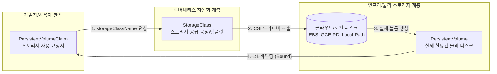
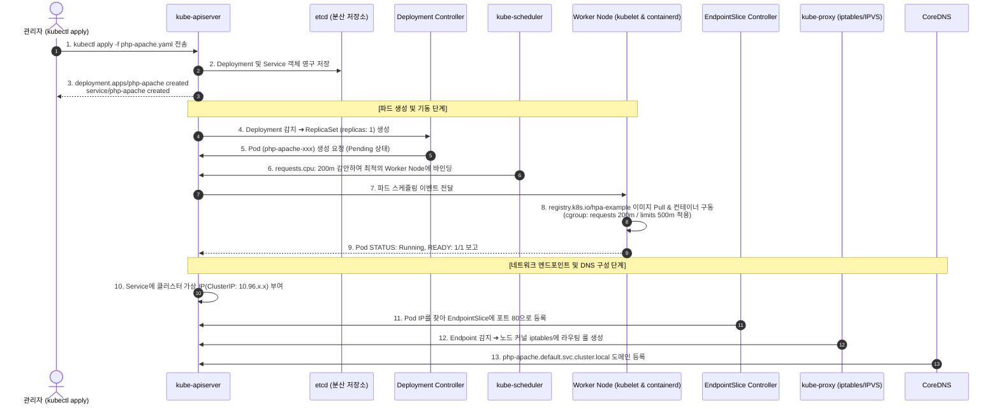
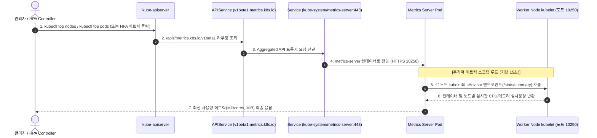

# Kubernetes 핵심 워크로드 및 네트워크 실습 가이드 (Pod, ReplicaSet, Deployment, Service, StatefulSet, Probes, Kube-Linter, GitOps, StorageClass, HPA, ConfigMap/Secret)

본 문서는 프로젝트 폴더 내의 실제 매니페스트 파일들(`pod.yaml`, `replicaset.yaml`, `deployment.yaml`, `deployment-configmap.yaml`, `mysql.yaml`, `db-secret.yaml`, `app-config2.yaml`, `service-*.yaml`, `statefulset.yaml`, `sf-db.yaml`, `init-sidecar.yaml`, `probe-deployment.yaml`, `probe-pod.yaml`, `kind-storageclass.yaml`, `GCP-storageclass.yaml`, `hpa.yaml`, `php-apache.yaml`, `components.yaml`, `test-pvc.yaml`, `test-pod.yaml`, `kind-config-2workers.yaml`, `atesting.yaml`)의 실제 내용과 상호 연계를 철저히 검증하여 작성된 쿠버네티스 종합 실습 가이드입니다.

---

## 1. 매니페스트 구조 및 전체 라인 상세 해설

### 1.1 `pod.yaml` 전체 라인 상세 해설

단일 Pod을 직접 생성하고 실행하기 위한 기본 단위의 매니페스트입니다. `kube-linter` 보안 검사를 통과하도록 비루트(`runAsNonRoot: true`, `runAsUser: 10001`) 및 읽기 전용 루트 파일시스템(`readOnlyRootFilesystem: true`)이 적용되어 있습니다.

```yaml
#pod.yaml
apiVersion: v1                # ① 쿠버네티스 핵심(Core) API 버전
kind: Pod                     # ② 최소 배포 단위인 Pod 리소스 지정
metadata:                     # ③ Pod의 메타데이터 (식별 정보)
  name: web-pod               #    - Pod의 고유한 이름
  namespace: default          #    - 배포 대상 네임스페이스
  labels:                     #    - 리소스 검색 및 그룹화를 위한 키-값 라벨
    app: web                  #      - 'app=web' 라벨 부여 (Service 연결 및 조회용)
spec:                         # ④ Pod의 실제 동작 사양 (PodSpec)
  # [kube-linter 해결 1: run-as-non-root] 루트(root) 실행 방지
  securityContext:
    runAsNonRoot: true
    runAsUser: 10001

  containers:                 #    - Pod 내부에서 실행될 컨테이너 목록
  - name: nginx               #      - 컨테이너 고유 식별 이름
    image: nginx:1.27         #      - 실행할 컨테이너 이미지 및 태그

    # [kube-linter 해결 2: no-read-only-root-fs] 루트 파일시스템 읽기 전용 설정
    securityContext:
      readOnlyRootFilesystem: true

    ports:                    #      - 컨테이너가 노출하는 네트워크 포트 목록
    - containerPort: 80       #        - 컨테이너 내부 수신 포트 번호 (HTTP 기본 80)
    resources:                #      - 컴퓨팅 리소스 요청량 및 제한치 설정
      requests: { cpu: 100m, memory: 128Mi } # - 최소 보장 자원 (CPU 0.1코어, 메모리 128Mi)
      limits:   { memory: 256Mi }            # - 최대 허용 메모리 (초과 시 OOMKill 방지)
  restartPolicy: Always       # ⑤ 컨테이너 종료 시 자동 재시작 정책 (Always, OnFailure, Never)
```

#### 📌 `pod.yaml` 줄별 상세 설명

| 필드 경로 | 값 / 예시 | 상세 설명 |
| :--- | :--- | :--- |
| `apiVersion` | `v1` | Pod, Service, Namespace 등 쿠버네티스 핵심(Core) 리소스가 속한 기본 API 버전입니다. |
| `kind` | `Pod` | 생성하려는 리소스 종류(타입)를 지정합니다. Pod은 1개 이상의 컨테이너가 네트워크/스토리지 네임스페이스를 공유하는 최소 실행 단위입니다. |
| `metadata.name` | `web-pod` | 네임스페이스 내에서 유일해야 하는 Pod의 고유 식별자(이름)입니다. |
| `metadata.labels` | `app: web` | 리소스 검색, 필터링(`-l app=web`), 그리고 상위 컨트롤러(Service, Deployment)와 연결하기 위한 키-값 라벨입니다. |
| `spec.securityContext` | `runAsNonRoot: true, runAsUser: 10001` | **[보안 모범 사례]** 컨테이너 프로세스가 루트(UID 0)로 구동되지 못하도록 차단하고 일반 사용자(UID 10001)로 실행을 강제합니다 (`kube-linter` 대응). |
| `spec.containers[].image` | `nginx:1.27` | 컨테이너 런타임이 레지스트리(Docker Hub 등)에서 내려받아 실행할 컨테이너 이미지 주소 및 버전 태그입니다. |
| `spec.containers[].securityContext` | `readOnlyRootFilesystem: true` | 악성코드 주입이나 임의 파일 변조를 막기 위해 루트 파일시스템을 읽기 전용으로 잠급니다. |
| `spec.containers[].ports[].containerPort` | `80` | 컨테이너 프로세스가 수신 대기(Listen)하는 내부 포트 번호입니다. |
| `spec.containers[].resources.requests` | `cpu: 100m, memory: 128Mi` | **최소 보장 자원(요청량)**: 스케줄러가 노드를 선택할 때 기준이 되며, 최소 CPU 0.1코어(100m)와 메모리 128Mi를 보장합니다. |
| `spec.containers[].resources.limits` | `memory: 256Mi` | **최대 제한 자원(상한선)**: 컨테이너가 사용할 수 있는 최대치로, 메모리 256Mi를 초과하면 시스템 보호를 위해 OOMKill(강제 종료 후 재시작)됩니다. |
| `spec.restartPolicy` | `Always` | 컨테이너 프로세스가 종료되었을 때의 재시작 정책입니다. (기본값: `Always`) |

---

### 1.2 `replicaset.yaml` 전체 라인 상세 해설

지정된 개수의 Pod 복제본을 항상 클러스터 내에 유지하고, 장애 발생 시 자동으로 새 Pod을 띄워 복구(자가 치유)하는 컨트롤러 매니페스트입니다. 실제 파일에는 `kube-linter` 검증을 통과하도록 파드 안티-어피니티(`affinity`), 보안 컨텍스트(`securityContext`), 리소스 제한(`resources`)이 완비되어 있습니다.

```yaml
#replicaset.yaml
apiVersion: apps/v1           # ① 워크로드 리소스 관리 API 그룹/버전
kind: ReplicaSet              # ② 지정된 수의 Pod 복제본을 항상 유지하고 자가 치유하는 컨트롤러
metadata:                     # ③ ReplicaSet의 식별 정보
  name: web-rs                #    - ReplicaSet 고유 이름
  namespace: default          #    - 배포 대상 네임스페이스
spec:                         # ④ 원하는 상태(Desired State) 정의
  replicas: 4                 #    - 항상 유지해야 할 Pod의 목표 수량 (4개)
  selector:                   #    - 관리할 Pod을 식별하기 위한 라벨 셀렉터
    matchLabels:              #      - 아래 라벨 조건을 만족하는 Pod을 감시/제어
      app: web                #        - 'app=web' 라벨을 가진 Pod 대상
  template:                   # ⑤ Pod 수가 부족할 때 새로 찍어낼 설계도 (PodTemplateSpec)
    metadata:                 #    - 생성될 Pod의 메타데이터
      labels:                 #      - 생성될 Pod에 부착될 라벨 (selector와 일치 필수)
        app: web              #        - 'app=web' 라벨 부여
    spec:                     # ⑥ 개별 Pod의 실행 사양 (PodSpec)
      # [kube-linter 해결 1: no-anti-affinity] Pod 안티-어피니티 설정 (복제본 분산 배치)
      affinity:
        podAntiAffinity:
          preferredDuringSchedulingIgnoredDuringExecution:
          - weight: 100
            podAffinityTerm:
              labelSelector:
                matchExpressions:
                - key: app
                  operator: In
                  values:
                  - web
              topologyKey: kubernetes.io/hostname

      # [kube-linter 해결 2: run-as-non-root] 루트(root) 실행 방지
      securityContext:
        runAsNonRoot: true
        runAsUser: 10001

      containers:             #    - 실행할 컨테이너 목록
      - name: nginx           #      - 컨테이너 고유 식별 이름
        image: nginx:1.27     #      - 실행할 컨테이너 이미지 및 버전 태그

        # [kube-linter 해결 3: no-read-only-root-fs] 루트 파일시스템 읽기 전용 설정
        securityContext:
          readOnlyRootFilesystem: true

        ports:
        - containerPort: 80

        # [kube-linter 해결 4 & 5: unset-cpu-requirements, unset-memory-requirements]
        resources:
          requests:
            cpu: 100m
            memory: 128Mi
          limits:
            memory: 256Mi
```

#### 📌 `replicaset.yaml` 줄별 상세 설명

| 필드 경로 | 값 / 예시 | 상세 설명 |
| :--- | :--- | :--- |
| `apiVersion` | `apps/v1` | ReplicaSet, Deployment 등 워크로드 컨트롤러가 속한 API 그룹입니다. |
| `kind` | `ReplicaSet` | 지정된 복제본(Replicas) 개수만큼 Pod이 항상 구동되도록 보장하는 리소스입니다. |
| `metadata.name` | `web-rs` | 생성될 ReplicaSet의 고유 식별 이름입니다. |
| `spec.replicas` | `4` | 클러스터 내에 항시 살아있어야 하는 목표 Pod 개수입니다. 장애로 Pod이 죽으면 즉시 새 Pod을 보충합니다. |
| `spec.selector.matchLabels` | `app: web` | ReplicaSet이 관리 대상으로 삼을 Pod의 라벨 조건입니다. Pod의 `labels`와 반드시 일치해야 합니다. |
| `spec.template.spec.affinity` | `podAntiAffinity` | `kind-config-2workers.yaml` 환경의 2개 워커 노드에 4개 파드를 골고루 분산 배치하도록 유도합니다. |
| `spec.template.spec.securityContext` | `runAsNonRoot: true` | 비루트 권한 실행을 강제합니다. |
| `spec.template.spec.containers[].resources` | `requests/limits` | CPU 100m, 메모리 128Mi 보장 및 메모리 256Mi 한도를 지정합니다. |

---

### 1.3 `deployment.yaml` 전체 라인 상세 해설

Pod 복제본을 유지하고, 롤링 업데이트 및 자가 치유(Self-Healing)를 자동 관리하는 고수준 컨트롤러 매니페스트입니다.
실제 파일에는 Nginx 표준 이미지의 루트 실행 및 캐시 디렉터리 쓰기 필요성을 반영하여 `annotations`로 린터 예외 처리가 구성되어 있고, 다중 노드 분산 배치를 위한 `podAntiAffinity`가 포함되어 있습니다.

```yaml
#deployment.yaml
apiVersion: apps/v1           # ① 워크로드(앱) 관리를 위한 API 그룹 및 버전
kind: Deployment              # ② Pod 복제본 관리 및 무중단 배포를 관장하는 컨트롤러
metadata:                     # ③ Deployment 자체를 식별하고 정보를 부여하는 메타데이터
  name: web                   #    - Deployment의 고유 이름
  namespace: default          #    - 배포 대상 네임스페이스 (기본: default)
  labels:                     #    - Deployment 리소스를 분류/식별하기 위한 라벨
    app: web                  #      - 'app=web' 라벨
  annotations:                #    - 시스템/운영 도구가 참조하는 비식별 부가 정보
    team: platform            #      - 관리 부서/팀 정보 ('team=platform')
    ignore-check.kube-linter.io/no-read-only-root-fs: "표준 nginx 이미지는 /var/cache 등 쓰기 권한이 필요함"
    ignore-check.kube-linter.io/run-as-non-root: "표준 nginx 이미지는 80 포트 바인딩 및 초기 구동 시 root 권한이 필요함"
spec:                         # ④ 원하는 상태(Desired State) 정의 (Deployment 자체 사양)
  replicas: 3                 #    - 항시 유지할 Pod 복제본(Replicas) 개수
  revisionHistoryLimit: 10    #    - 롤백을 위해 유지할 과거 배포 이력(ReplicaSet) 보관 개수 (기본값: 10)
  strategy:
    type: RollingUpdate       #    - 롤링 업데이트 방식 (기본값: 무중단 점진적 교체)
    rollingUpdate:
      maxSurge: 25%           #    - 배포 중 목표 Replicas를 초과하여 추가 생성 가능한 Pod 비율
      maxUnavailable: 25%     #    - 배포 중 일시적으로 사용 불가능해도 되는 Pod 비율
  minReadySeconds: 5          #    - 새 Pod 생성 후 Crash 없이 정상 작동하는지 대기/검증하는 최소 시간(초)
  selector:                   #    - 관리 대상 Pod을 찾아내기 위한 라벨 셀렉터
    matchLabels:              #      - 아래 라벨과 완전히 일치하는 Pod을 감시/관리
      app: web                #        - 'app=web' 라벨을 가진 Pod 대상
  template:                   # ⑤ 신규 Pod을 생성할 때 사용할 설계도 (PodTemplateSpec)
    metadata:                 #    - 생성될 Pod의 메타데이터
      labels:                 #      - 생성될 Pod에 부여할 라벨 (selector와 반드시 일치)
        app: web              #        - 'app=web' 라벨 부여
    spec:                     # ⑥ 개별 Pod의 구체적인 실행 사양 (PodSpec)
      # [kube-linter 해결 1: no-anti-affinity] Pod 안티-어피니티 설정 (복제본 Pod들을 서로 다른 노드에 분산 배치)
      affinity:
        podAntiAffinity:
          preferredDuringSchedulingIgnoredDuringExecution:
          - weight: 100
            podAffinityTerm:
              labelSelector:
                matchExpressions:
                - key: app
                  operator: In
                  values:
                  - web
              topologyKey: kubernetes.io/hostname

      containers:             #    - Pod 내부에서 실행될 컨테이너 목록
      - name: nginx           #      - 컨테이너 고유 식별 이름
        image: nginx:1.27     #      - 실행할 컨테이너 이미지 및 버전 태그
        ports:                #      - 컨테이너가 개방할 포트 목록
        - containerPort: 80   #        - 컨테이너 내부 수신 포트 번호 (HTTP 기본 80)
        resources:            #      - 컨테이너 컴퓨팅 자원 할당 정책
          requests:           #        - 스케줄링 시 보장받는 최소 자원 (요청량)
            cpu: 100m         #          - CPU 100밀리코어 (0.1 코어)
            memory: 128Mi     #          - 메모리 128 메비바이트
          limits:             #        - 컨테이너가 사용할 수 있는 최대 자원 (제한량)
            memory: 256Mi     #          - 메모리 256 메비바이트 (초과 시 OOMKill)
```

#### 📌 `deployment.yaml` 줄별 상세 설명

| 필드 경로 | 값 / 예시 | 상세 설명 |
| :--- | :--- | :--- |
| `apiVersion` | `apps/v1` | Deployment, StatefulSet, DaemonSet 등 애플리케이션 워크로드 컨트롤러가 속한 API 그룹입니다. |
| `kind` | `Deployment` | 지정된 개수의 Pod 복제본을 유지하고 롤링 업데이트/롤백을 제어하는 컨트롤러 리소스입니다. |
| `metadata` | - | Deployment 리소스 자체의 고유 정보를 선언합니다. |
| `metadata.name` | `web` | 클러스터 내에서 Deployment를 식별하는 이름입니다. |
| `metadata.namespace` | `default` | 이 리소스가 배포될 논리적 격리 공간(Namespace)입니다. |
| `metadata.labels` | `app: web` | Deployment 객체 자체에 부여하는 라벨입니다. |
| `metadata.annotations` | `team: platform` | 시스템, CI/CD 파이프라인, 모니터링 도구가 참조할 수 있는 비식별 부가 메타데이터입니다. |
| `spec` (외부) | - | **Deployment 자체의 동작 사양**을 정의하는 최상위 `spec`입니다. |
| `spec.replicas` | `3` | 클러스터 내에 항상 실행 상태로 유지해야 할 Pod의 목표 복제본 개수입니다. |
| `spec.revisionHistoryLimit` | `10` | 장애 시 롤백(`rollout undo`)을 위해 보관할 이전 ReplicaSet(배포 이력)의 최대 개수입니다 (기본값: 10). |
| `spec.strategy.type` | `RollingUpdate` | 배포 교체 전략으로, 구버전 Pod을 점진적으로 새 버전 Pod으로 교체하는 무중단 배포 방식입니다 (기본값). |
| `spec.strategy.rollingUpdate.maxSurge` | `25%` | 롤링 배포 진행 중 목표 Replicas를 초과하여 추가로 생성할 수 있는 최대 Pod 비율(또는 절대 개수)입니다. |
| `spec.strategy.rollingUpdate.maxUnavailable` | `25%` | 롤링 배포 중 일시적으로 서비스 불가능 상태가 되어도 되는 최대 Pod 비율(또는 절대 개수)입니다. |
| `spec.minReadySeconds` | `5` | 새로 생성된 Pod이 Ready 상태가 된 후, 컨테이너의 Crash 없이 안정적으로 기동 중인지 대기하며 검증하는 최소 시간(초)입니다. |
| `spec.selector` | - | 이 Deployment가 어떤 Pod들을 자신의 관리 대상으로 삼을지 지정하는 라벨 셀렉터입니다. |
| `spec.selector.matchLabels`| `app: web` | Pod의 라벨 중 `app=web`을 가진 Pod만을 선택하여 제어합니다. |
| `spec.template` | - | 새로운 Pod을 생성해야 할 때 참고하는 **"Pod 템플릿(설계도)"**입니다. |
| `spec.template.metadata.labels` | `app: web` | **생성될 Pod에 부착될 라벨**입니다. 반드시 상위 `selector.matchLabels`와 일치해야 합니다. |
| `spec.template.spec` (내부) | - | **개별 Pod의 실제 실행 사양 (`PodSpec`)**입니다. 단독 `pod.yaml`의 `spec`과 완전히 동일합니다. |
| `spec.template.spec.containers` | `[...]` | 생성될 Pod 내부에서 실행할 컨테이너 목록입니다. |
| `containers[].name` | `nginx` | 실행할 컨테이너의 이름입니다. |
| `containers[].image` | `nginx:1.27` | 실행할 컨테이너 이미지와 버전입니다. 이미지 변경 시 Deployment가 자동으로 무중단 롤링 업데이트를 수행합니다. |
| `containers[].ports[].containerPort` | `80` | 컨테이너가 사용하는 내부 네트워크 포트입니다. |
| `containers[].resources.requests` | `cpu: 100m, memory: 128Mi` | 각 Pod마다 보장할 최소 자원 요구량(0.1 CPU, 128Mi 메모리)입니다. |
| `containers[].resources.limits` | `memory: 256Mi` | 각 Pod이 사용할 수 있는 최대 메모리 한계치(256Mi)입니다. |
| `status` (주석) | `readyReplicas: 3` | 사용자가 선언하지 않고, 쿠버네티스 컨트롤러가 현재 실행 중인 실제 레플리카 수를 동적으로 보고하는 읽기 전용 영역입니다. |

---

### 1.4 외부 `spec` vs 내부 `spec` 차이점

Deployment 매니페스트에는 `spec` 필드가 두 번(루트 레벨 및 `template` 하위) 중첩되어 나타납니다.

| 구분 | 위치 | 의미 및 역할 | 주요 필드 |
| :--- | :--- | :--- | :--- |
| **외부 `spec`** | `spec:` (루트 레벨) | **Deployment 리소스 자체의 사양**<br>→ "Pod들을 몇 개 유지하고 어떻게 관리할 것인가?"를 정의 | `replicas`, `selector`, `strategy` 등 |
| **내부 `spec`** | `spec.template.spec:` | **생성될 개별 Pod의 사양 (`PodSpec`)**<br>→ "실제 실행될 각 Pod 내부에 어떤 컨테이너와 리소스를 둘 것인가?"를 정의 | `containers`, `volumes`, `restartPolicy` 등 |

- **`template` 필드의 역할**: 새로운 Pod를 찍어내기 위한 **"Pod 설계도(템플릿)"** 역할을 합니다.
- **`PodSpec` 구조**: `template.spec`은 단독 Pod(`pod.yaml`)를 정의할 때 사용하는 `spec`과 완전히 동일한 구조(`PodSpec`)를 갖습니다.

---

## 2. Pod 배포 및 상태 확인 방법

### 2.1 배포 및 상태 조회
```powershell
# 배포
kubectl apply -f pod.yaml

# Pod 상태 확인 (STATUS: Running, READY: 1/1 확인)
kubectl get pods

# IP 및 배포된 노드 정보까지 상세 확인
kubectl get pod web-pod -o wide

# 상태 변화 실시간 감시
kubectl get pods -w
```

### 2.2 상세 정보 및 로그 확인
```powershell
# Pod 이벤트 및 상세 사양 점검 (문제 발생/Pending/Crash 시 필수)
kubectl describe pod web-pod

# 컨테이너 로그 확인
kubectl logs web-pod
kubectl logs -f web-pod
```

### 2.3 로컬 접속 테스트 (Port-Forward)
```powershell
kubectl port-forward pod/web-pod 8080:80
```
- **PowerShell 주의사항**: `curl`은 PowerShell의 `Invoke-WebRequest` 별칭이므로 본문 전체가 아닌 객체 요약이 출력됩니다.
  - HTML 본문을 직접 확인하려면: `curl.exe http://localhost:8080` 또는 `(curl http://localhost:8080).Content` 실행

---

## 3. 웹 브라우저 접속 트러블슈팅

### 3.1 `GET /assets/... 404 (Not Found)` 오류
- **원인**: 이전에 `localhost:8080`에서 구동했던 프론트엔드 웹 앱(Todo 앱 등)의 **브라우저 캐시** 또는 **서비스 워커(Service Worker)**가 남아있어 이전 정적 자산을 요청하기 때문입니다.
- **해결 방법**:
  1. **강력 새로고침**: `Ctrl + Shift + R` 또는 `Ctrl + F5`
  2. **시크릿 창 접속**: `Ctrl + Shift + N` 후 `http://localhost:8080` 접속
  3. **사이트 데이터 삭제**: `F12(개발자 도구)` -> `Application` -> `Storage` -> `Clear site data` 실행

---

## 4. Deployment 포트 포워딩 동작 원리

### 4.1 `kubectl port-forward deployment/web 8012:80`
- **단일 Pod 터널링**: Deployment에 Pod이 3개(`replicas: 3`) 존재하더라도, `port-forward`는 **로드밸런서가 아니며 3개 중 조건(Running & Ready)을 만족하는 특정 1개 Pod과 1:1 고정 터널**을 생성합니다.
- 트래픽이 라운드로빈 방식으로 분산되지 않습니다.

### 4.2 실제 수신 Pod 검증 방법
레이블 기반으로 전체 Pod 로그를 동시에 스트리밍하여 확인합니다:

```powershell
kubectl logs -f -l app=web --max-log-requests=10 --prefix=true
```

- 브라우저나 `curl`로 `http://localhost:8012`에 요청을 보냈을 때:
  - 3개 Pod(`web-...-p9hbf`, `web-...-tbjj8`, `web-...-vpgts`) 중 **특정 1개 Pod(`web-...-p9hbf`)에만 `GET /` 200 HTTP 접근 로그가 기록**되는 것을 확인할 수 있습니다.

> **참고**: 여러 Pod으로 실제 트래픽을 분산(로드 밸런싱)하려면 `port-forward`가 아닌 쿠버네티스 **`Service`** 리소스(ClusterIP, NodePort, LoadBalancer)를 사용해야 합니다.

---

## 5. Pod vs ReplicaSet vs Deployment 계층 구조 및 ReplicaSet의 존재 이유

쿠버네티스 워크로드는 **`Pod -> ReplicaSet -> Deployment`**의 3단계 계층 구조로 이루어져 있으며, 각 리소스는 **단일 책임 원칙(Single Responsibility)**에 따라 명확히 역할을 분담합니다.

```text
[ Deployment ]  ──▶ "배포 전략, 버전 관리, 롤링 업데이트, 롤백 총괄" (지휘관)
       │
       ▼
[ ReplicaSet ]  ──▶ "지정된 개수(replicas)의 Pod을 항상 유지 및 자가 치유" (전담 일꾼)
       │
       ▼
    [ Pod ]     ──▶ "실제 컨테이너 프로세스 구동" (최소 실행 단위)
```

---

### 5.1 3자 비교 요약표

| 비교 항목 | Pod (`v1`) | ReplicaSet (`apps/v1`) | Deployment (`apps/v1`) |
| :--- | :--- | :--- | :--- |
| **핵심 역할** | 컨테이너 실행 최소 단위 | **Pod 복제본 수량 유지 및 자가 치유** | **무중단 롤링 배포 및 버전 이력 관리** |
| **자가 치유 (Self-Healing)** | ❌ 지원 안 됨 (노드 장애 시 종료) | ✅ 지원 (설정된 `replicas` 항시 유지) | ✅ 지원 (ReplicaSet을 통해 간접 유지) |
| **수평 확장 (Scaling)** | ❌ 수동 생성 필요 | ✅ `replicas` 수치 변경으로 즉시 증감 | ✅ `replicas` 수치 변경으로 즉시 증감 |
| **무중단 롤링 업데이트** | ❌ 불가 (삭제 후 재생성) | ❌ **불가** (이미지 변경 시 기존 Pod 불변) | ✅ **기본 지원** (`RollingUpdate`) |
| **배포 이력 및 롤백** | ❌ 불가 | ❌ **불가** (과거 이력 관리 없음) | ✅ **기본 지원** (`rollout undo`) |
| **실무 사용 빈도** | 일회성 테스트, 디버깅용 | **직접 작성하지 않음** (Deployment가 자동 생성) | **운영 환경의 웹 서비스 및 API 서버 표준** |

---

### 5.2 Deployment에 `replicas`가 있는데도 `ReplicaSet`이 존재하는 이유

`deployment.yaml`에 이미 `replicas: 3`이 선언되어 있는데도, 쿠버네티스 아키텍처에 `ReplicaSet`이 별도로 존재하고 작동하는 이유는 다음과 같습니다.

#### 1) 단일 책임 원칙 (Role Separation)
- **ReplicaSet의 유일한 임무**: **"라벨 셀렉터와 일치하는 Pod이 정확히 N개 살아있는가?"**만 감시합니다.
  - ReplicaSet은 이미지가 바뀌었는지, 배포가 성공했는지, 롤백을 해야 하는지 등의 **"배포 라이프사이클"에 대해서는 전혀 알지 못합니다.**
- **Deployment의 임무**: ReplicaSet 위에 군림하여 **"어떤 버전의 ReplicaSet을 몇 개씩 띄우고 줄일 것인가?"**를 조율하는 상위 관리자입니다.

#### 2) 무중단 롤링 배포(Rolling Update)의 핵심 메커니즘
Deployment가 무중단 배포를 실현하는 비결이 바로 **구버전 ReplicaSet과 신버전 ReplicaSet을 교차 스케일링**하는 데 있습니다.

- **Nginx v1 배포 시**:
  ```text
  Deployment (web)
      └── ReplicaSet-v1 (replicas: 3) ──▶ [Pod v1] [Pod v1] [Pod v1]
  ```
- **Nginx v2로 이미지 업데이트 시**:
  Deployment는 기존 ReplicaSet을 수정하지 않고, **새로운 `ReplicaSet-v2`를 새로 생성**한 후 점진적으로 파드를 이전합니다.
  ```text
  Deployment (web)
      ├── ReplicaSet-v1 (3개 ──▶ 2개 ──▶ 1개 ──▶ 0개로 축소)
      └── ReplicaSet-v2 (0개 ──▶ 1개 ──▶ 2개 ──▶ 3개로 확대) ──▶ [Pod v2] [Pod v2] [Pod v2]
  ```

#### 3) 초고속 롤백(`rollout undo`)의 원리
- 배포가 완료되어도 구버전의 `ReplicaSet-v1`은 완전히 삭제되지 않고 `replicas: 0` 상태로 클러스터에 보존됩니다 (`revisionHistoryLimit: 10` 기준).
- 만약 신규 버전에 장애가 발생하여 `$kubectl rollout undo deployment/web`을 실행하면:
  - Deployment는 보관되어 있던 `ReplicaSet-v1`의 `replicas`를 다시 `0 -> 3`으로 올리고, 문제의 `ReplicaSet-v2`를 `0`으로 내려 **1초 만에 즉시 구버전으로 복구**합니다.

---

### 5.3 실무 관점 vs 실습 관점

1. **실무 관점 (Production)**:
   - **엔지니어가 `ReplicaSet`을 직접 YAML 파일로 정의하는 일은 없습니다.**
   - 쿠버네티스 공식 문서에서도 *"ReplicaSet을 직접 생성하지 말고 항상 Deployment를 정의하여 사용할 것"*을 명시하고 있습니다.
2. **실습 관점 (Learning & Practice)**:
   - `replicaset.yaml`을 단독으로 작성해 보는 이유는, **Deployment가 Pod의 수량을 맞추고 자가 치유(Self-Healing)를 수행하는 내부 엔진이 바로 'ReplicaSet'이라는 사실을 명확히 이해하고 검증하기 위함**입니다.

---

## 6. YAML 템플릿의 빈 중괄호(`{}`) 필드 작성 가이드

`kubectl create deployment web --image=nginx:1.27 --dry-run=client -o yaml > a.yaml` 명령어로 스캐폴딩(초기 생성)할 때 나타나는 빈 중괄호(`{}`) 필드들의 의미와 작성법입니다.

### 6.1 `strategy: {}` (배포 전략)
새로운 버전으로 업데이트할 때 Pod을 어떻게 교체할지 정의합니다.
- **채우는 방법**:
  - **롤링 업데이트 세부 제어 (기본값)**:
    ```yaml
    strategy:
      type: RollingUpdate
      rollingUpdate:
        maxSurge: 25%        # 배포 중 최대 초과 생성 가능한 Pod 비율
        maxUnavailable: 25%  # 배포 중 일시적으로 사용 불가능해도 되는 Pod 비율
    ```
  - **전체 재생성 (Recreate)**: 기존 Pod을 전부 내린 후 새 Pod을 띄움 (다운타임 발생)
    ```yaml
    strategy:
      type: Recreate
    ```
- **권장 사항**: 기본 롤링 업데이트로 충분하다면 쿠버네티스 기본값이 적용되므로 **라인 자체를 완전히 삭제하거나 생략**해도 무방합니다.

### 6.2 `resources: {}` (컨테이너 컴퓨팅 자원 할당)
컨테이너가 사용할 최소 보장량(`requests`)과 최대 한계치(`limits`)를 지정합니다.
- **채우는 방법**:
  ```yaml
  resources:
    requests:
      cpu: 100m        # 최소 0.1 CPU (100m)
      memory: 128Mi    # 최소 128MB
    limits:
      memory: 256Mi    # 최대 256MB (초과 시 OOMKill 방지)
  ```
- **권장 사항**: 실습 환경에서는 `{}` 상태로 두어도 구동되지만, 운영 환경에서는 노드의 메모리 부족/CPU 독점을 막기 위해 **반드시 명시**하는 것이 좋습니다.

### 6.3 `status: {}` (클러스터 현재 상태)
- **채우는 내용**: **아무것도 채우지 않습니다.**
- **이유**: `status`는 사용자가 선언하는 값이 아니며, **쿠버네티스 컨트롤러가 Pod의 실제 실행 상태를 동적으로 기록**하는 공간입니다.
- **권장 사항**: `dry-run`으로 인해 생성된 빈 껍데기이므로 **이 라인은 완전히 삭제**하는 것이 표준입니다.

---

## 7. Kubernetes Service 개요 및 유형별 (ClusterIP, NodePort, LoadBalancer, Headless) 완벽 가이드

### 7.1 Kubernetes Service란?

쿠버네티스에서 **Pod은 언제든 죽고 재생성될 수 있는 일시적인(Ephemeral) 객체**입니다.
- Pod이 다시 뜰 때마다 **IP 주소가 매번 변경**됩니다.
- Deployment로 여러 개의 Pod(`replicas: 3`)을 운영할 때, 클라이언트가 어떤 Pod의 IP로 요청을 보내야 할지 알 수 없습니다.

**Service**는 이러한 문제를 해결하기 위해 Pod 앞단에 배치되는 **안정적인 단일 진입점(고정 가상 IP + DNS)**입니다.

```text
                                 ┌──▶ [ Pod 1 (10.244.1.5) ]
[ 클라이언트 요청 ] ──▶ [ Service ] ──┼──▶ [ Pod 2 (10.244.2.8) ]  (자동 로드밸런싱)
    (고정 IP/도메인)    (Selector: app=web) └──▶ [ Pod 3 (10.244.1.9) ]
```

#### 📌 Service의 3대 핵심 역할
1. **고정된 IP 및 DNS 제공**: Pod이 재생성되어 IP가 바뀌어도 Service의 가상 IP(ClusterIP)와 도메인 이름(`web-service.default.svc.cluster.local`)은 영구적으로 유지됩니다.
2. **동적 엔드포인트(Endpoints) 추적**: 라벨 셀렉터(`selector.matchLabels`)를 통해 조건에 맞는 정상 상태(Ready)의 Pod들을 실시간으로 감지하고 라우팅 대상 목록에 자동 등록/제거합니다.
3. **내부 부하 분산 (Load Balancing)**: 들어오는 트래픽을 감지된 복제본 Pod들로 공평하게 분산(L4 레이어) 전달합니다.

---

### 7.2 Service의 포트 매핑 이해 (`port` vs `targetPort` vs `nodePort`)

Service 매니페스트를 작성할 때 혼동하기 쉬운 3가지 포트의 역할과 관계입니다.

```text
[ 외부 사용자 ]
      │
      ▼  (nodePort : 30080)  ── 노드의 외부 통신 개방 포트 (NodePort, LoadBalancer 사용)
   [ Node ]
      │
      ▼  (port : 80)          ── Service 객체 자체의 가상 IP 포트
  [ Service ]
      │
      ▼  (targetPort : 80)    ── Pod 컨테이너 내부 프로세스가 수신 대기하는 포트
 [ Pod (Nginx) ]
```

- **`port`**: Service 자체의 가상 IP(VIP)에서 수신 대기하는 포트 (클러스터 내부 클라이언트가 Service에 접속할 때 쓰는 포트).
- **`targetPort`**: 트래픽이 최종적으로 전달될 **실제 Pod 내부 컨테이너 포트** (`deployment.yaml`의 `containerPort: 80`과 일치 필수).
- **`nodePort`**: 외부 접근을 위해 모든 워커 노드의 물리/가상 IP에 열어두는 포트 (`30000~32767` 범위).

---

### 7.3 Service 유형(Type) 상세 비교 (4종)

쿠버네티스는 외부 노출 수준과 워크로드의 특성에 따라 4가지 주요 Service 방식을 제공합니다.

#### 1) `ClusterIP` (기본값) — [service-cip.yaml](./service-cip.yaml)
- **개념**: 클러스터 내부에서만 접근 가능한 고정 가상 IP(ClusterIP)를 생성합니다. 외부 인터넷에서는 직접 접속할 수 없습니다.
- **주요 용도**: 백엔드 API 서버, 데이터베이스(MySQL, Redis), 캐시 등 **클러스터 내부 파드 간 사설 통신**.
- **트래픽 흐름**:
  ```text
  클러스터 내부 Pod ──▶ Service (ClusterIP:80) ──▶ Target Pod:80
  ```
- **매니페스트 예시**:
  ```yaml
  apiVersion: v1
  kind: Service
  metadata:
    name: web-service
  spec:
    type: ClusterIP      # 기본값이므로 생략 가능
    selector:
      app: web
    ports:
    - protocol: TCP
      port: 80
      targetPort: 80
  ```

- **💡 ClusterIP는 누가 어떻게 할당하는가?**:
  - **할당 주체**: **`kube-apiserver`** (쿠버네티스 API 서버) 내부의 Service CIDR 할당기(IP Allocator)가 직접 할당합니다.
  - **할당 대역**: 클러스터 구축 시 설정된 서비스 전용 가상 IP 대역(`--service-cluster-ip-range`, 기본값: 보통 `10.96.0.0/12`)에서 아직 사용되지 않은 IP를 하나 꺼내어 Service 객체의 `spec.clusterIP`에 기록하고 분산 저장소인 `etcd`에 영구 저장합니다.
    *(클러스터 설치 직후 항상 보이는 `kubernetes` 서비스(`10.96.0.1`) 역시 `kube-apiserver`가 시작될 때 해당 대역의 첫 번째 IP를 자신에게 자동 할당한 것입니다.)*
  - **할당자(`kube-apiserver`) vs 실제 패킷 처리자(`kube-proxy`)의 차이**:
    - **`kube-apiserver` (할당자)**: 대역 풀에서 비어있는 가상 IP를 꺼내 서비스 객체에 부여하고 `etcd`에 저장합니다.
    - **`kube-proxy` (라우팅 처리자)**: 각 워커 노드에서 실행되며, `kube-apiserver`가 부여한 ClusterIP를 감시(Watch)하다가 노드의 **`iptables` 또는 `IPVS` 룰을 조작하여 실제 네트워크 패킷을 대상 Pod IP로 전달(Routing)**합니다.

- **📌 `NodeIP` vs `ClusterIP` 핵심 차이 비교**:

  | 비교 항목 | `NodeIP` (노드 IP) | `ClusterIP` (서비스 가상 IP) |
  | :--- | :--- | :--- |
  | **개념 및 실체** | 워커/마스터 노드(서버, VM, Docker 컨테이너)의 **물리적/가상 네트워크 카드(NIC, `eth0` 등)에 바인딩된 실제 IP** | 물리 NIC에 바인딩되지 않고, 커널 네트워크 레이어(iptables/IPVS)에서만 존재하는 **가상 IP (Virtual IP, VIP)** |
  | **할당 주체** | 호스트 인프라 네트워크(GCP/AWS VPC DHCP, 공유기, 온프레미스 정적 IP) | **쿠버네티스 API 서버 (`kube-apiserver`)** |
  | **확인 명령어** | `kubectl get nodes -o wide` (`INTERNAL-IP`, `EXTERNAL-IP`) | `kubectl get svc` (`CLUSTER-IP`) |
  | **외부 접근성** | 노드와 같은 네트워크/LAN 대역에서 **직접 통신(Ping, SSH, NodePort 접속) 가능** | 외부에서는 **직접 라우팅/통신 불가 (Ping 응답 없음)**, 클러스터 내부 파드 및 노드에서만 유효 |
  | **주요 역할** | 노드 자체 관리(SSH), 쿠버네티스 노드 간 통신, `NodePort` 진입점 | 클러스터 내부 파드들에게 **변하지 않는 단일 진입점(VIP) 및 로드밸런싱** 제공 |

---

#### 2) `NodePort` — [service-np.yaml](./service-np.yaml)
- **개념**: `ClusterIP`를 기본 포함하면서, 모든 워커 노드의 실제 IP에 특정 포트(`nodePort`: 30000~32767)를 열어 외부에서 직접 접속할 수 있게 만듭니다.
- **주요 용도**: 개발/테스트 환경의 빠른 외부 노출, 온프레미스 환경에서 임시 외부 접속.
- **트래픽 흐름**:
  ```text
  외부 브라우저 ──▶ <워커 노드 IP>:30080 ──▶ Service (ClusterIP:80) ──▶ Target Pod:80
  ```
- **매니페스트 예시**:
  ```yaml
  apiVersion: v1
  kind: Service
  metadata:
    name: web-nodeport-service
  spec:
    type: NodePort
    selector:
      app: web
    ports:
    - protocol: TCP
      port: 80
      targetPort: 80
      nodePort: 30080    # 30000~32767 (생략 시 자동 할당)
  ```

---

#### 3) `LoadBalancer` — [service-lb.yaml](./service-lb.yaml)
- **개념**: `ClusterIP`와 `NodePort`를 내부적으로 자동 생성하고, 퍼블릭 클라우드(AWS, GCP, Azure) 또는 온프레미스 로드밸런서 솔루션(MetalLB)과 연동하여 **공인 외부 IP(External IP)**를 자동으로 프로비저닝합니다.
- **주요 용도**: 프로덕션 운영 환경의 인터넷 대고객 웹 서비스 및 상용 서비스 배포.
- **트래픽 흐름**:
  ```text
  외부 인터넷 사용자 ──▶ 클라우드 LB (External-IP:80) ──▶ 각 노드의 NodePort ──▶ ClusterIP ──▶ Target Pod:80
  ```
- **매니페스트 예시**:
  ```yaml
  apiVersion: v1
  kind: Service
  metadata:
    name: web-lb-service
  spec:
    type: LoadBalancer
    selector:
      app: web
    ports:
    - protocol: TCP
      port: 80           # 로드밸런서 외부 수신 포트
      targetPort: 80     # Pod 컨테이너 내부 포트
  ```
> **💡 kind 로컬 실습 팁**:
> kind(Kubernetes in Docker)는 실제 퍼블릭 클라우드가 아니므로 `LoadBalancer` 배포 시 기본적으로 `EXTERNAL-IP`가 `<pending>` 상태로 머무릅니다.
> 
> kind 환경에서 이를 해결하고 웹 브라우저에서 접속하는 대표적인 실습 방법:
> 1. **`kubectl port-forward` 활용 (별도 설치 없는 가장 간편한 방법)**:
>    - 새 PowerShell/터미널 창에서 아래 명령어를 실행하여 로컬 포트로 직접 연결합니다:
>      ```bash
>      kubectl port-forward svc/web-lb-service 8080:80
>      ```
>    - 브라우저에서 `http://localhost:8080`으로 접속하여 로드밸런서 경유 통신을 즉시 검증할 수 있습니다.
> 2. **`cloud-provider-kind` 실행 (공식 추천)**:
>    - kind 공식 도구인 `cloud-provider-kind`를 실행해 두면, Minikube의 터널처럼 로컬 Docker 네트워크 대역의 IP가 `EXTERNAL-IP`에 자동으로 할당됩니다.
> 3. **`MetalLB` 배포 (온프레미스 방식)**:
>    - 클러스터 내에 MetalLB를 설치하고 Docker 브리지 네트워크(`kind`) IP 대역 풀을 구성하여 실제 로드밸런서 IP를 자동 발급받을 수 있습니다.

---

#### 4) `Headless Service` (클러스터 IP가 없는 Service) — `spec.clusterIP: None` ([statefulset.yaml](./statefulset.yaml))

- **개념**: Service 매니페스트에 **`clusterIP: None`**을 명시적으로 선언하여, 쿠버네티스가 **단일 가상 IP(VIP)를 할당하지 않고 로드밸런싱이나 프록시 동작을 하지 않는 특수한 서비스**입니다.
- **왜 "Headless(머리가 없는)"라고 부르는가?**:
  - 일반적인 Service는 들어오는 트래픽을 받아 뒤편 Pod들에게 골고루 분배해 주는 **단일 진입점(가상 IP = "머리/Head")**을 제공합니다.
  - Headless Service는 이 가상 IP(머리)를 없애고, 클라이언트가 **각 Pod의 실제 IP로 직접(Direct) 1:1 통신**할 수 있도록 길(DNS)만 열어주기 때문에 Headless라고 부릅니다.
- **CoreDNS 동작 메커니즘 (결정적 차이)**:
  - **일반 ClusterIP 서비스 질의 시**: CoreDNS는 서비스의 가상 IP(VIP, 예: `10.96.0.12`) **단 1개**만 반환하며, 실제 어떤 Pod으로 연결될지는 `kube-proxy`(iptables/IPVS)가 임의로 결정합니다.
  - **Headless 서비스 질의 시**: CoreDNS가 단일 VIP 대신 라벨 셀렉터(`selector`)에 일치하는 **모든 준비된(Ready) Pod들의 실제 IP 목록(A 레코드 목록)**을 전부 반환합니다.
- **StatefulSet과의 결합 (개별 Pod 고유 도메인 생성)**:
  - StatefulSet 매니페스트의 `spec.serviceName`에 Headless Service 이름을 지정하면, CoreDNS는 각 Pod마다 다음과 같은 **고유 식별자 기반 FQDN(도메인)**을 자동으로 생성합니다:
    ```text
    <pod-name>.<service-name>.<namespace>.svc.cluster.local
    ```
    - `web-sts-0.web-service.default.svc.cluster.local` ──▶ `web-sts-0`의 실제 Pod IP 직통 연결
    - `web-sts-1.web-service.default.svc.cluster.local` ──▶ `web-sts-1`의 실제 Pod IP 직통 연결
    - `db-0.db.default.svc.cluster.local` ──▶ `db-0` (MySQL Master/Leader) 직통 연결
- **주요 활용 사례**:
  1. **StatefulSet 데이터베이스 클러스터**: Master(쓰기 전용)와 Slave(읽기 전용)의 주소를 명확히 분리하여 접속해야 할 때 (MySQL 복제, Redis Sentinel, MongoDB ReplicaSet).
  2. **분산 시스템 간 P2P(노드 간 직접) 통신**: Kafka 브로커 간 파티션 동기화, Elasticsearch 노드 간 검색, Cassandra의 Gossip 프로토콜, Zookeeper 리더 선출 등.
  3. **클라이언트 사이드 로드밸런싱**: gRPC처럼 클라이언트 애플리케이션 라이브러리가 모든 서버 Pod IP 목록을 받아 직접 가중치/라운드로빈 부하 분산을 수행할 때.
- **매니페스트 예시**:
  ```yaml
  apiVersion: v1
  kind: Service
  metadata:
    name: web-service
  spec:
    clusterIP: None              # 💡 Headless Service의 핵심 선언! (단일 VIP 미할당)
    selector:
      app: web                  # 라벨이 app=web인 모든 Pod을 DNS 엔드포인트로 등록
    ports:
    - port: 80
      name: web
  ```

> 💡 **쿠버네티스 YAML 작성 팁: `clusterIP`와 `ClusterIP`의 대소문자 구분 규칙**
>
> 쿠버네티스 YAML 매니페스트에서 **필드 이름(Key)**과 **필드 값(Value)**의 대소문자 규칙이 다르기 때문에 혼동하기 쉽습니다:
>
> ```yaml
> spec:
>   type: ClusterIP      # 1) 'type' 필드의 "값(Value)"으로 쓸 때는 대문자 'C' (ClusterIP)
>   clusterIP: None      # 2) 'clusterIP'라는 "필드 이름(Key)"으로 쓸 때는 소문자 'c' (clusterIP)
> ```
> - **필드 키(Key)**: `clusterIP: None`처럼 필드 이름은 소문자 카멜케이스(lowerCamelCase) 규칙에 따라 반드시 소문자 `c`로 시작해야 합니다. (`ClusterIP: None`과 같이 대문자로 작성 시 스키마 유효성 검사 에러 발생)
> - **필드 값(Value)**: `type: ClusterIP`처럼 서비스 유형의 이름은 파스칼케이스(PascalCase) 규칙에 따라 대문자 `ClusterIP`로 작성합니다.
> - **참고**: `spec.type` 필드를 아예 생략하더라도 쿠버네티스가 기본값으로 `type: ClusterIP`를 자동 지정하므로, Headless Service에서는 `clusterIP: None`만 명시해도 됩니다.

---

### 7.4 Service 유형 종합 비교표 (4종)

| 비교 항목 | `ClusterIP` | `NodePort` | `LoadBalancer` | `Headless Service` (`None`) |
| :--- | :--- | :--- | :--- | :--- |
| **외부 접근 여부** | ❌ 불가 (내부 전용) | ✅ 가능 (`<노드IP>:<NodePort>`) | ✅ 가능 (공인 `EXTERNAL-IP:Port`) | ❌ 불가 (내부 전용) |
| **가상 IP (VIP)** | ✅ 단일 VIP 자동 할당 | ✅ 단일 VIP + NodePort | ✅ 단일 VIP + NodePort + 외부IP | ❌ **VIP 없음 (`clusterIP: None`)** |
| **DNS 질의 결과** | Service의 가상 IP 1개 반환 | Service의 가상 IP 1개 반환 | Service의 가상 IP 1개 반환 | **모든 대상 Pod의 실제 IP 목록 전부 반환** |
| **트래픽 부하 분산**| kube-proxy (iptables/IPVS) | kube-proxy (iptables/IPVS) | 클라우드 LB + kube-proxy | **로드밸런싱 없음** (클라이언트가 직접 통신) |
| **개별 Pod 직접 통신**| ❌ 불가 (임의 부하분산) | ❌ 불가 (임의 부하분산) | ❌ 불가 (임의 부하분산) | ✅ **가능** (`<pod-name>.<service-name>`) |
| **상속 계층 구조** | `[ClusterIP]` | `[NodePort]` ⊃ `[ClusterIP]` | `[LoadBalancer]` ⊃ `[NodePort]` ⊃ `[ClusterIP]` | 독립적인 특수 ClusterIP (`None`) |
| **대표 활용 사례** | 마이크로서비스 간 내부 통신 | 개발/실습 테스트, 관리자 콘솔 | 운영 환경의 대고객 상용 웹 서비스 | **StatefulSet (MySQL Master-Slave, Kafka, Redis)** |

---

## 8. StatefulSet 심층 분석: Deployment + ClusterIP와의 결정적 차이 (`statefulset.yaml` & `sf-db.yaml`)

쿠버네티스에서 대부분의 웹 애플리케이션은 `Deployment + Service (ClusterIP)` 조합으로 배포합니다. 그러나 데이터베이스(MySQL, Redis, PostgreSQL), 분산 메시지 큐(Kafka, RabbitMQ), 분산 코디네이터(Zookeeper, etcd)와 같은 애플리케이션은 일반 Deployment로 배포할 경우 심각한 데이터 유실이나 클러스터 붕괴가 발생할 수 있습니다. 

이를 해결하기 위해 사용하는 컨트롤러가 바로 **`StatefulSet`**입니다.

---

### 8.1 핵심 개념: Stateless(무상태) vs Stateful(상태 유지)

| 구분 | Stateless (무상태 애플리케이션) | Stateful (상태 유지 애플리케이션) |
| :--- | :--- | :--- |
| **대표 예시** | Nginx 웹 서버, Spring Boot API 서버, Node.js 웹 앱 | MySQL, MongoDB, Redis Cluster, Kafka, Elasticsearch |
| **Pod의 성격** | 모든 Pod이 완전히 동일함 (대체 가능, 소모품처럼 취급) | 각 Pod이 고유한 데이터와 고유한 역할(Master/Slave)을 가짐 |
| **스토리지** | 로컬 디스크에 상태를 저장하지 않음 (DB나 S3 등 외부 저장소 활용) | 각 Pod마다 자신만의 영속 디스크(PV)를 가지고 데이터를 보존해야 함 |
| **권장 컨트롤러** | **`Deployment`** | **`StatefulSet`** |

---

### 8.2 Deployment + ClusterIP vs StatefulSet + Headless Service 4대 결정적 차이

#### 1) Pod 식별성(Identity) 및 이름 명명 규칙

- **`Deployment` (`deployment.yaml`)**:
  - Pod 이름 뒤에 **무작위 해시 문자열**이 붙습니다 (예: `web-78f56c79b-x9k2p`, `web-78f56c79b-lm4tz`).
  - Pod에 장애가 발생하여 재생성되면 **완전히 새로운 이름과 새로운 IP**를 가진 다른 Pod으로 대체됩니다.
  - 즉, Pod 간의 순서나 고유한 정체성이 전혀 존재하지 않습니다.

- **`StatefulSet` (`statefulset.yaml`, `sf-db.yaml`)**:
  - `0`부터 시작하는 **고정된 정수형 서수 인덱스(Ordinal Index)**가 부여됩니다.
    - 예: `web-sts-0`, `web-sts-1`, `web-sts-2` (또는 `db-0`, `db-1`, `db-2`)
  - Pod이 비정상 종료되거나 삭제되어 재생성되더라도 **반드시 이전과 동일한 이름(인덱스)**을 그대로 유지하며 부활합니다.

```text
[Deployment Pod 교체]
web-78f5-a1b2c (장애 발생/삭제)  ──▶  web-78f5-z9y8x (완전히 새로운 이름으로 생성)

[StatefulSet Pod 자가 치유]
web-sts-0 (장애 발생/삭제)       ──▶  web-sts-0 (동일한 이름과 신원 그대로 재생성)
```

---

#### 2) 네트워크 도메인 및 개별 Pod 접근성 (Headless Service 연동)

- **`Deployment + Service (ClusterIP)` (`service-cip.yaml`)**:
  - Service는 단일 가상 IP(VIP)를 가집니다.
  - 클라이언트가 `web-service.default.svc.cluster.local`로 요청을 보내면, 쿠버네티스 iptables/IPVS가 뒤편의 Pod 중 하나로 **무작위 부하 분산(Load Balancing)**합니다.
  - **문제점**: 외부나 다른 Pod에서 *"1번 Pod(복제본)에게만 데이터를 읽고, 0번 Pod(마스터)에게만 쓰기 트래픽을 보내겠다"* 와 같이 특정 Pod을 개별 지정하여 통신하는 것이 불가능합니다.

- **`StatefulSet + Headless Service` (`statefulset.yaml` 상단 `clusterIP: None`)**:
  - Service에 가상 IP(VIP)를 할당하지 않는 **Headless Service (`clusterIP: None`)**와 결합합니다.
  - 쿠버네티스 CoreDNS는 Service 이름을 통해 단일 IP를 주는 대신, **각 Pod마다 고유한 DNS A 레코드**를 자동으로 등록해 줍니다:
    - `web-sts-0.web-service.default.svc.cluster.local` ──▶ `web-sts-0`의 Pod IP로 직접 연결
    - `web-sts-1.web-service.default.svc.cluster.local` ──▶ `web-sts-1`의 Pod IP로 직접 연결
    - `web-sts-2.web-service.default.svc.cluster.local` ──▶ `web-sts-2`의 Pod IP로 직접 연결
  - **효과**: MySQL Master-Slave 복제 구성 시 Slave Pod들이 Master인 `db-0.db`의 고정 도메인을 바라보고 안전하게 데이터 동기화를 유지할 수 있습니다.

```text
[일반 ClusterIP 서비스]
요청 ──▶ [web-service (단일 VIP)] ──(임의 로드밸런싱)──▶ Pod 아무거나 하나 응답

[Headless Service (clusterIP: None)]
요청(web-sts-0.web-service) ──▶ web-sts-0 Pod 전용 직통 연결 (Leader/Primary 통신)
요청(web-sts-1.web-service) ──▶ web-sts-1 Pod 전용 직통 연결 (Follower/Secondary 통신)
```

---

#### 3) 스토리지 영속성 및 독립 바인딩 (`volumeClaimTemplates`의 마법)

`sf-db.yaml`에서 StatefulSet을 사용하는 가장 결정적인 이유입니다.

- **`Deployment`에서 스토리지를 사용할 때의 치명적 한계**:
  - `spec.template.spec.volumes`에 PersistentVolumeClaim(PVC)을 마운트하면, **모든 복제본 Pod이 동일한 1개의 PVC를 공유**하게 됩니다.
  - AWS EBS나 클라우드 표준 블록 스토리지는 대부분 `ReadWriteOnce(RWO)`만 지원하므로, 두 번째 Pod부터는 볼륨 마운트 에러(`Multi-Attach error`)가 발생하며 기동되지 않습니다.
  - NFS 같은 `ReadWriteMany(RWX)` 스토리지를 공유하더라도, 여러 MySQL 인스턴스가 하나의 데이터 디렉터리에 동시 쓰기를 시도하여 데이터가 파손(Data Corruption)됩니다.

- **`StatefulSet`의 `volumeClaimTemplates` (`sf-db.yaml`)**:
  - StatefulSet은 템플릿 기반으로 **각 Pod마다 전용 PVC를 1:1로 자동 생성**합니다.
    - `db-0` Pod ──▶ `data-db-0` PVC 자동 생성 및 마운트
    - `db-1` Pod ──▶ `data-db-1` PVC 자동 생성 및 마운트
    - `db-2` Pod ──▶ `data-db-2` PVC 자동 생성 및 마운트
  - **영속적 결합(Sticky Storage)**: 만약 노드 장애로 `db-0` Pod이 삭제되고 다른 노드에서 재생성되더라도, 새로 뜬 `db-0`은 다른 볼륨이 아닌 **자신이 사용하던 기존 `data-db-0` PVC를 찾아 완벽하게 다시 마운트**합니다. 데이터가 영구 보존되는 핵심 메커니즘입니다.

```text
[sf-db.yaml의 volumeClaimTemplates 동작]

  ┌──────────────┐          ┌──────────────┐          ┌──────────────┐
  │  Pod: db-0   │          │  Pod: db-1   │          │  Pod: db-2   │
  └──────┬───────┘          └──────┬───────┘          └──────┬───────┘
         │ (1:1 마운트)            │ (1:1 마운트)            │ (1:1 마운트)
  ┌──────▼───────┐          ┌──────▼───────┐          ┌──────▼───────┐
  │ PVC: data-db-0│          │ PVC: data-db-1│          │ PVC: data-db-2│
  └──────┬───────┘          └──────┬───────┘          └──────┬───────┘
         │                         │                         │
  ┌──────▼───────┐          ┌──────▼───────┐          ┌──────▼───────┐
  │   PV (1Gi)   │          │   PV (1Gi)   │          │   PV (1Gi)   │
  └──────────────┘          └──────────────┘          └──────────────┘
  ※ Pod이 삭제 후 다시 살아나도 자기 번호(0, 1, 2)의 PVC에만 영구 결합됨!
```

---

#### 4) 생성, 기동, 스케일링, 종료의 순서 보장 (Order Guarantee)

- **`Deployment`**:
  - `replicas: 3`으로 배포하면 3개의 Pod이 **동시에 병렬(Parallel)**로 기동됩니다.
  - 종료(Termination)할 때도 무작위 순서로 동시에 내려갑니다.

- **`StatefulSet`**:
  - **순차 생성**: `0`번 Pod이 먼저 생성되어 `Running` 및 `Ready` 상태가 완전히 검증된 후에야 비로소 `1`번 Pod 생성을 시작합니다 (`0 ──▶ 1 ──▶ 2`).
  - **역순 종료 (안전한 스케일 다운)**: Pod 수를 줄이거나 삭제할 때는 가장 높은 인덱스 번호부터 역순으로 하나씩 안전하게 종료합니다 (`2 ──▶ 1 ──▶ 0`).
  - **이유**: 분산 DB 클러스터는 Master가 먼저 준비되어야 Slave가 데이터를 복제받을 수 있고, 클러스터 멤버를 줄일 때도 데이터 마이그레이션 및 Quorum(정족수) 유지를 위해 안전하게 하나씩 내려야 하기 때문입니다.

---

---

### 8.3 왜 `statefulset.yaml`에서 Headless Service를 반드시 함께 선언해야 하는가?

`statefulset.yaml` 매니페스트를 보면 상단에 `apiVersion: v1, kind: Service, clusterIP: None` 형태로 Headless Service가 정의되어 있고, 하단 StatefulSet에 `serviceName: "web-service"`로 서로 연결되어 있습니다.

그렇다면 **"Nginx 같은 웹 서버는 굳이 DB도 아닌데 왜 일반 ClusterIP가 아닌 Headless Service를 반드시 선언해야 할까요?"**

---

#### 1) 기술적 이유: 쿠버네티스 StatefulSet의 역할 분담 (책임 분리 원칙)
- **StatefulSet 컨트롤러의 한계**:
  StatefulSet 컨트롤러는 Pod을 0번부터 순서대로 띄우고(`web-sts-0`, `web-sts-1`), 스토리지 볼륨을 붙여주는 **워크로드 생명주기 관리자**일 뿐입니다.
- **DNS 레코드 생성 권한은 Service 리소스에만 존재**:
  쿠버네티스에서 Pod에게 도메인 이름(DNS A 레코드)을 만들어 주는 권한은 워크로드 컨트롤러가 아니라 오직 **`Service` 리소스**에만 있습니다.
- 따라서 쿠버네티스는 StatefulSet 명세에 **`spec.serviceName`을 필수(Required)**로 지정하도록 설계하여, *"이 StatefulSet의 Pod들에게 고유한 도메인 주소를 만들어 줄 책임은 이 Service가 진다"* 고 명시합니다.

---

#### 2) 왜 "일반 ClusterIP 서비스"가 아니라 "Headless Service(`clusterIP: None`)"여야 하는가?

만약 일반 ClusterIP 서비스를 `serviceName`에 연결하면 어떻게 될까요?

| 비교 구분 | 일반 ClusterIP 서비스 사용 시 | Headless Service (`clusterIP: None`) 사용 시 |
| :--- | :--- | :--- |
| **가상 IP (VIP)** | 단일 가상 IP(VIP)가 무조건 부여됨 | 가상 IP가 없음 (`None`) |
| **트래픽 흐름** | Service 이름으로 요청 시 **무작위 Pod으로 로드밸런싱** | **요청한 특정 Pod(`web-sts-0`)의 실제 IP로 직통 연결** |
| **개별 Pod 식별** | ❌ 특정 Pod을 타겟팅하여 통신 불가능 | ✅ **`web-sts-0.web-service`로 1:1 직통 통신 가능** |
| **문제점** | 0번 Pod에 세션 데이터나 작업을 보내려 해도 다른 Pod으로 튀어버림 | 문제 없음 (완벽한 개별 신원 및 직통 라우팅 보장) |

즉, StatefulSet의 가장 핵심적인 존재 가치는 **"각 Pod이 고유한 번호(0, 1, 2)와 고유한 신원을 가지는 것"**인데, 일반 ClusterIP 서비스를 쓰면 **단일 VIP 뒤로 숨겨져 개별 Pod을 구분할 수 없게 되므로 StatefulSet을 쓰는 의미가 완전히 사라집니다.**

---

#### 3) 웹 애플리케이션(`statefulset.yaml`)에서의 실무 및 실습 목적

1. **실습 및 교육 관점 (가장 중요)**:
   - MySQL 같은 무거운 DB를 띄우기 전에, 배포가 빠르고 가벼운 **Nginx 웹 서버를 통해 StatefulSet의 고유 인덱스(`web-sts-0`)와 Headless Service에 의한 DNS 매핑(`web-sts-0.web-service`)이 어떻게 동작하는지 직관적으로 확인**할 수 있습니다.
2. **웹 애플리케이션 실무 관점**:
   - 웹 서버라도 다음과 같은 아키텍처에서는 StatefulSet + Headless Service가 필수적입니다:
     - **분산 세션 동기화**: Pod끼리 인메모리 세션 클러스터링(Infinispan, Hazelcast)을 위해 서로의 실제 IP로 직접 통신해야 할 때
     - **역할 기반 워커 노드**: `web-sts-0`은 크롤링/스케줄러 총괄, `web-sts-1~2`는 데이터 수집을 전담할 때
     - **웹소켓(WebSocket) 게임/채팅 서버**: 특정 사용자가 0번 Pod에 연결되어 있어, 다른 서버가 0번 Pod으로 직접 메시지를 라우팅해야 할 때

---

#### 4) 만약 Headless Service를 선언하지 않으면 어떻게 되는가?

`statefulset.yaml`에서 상단의 Headless Service 선언을 누락하거나 배포하지 않으면:
1. `web-sts-0`, `web-sts-1` Pod 자체는 정상적으로 생성되어 `Running` 상태가 됩니다.
2. 하지만 쿠버네티스 내부 CoreDNS에 `web-sts-0.web-service.default.svc.cluster.local` DNS A 레코드가 등록되지 않습니다.
3. 결과적으로 다른 Pod이나 클라이언트가 `ping web-sts-0.web-service` 또는 `curl web-sts-0.web-service`를 실행했을 때 **`Host Not Found (NXDOMAIN)` 오류**가 발생하며, StatefulSet의 핵심 기능인 **고정 네트워크 식별성(Stable Network Identity)**이 완전히 마비됩니다.

---

### 8.4 샘플 매니페스트 구조 비교

#### 📄 `statefulset.yaml` (웹 애플리케이션 StatefulSet 실습)
`statefulset.yaml` 파일은 Headless Service와 StatefulSet이 `---`로 구분되어 한 파일에 정의되어 있으며, 다중 노드 분산 배치를 위한 `podAntiAffinity` 및 자원 한도가 구성되어 있습니다:

```yaml
# 1. StatefulSet Pod들의 고유 네트워크 도메인을 위한 Headless Service
apiVersion: v1
kind: Service
metadata:
  name: web-service
  namespace: default
  labels:
    app: web
  annotations:
    ignore-check.kube-linter.io/dangling-service: "web-sts StatefulSet과 연동되는 Headless 서비스"
spec:
  clusterIP: None                # Headless Service 설정 (단일 VIP 대신 Pod별 고유 DNS 레코드 생성)
  selector:
    app: web
  ports:
  - port: 80
    name: web
---
# 2. StatefulSet 정의
apiVersion: apps/v1
kind: StatefulSet
metadata:
  name: web-sts
  namespace: default
  annotations:
    ignore-check.kube-linter.io/no-read-only-root-fs: "표준 nginx 이미지는 /var/cache 등 쓰기 권한이 필요함"
    ignore-check.kube-linter.io/run-as-non-root: "표준 nginx 이미지는 80 포트 바인딩 및 초기 구동 시 root 권한이 필요함"
spec:
  serviceName: "web-service"     # Headless Service(web-service)와 연동 필수
  replicas: 3                    # web-sts-0, web-sts-1, web-sts-2 순차 생성
  selector:
    matchLabels:
      app: web
  template:
    metadata:
      labels:
        app: web
    spec:
      affinity:
        podAntiAffinity:
          preferredDuringSchedulingIgnoredDuringExecution:
          - weight: 100
            podAffinityTerm:
              labelSelector:
                matchExpressions:
                - key: app
                  operator: In
                  values:
                  - web
              topologyKey: kubernetes.io/hostname
      containers:
      - name: nginx
        image: nginx:1.27
        ports:
        - containerPort: 80
          name: web
        resources:
          requests:
            cpu: 100m
            memory: 128Mi
          limits:
            memory: 256Mi
```
> **특징**: 볼륨 없이도 Pod의 **순차 생성/종료 순서**와 **고유 식별자(`web-sts-0`)**, **개별 Pod 고유 도메인(`web-sts-0.web-service`)**이 필요한 분산 워커나 클러스터 노드 관리에 적합합니다.

---

#### 📄 `sf-db.yaml` (MySQL 데이터베이스 StatefulSet 실습)
실제 `sf-db.yaml` 파일 역시 상단에 **Headless Service(`name: db`)**가 내장되어 있고, 하단에 **MySQL StatefulSet**이 정의되어 있습니다:

```yaml
# 1. StatefulSet 개별 Pod 식별 및 통신을 위한 Headless Service
apiVersion: v1
kind: Service
metadata:
  name: db                    # StatefulSet spec.serviceName="db" 및 init-sidecar.yaml의 DB_HOST="db"와 일치
  namespace: default
  labels:
    app: db
    tier: database
spec:
  clusterIP: None             # Headless Service 설정 (단일 VIP 없이 Pod별 고유 DNS db-0.db, db-1.db 생성)
  selector:
    app: db
  ports:
  - name: mysql
    port: 3306                # MySQL 기본 포트
    targetPort: 3306
---
# 2. MySQL 데이터베이스 StatefulSet 정의
apiVersion: apps/v1
kind: StatefulSet
metadata:
  name: db
  namespace: default
  labels:
    app: db
    tier: database
spec:
  serviceName: db             # 위에서 정의한 Headless Service(name: db)와 매핑
  replicas: 3                 # db-0 -> db-1 -> db-2 순서로 순차 생성
  selector:
    matchLabels:
      app: db
  template:
    metadata:
      labels:
        app: db
        tier: database
    spec:
      affinity:
        podAntiAffinity:
          preferredDuringSchedulingIgnoredDuringExecution:
          - weight: 100
            podAffinityTerm:
              labelSelector:
                matchExpressions:
                - key: app
                  operator: In
                  values:
                  - db
              topologyKey: kubernetes.io/hostname
      containers:
      - name: mysql
        image: mysql:8.0
        ports:
        - name: mysql
          containerPort: 3306
          protocol: TCP
        env:
        - name: MYSQL_ROOT_PASSWORD
          value: "password123!"
        - name: MYSQL_DATABASE
          value: "tododb"
        resources:
          requests: { cpu: 100m, memory: 256Mi }
          limits:   { cpu: 500m, memory: 512Mi }
        readinessProbe:
          tcpSocket: { port: 3306 }
          initialDelaySeconds: 15
          periodSeconds: 5
        livenessProbe:
          tcpSocket: { port: 3306 }
          initialDelaySeconds: 30
          periodSeconds: 10
        volumeMounts:
        - name: data
          mountPath: /var/lib/mysql

  # Pod마다 독립적인 영구 볼륨(PV/PVC)을 자동 생성/바인딩
  volumeClaimTemplates:
  - metadata:
      name: data
    spec:
      accessModes: [ReadWriteOnce]
      resources:
        requests:
          storage: 1Gi
      # 💡 storageClassName이 명시되지 않았으므로, 클러스터의 'standard (default)' StorageClass가 자동 적용됩니다.
```
> **특징**: `volumeClaimTemplates`를 선언하여 **각 MySQL Pod마다 고유한 1Gi 영속 볼륨(`data-db-0`, `data-db-1`, `data-db-2`)**을 동적으로 생성합니다. Pod이 재시작되거나 노드가 변경되어도 해당 번호의 볼륨을 그대로 다시 마운트하여 데이터가 유지됩니다.

---

### 8.5 `Deployment` vs `StatefulSet` 종합 비교 요약표

| 비교 항목 | `Deployment + ClusterIP` | `StatefulSet + Headless Service` |
| :--- | :--- | :--- |
| **Pod 이름 명명** | 임의 난수 해시 (`web-78f56-x9k2p`) | 고정 서수 인덱스 (`web-sts-0`, `db-0`) |
| **Pod 재생성 시** | 완전히 새로운 이름과 새로운 IP로 교체 | 동일한 이름(`db-0`)과 고유 신원을 유지하며 부활 |
| **배포/종료 순서** | 동시 병렬 생성 / 무작위 종료 | `0 -> 1 -> 2` 순차 생성 / `2 -> 1 -> 0` 역순 종료 |
| **스토리지 관리** | 하나의 PVC를 모든 Pod이 공유 (DB 적용 불가) | `volumeClaimTemplates`로 Pod별 독립 PVC/PV 바인딩 |
| **네트워크 접근** | 단일 VIP 기반 무작위 로드밸런싱 | Pod별 고유 DNS 레코드 (`db-0.db`, `db-1.db`)로 직통 연결 |
| **스케일 다운 시 볼륨** | 해당 없음 | Pod이 삭제되어도 안전을 위해 **PVC는 자동 삭제되지 않고 보존됨** |
| **적합한 워크로드** | Nginx, React, Node.js, Spring Boot 등 무상태 웹 앱 | MySQL, Redis Cluster, Kafka, MongoDB, Zookeeper 등 상태 유지 앱 |

---

### 8.6 실무 요약 가이드

1. **상태(데이터)가 디스크에 저장되지 않아도 되는 웹/WAS 서버**는 항상 **`Deployment`**를 선택하세요. (롤링 배포 속도가 빠르고 관리가 단순함)
2. **Pod마다 고유한 식별 번호가 필요하거나, 자신만의 디스크에 데이터를 영구 저장해야 하는 데이터베이스 및 분산 시스템**은 반드시 **`StatefulSet`**을 선언해야 합니다.

---

## 9. 컨테이너 헬스 체크(Health Check) 및 3대 Probe 완벽 가이드 (`probe-deployment.yaml`)

쿠버네티스는 컨테이너 내부 프로세스가 단순히 켜져 있는 것뿐만 아니라, **"실제 요청을 처리할 준비가 되었는지"**, **"교착 상태(Deadlock)에 빠지지 않고 정상 작동 중인지"**를 지속적으로 감시하고 자가 치유(Self-Healing)를 수행하기 위해 **프로브(Probe)** 메커니즘을 제공합니다.

---

### 9.1 `probe-deployment.yaml` 전체 매니페스트 및 줄별 상세 설명

`nginx:1.27` 공식 이미지를 기반으로 3대 프로브(`startupProbe`, `readinessProbe`, `livenessProbe`)를 결합한 고가용성 Deployment 매니페스트입니다.

```yaml
# probe-deployment.yaml
# 애플리케이션의 고가용성 및 무중단 배포를 위한 Deployment 매니페스트 (nginx:1.27 기반 3대 프로브 적용)
apiVersion: apps/v1
kind: Deployment
metadata:
  name: nginx-deployment
  namespace: default
  labels:
    app: nginx
spec:
  replicas: 3
  selector:
    matchLabels:
      app: nginx
  template:
    metadata:
      labels:
        app: nginx
    spec:
      # [kube-linter 해결 1: no-anti-affinity] Pod 안티-어피니티 설정 (동일 노드 집중 방지)
      affinity:
        podAntiAffinity:
          preferredDuringSchedulingIgnoredDuringExecution:
          - weight: 100
            podAffinityTerm:
              labelSelector:
                matchExpressions:
                - key: app
                  operator: In
                  values:
                  - nginx
              topologyKey: kubernetes.io/hostname

      # [kube-linter 해결 2: run-as-non-root] 루트(root) 실행 방지
      securityContext:
        runAsNonRoot: true
        runAsUser: 10001

      containers:
      - name: nginx
        image: nginx:1.27

        # [kube-linter 해결 3: no-read-only-root-fs] 루트 파일시스템 읽기 전용 설정
        securityContext:
          readOnlyRootFilesystem: true

        ports:
        - containerPort: 80
          protocol: TCP
        resources:
          requests:
            cpu: 100m
            memory: 128Mi
          limits:
            memory: 256Mi

        # ① 시작 프로브 (startupProbe)
        # Nginx 기본 웹서버 포트(80) 및 기본 경로(/)로 구동 여부 확인
        # 성공 전까지 livenessProbe 및 readinessProbe 동작을 보류함
        startupProbe:
          httpGet:
            path: /
            port: 80
          failureThreshold: 30  # 실패 허용 횟수 (최대 2초 x 30 = 60초 대기)
          periodSeconds: 2      # 점검 주기 (2초)

        # ② 준비 완료 프로브 (readinessProbe)
        # Nginx가 요청(트래픽)을 처리할 준비가 되었는지 5초 주기로 확인
        # 실패 시 Service 엔드포인트에서 제외하여 트래픽 인입 차단
        readinessProbe:
          httpGet:
            path: /
            port: 80
          periodSeconds: 5      # 점검 주기 (5초)

        # ③ 활성 프로브 (livenessProbe)
        # Nginx 프로세스가 정상 동작 중인지 10초 주기로 확인
        # 응답 불가 시 컨테이너를 강제 재시작하여 자동 복구
        livenessProbe:
          httpGet:
            path: /
            port: 80
          initialDelaySeconds: 10 # 최초 점검 전 대기 시간 (10초)
          periodSeconds: 10       # 점검 주기 (10초)
```

> **참고 (`probe-pod.yaml`)**: 복제본 없이 단일 Pod 단위로 3대 프로브를 테스트할 수 있는 매니페스트인 `probe-pod.yaml` 역시 프로젝트에 포함되어 있으며, `spec.containers[0]` 구조는 위와 완전히 동일합니다.

#### 📌 `probe-deployment.yaml` 줄별 상세 설명

| 필드 경로 | 값 / 예시 | 상세 설명 |
| :--- | :--- | :--- |
| `startupProbe` | - | 컨테이너 내부 애플리케이션이 **초기 구동(부팅)을 완료했는지** 확인하는 시작 프로브입니다. |
| `startupProbe.httpGet.path` | `/` | HTTP GET 요청을 보낼 엔드포인트 경로입니다. (Nginx 기본 환영 페이지) |
| `startupProbe.httpGet.port` | `80` | HTTP 요청을 수신할 컨테이너 내부 네트워크 포트 번호입니다. |
| `startupProbe.failureThreshold` | `30` | 프로브 실패로 판정하기 전까지 허용하는 최대 실패 횟수입니다. |
| `startupProbe.periodSeconds` | `2` | 프로브 검사를 수행할 주기(간격, 초 단위)입니다. (최대 대기 시간: $2\text{초} \times 30\text{회} = 60\text{초}$) |
| `readinessProbe` | - | 컨테이너가 **실제 사용자 트래픽을 처리할 준비가 되었는지** 지속 감시하는 준비 완료 프로브입니다. |
| `readinessProbe.httpGet` | `{path: /, port: 80}` | Nginx 서버로 HTTP GET 요청을 보내 200~399 상태 코드가 오는지 확인합니다. |
| `readinessProbe.periodSeconds` | `5` | 5초마다 주기적으로 준비 상태를 검사합니다. 실패 시 Service Endpoint 목록에서 해당 Pod IP를 제외합니다. |
| `livenessProbe` | - | 컨테이너가 **살아있는지(Deadlock, 먹통 상태가 아닌지)** 감시하는 활성 프로브입니다. |
| `livenessProbe.httpGet` | `{path: /, port: 80}` | 주기적인 헬스 체크 HTTP 요청을 전송합니다. |
| `livenessProbe.initialDelaySeconds` | `10` | 컨테이너 시작 직후 최초 프로브 검사를 시작하기 전 대기할 유예 시간(10초)입니다. |
| `livenessProbe.periodSeconds` | `10` | 10초마다 주기적으로 생존 여부를 점검합니다. 실패 시 컨테이너를 강제 재시작(Restart)합니다. |

---

### 9.2 3대 Probe (`startupProbe`, `readinessProbe`, `livenessProbe`) 비교 및 동작 메커니즘

| 비교 항목 | `startupProbe` (시작 프로브) | `readinessProbe` (준비 완료 프로브) | `livenessProbe` (활성 프로브) |
| :--- | :--- | :--- | :--- |
| **핵심 질문** | *"애플리케이션이 완전히 떴는가?"* | *"지금 고객 요청(트래픽)을 받을 수 있는가?"* | *"프로세스가 멈추거나 죽지 않고 살아있는가?"* |
| **주요 목적** | 초기 부팅(초기화) 시간이 긴 앱 보호 | 준비되지 않은 상태로 트래픽 인입 방지 | 교착 상태(Deadlock)에 빠진 컨테이너 자동 복구 |
| **실패 시 K8s 조치** | **컨테이너 강제 재시작 (Restart)** | **Pod 재시작 없음**, **Service 엔드포인트에서 제외** | **컨테이너 강제 재시작 (Restart)** |
| **동작 시점** | 컨테이너 기동 직후에만 실행 | `startupProbe` 성공 직후부터 파드 종료 시까지 | `startupProbe` 성공 직후부터 파드 종료 시까지 |
| **상호 작용** | 성공할 때까지 다른 두 프로브 동작을 **차단** | 실패해도 컨테이너는 정상 유지되며 트래픽만 차단 | 실패 시 Kubelet이 컨테이너를 즉시 Kill 후 재생성 |

---

### 9.3 컨테이너 생명주기 및 프로브 실행 흐름도

```text
               [ 컨테이너 시작 (Container Start) ]
                               │
                               ▼
                   [ startupProbe 주기적 실행 ]
                               │
            ┌──────────────────┴──────────────────┐
     (60초 내 성공)                         (최대 30회 실패 초과)
            │                                     │
            ▼                                     ▼
 [ startupProbe 비활성화 ]                 [ 컨테이너 강제 재시작 ]
 [ readiness & liveness 활성화 ]           (CrashLoopBackOff 위험)
            │
     ┌──────┴──────────────────────────┐
     ▼                                 ▼
[ readinessProbe 실행 (5s) ]     [ livenessProbe 실행 (10s) ]
     │                                 │
     ├─ 성공: Service Endpoints 연결   ├─ 성공: 정상 실행 유지
     └─ 실패: Service Endpoints 제외   └─ 실패: 컨테이너 강제 Kill & Restart
```

---

### 9.4 컨테이너 이미지 변경에 따른 프로브 설정 변동 사항 (`myapi:1.4.0` ➔ `nginx:1.27`)

강의 또는 실습 중 기존 API 전용 이미지(`myapi:1.4.0`)에서 표준 웹 서버(`nginx:1.27`)로 전환할 때 반드시 함께 수정해야 하는 항목들입니다:

1. **포트 번호 변경 (`containerPort`, `port: 8080` ➔ `80`)**:
   * API 서버는 주로 `8080` 포트를 사용하지만, 표준 Nginx 웹 서버는 기본 HTTP 수신 포트로 **`80`**을 사용합니다.
2. **Probe HTTP 경로 변경 (`path: /healthz, /ready` ➔ `/`)**:
   * **원인**: 공식 `nginx:1.27` 컨테이너에는 기본적으로 `/healthz`나 `/ready` 경로가 구성되어 있지 않습니다.
   * **영향**: 기본 이미지에 `/healthz` 요청을 보내면 Nginx는 **`HTTP 404 Not Found`**를 반환합니다. 쿠버네티스는 200~399 범위 외의 응답을 모두 **실패(Failure)**로 처리하므로:
     * `startupProbe` 실패 ➔ 컨테이너 무한 재시작 (`CrashLoopBackOff`)
     * `readinessProbe` 실패 ➔ Pod이 영원히 `READY 0/1` 상태로 트래픽 인입 불가
   * **해결**: Nginx가 기본 제공하는 환영 페이지인 루트 경로 **`/`**로 점검 경로를 변경하여 `HTTP 200 OK`를 수신하도록 합니다.

---

### 9.5 배포(`kubectl apply`) 후 4단계 필수 점검 체크리스트

매니페스트를 클러스터에 배포한 후 프로브가 의도대로 동작하는지 검증하는 표준 절차입니다:

#### 1단계: Pod 상태 및 Ready 컬럼 점검
```powershell
kubectl get pods -l app=nginx -w
```
* **체크 포인트**:
  * `READY` 열이 `0/1`에서 `1/1`로 정상 전환되는가?
  * `RESTARTS` 카운트가 `0`으로 안정적으로 유지되는가? (`CrashLoopBackOff` 발생 여부 확인)

#### 2단계: 프로브 세부 동작 및 Warning 이벤트 확인
```powershell
kubectl describe pod <POD_NAME>
```
* **체크 포인트**:
  * `Conditions` 섹션의 `Ready: True`, `ContainersReady: True` 확인
  * `Events` 섹션에 `Warning  Unhealthy  (Readiness/Liveness probe failed)` 로그가 없는지 확인

#### 3단계: Deployment 롤아웃 상태 점검
```powershell
kubectl rollout status deployment/nginx-deployment
kubectl get deployment nginx-deployment
```
* **체크 포인트**: `3/3 AVAILABLE` 및 `3/3 READY`가 표시되어 모든 복제본이 정상 배포 완료되었는지 확인

#### 4단계: 컨테이너 내부 웹서버 로컬 통신 검증
```powershell
kubectl port-forward deployment/nginx-deployment 8080:80
```
* 브라우저 또는 터미널(`curl.exe http://localhost:8080`)에서 Nginx 환영 페이지 응답(`HTTP 200 OK`) 확인

---

### 9.6 프로브 트러블슈팅 가이드 (FAQ)

* **Q. Pod의 STATUS는 `Running`인데 READY가 계속 `0/1`에 머물러 있습니다.**
  * **원인**: 컨테이너 프로세스는 켜졌으나 `readinessProbe`가 실패하여 트래픽을 받을 준비가 안 된 상태입니다.
  * **해결**: `kubectl describe pod <POD_NAME>`의 Events 섹션을 확인하여 HTTP 포트, 경로, 응답 코드(404 등) 오류를 점검합니다.
* **Q. Pod이 계속 재시작되며 RESTARTS 숫자가 올라갑니다.**
  * **원인**: `livenessProbe` 또는 `startupProbe`가 타임아웃/실패하여 쿠버네티스가 컨테이너를 강제 종료하고 있습니다.
  * **해결**: 초기 기동 시간이 오래 걸리는 경우 `startupProbe`의 `failureThreshold`를 늘려주고, `livenessProbe` 점검 URL이 정상 응답하는지 확인합니다.

---

## 10. 쿠버네티스 매니페스트 정적 검증 및 보안 린팅 (`kubeconform` & `kube-linter`)

실무 운영 환경에서는 매니페스트를 실제 클러스터에 배포하기 전에 **문법/스키마 오류**와 **보안 취약점/안티패턴**을 사전에 걸러내는 **정적 분석(Shift-Left Security)** 도구를 필수적으로 활용합니다.

---

### 10.1 `kubeconform` vs `kube-linter` 핵심 차이

| 비교 항목 | `kubeconform` (문법 및 스키마 검증) | `kube-linter` (보안 및 모범 사례 린팅) |
| :--- | :--- | :--- |
| **개발사 / 성격** | 오픈소스 (Yannh) / 경량 고속 스키마 검사기 | Red Hat (구 StackRox) / 보안 특화 정적 분석기 |
| **핵심 질문** | *"이 YAML이 쿠버네티스 공식 API 스펙(규격)에 부합하는가?"* | *"문법은 맞는데, **실무 보안과 운영상 위험한 설정은 없는가?**"* |
| **검사 기준** | 쿠버네티스 공식 **OpenAPI JSON Schema** | 쿠버네티스 **보안 표준(CIS Benchmark) 및 운영 모범 사례** |
| **주요 검사 항목** | • 오타, 잘못된 필드명, 들여쓰기 오류<br>• 리소스별 필수 필드 누락 여부<br>• 지원 중단(Deprecated)된 API 버전 | • 컨테이너 Root 권한 실행 여부<br>• 루트 파일시스템 쓰기 권한 허용 여부<br>• CPU/메모리 한도(Limits) 미지정 여부<br>• 멀티 레플리카의 단일 노드 쏠림(Anti-Affinity 누락) |
| **비유** | 글의 **맞춤법 및 문법 검사기** | 글의 **내용 적절성 및 위험 문장 첨삭기** |

---

### 10.2 컨테이너에서 '루트(root) 실행'의 의미와 보안 위험성 (Deep Dive)

#### 1) 리눅스의 `root` 사용자 (UID 0)란?
리눅스 운영체제에서 `root`는 모든 시스템 권한을 가진 **최고 관리자(Superuser, UID 0)**입니다. 어떤 파일이든 읽기/쓰기/삭제가 가능하며, 프로세스 제어 및 네트워크/커널 설정을 무제한으로 조작할 수 있습니다.

#### 2) 컨테이너에서 루트 실행이 위험한 이유
컨테이너는 독립된 하드웨어(가상 머신, VM)가 아니라, **호스트 노드(Worker Node)의 리눅스 커널을 공유하는 격리된 프로세스**입니다.
* **기본 동작**: Dockerfile이나 Pod 정의에서 실행 계정을 별도로 지정하지 않으면, 기본적으로 컨테이너 내부의 메인 프로세스(Nginx, Node, Python 등)는 **`UID 0 (root)`** 사용자로 실행됩니다.
* **컨테이너 탈출(Container Escape) 위험**:
  ```text
  [ 쿠버네티스 워커 노드 (Host OS) ] ── (리눅스 커널 공유)
      │
      ├── [ Pod: 컨테이너 (root 실행: UID 0) ]  <── 취약점 공격으로 침해 시!
      │         │
      │         └── ⚠ 컨테이너 탈출 취약점(Kernel Exploit, 볼륨 마운트 결함) 발생 시
      │             호스트 노드 전체의 root 권한까지 탈취당함 (Host Takeover)
      │
      └── [ Pod: 컨테이너 (비루트 실행: UID 10001) ] <── 안전 (침해되어도 시스템 권한 없음)
  ```
  * 웹 애플리케이션의 취약점(RCE, 웹셸 등)으로 해커가 컨테이너 셸을 획득하면, 해커는 즉시 컨테이너의 절대 권한(root)을 갖게 됩니다.
  * 이때 커널 취약점이나 호스트 볼륨 마운트 결함이 있을 경우, **컨테이너를 탈출하여 노드 전체를 장악(Host Takeover)**할 수 있습니다.

#### 3) 비유로 이해하는 루트 vs 비루트 실행
* **루트(root) 실행**: 호텔 손님(웹 앱)에게 객실을 빌려주면서 **호텔 전체 마스터키(root 키)**까지 건넨 상태입니다. 악의를 품은 손님이 다른 객실을 열거나 배전반을 차단할 수 있습니다.
* **비루트(Non-root) 실행**: 손님에게 **해당 객실 전용 카드키만 발급**하고, 관리실이나 공용 시설에는 접근하지 못하도록 물리적으로 격리한 상태입니다.

#### 4) 쿠버네티스에서의 해결책: `securityContext`
```yaml
spec:
  securityContext:
    runAsNonRoot: true    # ① 컨테이너가 root(UID 0)로 실행되려 하면 기동 자체를 거부함
    runAsUser: 10001      # ② root가 아닌 임의의 일반 사용자 UID(10001)로 실행 강제
```
이 설정을 통해 침해 사고가 발생하더라도 **최소 권한의 원칙(Least Privilege)**이 적용되어 호스트 노드 침투가 원천 차단됩니다.

---

### 10.3 `kube-linter` 오류 3종 및 `deployment.yaml` 조치 내역

기본 배포 매니페스트를 `kube-linter`로 검사했을 때 지적되는 3대 오류와 해결 코드입니다:

| 규칙 이름 (Check) | 위험 내용 및 진단 이유 | 해결 코드 (`deployment.yaml`) |
| :--- | :--- | :--- |
| **`no-anti-affinity`** | `replicas: 3` 설정 시 Pod 3개가 우연히 1개 노드에 몰려 배포되면, 노드 장애 시 서비스 전체가 다운됨 | `affinity.podAntiAffinity`: Pod들을 서로 다른 노드(`kubernetes.io/hostname`)에 분산 배치 |
| **`run-as-non-root`** | 컨테이너가 root 권한으로 실행되어 침해 시 노드 보안에 치명적 위협 발생 | `securityContext.runAsNonRoot: true`, `runAsUser: 10001`: 비루트 권한 실행 강제 |
| **`no-read-only-root-fs`** | 컨테이너 루트 파일시스템이 쓰기 가능 상태여서 악성코드 다운로드 및 시스템 변조 위험 | `containers[].securityContext.readOnlyRootFilesystem: true`: 파일시스템 읽기 전용 잠금 |

---

### 10.4 실무 DevOps CI/CD 매니페스트 3단계 검증 파이프라인

```text
[ 1단계: kubeconform ] ──▶ [ 2단계: kube-linter ] ──▶ [ 3단계: kubectl apply --dry-run=server ] ──▶ [ 실제 배포 ]
 (스키마/문법 오타 검증)     (보안/모범사례 안티패턴)     (클러스터 API/RBAC/어드미션 정책 검증)
```

1. **`.\kubeconform.exe -verbose deployment.yaml`**: 문법적 결함 및 누락 필드 검사
2. **`.\kube-linter.exe lint deployment.yaml`**: 보안 취약점 및 가용성 안티패턴 검사
3. **`kubectl apply -f deployment.yaml --dry-run=server`**: 클러스터 정책 및 리소스 충돌 여부 사전 검증

---

## 11. 현대 쿠버네티스 배포 표준: "매니페스트는 Git에 — Kustomize/Helm으로 환경 분리, GitOps로 배포"

현대 클라우드 네이티브(Cloud-Native) 환경에서 쿠버네티스 인프라와 애플리케이션을 안전하고 확장 가능하게 운영하기 위한 **업계 표준 CI/CD 및 운영 아키텍처 명제**입니다.

---

### 11.1 1단계: "매니페스트는 Git에" (단일 진실 공급원, Single Source of Truth)

* **핵심 개념**: 
  엔지니어가 로컬 PC 터미널에서 직접 `kubectl apply`를 실행하는 수동 운영(ManualOps / ClickOps)을 전면 금지하고, **클러스터에 배포될 모든 쿠버네티스 YAML 매니페스트를 독립된 Git 저장소에 커밋하여 관리**합니다.
* **주요 이점**:
  * **단일 진실 공급원 (SSOT)**: "현재 클러스터가 어떤 상태여야 하는가?"에 대한 유일한 정답이 Git 저장소의 코드가 됩니다.
  * **완벽한 추적성 (Audit Trail)**: 누가, 언제, 어떤 이유로 리소스(이미지 태그, CPU 요청량 등)를 변경했는지 `git log`와 커밋 메시지로 100% 추적 가능합니다.
  * **코드 리뷰(PR) 기반 배포 승인**: 변경 사항을 배포하기 전 동료의 검토(Pull Request)와 정적 분석(Linter)을 거치므로 인적 실수를 원천 차단합니다.
  * **초고속 롤백**: 배포 후 문제 발생 시 `git revert` 커밋 한 번으로 정상 작동하던 직전 상태로 즉시 복구됩니다.

---

### 11.2 2단계: "Kustomize / Helm으로 환경 분리" (중복 제거 및 DRY 원칙)

실무에서는 하나의 애플리케이션을 **개발(Dev), 스테이징(Staging), 운영(Prod)** 등 여러 환경에 배포합니다. 이 환경들은 90% 이상 구조가 동일하지만 일부 핵심 설정만 다릅니다:
* **개발(Dev)**: `replicas: 1`, 리소스 `128Mi`, 도메인 `dev.api.example.com`
* **운영(Prod)**: `replicas: 5`, 리소스 `2Gi`, 도메인 `api.example.com`

환경마다 YAML 파일을 통째로 복사-붙여넣기(`deployment-dev.yaml`, `deployment-prod.yaml`)하면 코드 중복과 유지보수 지옥이 발생합니다. 이를 스마트하게 해결하는 대표적인 2대 도구가 **Kustomize**와 **Helm**입니다:

```text
               [ 공통 매니페스트 (Base) ]
                           │
             ┌─────────────┴─────────────┐
             ▼ (Kustomize / Helm 적용)   ▼
    [ 개발 환경 (Dev) ]         [ 운영 환경 (Prod) ]
    - replicas: 1               - replicas: 5
    - memory: 128Mi             - memory: 2Gi
    - 도메인: dev.api.com       - 도메인: api.com
```

#### 📌 Kustomize vs Helm 완벽 비교

| 비교 항목 | **Kustomize** (오버레이 패치 방식) | **Helm** (패키지 템플릿 엔진 방식) |
| :--- | :--- | :--- |
| **작동 원리** | 템플릿 문법 없이 **순수 YAML** 기반으로, 공통 뼈대(`base/`) 위에 각 환경별 차이점(`overlays/dev/`, `overlays/prod/`)을 덧씌움(Patch) | Go 템플릿 문법(`{{ .Values.replicas }}`)을 사용하여, `values-dev.yaml`, `values-prod.yaml`의 변수를 주입받아 동적으로 YAML을 렌더링 |
| **설치 요건** | `kubectl` 자체에 **기본 내장** (`kubectl kustomize`, `kubectl apply -k`) | 별도의 Helm 바이너리 설치 필요 |
| **장점** | • 원본 YAML이 그대로 보존되어 가독성이 뛰어남<br>• 복잡한 템플릿 문법 학습 부담 없음 | • 오픈소스 패키지(차트) 재사용 및 배포가 매우 용이<br>• 릴리스 버전 이력 관리 및 자체 롤백 기능 제공 |
| **주요 용도** | 사내 자체 개발 마이크로서비스(MSA) 배포 | 데이터베이스, 모니터링 도구(Prometheus, Grafana) 등 외부 패키지 설치 |

---

### 11.3 3단계: "GitOps로 배포" (Pull 기반 자동 동기화 & 자가 치유)

#### 1) 기존 CI/CD 배포 방식 (Push 방식의 한계와 보안 위험)
* Jenkins, GitHub Actions 같은 외부 CI 도구가 클러스터의 최고 관리자 인증 정보(`kubeconfig`)를 보관하고 클러스터에 직접 `kubectl apply`를 밀어넣는(Push) 구조입니다.
* **문제점**: CI 서버가 해킹당하면 **클러스터 전체의 관리자 권한이 탈취**되며, 방화벽 외부에서 클러스터 내부로 접근 포트를 개방해야 하는 보안 취약점이 발생합니다.

#### 2) GitOps 방식 (Pull 기반의 혁신과 안전성)
* 클러스터 내부에 전담 GitOps 컨트롤러(**ArgoCD** 또는 **FluxCD**)를 상주시킵니다.
* 외부에서 클러스터로 접근하는 것이 아니라, 클러스터 내부의 에이전트가 **외부 Git 저장소를 주기적으로 감시(Pull)**합니다:
  * **상태 일치화 (Reconciliation / Auto-Sync)**: Git에 선언된 상태(**Desired State**)와 현재 클러스터에서 돌고 있는 실시간 상태(**Live State**)가 다르면, 자동으로 클러스터를 Git 상태로 맞춰 업데이트합니다.
  * **자가 치유 (Self-Healing)**: 관리자가 실수로 클러스터에서 직접 `kubectl delete`를 하거나 설정을 임의로 바꾸더라도(Configuration Drift), GitOps 엔진이 즉시 감지하여 **Git에 기록된 원래 상태로 강제 복원**합니다.

---

### 11.4 엔드투엔드 전체 배포 파이프라인 아키텍처

```text
1. [ 개발자 ]
      │ (git push: 애플리케이션 소스코드 수정)
      ▼
2. [ CI 파이프라인 (GitHub Actions / Jenkins) ]
      │ • 앱 빌드, 테스트, 보안 스캔 수행
      │ • 컨테이너 이미지 빌드 및 Docker Registry 푸시
      │ • 매니페스트 Git 저장소의 버전 태그 자동 수정 (예: v1.0.0 ➔ v1.0.1)
      ▼
3. [ Manifest Git Repository ] ── (Kustomize/Helm으로 dev/staging/prod 분리)
      │
      ▲ (주기적 감시 / Pull)
4. [ GitOps 엔진 (ArgoCD / FluxCD) ] (클러스터 내부에 상주)
      │
      ▼ (자동 상태 동기화 & 자가 치유)
5. [ Kubernetes 클러스터 (Dev / Staging / Prod) ]
```

---

### 11.5 핵심 요약
> **"매니페스트는 Git에, Kustomize/Helm으로 환경 분리, GitOps로 배포"**란:
> 1. 모든 인프라 변경을 **Git의 커밋/PR 이력으로 투명하게 통제**하고,
> 2. 개발·운영 환경 간의 중복 YAML을 **Kustomize/Helm으로 깔끔하게 차등 관리**하며,
> 3. **ArgoCD/Flux 같은 GitOps 도구**를 통해 사람이 클러스터에 직접 손대지 않고 **완전 자동화 및 자가 치유(Self-Healing)되는 무중단 배포 체계를 구축하겠다**는 의미입니다.

---

## 12. [실전 풀스택 실습] Windows KinD 환경에서 `getting-started-todo-app` 구동 가이드 (`kind load image` + `sf-db.yaml` + `init-sidecar.yaml` + `port-forward`)

본 섹션은 로컬 Windows 환경의 KinD(Kubernetes in Docker) 클러스터(`my-k8s`)에서 Docker 공식 Todo 애플리케이션(`todo-backend:prod`)을 **MySQL StatefulSet 데이터베이스 계층**, **Init 컨테이너 대기 로직**, **K8s v1.28+ 네이티브 사이드카(Fluent-bit)**, 그리고 **로컬 포트 포워딩(`port-forward`)**과 유기적으로 결합하여 엔드투엔드로 구동하는 전체 실습 워크플로우를 완벽하게 정리한 가이드입니다.

---

### 12.1 전체 시스템 아키텍처 및 통신 흐름도

```mermaid
graph TD
    subgraph Host_Windows ["Windows 호스트 PC"]
        Browser["웹 브라우저 (http://localhost)"]
        PF["kubectl port-forward (80 -> 3000)"]
    end

    subgraph KinD_Cluster ["KinD Kubernetes Cluster (my-k8s)"]
        subgraph Pod_Todo ["todo-backend Pod (2/2 Running)"]
            Init["① Init Container: wait-mysql<br>(busybox:1.36)"]
            Sidecar["② Native Sidecar: log-shipper<br>(fluent-bit:3.2 / Always)"]
            App["③ Main Container: app<br>(todo-backend:prod / Port 3000)"]
            SharedVol[("공유 볼륨: shared-logs<br>(/var/log/app)")]
        end

        subgraph Service_DB ["Headless Service"]
            SvcDB["Service: db (clusterIP: None)"]
        end

        subgraph StatefulSet_DB ["MySQL StatefulSet (3 Replicas)"]
            DB0[("db-0 (MySQL 8.0)<br>tododb")]
            DB1[("db-1 (MySQL 8.0)<br>tododb")]
            DB2[("db-2 (MySQL 8.0)<br>tododb")]
        end
    end

    Browser -->|HTTP 요청| PF
    PF -->|트래픽 전달| App
    Init -.->|1. TCP 3306 헬스체크 대기| SvcDB
    SvcDB -.-> DB0
    App ==>|2. DB 질의 (MYSQL_HOST=db)| SvcDB
    App -->|3. 비즈니스 로그 기록| SharedVol
    SharedVol -->|4. 실시간 수집 및 배전| Sidecar
```

---

### 12.2 단계별 배포 및 검증 절차

#### 1단계: 로컬 Docker 이미지를 KinD 노드로 전송 (`kind load docker-image`)

KinD는 Docker 컨테이너 내부에서 가상 쿠버네티스 노드를 실행하는 아키텍처입니다. 따라서 호스트 PC의 Docker Desktop에만 존재하는 로컬 빌드 이미지(`todo-backend:prod`)는 원격 레지스트리(Docker Hub 등)에 올리지 않는 한 KinD 노드가 내려받을 수 없습니다(`ErrImagePull` 발생). 

이를 해결하기 위해 호스트의 이미지를 KinD 노드의 컨테이너 런타임(containerd) 내부로 직접 주입(사출)해야 합니다.

```powershell
# [문법] kind load docker-image <이미지명:태그> --name <클러스터이름>
kind load docker-image todo-backend:prod --name my-k8s
```

> **📌 주의사항 및 명령어 문법 팁**:
> - `--name` 옵션은 **KinD 클러스터의 이름**(예: `my-k8s`)을 지정하는 플래그입니다.
> - 이미지 이름을 `--name` 바로 뒤에 쓰면(예: `kind load docker-image --name todo-backend:prod`) `ERROR: a list of image names is required` 에러가 발생하므로, 반드시 이미지명을 먼저 명시하거나 플래그와 인수를 정확히 분리해야 합니다.

---

#### 2단계: 데이터베이스 계층 배포 (`sf-db.yaml`)

MySQL 8.0 데이터베이스를 안정적으로 운영하기 위해 **Headless Service(`db`)**와 **StatefulSet(`db`)**을 배포합니다.

```powershell
kubectl apply -f sf-db.yaml
```

* **핵심 상호동작 포인트**:
  1. **Headless Service (`clusterIP: None`, `name: db`)**: StatefulSet의 개별 파드(`db-0.db`, `db-1.db`, `db-2.db`)에 안정적인 고유 DNS를 부여하고, `db:3306` 요청을 살아있는 DB 파드로 연결합니다.
  2. **데이터베이스 자동 초기화**: `MYSQL_DATABASE: "tododb"` 환경변수가 지정되어 있어, MySQL 구동 시 Todo 백엔드가 사용할 `tododb` 스키마가 즉시 자동 생성됩니다.

* **배포 상태 확인**:
  ```powershell
  kubectl get sts,svc,pods -l app=db
  ```
  `db-0`, `db-1`, `db-2` 파드가 순차적으로 `1/1 Running` 상태가 되는지 확인합니다.

---

#### 3단계: Todo 백엔드 & 네이티브 사이드카 배포 (`init-sidecar.yaml`)

백엔드 애플리케이션 및 보조 컨테이너들을 담은 고수준 컨트롤러(Deployment)를 배포합니다.

```powershell
kubectl apply -f init-sidecar.yaml
```

* **컨테이너별 생명주기 및 역할**:
  1. **`wait-mysql` (Init 컨테이너)**:
     - `until nc -z -w 2 db 3306; do echo waiting...; sleep 2; done`
     - MySQL 서비스(`db:3306`)가 실제로 열려 클라이언트 접속을 수용할 준비가 될 때까지 안전하게 대기한 뒤 종료(`exit 0`)됩니다. 메인 앱의 CrashLoopBackOff를 원천 차단합니다.
  2. **`log-shipper` (K8s v1.28+ Native Sidecar)**:
     - `fluent/fluent-bit:3.2` 이미지와 **`restartPolicy: Always`**가 지정되어, 초기화 단계에서 켜진 뒤 메인 컨테이너 종료 시까지 영구 동작합니다.
     - 메인 앱과 `shared-logs` (`emptyDir: {}`) 볼륨을 공유하여 비즈니스 로그를 실시간 수집/전송합니다.
  3. **`app` (메인 애플리케이션 컨테이너)**:
     - `todo-backend:prod` (Node.js 기반 웹 서비스).
     - 데이터베이스 접속 정보를 `MYSQL_*` 환경변수로 주입받아 동작합니다:
       ```yaml
       env:
       - name: PORT
         value: "3000"
       - name: MYSQL_HOST
         value: "db"            # sf-db.yaml의 Headless Service 이름과 일치
       - name: MYSQL_USER
         value: "root"
       - name: MYSQL_PASSWORD
         value: "password123!"
       - name: MYSQL_DB
         value: "tododb"
       ```

> **⚠️ 실무 트러블슈팅 팁 (EACCES: permission denied, mkdir '/etc/todos' 해결)**:
> Node.js Todo 백엔드는 `MYSQL_HOST` 환경변수가 주어지지 않으면 기본값인 SQLite 로컬 파일 모드로 자동 전환(`fallback`)됩니다. 이때 루트 권한이 없는 계정으로 실행되면 `/etc/todos` 디렉터리를 만들지 못해 `CrashLoopBackOff`가 발생합니다. 반드시 환경변수 이름을 **`MYSQL_HOST`**, **`MYSQL_DB`** 규격으로 맞춰 주어야 MySQL 모드로 정상 동작합니다.

* **파드 구동 확인**:
  ```powershell
  kubectl get pods -l app=todo-backend
  ```
  사이드카 컨테이너와 메인 컨테이너가 모두 정상 기동되어 **`2/2 Running`** 상태로 표시되어야 합니다.

---

#### 4단계: 호스트 PC 브라우저에서 서비스 접속 (`port-forward`)

쿠버네티스 파드는 클러스터 내부 전용 가상 IP(`10.244.x.x`)를 사용하므로, 클러스터 외부인 Windows 호스트 PC의 웹 브라우저에서는 기본적으로 `http://localhost`로 직접 접근할 수 없습니다.

가장 빠르고 확실하게 호스트 PC와 파드를 연결하는 방법은 **`kubectl port-forward`**입니다:

```powershell
# [방법 A] 기본 HTTP 포트(80)로 직결 (브라우저 주소창에 포트 번호 생략 가능):
kubectl port-forward deployment/todo-backend 80:3000

# [방법 B] 일반 사용자 포트(3000)로 포워딩:
kubectl port-forward deployment/todo-backend 3000:3000
```

* **접속 및 검증**:
  - 방법 A 실행 시: 웹 브라우저에서 **`http://localhost`** 접속
  - 방법 B 실행 시: 웹 브라우저에서 **`http://localhost:3000`** 접속
  - 브라우저에 Todo 웹 화면이 정상 표시되고, 터미널에 `Handling connection for 80` 로그가 출력되면 성공입니다!

---

### 12.3 핵심 요약 및 명령어 모음표 (Cheatsheet)

| 단계 | 목적 | 핵심 명령어 |
| :--- | :--- | :--- |
| **1. 이미지 로드** | 호스트 Docker 이미지를 KinD 노드로 주입 | `kind load docker-image todo-backend:prod --name my-k8s` |
| **2. DB 배포** | MySQL Headless Service 및 StatefulSet 구동 | `kubectl apply -f sf-db.yaml` |
| **3. 백엔드 배포** | Init 대기 컨테이너 + 사이드카 + Todo 백엔드 기동 | `kubectl apply -f init-sidecar.yaml` |
| **4. 상태 검증** | 모든 파드가 1/1, 2/2 정상 Running인지 확인 | `kubectl get pods -o wide` |
| **5. 외부 접속** | 호스트 PC의 80번 포트를 파드의 3000번 포트로 터널링 | `kubectl port-forward deployment/todo-backend 80:3000` |
| **6. 로그 점검** | 사이드카 컨테이너 실시간 로그 수집 확인 | `kubectl logs <pod-name> -c log-shipper` |

---

## 13. Kubernetes 스토리지 아키텍처 및 StorageClass 완벽 가이드

컨테이너는 기본적으로 상태를 저장하지 않는 휘발성(Stateless) 특성을 가집니다. 파드가 재시작되거나 삭제되면 내부 데이터는 모두 증발합니다. 이를 극복하고 데이터베이스(MySQL, Redis 등)나 파일 서버처럼 영구적인 데이터 저장이 필요한 스테이트풀(Stateful) 애플리케이션을 운영하기 위해 쿠버네티스는 **PV (PersistentVolume), PVC (PersistentVolumeClaim), StorageClass**라는 3단계 스토리지 추상화 계층을 제공합니다.

---

### 13.1 스토리지 핵심 개념 및 동적 프로비저닝 (Dynamic Provisioning)

#### 1) 3대 핵심 스토리지 리소스의 역할과 관계



* **StorageClass (스토리지 클래스)**:
  - "어떤 종류의 디스크를 어떤 드라이버로 만들 것인가?"를 정의한 **스토리지 템플릿(공장)**입니다.
  - 관리자가 미리 물리 디스크를 수동 생성해둘 필요 없이, 요청이 들어오면 실시간으로 디스크를 생성하는 **동적 프로비저닝(Dynamic Provisioning)**의 핵심 주체입니다.
* **PVC (PersistentVolumeClaim, 영구 볼륨 요청서)**:
  - 개발자나 파드가 "스토리지 클래스 `fast`에서 용량 `500Mi`를 `ReadWriteOnce` 권한으로 쓸 수 있게 빌려달라"고 작성하는 **요청 티켓**입니다.
* **PV (PersistentVolume, 실제 물리 볼륨)**:
  - 클라우드 디스크(AWS EBS, GCP PD)나 노드 디렉터리에 실체화된 실제 저장소이며, PVC와 1:1로 바인딩(Bound)되어 파드 컨테이너에 마운트됩니다.

---

### 13.2 StorageClass 매니페스트 필드별 상세 분석

실습에 사용된 `kind-storageclass.yaml` (및 AWS/GCP 매니페스트)의 구조입니다:

```yaml
apiVersion: storage.k8s.io/v1
kind: StorageClass
metadata:
  name: fast                      # ① 스토리지 클래스의 고유 식별 이름
provisioner: rancher.io/local-path  # ② 스토리지 볼륨을 생성할 CSI 프로비저너 드라이버
reclaimPolicy: Delete             # ③ PVC 삭제 시 연결된 실제 볼륨(PV)의 처리 정책 (Delete vs Retain)
volumeBindingMode: WaitForFirstConsumer # ④ 볼륨 생성 및 바인딩 시점 제어 (즉시 vs 파드 스케줄 후)
allowVolumeExpansion: true        # ⑤ 서비스 운영 중 다운타임 없이 디스크 용량 동적 확장 허용 여부
```

| 필드 | 주요 설정값 | 상세 해설 및 아키텍처적 의미 |
| :--- | :--- | :--- |
| **`provisioner`** | `rancher.io/local-path`<br>`ebs.csi.aws.com`<br>`pd.csi.storage.gke.io` | **CSI(Container Storage Interface) 드라이버 지정**: 쿠버네티스가 스토리지 생성을 요청할 실제 공급자 엔진입니다. 클러스터 환경(KinD, AWS, GCP)에 따라 지원되는 프로비저너가 다릅니다. |
| **`reclaimPolicy`** | **`Delete`** (기본)<br>`Retain` | **볼륨 회수 정책**: PVC가 삭제되었을 때 연결되어 있던 실제 물리 볼륨(PV/디스크)을 어떻게 처리할지 결정합니다.<br>• `Delete`: PVC 삭제 시 클라우드 디스크도 함께 자동 삭제 (불필요한 클라우드 과금 방지, 실습/비용 최적화)<br>• `Retain`: PVC가 삭제되어도 실제 데이터 디스크는 보존 (실무 프로덕션 DB 필수 권장) |
| **`volumeBindingMode`** | **`WaitForFirstConsumer`**<br>`Immediate` | **볼륨 바인딩 시점 (★핵심 설정)**:<br>• `Immediate`: PVC가 생성되자마자 즉시 디스크를 생성하고 바인딩함.<br>• `WaitForFirstConsumer`: **해당 PVC를 사용하는 파드가 실제로 특정 노드(가용영역, AZ)에 스케줄링될 때까지 볼륨 생성을 지연**시킴. |
| **`allowVolumeExpansion`** | `true` / `false` | 파드를 재시작하거나 볼륨을 포맷하지 않고, PVC의 `spec.resources.requests.storage` 용량 수치만 수정하여 라이브 상태에서 디스크 크기를 늘릴 수 있도록 허용합니다. |

> **💡 면접/실무 빈출: `volumeBindingMode: WaitForFirstConsumer`가 왜 필수적인가?**
> AWS EBS나 GCP Persistent Disk 같은 클라우드 블록 스토리지는 **특정 가용 영역(AZ / Zone, 예: `ap-northeast-2a`)에 물리적으로 종속**되어 생성됩니다.
> 만약 `Immediate`로 설정하면 PVC 생성 즉시 아무 가용영역(`2a`)에나 디스크가 만들어집니다. 이후 파드가 리소스 부족 등의 이유로 다른 가용영역(`2c`)의 노드에 스케줄링되면, **"가용영역이 달라 디스크를 마운트할 수 없는 치명적인 장애(`VolumeZoneSchedulingConflict`)"**가 발생합니다.
> `WaitForFirstConsumer`는 파드가 어느 노드(AZ)에 뜰지 먼저 확정한 뒤, **그 파드가 위치한 바로 그 가용영역 노드에 디스크를 생성**하므로 이 문제를 완벽히 방지합니다.

---

### 13.3 환경별 StorageClass 구성 및 호환성 비교 (KinD vs AWS vs GCP)

실무 매니페스트는 다양한 환경(로컬 개발, 스테이징, 멀티 클라우드)에서 배포됩니다. 동일한 애플리케이션 매니페스트(`spec.storageClassName: fast`)를 유지하면서 인프라 환경만 갈아끼우는 방식입니다:

| 비교 항목 | 로컬 실습 환경 (KinD) | AWS 클라우드 (EKS) | GCP 클라우드 (GKE) |
| :--- | :--- | :--- | :--- |
| **파일 이름** | `kind-storageclass.yaml` | `aws-storageclass.yaml` (EKS 예시) | `GCP-storageclass.yaml` |
| **`metadata.name`** | **`fast`** | **`fast`** | **`fast`** |
| **`provisioner`** | **`rancher.io/local-path`** | **`ebs.csi.aws.com`** | **`pd.csi.storage.gke.io`** |
| **`parameters`** | 없음 (호스트 파일시스템 디렉터리 자동 매핑) | `type: gp3` (차세대 범용 SSD) | `type: pd-balanced` (균형 SSD) |
| **`reclaimPolicy`** | `Delete` | `Delete` | `Delete` |
| **`volumeBindingMode`** | `WaitForFirstConsumer` | `WaitForFirstConsumer` | `WaitForFirstConsumer` |
| **운영 비용** | **무료 (로컬 도커 볼륨)** | AWS EBS 과금 발생 | GCP PD 과금 발생 |

> **💡 매니페스트 이식성(Portability) 모범 사례:**
> PVC나 StatefulSet 코드에 `storageClassName`을 클라우드 종속적인 이름(`gp3`, `standard-rwo`)으로 하드코딩하지 않고, `fast`나 `shared` 같은 **추상화된 업무용 이름**으로 정의합니다. 그리고 클러스터마다 해당 이름을 가진 StorageClass를 배포해 두면, **애플리케이션 코드를 단 한 줄도 수정하지 않고 로컬 KinD와 AWS, GCP 간에 자유롭게 배포**할 수 있습니다.

---

### 13.4 [실습 검증] StorageClass 기반 영구 데이터 보존(Persistence) 실습

로컬 KinD 클러스터에서 `fast` StorageClass를 등록하고, 실제 파드가 삭제되어도 데이터가 유지되는지 검증한 실제 절차입니다.

#### 1단계: `kind-storageclass.yaml` 배포 및 스토리지 클래스 확인
```powershell
$ kubectl apply -f kind-storageclass.yaml
storageclass.storage.k8s.io/fast created

$ kubectl get sc
NAME                 PROVISIONER             RECLAIMPOLICY   VOLUMEBINDINGMODE      ALLOWVOLUMEEXPANSION   AGE
fast                 rancher.io/local-path   Delete          WaitForFirstConsumer   false                  11s
standard (default)   rancher.io/local-path   Delete          WaitForFirstConsumer   false                  24h
```

#### 2단계: PVC 배포 (`test-pvc.yaml`)
`storageClassName: fast`를 요청하는 500Mi 요청서를 배포합니다:
```yaml
# test-pvc.yaml
apiVersion: v1
kind: PersistentVolumeClaim
metadata:
  name: fast-pvc
spec:
  storageClassName: fast
  accessModes:
    - ReadWriteOnce
  resources:
    requests:
      storage: 500Mi
```
```powershell
$ kubectl apply -f test-pvc.yaml
persistentvolumeclaim/fast-pvc created

$ kubectl get pvc fast-pvc
# WaitForFirstConsumer 설정으로 인해 파드가 생성되기 전까지는 상태가 'Pending'으로 정상 대기합니다.
```

#### 3단계: 파드 생성 및 데이터 작성 (`test-pod.yaml`)
```yaml
# test-pod.yaml
apiVersion: v1
kind: Pod
metadata:
  name: storage-test-pod
spec:
  containers:
  - name: test
    image: busybox
    command: ["sh", "-c", "sleep 3600"]
    volumeMounts:
    - name: my-storage
      mountPath: /data          # 컨테이너 내부에 영구 저장소 마운트
  volumes:
  - name: my-storage
    persistentVolumeClaim:
      claimName: fast-pvc       # fast-pvc와 연결
```
```powershell
$ kubectl apply -f test-pod.yaml
pod/storage-test-pod created

# 파드가 스케줄링되면서 PVC 상태가 자동으로 'Bound'로 바뀌고 실제 디렉터리 PV가 프로비저닝됩니다.
$ kubectl get pvc fast-pvc
NAME       STATUS   VOLUME                                     CAPACITY   ACCESS MODES   STORAGECLASS   AGE
fast-pvc   Bound    pvc-8bf686dd-c3fc-46c5-8424-6330ce4f6da8   500Mi      RWO            fast           15s

# 컨테이너 내부 마운트 경로(/data)에 테스트 파일 기록
$ kubectl exec storage-test-pod -- sh -c "echo 'hello kind storage!' > /data/mydata.txt"
```

#### 4단계: 파드 완전 삭제 후 데이터 보존(Persistence) 검증
```powershell
# 1. 파드 강제 삭제 (컨테이너 인스턴스 소멸)
$ kubectl delete pod storage-test-pod
pod "storage-test-pod" deleted from default namespace

# 2. 동일한 PVC를 바라보는 새 파드 다시 생성
$ kubectl apply -f test-pod.yaml
pod/storage-test-pod created

# 3. 새 파드 내부에서 파일이 보존되어 있는지 확인
$ kubectl exec storage-test-pod -- cat /data/mydata.txt
hello kind storage!
```
* **결과**: 컨테이너가 완전히 삭제되고 새 컨테이너로 교체되었음에도 불구하고, StorageClass와 PVC를 통해 매핑된 디스크 데이터는 안전하게 보존되었습니다.

---

### 13.5 [실무 연계] StatefulSet(`sf-db.yaml`)의 볼륨 바인딩 메커니즘 (`standard` vs `fast`)

데이터베이스(MySQL)와 같은 고가용성 상태 유지형 워크로드는 개별 파드(`db-0`, `db-1`, `db-2`)마다 각각 독립된 전용 스토리지를 소유해야 합니다.

#### 1) 실제 `sf-db.yaml`의 기본 설정 (Default StorageClass 동작)
현재 프로젝트 폴더의 [sf-db.yaml](./sf-db.yaml) 하단 `volumeClaimTemplates`에는 `storageClassName` 필드가 지정되어 있지 않습니다:

```yaml
  # sf-db.yaml 하단 실제 코드
  volumeClaimTemplates:
  - metadata:
      name: data
    spec:
      accessModes: [ReadWriteOnce]
      resources:
        requests:
          storage: 1Gi
```

* **동작 원리**:
  - `storageClassName`을 생략하면 쿠버네티스는 클러스터의 기본 스토리지 클래스인 **`standard (default)`**를 자동으로 할당합니다.
  - KinD 클러스터 구축 시 `standard`가 기본값으로 내장(`rancher.io/local-path`)되어 있으므로, 별도 StorageClass를 생성하지 않아도 `data-db-0`, `data-db-1`, `data-db-2` PVC가 자동으로 생성되고 정상 `Bound`됩니다.

#### 2) 커스텀 StorageClass(`fast`)를 명시적으로 연동하는 방법
만약 `kind-storageclass.yaml` 또는 `GCP-storageclass.yaml`에서 배포한 `fast` 스토리지 클래스를 직접 지정하여 사용하려면 다음과 같이 `storageClassName: fast`를 명시합니다:

```yaml
  # sf-db.yaml에 fast 스토리지 클래스를 명시할 경우
  volumeClaimTemplates:
  - metadata:
      name: data
    spec:
      storageClassName: fast      # <--- 우리가 정의한 fast StorageClass를 직접 호출
      accessModes: [ReadWriteOnce]
      resources:
        requests:
          storage: 1Gi
```

* **동작 원리**:
  1. `db-0` 파드 생성 시 `data-db-0` PVC 자동 생성 → `fast` 스토리지 클래스가 1Gi 디스크 프로비저닝 및 마운트.
  2. `db-1` 파드 생성 시 `data-db-1` PVC 자동 생성 → 독립된 별도의 1Gi 디스크 프로비저닝 및 마운트.
  3. 만약 `db-0` 노드가 다운되어 다른 노드로 이동하더라도, 쿠버네티스는 기존 `data-db-0` 볼륨을 그대로 찾아 새 노드의 `db-0` 파드에 재부착(Re-attach)하여 데이터 유실 없는 무중단 서비스를 보장합니다.

---

## 14. Pod 오토스케일링 아키텍처 및 HPA 심층 가이드 (`HorizontalPodAutoscaler`, `hpa.yaml`, `php-apache.yaml`, `components.yaml`)

클라우드 네이티브 환경에서는 트래픽이 평소에는 적다가 특정 이벤트(세일, 출퇴근 시간 등) 시에 수십 배로 폭증할 수 있습니다. 엔지니어가 24시간 모니터링하며 수동으로 `kubectl scale` 명령어를 칠 수 없으므로, 쿠버네티스는 시스템 메트릭(CPU, 메모리, 커스텀 요청량)에 반응하여 자동으로 파드 복제본(Replicas) 개수를 조절하는 **HPA (Horizontal Pod Autoscaler, 수평형 파드 자동 확장기)**를 제공합니다.

---

### 14.1 HPA의 핵심 개념 및 오토스케일링 메커니즘

#### 1) 수평적 확장(HPA) vs 수직적 확장(VPA)

| 구분 | HPA (Horizontal Pod Autoscaler) | VPA (Vertical Pod Autoscaler) |
| :--- | :--- | :--- |
| **방식** | **스케일 아웃 / 인 (Scale-Out / In)** | **스케일 업 / 다운 (Scale-Up / Down)** |
| **동작** | 파드의 **개수(Replicas)**를 늘리거나 줄임 | 파드의 **CPU/메모리 자원 크기(requests/limits)**를 키우거나 줄임 |
| **특징** | • 무중단 점진적 확장 가능 (웹 서비스 표준)<br>• Stateless 웹/API 서버에 최적화 | • 파드 재기동(재배포)이 발생할 수 있음<br>• 싱글 인스턴스 배치 작업이나 DB에 주로 사용 |

#### 2) HPA 제어 루프 (Control Loop) 아키텍처

```mermaid
flowchart TD
    A[1. Metrics Server<br/>kubelet으로부터 파드 CPU/메모리 수집] --> B[2. K8s Metrics API]
    B --> C[3. HPA Controller<br/>15초마다 메트릭 폴링 및 목표치 비교]
    C --> D{평균 CPU 사용률 > 70% ?}
    D -- YES --> E[4. 목표 파드 수 계산<br/>ceil(현재수 * 현재사용률 / 70%)]
    E --> F[5. Deployment Replicas 업데이트]
    F --> G[6. ReplicaSet이 신규 파드 자동 생성]
    D -- NO --> H[안정 상태 유지 또는 스케일 인 대기]
```

#### 3) 목표 파드 수 계산 공식

$$\text{Desired Replicas} = \left\lceil \text{Current Replicas} \times \left( \frac{\text{Current Metric Value}}{\text{Target Metric Value}} \right) \right\rceil$$

* **예시**: 현재 파드가 2개이고, `hpa.yaml`의 목표 CPU 사용률이 `70%`인데 실제 부하로 인해 평균 `140%`의 CPU가 사용 중이라면:
  $$\text{목표 파드 수} = \left\lceil 2 \times \frac{140\%}{70\%} \right\rceil = \lceil 4.0 \rceil = 4\text{개로 즉시 스케일 아웃}$$

---

### 14.2 `hpa.yaml` 전체 매니페스트 상세 라인 해설

```yaml
#hpa.yaml
apiVersion: autoscaling/v2           # ① HPA 최신 API 버전 (멀티 메트릭 및 behavior 세부 제어 지원)
kind: HorizontalPodAutoscaler        # ② 수평형 파드 자동 확장 컨트롤러 리소스 지정
metadata:
  name: web-hpa                      # ③ HPA 리소스의 고유 이름
  namespace: default                 # ④ 관리 대상 리소스가 위치한 네임스페이스
  labels:
    app: web                         # ⑤ 리소스 분류 및 검색용 라벨
spec:
  scaleTargetRef:                    # ⑥ 오토스케일링을 적용할 대상 워크로드 참조
    apiVersion: apps/v1              #    - 대상 리소스의 API 그룹 및 버전
    kind: Deployment                 #    - 대상 리소스 타입 (Deployment 또는 StatefulSet)
    name: web                        #    - 대상 리소스의 메타데이터 이름 (Deployment/web)
  minReplicas: 2                     # ⑦ 트래픽이 없어도 상시 유지할 최소 파드 수 (고가용성 보장)
  maxReplicas: 10                    # ⑧ 트래픽 폭증 시 확장 가능한 최대 파드 수 (노드 자원 보호)
  metrics:                           # ⑨ 오토스케일링 트리거로 사용할 메트릭 목록 (배열)
  - type: Resource                   #    - 리소스 메트릭 (CPU 또는 Memory)
    resource:
      name: cpu                      #    - 감시 대상 리소스: CPU
      target:
        type: Utilization            #    - 측정 방식: 비율(%) 단위 (Utilization)
        averageUtilization: 70       #    - 목표 평균 사용률: 70% 초과 시 스케일 아웃
```

#### 📌 필드별 핵심 체크포인트

| 필드 | 값 | 상세 설명 |
| :--- | :--- | :--- |
| `apiVersion` | `autoscaling/v2` | 과거 `v1`은 단일 CPU 메트릭만 지원했으나, `v2`부터는 **CPU, Memory, 사용자 정의 메트릭(Custom Metrics), 외부 메트릭(External Metrics)**을 동시에 감시할 수 있고 스케일 속도를 제어하는 `behavior` 정책을 지원합니다. |
| `scaleTargetRef` | `Deployment/web` | HPA가 Replicas 수를 직접 조절할 상위 컨트롤러를 지정합니다. **Pod을 직접 지정하지 않고 반드시 Deployment나 ReplicaSet을 타겟팅**해야 합니다. |
| `minReplicas` | `2` | 트래픽이 0에 수렴하더라도 최소 2개의 파드를 유지하여 노드 장애나 파드 재시작 시에도 서비스 무중단을 보장합니다. |
| `maxReplicas` | `10` | 무제한 스케일 아웃으로 인해 클러스터 전체 노드 메모리가 고갈되거나 클라우드 과금 폭탄이 발생하는 것을 방지하는 안전 상한선입니다. |
| `averageUtilization` | `70` | 모든 복제본 파드들의 CPU 사용률 합을 파드 수로 나눈 평균값이 70%를 넘으면 스케일 아웃이 발동됩니다. |

---

### 14.3 HPA 정상 작동을 위한 2가지 필수 전제 조건 (★ 실무 필수)

쿠버네티스 환경에서 HPA를 처음 적용할 때 가장 빈번하게 발생하는 **`TARGETS: <unknown>/70%`** 에러의 원인과 해결법입니다:

#### ① 전제 조건 1: 대상 파드에 `resources.requests` 선언 필수
* **원인**: `averageUtilization: 70`의 기준이 되는 100%는 바로 파드 매니페스트에 적힌 **`resources.requests.cpu`**입니다.
* 만약 `requests.cpu`가 생략되어 있다면, 기준 분모가 `0`이 되므로 쿠버네티스는 사용률(%)을 영원히 계산할 수 없습니다.
* **해결**: [deployment.yaml](./deployment.yaml)처럼 컨테이너 스펙에 반드시 `requests.cpu: 100m` 형태로 요청량이 선언되어 있어야 합니다.

#### ② 전제 조건 2: 클러스터 내 `metrics-server` 애드온 정상 구동 필수
* **원인**: HPA 컨트롤러는 파드의 실제 자원 소비량을 측정할 능력이 없으며, 오직 **Metrics Server**가 제공하는 메트릭 API(`metrics.k8s.io`)를 조회합니다.
* **로컬 KinD 환경에서 Metrics Server 설치 방법**:
  ```powershell
  # 1. 최신 Metrics Server 매니페스트 배포
  kubectl apply -f https://github.com/kubernetes-sigs/metrics-server/releases/latest/download/components.yaml

  # 2. KinD 환경 특성상 kubelet 자체 서명 인증서를 신뢰하도록 패치 적용 (필수)
  kubectl patch deployment metrics-server -n kube-system --type='json' -p='[{"op": "add", "path": "/spec/template/spec/containers/0/args/-", "value": "--kubelet-insecure-tls"}]'

  # 3. 메트릭 수집 정상 확인 (파드/노드 자원 사용량이 출력되면 성공)
  kubectl top nodes
  kubectl top pods
  ```

---

### 14.4 [실습 검증] HPA 부하 테스트 및 실시간 오토스케일링 관찰

실제 대량의 가상 HTTP 트래픽을 유입시켜 파드가 2개에서 최대 10개까지 늘어났다가, 트래픽 종료 후 안전하게 축소되는 전체 실습 과정입니다.

#### 1단계: HPA 배포 및 초기 상태 점검
```powershell
$ kubectl apply -f hpa.yaml
horizontalpodautoscaler.autoscaling/web-hpa created

$ kubectl get hpa web-hpa
NAME      REFERENCE        TARGETS   MINPODS   MAXPODS   REPLICAS   AGE
web-hpa   Deployment/web   0%/70%    2         10        3          25s
```
*(초기에는 유입 트래픽이 없으므로 `0%/70%`로 정상 출력됩니다.)*

#### 2단계: 부하 생성기(Load Generator) 파드 실행
새 터미널 창을 열고, Nginx 웹 서비스(`http://web`)로 무한 HTTP 요청을 쏘아 보내는 경량 Busybox 파드를 실행합니다:
```powershell
kubectl run -it --rm load-generator --image=busybox:1.28 --restart=Never -- /bin/sh -c "while true; do wget -q -O- http://web > /dev/null; done"
```

#### 3단계: 실시간 스케일 아웃(Scale-Out) 모니터링
다른 터미널 창에서 HPA 상태 변화를 실시간 감시(`-w`)합니다:
```powershell
$ kubectl get hpa web-hpa -w
NAME      REFERENCE        TARGETS    MINPODS   MAXPODS   REPLICAS   AGE
web-hpa   Deployment/web   0%/70%     2         10        3          1m
web-hpa   Deployment/web   85%/70%    2         10        3          1m30s
web-hpa   Deployment/web   130%/70%   2         10        6          2m
web-hpa   Deployment/web   95%/70%    2         10        8          2m30s
web-hpa   Deployment/web   72%/70%    2         10        10         3m
```
* **결과**: CPU 부하가 목표치(70%)를 넘자 HPA가 즉시 작동하여 파드 수를 3개에서 6개, 8개, 최대 10개까지 자동으로 확장합니다.
* `kubectl get pods -l app=web`으로 확인하면 새로 생성된 파드들이 분산 처리하고 있음을 확인할 수 있습니다.

#### 4단계: 부하 중단 및 스케일 인(Scale-In) 안정화 기간 검증
1. 부하 생성기 터미널에서 `Ctrl + C`를 눌러 요청을 즉시 중단합니다.
2. CPU 사용률은 수 초 내에 다시 `0%/70%`로 떨어집니다.
3. **스케일 인 지연(Stabilization Window)**:
   - 트래픽이 끊겼다고 해서 파드를 즉시 삭제해 버리면, 잠시 뒤 트래픽이 다시 들어올 때 파드를 또 띄워야 하는 **플래핑(Flapping, 자원 낭비 및 지연)** 현상이 발생합니다.
   - 따라서 쿠버네티스는 **기본 5분(300초)** 동안 트래픽이 안정적으로 낮은 상태를 유지하는지 지켜본 뒤, 점진적으로 파드 개수를 원래의 `minReplicas: 2`개로 축소합니다.

---

### 14.5 [실무 고급 팁] 급격한 스케일 다운 방지를 위한 `behavior` 커스터마이징

프로덕션 환경에서는 트래픽이 출렁거릴 때 서비스 안정성을 위해 "확장(Scale-Up)은 빠르게 100%씩 늘리고, 축소(Scale-Down)는 느리게 조금씩 줄이도록" `behavior` 정책을 명시할 수 있습니다:

```yaml
spec:
  # ... (scaleTargetRef, minReplicas, maxReplicas, metrics 생략)
  behavior:
    scaleUp:
      stabilizationWindowSeconds: 0      # 부하 감지 즉시 지체 없이 파드 확장
      policies:
      - type: Percent
        value: 100                       # 한 번에 현재 파드 수의 100%씩 확장
        periodSeconds: 15
    scaleDown:
      stabilizationWindowSeconds: 300    # 부하가 사라져도 5분(300초) 동안 대기 후 축소
      policies:
      - type: Percent
        value: 10                        # 1분에 최대 10%씩만 아주 천천히 파드 제거
        periodSeconds: 60
```
이 설정을 추가하면 대규모 프로덕션 트래픽 환경에서도 파드 축소로 인한 간헐적 타임아웃 장애를 완벽하게 예방할 수 있습니다.

---

### 14.6 [표준 예제 심층 분석] `kubectl apply -f php-apache.yaml` 실행 시 내부 처리 메커니즘 (HPA 표준 부하 테스트 워크로드)

프로젝트 폴더 내 [php-apache.yaml](./php-apache.yaml)은 쿠버네티스 공식 문서의 **HPA (Horizontal Pod Autoscaler) 실습용 표준 샘플 애플리케이션(https://k8s.io/examples/application/php-apache.yaml)**입니다.

이 명령어를 실행했을 때 쿠버네티스 클러스터 내부에서 **어떤 리소스들이 생성되고, 어떤 일련의 프로세스가 처리되는지** 전체 라이프사이클을 단계별로 심층 분석합니다.



---

#### 14.6.1 `php-apache.yaml` 매니페스트 구조 상세 분석

`php-apache.yaml`은 `---` 구분자로 **Deployment(워크로드)**와 **Service(네트워크 진입점)** 총 2개의 리소스를 한 번에 정의합니다:

```yaml
# php-apache.yaml
apiVersion: apps/v1
kind: Deployment
metadata:
  name: php-apache
spec:
  selector:
    matchLabels:
      run: php-apache
  template:
    metadata:
      labels:
        run: php-apache
    spec:
      containers:
      - name: php-apache
        image: registry.k8s.io/hpa-example
        ports:
        - containerPort: 80
        resources:
          limits:
            cpu: 500m                  # 최대 허용 CPU: 0.5 코어 (한도)
          requests:
            cpu: 200m                  # 최소 보장 CPU: 0.2 코어 (★ HPA 사용률 기준 분모)
---
apiVersion: v1
kind: Service
metadata:
  name: php-apache
  labels:
    run: php-apache
spec:
  ports:
  - port: 80                          # 클러스터 내부 서비스 수신 포트
  selector:
    run: php-apache                    # Deployment의 Pod 라벨(run: php-apache)과 매핑
```

---

#### 14.6.2 `kubectl apply -f php-apache.yaml` 실행 시 일어나는 5단계 내부 라이프사이클

##### 1단계: API 서버 접수 및 etcd 선언적 저장 (`kube-apiserver` & `etcd`)
1. `kubectl`이 매니페스트를 파싱하여 `POST/PUT` 요청으로 마스터 노드의 `kube-apiserver`에 전송합니다.
2. `kube-apiserver`는 사용자 인증/인가(RBAC) 및 스키마 유효성을 검사합니다.
3. 통과 시 분산 저장소인 `etcd`에 **`Deployment/php-apache`**와 **`Service/php-apache`**의 원하는 상태(Desired State)를 즉시 영구 기록합니다.
4. 터미널에 성공 메시지가 반환됩니다:
   ```text
   deployment.apps/php-apache created
   service/php-apache created
   ```

##### 2단계: 컨트롤러의 감지와 ReplicaSet 생성 (`kube-controller-manager`)
1. `kube-controller-manager` 내부의 **Deployment Controller**가 새 Deployment 등록 이벤트를 감지(Watch)합니다.
2. Pod 복제본을 직접 관리하기 위해 자식 객체인 **`ReplicaSet (php-apache-<해시값>)`**을 생성합니다.
3. `spec.replicas`가 생략되어 있으므로 쿠버네티스 표준 기본값인 **`replicas: 1`**이 적용되어 1개의 파드 객체 생성을 API 서버에 요청합니다.

##### 3단계: 리소스 기반 워커 노드 스케줄링 (`kube-scheduler`)
1. 생성된 파드(`php-apache-<해시값>-<난수>`)는 아직 실행 노드가 결정되지 않아 `Pending` 상태가 됩니다.
2. **`kube-scheduler`**는 파드 스펙의 **`requests.cpu: 200m`**을 확인합니다.
3. 2개의 워커 노드(`my-k8s-worker`, `my-k8s-worker2`) 중 **최소 200밀리코어(0.2 코어) 이상의 할당 가능한 여유 CPU를 가진 노드**를 탐색 및 필터링하여 최적의 노드로 파드를 바인딩(Binding)합니다.

##### 4단계: 워커 노드 컨테이너 런타임 구동 (`kubelet` & `containerd`)
1. 파드가 배치된 워커 노드의 **`kubelet`**이 자기 노드에 새 파드가 할당되었음을 감지합니다.
2. 컨테이너 런타임(containerd)을 호출하여 **`registry.k8s.io/hpa-example`** 이미지를 레지스트리에서 다운로드(Pull)합니다.
3. 리눅스 **`cgroups`**를 통해 엄격한 자원 격리를 적용합니다:
   - `cpu.shares / cpu.weight`: 200m에 해당하는 가중치 보장
   - `cpu.cfs_quota_us / cpu.max`: 500m에 해당하는 상한선(0.5 코어 = 100,000us 중 50,000us) 강제
4. 컨테이너 내부의 아파치 웹서버가 80번 포트로 구동 완료되면 파드 상태가 **`Running` (READY: 1/1)**로 전환됩니다.

##### 5단계: 서비스 가상 IP 할당 및 엔드포인트 연결 (`kube-proxy` & `CoreDNS`)
1. **가상 IP 부여**: `kube-apiserver`가 클러스터 서비스 CIDR 대역에서 고정 사설 가상 IP(ClusterIP, 예: `10.96.185.120`)를 꺼내 `Service/php-apache`에 할당합니다.
2. **엔드포인트 등록**: `EndpointSlice Controller`가 `selector (run: php-apache)`와 일치하는 파드의 실제 IP(`10.244.x.x`)와 80 포트를 찾아 `EndpointSlice`에 자동 등록합니다.
3. **패킷 포워딩 룰 수립**: 모든 워커 노드의 `kube-proxy`가 노드 리눅스 커널의 `iptables`에 룰을 작성하여 `ClusterIP:80`으로 들어오는 트래픽을 실제 파드 IP(`10.244.x.x:80`)로 DNAT(목적지 주소 변환) 라우팅합니다.
4. **내부 DNS 등록**: `CoreDNS`가 **`php-apache.default.svc.cluster.local`** (축약 도메인: **`http://php-apache`**) A 레코드를 자동 생성합니다. 이제 클러스터 내의 어떤 파드에서도 IP 주소를 몰라도 `http://php-apache`로 바로 HTTP 요청을 보낼 수 있습니다.

---

#### 14.6.3 컨테이너 이미지 `registry.k8s.io/hpa-example`의 정체와 HPA의 핵심 원리

이 매니페스트가 HPA 실습에서 전 세계적으로 가장 널리 사용되는 이유는 **컨테이너 이미지 내부의 동작 원리** 때문입니다.

##### 1) 내부 `index.php` 소스코드의 동작 메커니즘
컨테이너 내부 웹 루트에는 다음과 같은 PHP 코드가 작성되어 있습니다:
```php
<?php
  $x = 0.0001;
  for ($i = 0; $i <= 1000000; $i++) {
    $x += sqrt($x); // 1백만 번 부동소수점 제곱근 반복 계산 (CPU 극단적 소모)
  }
  echo "OK!";
?>
```
* 일반적인 웹페이지는 I/O 대기가 많아 CPU가 거의 오르지 않습니다.
* 하지만 이 앱은 **HTTP GET 요청 1번을 받을 때마다 CPU를 1백만 번 쥐어짜는 무거운 수학 연산**을 수행합니다. 따라서 트래픽이 조금만 유입되어도 CPU 사용률이 즉시 치솟습니다.

##### 2) `requests.cpu: 200m`이 HPA에서 결정적인 이유 (분모의 법칙)
* HPA가 계산하는 CPU 사용률(%) 공식:
  $$\text{CPU Utilization (\%)} = \frac{\text{현재 실제 소비 CPU (Millicores)}}{\text{spec.containers[].resources.requests.cpu (200m)}} \times 100$$
* 만약 부하 발생기로 초당 수십 번의 요청을 보내 파드가 **`400m`**의 CPU를 쓰게 되면:
  $$\text{사용률} = \frac{400\text{m}}{200\text{m}} \times 100 = 200\%$$
* HPA의 목표치가 50%라면 사용률(200%)이 4배나 초과되므로, HPA 컨트롤러는 파드 수를 즉시 1개에서 4개, 8개로 자동 확장(Scale-Out)하게 됩니다.

---

#### 14.6.4 배포 확인 및 HPA 연동 검증 실습 절차

##### 1단계: 배포 상태 확인
```powershell
$ kubectl apply -f php-apache.yaml
deployment.apps/php-apache created
service/php-apache created

$ kubectl get deploy,rs,pod,svc -l run=php-apache
NAME                             READY   UP-TO-DATE   AVAILABLE   AGE
deployment.apps/php-apache       1/1     1            1           30s

NAME                               DESIRED   CURRENT   READY   AGE
replicaset.apps/php-apache-7869f   1         1         1       30s

NAME                              READY   STATUS    RESTARTS   AGE
pod/php-apache-7869f8bf6b-5k2pt   1/1     Running   0          30s

NAME                 TYPE        CLUSTER-IP      EXTERNAL-IP   PORT(S)   AGE
service/php-apache   ClusterIP   10.96.185.120   <none>        80/TCP    30s
```

##### 2단계: HPA 오토스케일러 등록
CPU 사용률이 `50%`를 넘으면 최소 1개에서 최대 10개까지 자동 확장하도록 HPA를 연결합니다:
```powershell
kubectl autoscale deployment php-apache --cpu-percent=50 --min=1 --max=10
```

##### 3단계: 부하 생성 파드 구동 (트래픽 유입)
새 터미널을 열고 `http://php-apache` 서비스로 무한 루프 HTTP 요청을 쏩니다:
```powershell
kubectl run -i --tty load-generator --rm --image=busybox:1.28 --restart=Never -- /bin/sh -c "while sleep 0.01; do wget -q -O- http://php-apache; done"
```

##### 4단계: HPA 실시간 스케일 아웃 감시
다른 터미널 창에서 상태를 관찰합니다:
```powershell
$ kubectl get hpa php-apache -w
NAME         REFERENCE               TARGETS    MINPODS   MAXPODS   REPLICAS   AGE
php-apache   Deployment/php-apache   0%/50%     1         10        1          1m
php-apache   Deployment/php-apache   215%/50%   1         10        1          1m45s
php-apache   Deployment/php-apache   180%/50%   1         10        4          2m
php-apache   Deployment/php-apache   65%/50%    1         10        6          2m30s
```
* **결과**: 부하가 발생하자 CPU가 목표치(50%)를 훌쩍 넘어 215%까지 치솟고, HPA가 이를 감지하여 파드를 1개 ➔ 4개 ➔ 6개로 자동 복제하여 부하를 분산 처리함을 확인할 수 있습니다.

---

### 14.7 Metrics Server 공식 배포 매니페스트 상세 해설 ([components.yaml](./components.yaml))

프로젝트 폴더 내 [components.yaml](./components.yaml)(203줄)은 쿠버네티스 공식 SIGs(`kubernetes-sigs/metrics-server`)에서 제공하는 **Metrics Server v0.9.0의 통합 배포 매니페스트**입니다.

14절에서 다룬 HPA(`HorizontalPodAutoscaler`)가 동작하기 위해서는 파드와 노드의 실시간 CPU 및 메모리 사용량을 수집해 주는 **Metrics Server**가 클러스터 내에 반드시 실행 중이어야 합니다. `components.yaml` 매니페스트가 클러스터에 배포하는 전체 리소스와 내부 동작 원리를 단계별로 분석합니다.



---

#### 14.7.1 `components.yaml` 내 9대 리소스 구조 및 역할 분석

`components.yaml`은 `---` 구분자를 통해 총 **9개의 쿠버네티스 리소스**를 `kube-system` 네임스페이스에 유기적으로 프로비저닝합니다:

| 순번 | 리소스 종류 (`kind`) | 리소스 이름 (`metadata.name`) | 주요 역할 및 아키텍처적 의미 |
| :--- | :--- | :--- | :--- |
| **1** | `ServiceAccount` | `metrics-server` | Metrics Server 파드가 쿠버네티스 API 서버와 통신할 때 사용할 전용 서비스 계정 |
| **2** | `ClusterRole` | `system:aggregated-metrics-reader` | 일반 사용자/관리자(`admin`, `edit`, `view`)가 파드/노드의 메트릭(`metrics.k8s.io`)을 읽을 수 있도록 권한을 자동 통합(Aggregation) |
| **3** | `ClusterRole` | `system:metrics-server` | Metrics Server가 클러스터 내 모든 노드의 메트릭(`nodes/metrics`)과 노드/파드 목록을 조회할 수 있는 RBAC 읽기 권한 |
| **4** | `RoleBinding` | `metrics-server-auth-reader` | `kube-system` 네임스페이스의 인증 설정(`extension-apiserver-authentication-reader`)을 읽어 API 확장에 필요한 클라이언트 인증서를 검증 |
| **5** | `ClusterRoleBinding` | `metrics-server:system:auth-delegator` | API 서버의 사용자 인증/인가를 위임받아 수행할 수 있는 권한 부여 |
| **6** | `ClusterRoleBinding` | `system:metrics-server` | `ServiceAccount:metrics-server`에 3번 `ClusterRole` 권한을 최종 바인딩 |
| **7** | `Service` | `metrics-server` | 클러스터 내부 포트 **443**을 Metrics Server 파드의 내부 포트 **10250**으로 연결하는 ClusterIP 서비스 |
| **8** | `Deployment` | `metrics-server` | 실제 Metrics Server 파드 1기를 관리하는 컨트롤러 (자원 요청량, 헬스체크, 실행 옵션 지정) |
| **9** | `APIService` | `v1beta1.metrics.k8s.io` | **[핵심]** 메트릭 API 요청(`/apis/metrics.k8s.io`)을 마스터 API 서버에서 Metrics Server 파드로 연결해 주는 API 애그리게이션 리소스 |

---

#### 14.7.2 `Deployment/metrics-server` 주요 실행 스펙 상세 분석

`components.yaml`의 핵심인 Deployment 정의부(Line 115~186)의 중요 파라미터입니다:

```yaml
# components.yaml (Deployment 발췌)
apiVersion: apps/v1
kind: Deployment
metadata:
  labels:
    k8s-app: metrics-server
  name: metrics-server
  namespace: kube-system
spec:
  selector:
    matchLabels:
      k8s-app: metrics-server
  template:
    spec:
      containers:
      - name: metrics-server
        image: registry.k8s.io/metrics-server/metrics-server:v0.9.0
        args:
        - --cert-dir=/tmp                                                    # 자체 서명 인증서 생성 임시 디렉터리
        - --secure-port=10250                                               # HTTPS 서비스 수신 포트
        - --kubelet-preferred-address-types=InternalIP,ExternalIP,Hostname  # 노드 접근 시 IP 우선순위
        - --kubelet-use-node-status-port                                    # 노드 상태에 지정된 kubelet 포트 사용
        - --metric-resolution=15s                                           # 메트릭 수집 주기 (15초마다 갱신)
        ports:
        - containerPort: 10250
          name: https
        resources:
          requests:
            cpu: 100m                                                       # 최소 0.1코어 CPU 보장
            memory: 200Mi                                                   # 최소 200MiB 메모리 보장
        securityContext:
          allowPrivilegeEscalation: false                                   # 권한 상승 차단 (보안 강화)
          readOnlyRootFilesystem: true                                      # 루트 파일시스템 쓰기 금지
          runAsNonRoot: true                                                # 비루트 사용자 실행 강제
          runAsUser: 1000                                                   # UID 1000으로 실행
        volumeMounts:
        - mountPath: /tmp
          name: tmp-dir
      priorityClassName: system-cluster-critical                            # 노드 자원 부족 시에도 최후까지 축출(Evict) 방지
```

---

#### 14.7.3 KinD 로컬 환경에서 `--kubelet-insecure-tls` 인자가 필수인 이유 (★ 실무 핵심 트러블슈팅)

로컬 KinD(Kubernetes-in-Docker) 클러스터에서 `components.yaml`을 원본 그대로 배포하면 `kubectl top nodes` 실행 시 다음과 같은 에러가 발생하며 메트릭 수집이 실패합니다:

```text
E1027 08:30:15.123456 1 scraper.go:140] "Failed to scrape node" err="Get \"https://172.18.0.3:10250/stats/summary\": x509: cannot validate certificate for 172.18.0.3 because it doesn't contain any IP SANs" node="my-k8s-worker"
```

##### 1) 에러의 근본 원인
* KinD 클러스터 구축 시 각 노드의 `kubelet`이 사용하는 서빙 인증서는 `kubeadm`이 자동으로 생성한 **자체 서명(Self-Signed) 인증서**입니다.
* 이 인증서에는 KinD 도커 컨테이너의 내부 가상 IP(예: `172.18.0.3`)가 주체 대체 이름(IP SANs)에 포함되어 있지 않습니다.
* Metrics Server는 보안을 위해 기본적으로 대상 노드의 kubelet 인증서가 공인 CA에 의해 유효하게 발급되었는지 엄격히 검증하므로, KinD 환경에서는 핸드셰이크 오류로 통신을 차단하게 됩니다.

##### 2) 해결 방안: `--kubelet-insecure-tls` 추가
Metrics Server가 kubelet과 통신할 때 인증서 검증을 건너뛰도록 실행 인자(`args`)에 `--kubelet-insecure-tls` 플래그를 추가해야 합니다:

* **방법 1: `components.yaml` 파일 직접 수정**:
  ```yaml
        args:
        - --cert-dir=/tmp
        - --secure-port=10250
        - --kubelet-preferred-address-types=InternalIP,ExternalIP,Hostname
        - --kubelet-use-node-status-port
        - --metric-resolution=15s
        - --kubelet-insecure-tls   # <--- 이 줄을 components.yaml args 목록에 추가
  ```

* **방법 2: 이미 배포된 상태에서 `kubectl patch`로 즉시 적용**:
  ```powershell
  kubectl patch deployment metrics-server -n kube-system --type='json' -p='[{"op": "add", "path": "/spec/template/spec/containers/0/args/-", "value": "--kubelet-insecure-tls"}]'
  ```

---

#### 14.7.4 `APIService (v1beta1.metrics.k8s.io)`의 역할 (API 애그리게이션)

쿠버네티스 마스터 API 서버(`kube-apiserver`)는 자체적으로 시계열 CPU/메모리 실측치를 저장하지 않습니다.
대신 쿠버네티스의 **API Aggregation Layer(API 확장 집계)** 기능을 활용합니다:

```yaml
# components.yaml (APIService 발췌)
apiVersion: apiregistration.k8s.io/v1
kind: APIService
metadata:
  labels:
    k8s-app: metrics-server
  name: v1beta1.metrics.k8s.io
spec:
  group: metrics.k8s.io
  groupPriorityMinimum: 100
  insecureSkipTLSVerify: true
  service:
    name: metrics-server          # 요청을 전달할 서비스 이름
    namespace: kube-system        # 서비스가 위치한 네임스페이스
  version: v1beta1
  versionPriority: 100
```

1. 클러스터 외부나 내부에서 `https://<Kube-API>:6443/apis/metrics.k8s.io/v1beta1`로 HTTP 요청이 유입됩니다.
2. `kube-apiserver`는 `APIService/v1beta1.metrics.k8s.io` 설정을 읽고, 해당 경로에 대한 처리를 마스터가 직접 하지 않고 `kube-system/metrics-server:443` 서비스로 **투명하게 프록시 포워딩**합니다.
3. 이 아키텍처 덕분에 `kubectl top`과 같은 표준 쿠버네티스 CLI 도구들이 별도의 모니터링 주소 없이 기존 `kubectl` 인증 컨텍스트 그대로 파드/노드 자원 사용량을 즉시 조회할 수 있습니다.

---

#### 14.7.5 [실습 검증] `components.yaml` 배포 및 메트릭 정상 수집 확인

```powershell
# 1. 로컬 components.yaml 배포
kubectl apply -f components.yaml

# 2. KinD 환경용 insecure-tls 패치 (필요 시)
kubectl patch deployment metrics-server -n kube-system --type='json' -p='[{"op": "add", "path": "/spec/template/spec/containers/0/args/-", "value": "--kubelet-insecure-tls"}]'

# 3. 파드 상태 정상 구동 확인 (READY 1/1, Running)
kubectl get pods -n kube-system -l k8s-app=metrics-server

# 4. APIService 가용성 확인 (AVAILABLE: True)
kubectl get apiservice v1beta1.metrics.k8s.io

# 5. 노드 및 파드 메트릭 실시간 출력 검증
$ kubectl top nodes
NAME                  CPU(cores)   CPU%   MEMORY(bytes)   MEMORY%
my-k8s-control-plane  142m         7%     620Mi           7%
my-k8s-worker         45m          2%     310Mi           3%
my-k8s-worker2        38m          1%     290Mi           3%

$ kubectl top pods
NAME                          CPU(cores)   MEMORY(bytes)
php-apache-7869f8bf6b-5k2pt   1m           11Mi
```

---

## 15. [실습 검증] 단일 인스턴스 MySQL 배포 및 환경설정 연동 (`mysql.yaml`, `app-config2.yaml`, `db-secret.yaml`, `deployment-configmap.yaml`)

본 프로젝트 폴더에는 StatefulSet 기반 DB(`sf-db.yaml`) 외에도, 단일 인스턴스 MySQL을 Deployment와 독립 PVC로 배포하고 ConfigMap과 Secret을 통해 환경변수를 주입하는 실습 매니페스트들이 포함되어 있습니다.

---

### 15.1 `mysql.yaml` 전체 매니페스트 및 핵심 아키텍처 분석

```yaml
# mysql.yaml
apiVersion: v1
kind: PersistentVolumeClaim
metadata: { name: mysql-data }
spec:
  accessModes: [ReadWriteOnce]
  resources: { requests: { storage: 1Gi } }
---
apiVersion: apps/v1
kind: Deployment
metadata: { name: mysql }
spec:
  strategy: { type: Recreate }        # ① 핵심: 롤링 업데이트 대신 Recreate 전략 채택
  selector: { matchLabels: { app: mysql } }
  template:
    metadata: { labels: { app: mysql } }
    spec:
      containers:
      - name: mysql
        image: mysql:8.4              # ② MySQL 8.4 공식 이미지
        envFrom:
        - configMapRef: { name: app-config2 } # ③ ConfigMap에서 DB 설정 일괄 주입
        - secretRef: { name: db-secret }       # ④ Secret에서 비밀번호 일괄 주입
        volumeMounts:
        - { name: data, mountPath: /var/lib/mysql }
      volumes:
      - name: data
        persistentVolumeClaim: { claimName: mysql-data }
```

#### 📌 핵심 설계 포인트
1. **`PersistentVolumeClaim: mysql-data`의 StorageClass 바인딩**:
   - `storageClassName` 필드가 생략되어 있으므로, KinD 클러스터의 기본 스토리지 클래스인 **`standard (default)` (`rancher.io/local-path`)**를 사용하여 1Gi 디스크가 자동 프로비저닝됩니다.
2. **`strategy: { type: Recreate }`의 필수성**:
   - `mysql-data` 볼륨은 **`ReadWriteOnce (RWO)`** 볼륨입니다. RWO 볼륨은 한 번에 오직 하나의 노드/파드에만 마운트될 수 있습니다.
   - 만약 `RollingUpdate` 전략을 사용하면 새 버전 파드가 먼저 뜨면서 동일한 볼륨 마운트를 시도하여 **`Multi-Attach error for volume`** 교착 상태가 발생합니다.
   - `Recreate` 전략은 구버전 파드를 완전히 종료하여 볼륨을 안전하게 언마운트한 뒤 새 파드를 기동하므로 단일 인스턴스 DB에 적합합니다.

---

### 15.2 환경 설정 및 민감 정보 주입 (`app-config2.yaml` & `db-secret.yaml`)

#### 1) ConfigMap (`app-config2.yaml`): 일반 설정 관리
```yaml
apiVersion: v1
kind: ConfigMap
metadata:
  name: app-config2
data:
  MYSQL_DATABASE: todos               # 생성할 기본 데이터베이스 스키마 이름
```

#### 2) Secret (`db-secret.yaml`): 암호화된 자격 증명 관리
```yaml
apiVersion: v1
kind: Secret
metadata:
  name: db-secret
data:
  MYSQL_ROOT_PASSWORD: c2VjcmV0        # "secret" 문자열을 Base64로 인코딩한 값
```

#### 3) Secret 값 디코딩 및 검증 실습 명령어
* **Base64 디코딩 (공백 없이 작성 필수)**:
  ```bash
  kubectl get secret db-secret -o jsonpath='{.data.MYSQL_ROOT_PASSWORD}' | base64 -d
  # 출력: secret
  ```
  *(주의: `-o jsonpath=` 뒤에 공백이 들어가면 `template format specified but no template given` 에러가 발생합니다.)*
* **kubectl 내장 `go-template` 함수 활용 (OS 무관 권장)**:
  ```bash
  kubectl get secret db-secret -o go-template="{{.data.MYSQL_ROOT_PASSWORD | base64decode}}"
  # 출력: secret
  ```

---

### 15.3 [실습 검증] MySQL 재기동 및 데이터 무결성 검증

1. **설정 변경 후 안전한 롤아웃 재시작**:
   ```powershell
   kubectl rollout restart deployment/mysql
   ```
2. **MySQL 컨테이너 접속 및 테이블 데이터 쿼리**:
   ```powershell
   kubectl exec -it deploy/mysql -- mysql -uroot -psecret -e "SELECT * FROM todos.t;"
   ```
   **실제 실행 결과**:
   ```text
   mysql: [Warning] Using a password on the command line interface can be insecure.
   +------+
   | v    |
   +------+
   |    1 |
   +------+
   ```
   * 파드가 재기동되어도 `mysql-data` PVC를 통해 데이터가 유실 없이 안전하게 보존됨을 확인했습니다.

---

### 15.4 [패턴 비교] ConfigMap의 3대 주입 방식과 `deployment-configmap.yaml`

설정 파일(`app.conf`) 및 [deployment-configmap.yaml](./deployment-configmap.yaml)을 통해 살펴볼 수 있는 ConfigMap 주입 패턴 비교입니다:

| 주입 방식 | 매니페스트 선언 예시 | 주요 특징 및 활용 |
| :--- | :--- | :--- |
| **1. 전체 환경변수 주입** (`envFrom`) | `envFrom: - configMapRef: { name: app-config2 }` | ConfigMap의 모든 Key-Value를 한 번에 환경변수로 등록 (`mysql.yaml`에서 사용) |
| **2. 개별 환경변수 선택 주입** (`valueFrom`) | `env: - name: DB_HOST, valueFrom: { configMapKeyRef: ... }` | 필요한 특정 키만 골라서 환경변수로 매핑 |
| **3. 파일시스템 볼륨 마운트** (`volumes`) | `volumes: - name: config-vol, configMap: { name: app-conf }`<br>`volumeMounts: - { mountPath: /etc/app }` | 설정 파일(`app.conf` 등) 통째로 컨테이너 내부 디렉터리에 마운트 ([deployment-configmap.yaml](./deployment-configmap.yaml)에서 사용, **ConfigMap 수정 시 컨테이너 재시작 없이 실시간 파일 갱신 지원**) |

---

## 16. 로컬 KinD 클러스터 아키텍처 및 노드 토폴로지 (`kind-config-2workers.yaml`)

본 실습에 사용된 KinD 클러스터 구성 파일인 [kind-config-2workers.yaml](./kind-config-2workers.yaml)의 구조와 각 컴포넌트의 역할입니다.

```yaml
kind: Cluster
apiVersion: kind.x-k8s.io/v1alpha4
nodes:
# 1. Control Plane 마스터 노드 (L7 Ingress 및 HTTP/HTTPS 포트 매핑)
- role: control-plane
  kubeadmConfigPatches:
  - |
    kind: InitConfiguration
    nodeRegistration:
      kubeletExtraArgs:
        node-labels: "ingress-ready=true"
  extraPortMappings:
  # 호스트 PC 80번 포트 ➔ NGINX Ingress Controller 수신 포트 80
  - containerPort: 80
    hostPort: 80
    protocol: TCP
  # 호스트 PC 443번 포트 ➔ NGINX Ingress Controller 수신 포트 443
  - containerPort: 443
    hostPort: 443
    protocol: TCP

# 2. Worker 노드 1
- role: worker

# 3. Worker 노드 2
- role: worker
```

### 📌 클러스터 토폴로지의 아키텍처적 의미

1. **`extraPortMappings` (포트 80, 443 포워딩)**:
   - 로컬 Windows 호스트 PC의 웹 브라우저(`http://localhost`)에서 유입되는 트래픽이 KinD 마스터 노드의 80/443 포트로 직접 바인딩되도록 연결합니다.
2. **다중 워커 노드(2 Workers)와 `podAntiAffinity`의 상관관계**:
   - 단일 노드(Single-Node) 클러스터에서는 `podAntiAffinity`(`topologyKey: kubernetes.io/hostname`)를 설정해도 분산할 다른 노드가 없어 파드가 한곳에 몰리거나 Pending 상태가 됩니다.
   - `kind-config-2workers.yaml`은 **2개의 독립된 워커 노드(`worker`, `worker2`)**를 프로비저닝하므로, `deployment.yaml`, `replicaset.yaml`, `statefulset.yaml`, `sf-db.yaml`에 정의된 안티-어피니티 규칙이 실제로 작동하여 복제본 파드들이 서로 다른 워커 노드에 분산 배치됩니다.
