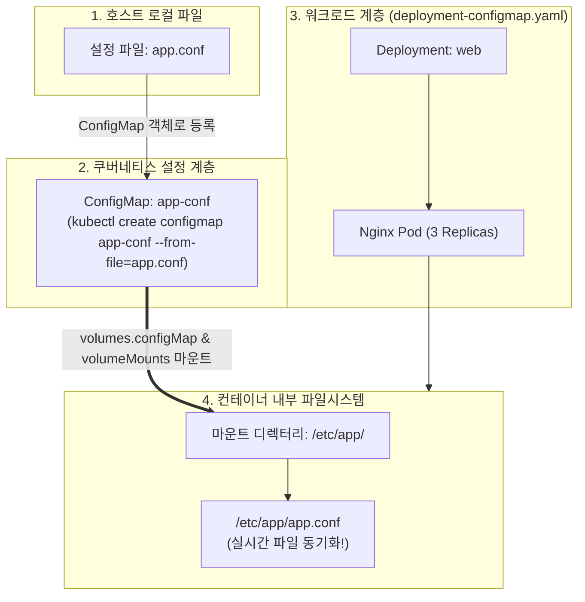

# Kubernetes ConfigMap 주입 패턴 및 실습 가이드 (`config.md`)

본 문서는 프로젝트 폴더 내의 설정 템플릿 파일인 [`app.conf`](./app.conf)의 정체와 역할, 이를 쿠버네티스 볼륨으로 마운트하여 사용하는 [`deployment-configmap.yaml`](./deployment-configmap.yaml)의 연동 절차, **ConfigMap이 파드 내부에서 실제로 활용되는 파일 매핑 메커니즘**, 그리고 **ConfigMap 3대 주입 방식(환경변수 vs 볼륨 마운트)의 핵심 차이점**을 정리한 기술 가이드입니다.

---

## 1. 개요 및 통신 아키텍처

[`app.conf`](./app.conf)는 단독으로 배포되는 쿠버네티스 리소스가 아니라, **쿠버네티스에서 ConfigMap을 파드에 주입하는 3대 대표 패턴을 정리한 치트시트(템플릿)**이자, **[`deployment-configmap.yaml`](./deployment-configmap.yaml)에서 컨테이너 내부 파일로 마운트하여 사용하는 실습용 설정 파일**입니다.



---

## 2. `deployment-configmap.yaml` 적용 시 `ConfigMap/app-conf`의 구체적인 활용 메커니즘

[`deployment-configmap.yaml`](./deployment-configmap.yaml)이 적용되면, **`ConfigMap/app-conf`에 저장된 설정 데이터가 컨테이너 내부의 실제 텍스트 파일(`/etc/app/app.conf`)로 자동 변환되어 마운트**됩니다.

### 2.1 매핑 및 파일 생성 메커니즘
쿠버네티스는 ConfigMap을 볼륨으로 마운트할 때 **`Key = 파일 이름`**, **`Value = 파일 내용`** 규칙으로 컨테이너 디렉터리에 파일을 생성합니다:

```text
[ ConfigMap: app-conf ]                     [ Nginx 컨테이너 내부 ]
┌──────────────────────────────┐            ┌───────────────────────────────────┐
│ data:                        │            │ 마운트 경로: /etc/app/            │
│   app.conf (Key 이름) ───────┼───────────>│   └── app.conf (실제 텍스트 파일)  │
│     : "#//app.conf ... "     │            │       (파일 내용 = Key의 Value)   │
└──────────────────────────────┘            └───────────────────────────────────┘
```

1. **`volumes.configMap.name: app-conf`**: 파드가 `app-conf`라는 ConfigMap을 메모리 볼륨으로 로드합니다.
2. **`volumeMounts.mountPath: /etc/app`**: 컨테이너 내부의 `/etc/app` 디렉터리에 해당 볼륨을 연결합니다.
3. **`volumeMounts.readOnly: true`**: 마운트된 디렉터리와 파일을 읽기 전용으로 보호하여 컨테이너 내부 프로세스가 설정을 변조하거나 삭제할 수 없게 합니다.
4. 그 결과 컨테이너 내부에는 **`/etc/app/app.conf`**라는 실제 파일이 생성됩니다.

---

### 2.2 실제 파드 내부 파일시스템 구조 (Live 검증 결과)

실제 클러스터에서 동작 중인 파드 내부를 조회해 보면, 쿠버네티스는 원자적(Atomic) 파일 교체를 위해 **심볼릭 링크(Symlink)** 구조를 사용하여 파일을 배치합니다:

```powershell
# 1. /etc/app 디렉터리 내부 심볼릭 링크 구조 확인
$ kubectl exec <pod-name> -- ls -la /etc/app
total 16
drwxrwxrwx 3 root root 4096 Nov 13 02:02 .
drwxr-xr-x 1 root root 4096 Nov 13 02:02 ..
drwxr-xr-x 2 root root 4096 Nov 13 02:02 ..2026_11_13_02_02_52.1161325086
lrwxrwxrwx 1 root root   32 Nov 13 02:02 ..data -> ..2026_11_13_02_02_52.1161325086
lrwxrwxrwx 1 root root   15 Nov 13 02:02 app.conf -> ..data/app.conf

# 2. 마운트된 파일 내용 열람
$ kubectl exec <pod-name> -- cat /etc/app/app.conf
#//app.conf
# ① 전체를 환경 변수로
envFrom:
- configMapRef: { name: my-config }
...
```

---

### 2.3 애플리케이션 관점에서의 3가지 실질적 활용 이점

1. **애플리케이션 코드 수정 없이 외부 설정 주입**:
   - Nginx의 `nginx.conf`, 스프링 부트의 `application.yml`, 데이터베이스의 `my.cnf`처럼 **파일 경로를 직접 읽는 구조의 소프트웨어**에 이미지를 재빌드하지 않고도 외부에서 설정을 안전하게 주입할 수 있습니다.
2. **`readOnly: true`로 설정 파일 변조 및 삭제 방지**:
   - 컨테이너 내부 프로세스나 악성코드가 실행 중 실수로 설정 파일을 지우거나 덮어쓰지 못하도록 운영체제 레벨에서 보호됩니다.
3. **★ 파드 재시작 없는 무중단 실시간 갱신 (Hot-Reload)**:
   - 환경변수(`env`) 방식은 한 번 파드가 뜨면 설정을 바꿔도 파드를 재부팅(`rollout restart`)해야만 적용됩니다.
   - 하지만 볼륨 마운트 방식은 `kubectl edit configmap app-conf`로 설정을 수정하면, **쿠버네티스 kubelet이 파드를 죽이지 않고도 `/etc/app/app.conf` 파일 내용만 실시간으로 자동 갱신**해 줍니다.

---

## 3. `app.conf` 내부의 ConfigMap 3대 주입 방식 비교

[`app.conf`](./app.conf) 내부에는 쿠버네티스에서 환경 설정을 애플리케이션에 전달하는 3가지 대표 문법이 정리되어 있습니다:

```yaml
#//app.conf
# ① 전체를 환경 변수로
envFrom:
- configMapRef: { name: my-config }
 
# ② 특정 키만 환경 변수로
env:
- name: DB_HOST
  valueFrom:
    configMapKeyRef: { name: my-config, key: DB_HOST }
 
# ③ 파일로 마운트 (변경 시 자동 반영)
volumes:
- name: config-volume
  configMap: { name: app-conf }
containers:
- volumeMounts:
  - { name: config-volume, mountPath: /etc/app }
```

### 📌 3대 주입 방식 비교 분석표

| 주입 방식 | 매니페스트 선언 문법 | 실제 프로젝트 활용 사례 | 주요 특징 및 장단점 |
| :--- | :--- | :--- | :--- |
| **① 전체 환경변수 일괄 주입** | `envFrom` | [`mysql.yaml`](./mysql.yaml) (`app-config2`) | • ConfigMap의 모든 Key-Value를 한 번에 환경변수로 등록<br>• 설정 변경 시 **반드시 파드를 재기동(Restart)해야 반영됨** |
| **② 개별 환경변수 선택 주입** | `env.valueFrom.configMapKeyRef` | [`init-sidecar.yaml`](./init-sidecar.yaml) | • 필요한 특정 설정(`DB_HOST` 등)만 골라서 환경변수로 매핑<br>• 설정 변경 시 **반드시 파드를 재기동(Restart)해야 반영됨** |
| **③ 파일시스템 볼륨 마운트** | `volumes.configMap`<br>+ `volumeMounts` | [`deployment-configmap.yaml`](./deployment-configmap.yaml) | • 설정 파일(`app.conf` 등) 통째로 디렉터리에 마운트<br>• **★ ConfigMap을 수정하면 파드 재시작 없이 내부 파일이 실시간 자동 갱신(Hot-reload)됨!** |

---

## 4. 단계별 실습 및 검증 절차 (Runbook)

### 1단계: `app.conf` 파일로 ConfigMap 객체 생성
로컬에 있는 `app.conf` 파일의 내용을 담아 `app-conf`라는 이름의 ConfigMap을 생성합니다:

```powershell
kubectl create configmap app-conf --from-file=app.conf
```

*ConfigMap 생성 확인:*
```powershell
kubectl get configmap app-conf -o yaml
```

---

### 2단계: 볼륨 마운트가 선언된 Deployment 배포 (`deployment-configmap.yaml`)

[`deployment-configmap.yaml`](./deployment-configmap.yaml)을 배포하여 `app-conf` ConfigMap을 컨테이너 내부의 `/etc/app` 경로에 마운트합니다:

```yaml
# deployment-configmap.yaml 핵심 마운트 설정
        volumeMounts:
        - name: config-volume
          mountPath: /etc/app       # 컨테이너 내부에 파일이 생성될 디렉터리 경로
          readOnly: true            # 읽기 전용으로 안전하게 마운트
      volumes:
      - name: config-volume
        configMap:
          name: app-conf           # 연동할 ConfigMap 이름
```

*배포 명령어:*
```powershell
kubectl apply -f deployment-configmap.yaml
```

*파드 기동 상태 확인:*
```powershell
kubectl get pods -l app=web
```

---

### 3단계: 파드 내부에서 마운트된 파일 확인
Nginx 파드 컨테이너 내부의 `/etc/app` 경로를 열어 `app.conf` 파일이 정상적으로 마운트되었는지 확인합니다:

```powershell
# 1. /etc/app 디렉터리 내 파일 목록 확인
kubectl exec -it deploy/web -- ls -la /etc/app

# 2. 마운트된 파일 내용 출력
kubectl exec -it deploy/web -- cat /etc/app/app.conf
```

---

## 5. [핵심 검증] 무중단 실시간 설정 갱신 (Hot-Reload) 테스트

파일시스템 볼륨 마운트 방식의 가장 큰 장점은 **파드를 재기동하지 않고도 설정 내용을 실시간으로 변경**할 수 있다는 점입니다.

### 1) 실시간으로 ConfigMap 수정
```powershell
# ConfigMap 편집기 열기 (또는 kubectl create configmap ... --dry-run=client -o yaml | kubectl apply -f -)
kubectl edit configmap app-conf
```
*파일 내용 끝에 `# Updated configuration!` 주석을 추가하고 저장합니다.*

### 2) 파드 재시작 없이 파일 내용 변경 확인
파드를 재시작(`rollout restart`)하지 않고 약 10~30초(kubelet의 ConfigMap 동기화 주기) 후 다시 파일 내용을 확인합니다:

```powershell
kubectl exec -it deploy/web -- cat /etc/app/app.conf
```
*결과*: 파드가 죽거나 재부팅되지 않고 가동 시간(Uptime)이 유지된 상태에서 파일 내용만 새로운 설정으로 자동 갱신됩니다!

---

## 6. 실무 모범 사례 요약

1. **설정 파일(nginx.conf, application.properties, redis.conf 등)**:
   - 파일 크기가 크거나 애플리케이션이 파일 경로를 직접 읽는 구조라면 **③ 볼륨 마운트 방식**을 채택하여 무중단 핫리로드(Hot-reload)를 지원하는 것이 유리합니다.
2. **단순 접속 정보(포트, 접속 주소, 플래그 등)**:
   - 소스 코드에서 `process.env.DB_HOST`처럼 환경변수로 읽어오는 구조라면 **① `envFrom`** 또는 **② `configMapKeyRef`** 방식을 사용합니다.
3. **보안 민감 정보(비밀번호, API 키, 인증 토큰)**:
   - ConfigMap 대신 반드시 **Secret 리소스**(`spec.volumes[].secret` 또는 `secretRef`)를 사용해야 합니다.
