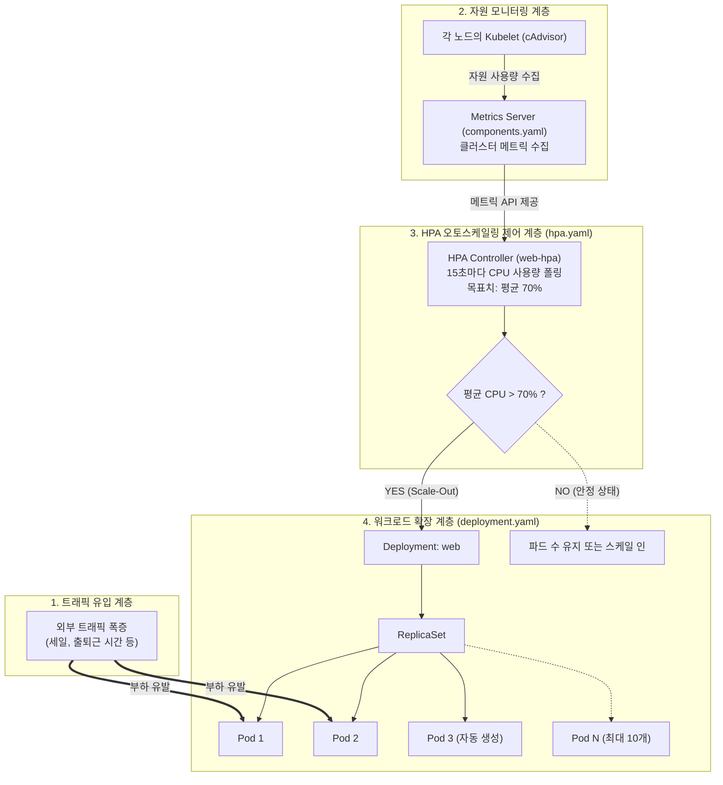

# Kubernetes Horizontal Pod Autoscaler 실습 가이드 (`hpa.md`)

본 문서는 트래픽 부하에 따라 파드(Pod)의 복제본 개수를 실시간으로 자동 조절하는 **[`hpa.yaml`](./hpa.yaml)** 매니페스트의 동작 원리, 줄별 상세 해설, 선행 필수 조건(Metrics Server 및 Resource Requests), 그리고 부하 테스트(Load Generation)를 통한 스케일 아웃/인 검증 실습 절차를 완벽하게 정리한 기술 가이드입니다.

---

## 1. `hpa.yaml`이 하는 일 (개요 및 목적)

[`hpa.yaml`](./hpa.yaml)은 쿠버네티스의 **HPA (Horizontal Pod Autoscaler, 수평형 파드 자동 확장기)** 컨트롤러를 생성하는 파일입니다.

- **핵심 역할**: [`deployment.yaml`](./deployment.yaml)에 배포된 `web` 파드들의 CPU 사용량을 실시간으로 감시하다가, **평균 CPU 사용률이 70%를 초과하면 파드 개수를 자동으로 2개에서 최대 10개까지 늘려주고(Scale-Out)**, 트래픽이 줄어들면 다시 **최소 2개로 줄여주는(Scale-In)** 역할을 수행합니다.
- **도입 효과**: 24시간 엔지니어가 모니터링하며 수동으로 `kubectl scale` 명령을 내리지 않아도 서비스 장애를 방지하고 클라우드 인프라 비용을 최적화합니다.



---

## 2. `hpa.yaml` 전체 매니페스트 및 줄별 상세 해설

```yaml
# hpa.yaml
apiVersion: autoscaling/v2           # ① HPA 최신 API 버전 (멀티 메트릭 및 behavior 정책 지원)
kind: HorizontalPodAutoscaler        # ② 수평형 파드 자동 확장 리소스 타입 지정
metadata:
  name: web-hpa                      # ③ HPA 리소스의 고유 식별 이름
  namespace: default                 # ④ 관리 대상 리소스가 위치한 네임스페이스
  labels:
    app: web                         # ⑤ 리소스 분류 및 검색용 라벨
spec:
  scaleTargetRef:                    # ⑥ [핵심] 오토스케일링을 적용할 대상 워크로드 지정
    apiVersion: apps/v1              #    - 대상의 API 그룹/버전
    kind: Deployment                 #    - 대상 타입 (Deployment 또는 StatefulSet)
    name: web                        #    - 대상 리소스 이름 (deployment.yaml의 web)
  minReplicas: 2                     # ⑦ 트래픽이 0이어도 상시 유지할 최소 파드 수 (고가용성 보장)
  maxReplicas: 10                    # ⑧ 트래픽 폭증 시 확장 가능한 최대 파드 수 (클러스터 자원 보호)
  metrics:                           # ⑨ 오토스케일링 판단 기준으로 사용할 메트릭 목록
  - type: Resource                   #    - 시스템 자원 메트릭 (CPU 또는 Memory)
    resource:
      name: cpu                      #    - 감시 대상: CPU
      target:
        type: Utilization            #    - 측정 기준: 비율(%) 단위
        averageUtilization: 70       #    - 목표치: 평균 CPU 사용률 70%
```

### 📌 필드별 핵심 체크포인트

| 필드 | 설정값 | 상세 설명 및 설계 의도 |
| :--- | :---: | :--- |
| `apiVersion` | `autoscaling/v2` | 과거 `v1`은 단일 CPU 메트릭만 감시 가능했으나, `v2`부터는 **CPU, 메모리, 커스텀 메트릭(요청 수 등)을 복합 감시**하고 스케일 속도를 조절하는 `behavior` 정책을 지원합니다. |
| `scaleTargetRef` | `Deployment/web` | HPA가 Replicas 수를 직접 조절할 상위 컨트롤러를 지정합니다. **Pod을 직접 지정하지 않고 반드시 Deployment나 ReplicaSet을 참조**해야 합니다. |
| `minReplicas` | `2` | 트래픽이 없는 심야 시간대에도 최소 2개의 파드를 유지하여 노드 장애나 롤링 업데이트 시 무중단 서비스를 보장합니다. |
| `maxReplicas` | `10` | 무제한 스케일 아웃으로 인해 클러스터 노드 메모리가 고갈되거나 클라우드 과금 폭탄이 발생하는 것을 방지하는 안전 상한선입니다. |
| `averageUtilization` | `70` | 모든 파드 복제본의 CPU 사용률 평균이 **70%**를 넘으면 스케일 아웃이 즉시 발동됩니다. |

---

## 3. 목표 파드 수 계산 공식 (수학적 원리)

쿠버네티스 HPA 컨트롤러는 아래 공식에 따라 목표 파드 수(Desired Replicas)를 계산하고 올림(`ceil`)합니다:

$$\text{목표 파드 수} = \left\lceil \text{현재 파드 수} \times \left( \frac{\text{현재 평균 CPU 사용률}}{\text{목표 CPU 사용률 (70\%)}} \right) \right\rceil$$

### 💡 계산 예시
- 현재 `web` 파드가 **2개** 실행 중
- 대량 트래픽으로 인해 각 파드의 평균 CPU 사용률이 **140%**로 치솟음
- HPA의 목표 계산:
  $$\text{목표 파드 수} = \left\lceil 2 \times \frac{140\%}{70\%} \right\rceil = \lceil 4.0 \rceil = \mathbf{4\text{개}}$$
- HPA가 Deployment의 `replicas`를 2 ➔ 4로 즉시 업데이트하여 파드 2개를 자동 증설합니다.

---

## 4. HPA 구동을 위한 2가지 필수 전제 조건 (★ 트러블슈팅)

HPA를 배포했을 때 `TARGETS: <unknown>/70%` 상태로 멈춰 있는 경우, 99% 아래 2가지 원인 중 하나입니다.

### ① 전제조건 1: 대상 파드에 `resources.requests.cpu` 선언 필수
- **원인**: `averageUtilization: 70%`의 기준이 되는 **100% 분모**는 바로 파드 매니페스트에 적힌 **`resources.requests.cpu`**입니다.
- 만약 요청량이 생략되어 있다면 기준 분모가 `0`이 되므로 쿠버네티스는 사용률(%)을 계산할 수 없습니다.
- **해결**: [`deployment.yaml`](./deployment.yaml)처럼 파드 스펙에 반드시 요청량이 선언되어 있어야 합니다:
  ```yaml
  resources:
    requests:
      cpu: 100m      # 0.1 CPU를 100% 기준으로 삼아 70%(70m) 초과 시 확장
      memory: 128Mi
  ```

### ② 전제조건 2: 클러스터 내 `metrics-server` 애드온 정상 구동 필수
- **원인**: HPA는 자체적으로 파드 CPU를 잴 수 없으며, 클러스터에 설치된 **Metrics Server**(`metrics.k8s.io`)로부터 데이터를 받아옵니다.
- **확인 방법**: 아래 명령어를 쳤을 때 노드와 파드의 CPU/메모리 수치가 출력되어야 합니다:
  ```powershell
  kubectl top nodes
  kubectl top pods
  ```
- *만약 KinD 환경에서 Metrics Server가 없다면 [`components.yaml`](./components.yaml)을 배포하고 `--kubelet-insecure-tls` 패치를 적용해야 합니다.*

---

## 5. 단계별 부하 테스트 및 오토스케일링 검증 실습 (Runbook)

### 1단계: 웹 애플리케이션 및 HPA 배포
```powershell
# 1. 대상 Deployment 및 Service 배포
kubectl apply -f deployment.yaml
kubectl apply -f service-cip.yaml

# 2. HPA 배포
kubectl apply -f hpa.yaml
```

*HPA 초기 상태 확인:*
```powershell
kubectl get hpa web-hpa
```
*출력 예시:*
```text
NAME      REFERENCE        TARGETS   MINPODS   MAXPODS   REPLICAS   AGE
web-hpa   Deployment/web   0%/70%    2         10        3          25s
```
*(초기에는 유입 트래픽이 없으므로 `0%/70%`로 정상 표시됩니다.)*

---

### 2단계: 부하 생성기(Load Generator) 파드 실행
새 PowerShell 터미널을 열고, `web` 서비스(`http://web-service:80`)로 무한 HTTP 요청을 쏘아 보내 CPU 부하를 유발하는 경량 파드를 실행합니다:

```powershell
kubectl run -it --rm load-generator --image=busybox:1.36 --restart=Never -- /bin/sh -c "while true; do wget -q -O- http://web-service:80 > /dev/null; done"
```

---

### 3단계: 실시간 스케일 아웃(Scale-Out) 관찰
기존 터미널에서 HPA 상태 변화를 실시간 모니터링(`-w`)합니다:

```powershell
kubectl get hpa web-hpa -w
```

*실제 상태 전이 흐름:*
```text
NAME      REFERENCE        TARGETS    MINPODS   MAXPODS   REPLICAS   AGE
web-hpa   Deployment/web   0%/70%     2         10        3          1m
web-hpa   Deployment/web   85%/70%    2         10        3          2m  <-- 70% 초과 감지!
web-hpa   Deployment/web   130%/70%   2         10        4          2m30s
web-hpa   Deployment/web   95%/70%    2         10        6          3m  <-- 파드가 6개까지 자동 증설!
```

*실제 늘어난 파드 목록 확인:*
```powershell
kubectl get pods -l app=web
```

---

### 4단계: 부하 중단 및 스케일 인(Scale-In / 쿨다운) 관찰
2단계의 `load-generator` 터미널에서 `Ctrl + C`를 눌러 트래픽을 중단합니다.

- **안정화 지연 시간 (Cool-down Period)**:
  - 트래픽이 끊기자마자 파드를 바로 줄이면 다시 트래픽이 튈 때 파드를 또 띄워야 하는 **플래핑(Flapping/Thrashing)** 현상이 발생합니다.
  - 쿠버네티스는 기본적으로 약 **5분(300초)** 동안 트래픽이 낮은 상태를 유지하는지 관찰한 후, 안전하게 `minReplicas: 2`로 파드를 축소합니다.

---

## 6. 핵심 요약 및 점검표

| 질문 | 핵심 요약 |
| :--- | :--- |
| **`hpa.yaml`의 역할은?** | CPU 사용률이 70%를 넘으면 파드를 2개~10개 범위 내에서 자동으로 증설/감소시킵니다. |
| **`minReplicas`와 `maxReplicas`는?** | 서비스 안정성을 위한 최소 보장선(2개)과 과금/노드 고갈 방지를 위한 최대 상한선(10개)입니다. |
| **`<unknown>/70%` 에러 해결법은?** | 1) 파드에 `requests.cpu` 선언 확인, 2) 클러스터에 `metrics-server` 정상 구동 확인 (`kubectl top pods`). |

