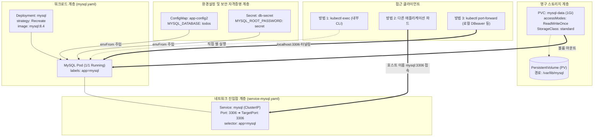

# Kubernetes MySQL 단일 인스턴스 배포 및 연동 가이드 (`mysql.md`)

본 문서는 단일 인스턴스 데이터베이스 배포 매니페스트인 [`mysql.yaml`](./mysql.yaml)의 아키텍처 상세 해석, 선행 의존 리소스(ConfigMap/Secret), 그리고 다른 파드나 외부에서 MySQL에 접근하기 위해 필요한 [`service-mysql.yaml`](./service-mysql.yaml)의 구성 및 실습 검증 절차를 정리한 기술 가이드입니다.

---

## 1. 전체 아키텍처 및 통신 구조

`mysql.yaml`은 **영구 볼륨(PVC)**, **외부 설정(ConfigMap)**, **보안 자격증명(Secret)**, 그리고 **네트워크 진입점(Service)**이 유기적으로 결합되어 동작합니다.



---

## 2. `mysql.yaml` 전체 매니페스트 및 줄별 상세 해설

```yaml
# mysql.yaml
apiVersion: v1
kind: PersistentVolumeClaim
metadata: { name: mysql-data }
spec:
  accessModes: [ReadWriteOnce]       # ① 단일 노드 읽기/쓰기 전용 (RWO)
  resources: { requests: { storage: 1Gi } } # ② 1Gi 디스크 요청 (기본 StorageClass 자동 바인딩)
---
apiVersion: apps/v1
kind: Deployment
metadata: { name: mysql }
spec:
  strategy: { type: Recreate }        # ③ [핵심] 롤링 업데이트 대신 Recreate 전략 채택!
  selector: { matchLabels: { app: mysql } }
  template:
    metadata: { labels: { app: mysql } }
    spec:
      containers:
      - name: mysql
        image: mysql:8.4              # ④ MySQL 8.4 LTS 공식 이미지
        envFrom:                      # ⑤ [핵심] 외부 설정 파일에서 환경변수 일괄 주입
        - configMapRef: { name: app-config2 } # ➔ MYSQL_DATABASE=todos 주입
        - secretRef: { name: db-secret }       # ➔ MYSQL_ROOT_PASSWORD=secret 주입
        volumeMounts:
        - { name: data, mountPath: /var/lib/mysql } # ⑥ 실제 DB 데이터 파일 영구 저장 경로
      volumes:
      - name: data
        persistentVolumeClaim: { claimName: mysql-data } # ⑦ 상단 PVC와 바인딩
```

### 📌 핵심 설계 포인트 2가지

#### 1) `strategy: { type: Recreate }`가 필수인 이유
- MySQL 데이터 디스크(`mysql-data`)는 **`ReadWriteOnce (RWO)`** 볼륨입니다. RWO 볼륨은 한 번에 오직 **하나의 노드/파드에만 마운트**될 수 있습니다.
- 만약 기본값인 `RollingUpdate`를 사용하면, 새 버전 파드가 먼저 생성되면서 구버전 파드가 아직 잡고 있는 볼륨을 동시에 마운트하려고 시도하여 **`Multi-Attach error for volume` 교착 상태**가 발생합니다.
- `Recreate` 전략은 구버전 파드를 완전히 종료하여 볼륨을 안전하게 언마운트한 뒤 새 파드를 기동하므로 볼륨 충돌을 원천 방지합니다.

#### 2) `envFrom`을 통한 보안 및 환경설정 분리
- 데이터베이스 비밀번호와 기본 스키마 이름을 YAML에 하드코딩하지 않고, ConfigMap과 Secret으로부터 일괄 주입받아 보안성과 유지보수성을 극대화합니다.

---

## 3. 선행 필수 리소스: 환경 설정 및 자격 증명

`mysql.yaml`을 배포하기 전에, 파드가 참조할 **ConfigMap**과 **Secret**이 클러스터에 먼저 존재해야 합니다.

### 3.1 [`app-config2.yaml`](./app-config2.yaml) (기본 데이터베이스 이름 정의)
```yaml
apiVersion: v1
kind: ConfigMap
metadata:
  name: app-config2
data:
  MYSQL_DATABASE: todos               # 컨테이너 시작 시 자동 생성될 DB 이름
```

### 3.2 [`db-secret.yaml`](./db-secret.yaml) (암호화된 root 비밀번호 정의)
```yaml
apiVersion: v1
kind: Secret
metadata:
  name: db-secret
data:
  MYSQL_ROOT_PASSWORD: c2VjcmV0        # "secret" 문자열을 Base64로 인코딩한 값
```

*Secret 값 디코딩 및 검증:*
```powershell
kubectl get secret db-secret -o go-template="{{.data.MYSQL_ROOT_PASSWORD | base64decode}}"
# 출력: secret
```

---

## 4. MySQL에 접근하기 위해 필요한 Service 매니페스트 (`service-mysql.yaml`)

`mysql.yaml` 매니페스트 자체에는 **네트워크 통신 창구인 Service(서비스)가 포함되어 있지 않습니다.**  
파드의 IP는 재기동될 때마다 바뀌므로, 다른 파드들이나 외부에서 안정적으로 접속하려면 고정 DNS와 VIP를 제공하는 **Service 매니페스트**를 배포해야 합니다.

### 4.1 [`service-mysql.yaml`](./service-mysql.yaml) 매니페스트

```yaml
# service-mysql.yaml
apiVersion: v1
kind: Service
metadata:
  name: mysql                 # 다른 파드가 접근할 클러스터 내부 도메인 이름 (호스트: "mysql")
  namespace: default
spec:
  type: ClusterIP             # 클러스터 내부 통신 전용 가상 IP 생성 (기본값)
  selector:
    app: mysql                # mysql.yaml의 Pod 라벨(app: mysql)과 일치시켜 트래픽 전달
  ports:
  - port: 3306                # Service가 노출하는 포트
    targetPort: 3306          # 실제 MySQL 컨테이너 내부 포트
```

### 4.2 배포 명령어
```powershell
kubectl apply -f service-mysql.yaml
```
*(명령어로 즉시 임시 생성하려면: `kubectl expose deployment mysql --name=mysql --port=3306`)*

---

## 5. 단계별 전체 배포 및 접근 절차 (Runbook)

### 1단계: 선행 리소스 및 MySQL 배포
```powershell
# 1. ConfigMap 및 Secret 배포
kubectl apply -f app-config2.yaml
kubectl apply -f db-secret.yaml

# 2. MySQL PVC 및 Deployment 배포
kubectl apply -f mysql.yaml

# 3. 네트워크 접근용 Service 배포
kubectl apply -f service-mysql.yaml
```

*파드 및 서비스 정상 구동 확인:*
```powershell
kubectl get pods,pvc,svc -l app=mysql
```
*출력 예시:*
```text
NAME                         READY   STATUS    RESTARTS   AGE
pod/mysql-6b46d8db45-fgfjj   1/1     Running   0          45s

NAME                               STATUS   VOLUME                                     CAPACITY   ACCESS MODES   STORAGECLASS   AGE
persistentvolumeclaim/mysql-data   Bound    pvc-12345678-aaaa-bbbb-cccc-dddddddddddd   1Gi        RWO            standard       46s

NAME            TYPE        CLUSTER-IP      EXTERNAL-IP   PORT(S)    AGE
service/mysql   ClusterIP   10.96.64.188    <none>        3306/TCP   20s
```

---

### 2단계: 실제 MySQL 접근 및 쿼리 테스트 (3가지 방법)

#### 방법 1: `kubectl exec`로 컨테이너 내부 MySQL CLI 직접 접속
클러스터 내부 파드 쉘에 직접 들어가 쿼리를 실행합니다:
```powershell
kubectl exec -it deploy/mysql -- mysql -uroot -psecret -e "SHOW DATABASES;"
```
*출력 결과:*
```text
+--------------------+
| Database           |
+--------------------+
| information_schema |
| mysql              |
| performance_schema |
| sys                |
| todos              |  <-- app-config2.yaml에 의해 자동 생성된 데이터베이스 확인!
+--------------------+
```

*테이블 생성 및 테스트 데이터 입력:*
```powershell
kubectl exec -it deploy/mysql -- mysql -uroot -psecret -e "CREATE TABLE todos.t (v INT); INSERT INTO todos.t VALUES (100);"
kubectl exec -it deploy/mysql -- mysql -uroot -psecret -e "SELECT * FROM todos.t;"
```

#### 방법 2: 호스트 PC에서 GUI 툴(DBeaver, Workbench) 또는 로컬 터미널로 접근
호스트 PC의 3306 포트를 MySQL 파드로 터널링합니다:
```powershell
kubectl port-forward deployment/mysql 3306:3306
```
- **접속 호스트**: `127.0.0.1` (또는 `localhost`)
- **포트**: `3306`
- **사용자(User)**: `root`
- **비밀번호(Password)**: `secret`
- **데이터베이스(Database)**: `todos`

#### 방법 3: 다른 애플리케이션 파드에서 접속
같은 네임스페이스에 있는 웹 애플리케이션 파드는 환경변수나 설정에 다음과 같이 지정하여 통신합니다:
- **DB Host**: `mysql` (또는 `mysql.default.svc.cluster.local`)
- **DB Port**: `3306`
- **DB User**: `root`
- **DB Password**: `secret`
- **DB Name**: `todos`

---

### 3단계: [영구성 검증] 파드 재시작 후 데이터 보존 확인

Deployment를 재시작하여 파드가 완전히 새로 생성되어도 데이터가 보존되는지 검증합니다:

```powershell
# 1. MySQL 파드 재시작 (Rollout Restart)
kubectl rollout restart deployment/mysql

# 2. 새 파드가 1/1 Running 될 때까지 대기
kubectl rollout status deployment/mysql

# 3. 데이터가 여전히 남아있는지 확인
kubectl exec -it deploy/mysql -- mysql -uroot -psecret -e "SELECT * FROM todos.t;"
```
*출력 결과:*
```text
+------+
| v    |
+------+
|  100 |
+------+
```
> **검증 성공**: 파드가 교체되었음에도 `mysql-data` PVC를 통해 데이터가 유실 없이 안전하게 유지됩니다.

