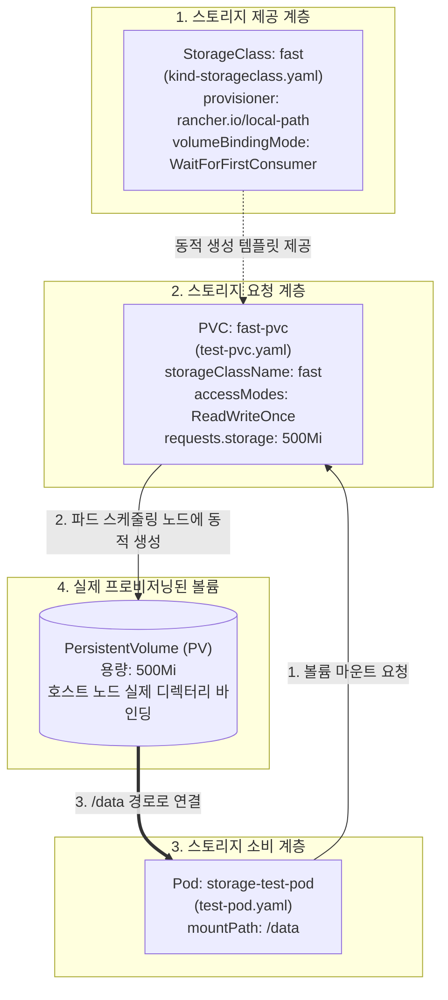

# Kubernetes 영구 스토리지 실습 가이드: `test-pvc.yaml` & `test-pod.yaml`

본 문서는 쿠버네티스의 동적 스토리지 프로비저닝(Dynamic Storage Provisioning) 환경에서 **스토리지 요청서인 [`test-pvc.yaml`](./test-pvc.yaml)**과 **이를 마운트하여 사용하는 컨테이너인 [`test-pod.yaml`](./test-pod.yaml)**의 연동 구조, 단계별 사용 방법, 그리고 **파드 삭제 후에도 데이터가 영구 보존(Persistence)되는지 검증하는 실습 절차**를 상세히 정리한 가이드입니다.

---

## 1. 아키텍처 및 동작 구조

쿠버네티스의 영구 스토리지는 **StorageClass ➔ PersistentVolumeClaim(PVC) ➔ Pod**의 3단계 추상화 계층으로 동작합니다.



---

## 2. 매니페스트 구조 분석

### 2.1 `test-pvc.yaml` (영구 볼륨 요청서)

```yaml
# test-pvc.yaml
apiVersion: v1
kind: PersistentVolumeClaim
metadata:
  name: fast-pvc
spec:
  storageClassName: fast       # ① 사용할 StorageClass 이름 (kind-storageclass.yaml과 매핑)
  accessModes:
    - ReadWriteOnce            # ② 접근 모드 (단일 노드에서 읽기/쓰기 마운트 허용)
  resources:
    requests:
      storage: 500Mi           # ③ 최소 요구 용량 (500 메비바이트, 약 524 MB)
```

| 필드 | 값 | 설명 |
| :--- | :--- | :--- |
| `storageClassName` | `fast` | [`kind-storageclass.yaml`](./kind-storageclass.yaml)에 정의된 `fast` 스토리지 클래스를 지정하여 동적으로 볼륨을 생성하도록 요청합니다. |
| `accessModes` | `ReadWriteOnce` (RWO) | 한 번에 오직 하나의 워커 노드에서만 읽기/쓰기 볼륨으로 마운트될 수 있습니다. |
| `resources.requests.storage` | `500Mi` | 최소 보장받고자 하는 디스크 용량입니다. ($500 \times 1024 \times 1024 \text{ bytes} \approx 524.3\text{ MB}$) |

---

### 2.2 `test-pod.yaml` (볼륨 소비자 파드)

```yaml
# test-pod.yaml
apiVersion: v1
kind: Pod
metadata:
  name: storage-test-pod
spec:
  containers:
  - name: test
    image: busybox:1.36
    command: ["sh", "-c", "sleep 3600"]
    volumeMounts:
    - name: my-storage
      mountPath: /data          # ① 컨테이너 내부에서 접근할 마운트 경로
  volumes:
  - name: my-storage
    persistentVolumeClaim:
      claimName: fast-pvc       # ② 위에서 생성한 fast-pvc와 연결
```

| 필드 | 값 | 설명 |
| :--- | :--- | :--- |
| `spec.volumes[].persistentVolumeClaim.claimName` | `fast-pvc` | 앞에서 선언한 PVC의 이름(`fast-pvc`)을 직접 참조하여 볼륨을 파드에 바인딩합니다. |
| `spec.containers[].volumeMounts[].mountPath` | `/data` | 컨테이너 내부의 `/data` 디렉터리에 해당 영구 디스크를 마운트합니다. 이 디렉터리에 쓰는 모든 파일은 파드가 삭제되어도 보존됩니다. |

---

## 3. 단계별 실습 및 검증 절차 (Step-by-Step Guide)

### 1단계: 선행 StorageClass (`kind-storageclass.yaml`) 배포

PVC가 참조할 `fast` 스토리지 클래스를 클러스터에 배포합니다:

```powershell
kubectl apply -f kind-storageclass.yaml
```

*스토리지 클래스 등록 확인:*
```powershell
kubectl get sc
```
*출력 예시:*
```text
NAME                 PROVISIONER             RECLAIMPOLICY   VOLUMEBINDINGMODE      ALLOWVOLUMEEXPANSION   AGE
fast                 rancher.io/local-path   Delete          WaitForFirstConsumer   false                  10s
standard (default)   rancher.io/local-path   Delete          WaitForFirstConsumer   false                  2d
```

---

### 2단계: PVC 배포 및 `Pending` 상태 확인 (`test-pvc.yaml`)

```powershell
kubectl apply -f test-pvc.yaml
```

*PVC 상태 조회:*
```powershell
kubectl get pvc fast-pvc
```
*출력 예시:*
```text
NAME       STATUS    VOLUME   CAPACITY   ACCESS MODES   STORAGECLASS   AGE
fast-pvc   Pending                                      fast           5s
```

> **💡 왜 PVC가 즉시 `Bound`되지 않고 `Pending` 상태인가요? (정상 동작)**  
> `kind-storageclass.yaml`에 **`volumeBindingMode: WaitForFirstConsumer`**가 설정되어 있기 때문입니다.  
> 실제 이 PVC를 사용할 **첫 번째 파드(Consumer)가 어느 워커 노드에 배치될지 결정될 때까지 실제 디스크 할당을 안전하게 지연**시키는 모범 사례입니다. (파드가 뜨기 전까지 Pending인 것은 지극히 정상입니다.)

---

### 3단계: 파드 배포 및 PVC `Bound` 전이 확인 (`test-pod.yaml`)

```powershell
kubectl apply -f test-pod.yaml
```

*파드 생성과 동시에 PVC가 `Bound`로 바뀐 것 확인:*
```powershell
kubectl get pod storage-test-pod
kubectl get pvc fast-pvc
```
*출력 예시:*
```text
NAME               READY   STATUS    RESTARTS   AGE
storage-test-pod   1/1     Running   0          10s

NAME       STATUS   VOLUME                                     CAPACITY   ACCESS MODES   STORAGECLASS   AGE
fast-pvc   Bound    pvc-8bf686dd-c3fc-46c5-8424-6330ce4f6da8   500Mi      RWO            fast           45s
```
파드가 특정 워커 노드에 스케줄링되자마자, 프로비저너가 해당 노드에 500Mi 디스크 PV를 즉시 생성하고 PVC와 **`Bound`**되었습니다.

---

### 4단계: [핵심 검증] 영구 데이터 보존(Persistence) 테스트

#### 1) 파드 내부의 마운트 디렉터리(`/data`)에 테스트 파일 작성
```powershell
kubectl exec storage-test-pod -- sh -c "echo 'Hello K8s Persistent Storage!' > /data/message.txt"
```

*작성된 내용 확인:*
```powershell
kubectl exec storage-test-pod -- cat /data/message.txt
# 출력: Hello K8s Persistent Storage!
```

#### 2) 파드를 완전히 삭제 (컨테이너 소멸)
```powershell
kubectl delete pod storage-test-pod
```
*파드가 완전히 삭제되었는지 확인:*
```powershell
kubectl get pods -l app=storage-test-pod # 파드가 없음을 확인
```

#### 3) 새 파드를 다시 생성하여 동일한 PVC에 연결
```powershell
kubectl apply -f test-pod.yaml
```
*파드가 `1/1 Running` 될 때까지 잠시 대기 후:*
```powershell
kubectl get pod storage-test-pod
```

#### 4) 새로 생성된 파드에서 과거 파일이 그대로 살아있는지 확인
```powershell
kubectl exec storage-test-pod -- cat /data/message.txt
```
*최종 출력:*
```text
Hello K8s Persistent Storage!
```
> **검증 성공**: 이전 컨테이너가 완전히 삭제되고 새 컨테이너로 교체되었음에도 불구하고, **PVC를 통해 연결된 실제 디스크의 데이터는 전혀 유실되지 않고 안전하게 보존**되었습니다!

---

## 4. 리소스 정리 (Clean up) 순서

영구 볼륨 실습을 종료할 때는 의존성 역순으로 삭제합니다:

```powershell
# 1. 파드 삭제 (볼륨 언마운트)
kubectl delete -f test-pod.yaml

# 2. PVC 삭제 (reclaimPolicy: Delete에 의해 연결된 PV도 함께 자동 정리됨)
kubectl delete -f test-pvc.yaml

# 3. StorageClass 삭제 (선택)
kubectl delete -f kind-storageclass.yaml
```

---

## 5. 핵심 요약 및 FAQ

| 질문 | 답변 및 핵심 개념 |
| :--- | :--- |
| **`test-pvc.yaml`의 역할은?** | 필요한 스토리지 사양(StorageClass: fast, 접근 모드: RWO, 용량: 500Mi)을 적어 제출하는 **"스토리지 요청서"**입니다. |
| **`test-pod.yaml`의 역할은?** | `fast-pvc` 요청서가 받아낸 실제 디스크를 컨테이너 내부의 특정 경로(`/data`)에 마운트하여 사용하는 **"스토리지 소비자"**입니다. |
| **`volumeBindingMode: WaitForFirstConsumer`란?** | 파드가 생성되기 전까지 PV 생성을 미루고, 파드가 배치된 워커 노드와 동일한 위치에 볼륨을 생성하도록 보장하는 지연 바인딩 모드입니다. |
| **`500Mi`의 의미는?** | 2진수 500 메비바이트 ($500 \times 1024 \times 1024 \text{ Byte} \approx 524\text{ MB}$)입니다. |
| **`ReadWriteOnce (RWO)`란?** | 하나의 노드에만 읽기/쓰기 모드로 단독 마운트될 수 있는 볼륨 모드입니다. |

