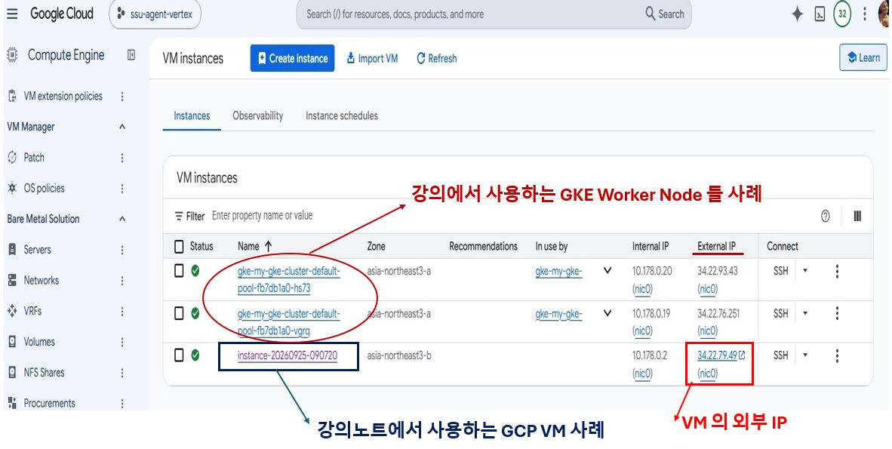

# GCP VM 환경 Docker Compose 배포 및 HTTPS(TLS) 설정 가이드

본 문서는 GCP Compute Engine VM 인스턴스(공인 IP: `34.22.79.49`) 환경에서 Docker Compose를 사용하여 Todo 애플리케이션을 구동할 때 필요한 **Traefik 리버스 프록시의 HTTP/HTTPS(TLS) 라우팅 설정**과 **Node.js 백엔드(`index.js`)의 포트 바인딩 최적화 이유**를 체계적으로 정리한 워크플로우 가이드입니다.

---

## 1. 개요 및 환경 정보

| 항목 | 설정값 / 설명 |
| :--- | :--- |
| **호스트 환경** | GCP Compute Engine VM (Linux) |
| **VM 공인 IP (External IP)** | GCP VM http console 에서 확인 (아래 그림 참조; 여기에서는 '34.22.79.49') |
| **HTTP 서비스 포트** | `80` (Traefik 엔트리포인트: `web`) |
| **HTTPS 서비스 포트** | `443` (Traefik 엔트리포인트: `websecure`, TLS 활성화) |
| **백엔드 애플리케이션 포트** | `3000` (Node.js Express) |
| **데이터베이스** | MySQL 9.3 (`todo-mysql-data` Volume) |
| **대상 구성 파일** | [`compose-prod-build.yml`](file:///d:/Lecture%20Notes/2026-2CloudComputing/practices/06week/getting-started-todo-app/compose-prod-build.yml) |
| **백엔드 소스 파일** | [`backend/src/index.js`](file:///d:/Lecture%20Notes/2026-2CloudComputing/practices/06week/getting-started-todo-app/backend/src/index.js) |

---


## 2. `compose-prod-build.yml` HTTP & HTTPS(TLS) 라우팅 보강

### 2.1 문제 배경 및 요구사항
1. **Host 헤더 불일치 문제**:
   - 로컬(`localhost`) 환경용 규칙(`Host(\`localhost\`)`)만 존재할 경우, 외부 브라우저에서 공인 IP(`34.22.79.49`)로 유입되는 트래픽의 Host 헤더(`Host: 34.22.79.49`)와 일치하지 않아 **404 Not Found**가 발생합니다.
2. **HTTPS(`https://34.22.79.49/`) 트래픽 지원 필요**:
   - 브라우저에서 안전한 통신(HTTPS, 포트 443)으로 접근할 때 Traefik이 TLS 핸드셰이크를 처리하고 백엔드 컨테이너(3000 포트)로 정상 라우팅할 수 있어야 합니다.
   - Traefik에 `websecure`(:443) 엔트리포인트와 TLS 옵션(`tls: "true"`)이 적용된 전용 HTTPS 라우터가 구성되어야 합니다.

### 2.2 설정 수정 내용

[`compose-prod-build.yml`](file:///d:/Lecture%20Notes/2026-2CloudComputing/practices/06week/getting-started-todo-app/compose-prod-build.yml)의 `proxy` 서비스와 `backend` 서비스를 다음과 같이 업데이트하였습니다.

#### (1) `proxy` 서비스: HTTPS(443) 엔트리포인트 및 포트 바인딩 추가
```yaml
  proxy:
    image: traefik:v3.6
    command:
      - --providers.docker=true
      - --providers.docker.exposedbydefault=true
      - --entrypoints.web.address=:80
      - --entrypoints.websecure.address=:443
    ports:
      - 80:80
      - 443:443
    volumes:
      - /var/run/docker.sock:/var/run/docker.sock
```

#### (2) `backend` 서비스: HTTP 및 HTTPS(TLS) 범용 라우터 구성
```yaml
    labels:
      traefik.enable: "true"
      # [HTTP 라우터 - 포트 80] (특정 IP에 종속되지 않고 localhost 및 임의의 IP/도메인 접속 지원)
      traefik.http.routers.backend-http.entrypoints: "web"
      traefik.http.routers.backend-http.rule: "PathPrefix(`/`)"
      traefik.http.routers.backend-http.service: "backend-service"

      # [HTTPS 라우터 - 포트 443] (특정 IP에 종속되지 않고 localhost 및 임의의 IP/도메인 HTTPS 접속 지원)
      traefik.http.routers.backend-https.entrypoints: "websecure"
      traefik.http.routers.backend-https.rule: "PathPrefix(`/`)"
      traefik.http.routers.backend-https.tls: "true"
      traefik.http.routers.backend-https.service: "backend-service"

      # 백엔드 컨테이너 내부 포트 3000 바인딩
      traefik.http.services.backend-service.loadbalancer.server.port: "3000"
```

### 2.3 라우팅 규칙 상세 분석
* **`PathPrefix(\`/\`)` 범용 라우팅 (Catch-All)**:
  - `Host(...)` 조건을 하드코딩하지 않고 URL 경로가 `/`로 시작하는 모든 요청을 매칭합니다.
  - 따라서 **특정 IP(`34.22.79.49`)에 구애받지 않고**, VM의 IP가 변경되거나 다른 VM/로컬/도메인 환경에 배포되더라도 **어떤 IP 주소나 호스트로 접근하든 100% 정상 수용**됩니다.
* **`backend-http` 라우터**: 일반 HTTP 80 포트로 유입되는 모든 호스트/IP 트래픽을 처리합니다.
* **`backend-https` 라우터**: `entrypoints: "websecure"`와 `tls: "true"`를 통해 포트 443으로 들어오는 HTTPS 요청을 수신하며, Traefik의 내장 TLS 핸드셰이크를 거친 후 백엔드의 3000 포트로 부하 분산합니다.

> [!NOTE]
> IP 주소로 직접 HTTPS 접속 시 Let's Encrypt 공인 인증서가 아닌 Traefik 기본 자체 서명(Self-Signed) TLS 인증서가 사용됩니다.  
> 따라서 브라우저에서 `https://<IP주소>/`로 처음 접속할 때 *"연결이 비공개로 설정되어 있지 않습니다"* 경고가 표시될 수 있으며, **[고급] -> [<IP주소>(으)로 이동(안전하지 않음)]**을 클릭하여 접속하시면 암호화 통신으로 정상 이용할 수 있습니다.

---

## 3. `backend/src/index.js` 포트 선언 코드 수정 이유

### 3.1 변경 대상 코드 비교

```javascript
// [수정 전 (문제 코드)]
db.init()
    .then(() => {      
        app.listen(PORT, () => console.log(`Listening on port ${PORT}`));
    })
```

```javascript
// [수정 후 (개선 코드)]
db.init()
    .then(() => {
        const PORT = process.env.PORT || 3000;
        app.listen(PORT, () => console.log(`Listening on port ${PORT}`));
    })
```

### 3.2 수정해야 하는 핵심 이유

#### 1) 런타임 오류 방지 (`ReferenceError: PORT is not defined`)
* 수정 전 코드에서는 `PORT` 변수가 스코프 내에 선언(`const`, `let`, `var`)되지 않아 식별자를 찾지 못합니다.
* 이 상태로 Node.js 프로세스가 기동되면 실행 즉시 `ReferenceError: PORT is not defined`가 발생하고 컨테이너가 CrashLoop 상태로 종료됩니다.
* 따라서 `const PORT = ...`로 명시적 변수 선언이 필수적입니다.

#### 2) 클라우드 환경 지원 및 12-Factor App 원칙 준수 (포트 바인딩)
* **GCP Cloud Run, App Engine, Heroku** 등 최신 클라우드 및 PaaS 환경에서는 컨테이너 내부 포트를 고정하지 않고 **`PORT` 환경 변수(`process.env.PORT`)**를 통해 동적으로 주입합니다.
* `process.env.PORT`를 수용할 수 있도록 구성해야 코드 변경 없이 다양한 클라우드 환경에 유연하게 배포할 수 있습니다.

#### 3) 기본값(Fallback) 제공 (`|| 3000`)을 통한 이식성 보장
* 로컬 개발 환경, Docker Compose, 또는 환경 변수가 지정되지 않은 환경에서는 `process.env.PORT`가 `undefined`입니다.
* 단락 평가 연산자(`|| 3000`)를 통해 환경 변수가 없더라도 기본 포트인 **`3000`**번으로 안전하게 폴백(Fallback)되어 정상 구동됩니다.

---

## 4. GCP VM 배포 및 검증 워크플로우

### 단계 1: GCP VM 방화벽 규칙 확인 (포트 80 및 443 허용)
외부에서 HTTP(80) 및 HTTPS(443) 트래픽이 유입될 수 있도록 방화벽 규칙을 적용합니다:

```bash
# HTTP (80) 포트 허용 규칙
gcloud compute firewall-rules create allow-http-80 \
    --allow=tcp:80 \
    --target-tags=http-server \
    --description="Allow incoming HTTP traffic on port 80"

# HTTPS (443) 포트 허용 규칙
gcloud compute firewall-rules create allow-https-443 \
    --allow=tcp:443 \
    --target-tags=https-server \
    --description="Allow incoming HTTPS traffic on port 443"
```

### 단계 2: Docker Compose 빌드 및 백그라운드 구동
GCP VM 내부에서 수정된 [`compose-prod-build.yml`](file:///d:/Lecture%20Notes/2026-2CloudComputing/practices/06week/getting-started-todo-app/compose-prod-build.yml) 파일을 실행합니다:

```bash
# 컨테이너 빌드 및 백그라운드 실행
docker compose -f compose-prod-build.yml up -d --build
```

### 단계 3: 구동 상태 점검
```bash
# 구동 중인 컨테이너 상태 점검 (proxy, backend, mysql)
docker compose -f compose-prod-build.yml ps
```

### 단계 4: 접속 및 동작 검증
* **HTTPS 접속 (공인 IP)**:  
  [https://34.22.79.49/](https://34.22.79.49/)
* **HTTP 접속 (공인 IP)**:  
  [http://34.22.79.49/](http://34.22.79.49/)
* **API 동작 확인**:  
  [https://34.22.79.49/api/items](https://34.22.79.49/api/items)
* **로컬 내부 헬스체크 (VM 내부 CLI)**:  
  ```bash
  # HTTP 점검
  curl -I http://localhost/
  
  # HTTPS 점검 (자체 서명 인증서 무시 옵션 -k)
  curl -k -I https://34.22.79.49/
  ```
