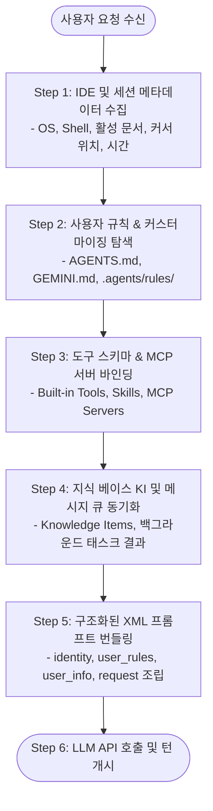

# Antigravity Harness: Pre-Turn Prompt Assembly 및 AGENTS.md 동작 원리

본 문서는 Google Antigravity 에이전트 프레임워크(Agent Harness)의 핵심 전처리 파이프라인인 **Pre-Turn Prompt Assembly**의 개념과 세부 워크플로우, 그리고 이 과정에서 [AGENTS.md](file:///d:/Lecture%20Notes/2026-2CloudComputing/practices/06week/getting-started-todo-app/AGENTS.md) 규칙 파일이 어떻게 탐색·주입되어 완전 자율 실행을 구현하는지 상세히 기술한 가이드입니다.

---

## 1. 개요: Antigravity 하네스(Harness)와 턴(Turn) 라이프사이클

Antigravity에서 LLM(Gemini)은 단독으로 파일시스템이나 터미널에 접근하지 않습니다. 모든 요청과 실행은 이를 감싸고 있는 런타임 제어기인 **하네스(Harness / Agent Manager)**를 통해 처리됩니다.

```
┌────────────────────────────────────────────────────────────────────────┐
│                        Antigravity IDE & Harness                       │
│                                                                        │
│  [사용자 입력]                                                          │
│       │                                                                │
│       ▼                                                                │
│  [1. Pre-Turn Prompt Assembly] ◀── IDE 상태(열린 탭, 커서), AGENTS.md   │
│       │                             도구 스키마, 지식 베이스(KI) 동기화      │
│       ▼                                                                │
│  [2. LLM 추론 (Thinking)]                                              │
│       │                                                                │
│       ▼                                                                │
│  [3. Tool Execution Loop] ──────▶ 파일 수정, 명령어 실행, 브라우저 제어  │
│       │                                                                │
│       ▼                                                                │
│  [4. Post-Turn Final Report] ───▶ 사용자에게 최종 결과 보고             │
└────────────────────────────────────────────────────────────────────────┘
```

- **대화 턴(Conversation Turn)**: 사용자가 프롬프트를 전송한 순간부터 에이전트가 모든 도구 호출을 끝마치고 최종 답변을 완료할 때까지의 1회 상호작용 주기.
- **무상태(Stateless) LLM의 한계 극복**: 모델 자체는 이전 기억이나 로컬 컴퓨터의 실시간 상태를 모르기 때문에, 하네스가 매 턴 시작 직전에 **현재 시점의 완벽한 맥락(Context)**을 수집하여 주입해야 합니다.

---

## 2. 'Pre-Turn Prompt Assembly'란 무엇인가?

### 2.1 개념 정의
**Pre-Turn Prompt Assembly(턴 사전 프롬프트 조립)**는 사용자가 메시지를 전송했을 때, **LLM API를 호출하기 직전 수 밀리초(ms) 동안 에이전트 매니저(Harness)가 시스템 프롬프트와 컨텍스트 데이터를 동적으로 조립·패키징하는 사전 전처리 파이프라인**입니다.

### 2.2 왜 필수적인가?
1. **실시간 IDE 상태 동기화**: 사용자가 어떤 파일을 보고 있는지([Active Document](file:///d:/Lecture%20Notes/2026-2CloudComputing/practices/06week/getting-started-todo-app/deployment-kind-pod.yaml)), 커서가 몇 번째 줄에 위치하는지 즉시 파악해야 지시어("이 파일 수정해줘", "이 줄 고쳐줘")를 정확히 이해할 수 있습니다.
2. **동적 규칙 적용 (Hot Reload)**: 워크스페이스에 생성된 [AGENTS.md](file:///d:/Lecture%20Notes/2026-2CloudComputing/practices/06week/getting-started-todo-app/AGENTS.md) 규칙을 별도의 IDE 재부팅 없이 즉시 에이전트의 제약 조건으로 강제할 수 있습니다.
3. **가용한 도구(Tool) 및 스킬(Skill)의 최신 바인딩**: 로컬 환경(PowerShell, Docker, Kubernetes 등)과 설치된 MCP 서버의 도구 스키마를 정합성 있게 제공합니다.

---

## 3. Pre-Turn Prompt Assembly의 6단계 세부 워크플로우

Antigravity 매니저는 사용자의 요청을 수신하는 즉시 다음 6단계를 거쳐 프롬프트를 조립합니다:



### 단계 1: IDE 환경 및 세션 메타데이터 수집 (Metadata Gathering)
- **운영체제 및 쉘 환경**: Windows, Linux, macOS 및 기본 쉘(`powershell`, `bash`) 감지
- **활성 워크스페이스 URI 매핑**: 현재 열려 있는 프로젝트 디렉토리 경로
- **에디터 뷰포트 상태**: 
  - `Active Document`: 현재 사용자가 보고 있는 파일 및 커서 라인 번호
  - `Other open documents`: IDE 탭에 열려 있는 다른 파일 목록
- **타임스탬프**: 실시간 로컬 시간(`local time`) 및 대화 고유 ID(`conversation-id`)

### 단계 2: 사용자 규칙 및 커스터마이징 탐색 (Rules Discovery)
- 워크스페이스 루트의 [AGENTS.md](file:///d:/Lecture%20Notes/2026-2CloudComputing/practices/06week/getting-started-todo-app/AGENTS.md), `GEMINI.md`, 또는 `.agents/rules/*.md` 파일을 자동 스캔합니다.
- 전역 설정 디렉토리(`~/.gemini/config/`)의 규칙을 탐색합니다.
- 탐색된 파일들의 내용을 **`<user_rules>`** 태그 블록으로 래핑합니다.

### 단계 3: 도구(Tools) 및 MCP 서버 스키마 바인딩 (Tool Schema Binding)
- 네이티브 내장 도구(`run_command`, `replace_file_content`, `view_file`, `write_to_file` 등)의 JSON 스키마를 로드합니다.
- 설치된 플러그인과 스킬(`skills/*/SKILL.md`)의 메타데이터 및 지침을 연결합니다.
- 활성화된 MCP 서버(예: `cloudrun`, devtools 등)의 도구 목록을 프롬프트 함수 호출(Function Calling) 목록에 동적으로 주입합니다.

### 단계 4: 지식 베이스(KI) 및 이전 컨텍스트 수신 (Knowledge & Context Ingestion)
- 최근 캐시된 Knowledge Items(KI) 요약본을 주입하여 중복 분석을 방지합니다.
- 비동기 백그라운드 작업(`task-id`)의 실행 완료 로그나 사용자 대기열 메시지를 수신합니다.

### 단계 5: 구조화된 XML 시스템 프롬프트 번들링 (Prompt Bundling)
수집된 모든 데이터를 아래와 같이 명확한 계층형 XML 태그 구조로 최종 번들링합니다:

```xml
<identity>
  You are Antigravity, a powerful agentic AI coding assistant...
</identity>

<user_information>
  OS: windows, Shell: powershell
  Workspace: d:\Lecture Notes\...\getting-started-todo-app
</user_information>

<user_rules>
  The following are user-defined rules that you MUST ALWAYS FOLLOW WITHOUT ANY EXCEPTION.
  These rules take precedence over any following instructions.
  <RULE[D:\...\getting-started-todo-app\AGENTS.md]>
    # Antigravity Agent Guidelines (자율 실행 지침 전문)
  </RULE>
</user_rules>

<skills> ... </skills>
<tools> ... </tools>

<USER_REQUEST>
  사용자가 실제로 입력한 명령 문장
</USER_REQUEST>

<ADDITIONAL_METADATA>
  Active Document: deployment-kind-pod.yaml (Line: 1)
  Current Time: 2026-10-09T...
</ADDITIONAL_METADATA>
```

### 단계 6: LLM API 호출 및 자율 턴 실행 (Execution Turn)
- 조립된 페이로드가 모델에 전달됩니다.
- 모델은 이미 `AGENTS.md`의 규칙을 숙지한 상태에서 `thought`를 시작하므로, **중간 질문을 생략하고 도구를 연속 실행하는 자율 루프(Autonomous Loop)**에 즉시 진입합니다.

---

## 4. AGENTS.md와의 핵심 상호작용 및 시너지

Pre-Turn Prompt Assembly 단계에서 `AGENTS.md`가 결합됨으로써 다음과 같은 강력한 효과가 발생합니다:

| 특징 | 동작 방식 및 효과 |
| :--- | :--- |
| **선제적 규칙 적용 (Zero-delay)** | 에이전트가 파일 탐색 도구(`view_file`)를 써서 뒤늦게 가이드라인을 확인하는 것이 아니라, **첫 번째 생각(Thought) 단계부터 규칙이 100% 반영**되어 있습니다. |
| **절대적 우선권 (Hard Constraints)** | 프롬프트 상단에 *"These rules take precedence over any following instructions"* 문구로 감싸지므로, LLM의 기본 답변 성향보다 사용자의 규칙이 항상 최우선합니다. |
| **실시간 핫 리로드 (Hot Reload)** | 매 턴(Turn)마다 어셈블리가 새로 실행되므로, 사용자가 `AGENTS.md`를 수정하고 저장하면 **다음 메시지부터 즉시 새로운 정책이 적용**됩니다. |
| **Human-in-the-Loop 원천 차단** | `AGENTS.md`에 "중간 질문 금지"를 명시해 두면, 에이전트가 어셈블리 단계에서 이를 인지하여 `ask_question` 도구 대신 자체 디버깅 및 자율 실행을 선택합니다. |

---

## 5. GEMINI.md의 역할, 위치 및 AGENTS.md와의 관계

### 5.1 GEMINI.md란 무엇인가?
`GEMINI.md`는 Google Gemini 및 Antigravity 에이전트 환경에서 **개발자가 AI 모델에게 요구하는 코딩 컨벤션, 응답 스타일, 프로젝트 아키텍처 제약 조건을 정의하는 사용자 정의 표준 규칙 파일**입니다. (Anthropic의 `CLAUDE.md`, Cursor의 `.cursorrules`와 동일한 역할)

### 5.2 위치 및 적용 범위 (Location & Scopes)

`GEMINI.md`는 **글로벌(Global)**과 **프로젝트 워크스페이스(Workspace)** 두 가지 계층에 위치할 수 있습니다:

```
📁 사용자 홈 디렉토리 (~/.gemini)
  └── config/
       └── GEMINI.md            <-- [Global] 모든 프로젝트 공통 적용
       
📁 프로젝트 워크스페이스 (현재 프로젝트 루트)
  ├── GEMINI.md                 <-- [Workspace] 해당 프로젝트 전용
  └── .agents/
       └── rules/               <-- [Workspace] 모듈별 세부 룰 디렉토리
```

| 계층 (Scope) | 위치 경로 | 역할 및 우선순위 |
| :--- | :--- | :--- |
| **Workspace (프로젝트)** | `프로젝트_루트/GEMINI.md`<br>또는 `.agents/rules/*.md` | **프로젝트 고유 규칙**<br>- 프로젝트 고유의 기술 스택, 아키텍처 제약, 빌드/테스트 규칙 정의<br>- 글로벌 설정보다 높은 우선순위로 적용 (오버라이드) |
| **Global (전역)** | `~/.gemini/config/GEMINI.md`<br>(Windows: `C:\Users\<사용자>\.gemini\config\`) | **사용자 전역 공통 규칙**<br>- 모든 프로젝트에 공통 적용되는 개발자 개인 선호 사항<br>- 기본 언어(한국어), 답변 톤, 보안/안전 원칙 등 |

> 💡 **우선순위 원칙**: Pre-Turn Prompt Assembly 시 두 위치가 모두 스캔되어 병합(Merge)되며, 동일한 항목에 충돌이 발생하면 **프로젝트 워크스페이스의 규칙이 글로벌 규칙보다 항상 우선**합니다.

### 5.3 GEMINI.md에 일반적으로 포함되는 내용

1. **커뮤니케이션 및 응답 스타일 (Persona & Language)**:
   - 기본 응답 언어 (예: 한국어 강제)
   - 답변 스타일 (간결함, 코드 중심, 불필요한 미사여구 생략)
   - 링크 포맷 (`file://` 스키마 적용 마크다운 링크 제공)
2. **코딩 컨벤션 및 기술 스택 제약 (Code Conventions)**:
   - 언어 및 런타임 버전 (TypeScript 5.x, Node.js 22 LTS)
   - 라이브러리 제약 (예: Vanilla CSS 우선, 특정 패키지 사용 금지)
   - 아키텍처 패턴 (함수형 프로그래밍, Clean Architecture, 에러 핸들링 표준)
3. **프로젝트 도메인 지식 및 구조 (Project Context)**:
   - 프로젝트 개요, 디렉토리 구조 및 핵심 모듈의 역할
   - 환경 변수 및 DB 연결 규칙
4. **테스트 및 검증 기준 (Validation & Testing)**:
   - 커밋/보고 전 실행해야 할 빌드/테스트 명령어
   - YAML 매니페스트 사전 검증 및 드라이런 규칙
5. **보안 및 안전 원칙 (Security & Safety)**:
   - 민감한 크레덴셜/비밀 키 하드코딩 금지
   - 위험 명령어(`rm -rf`, `DROP TABLE`) 방지

### 5.4 GEMINI.md vs AGENTS.md 비교 및 관계

| 비교 항목 | GEMINI.md | AGENTS.md |
| :--- | :--- | :--- |
| **핵심 초점** | **코드 품질 및 스타일 중심** | **에이전트 실행 권한 및 행동 중심** |
| **주요 정의 내용** | 코딩 스타일, 기술 스택, 응답 언어, 프로젝트 구조 | 완전 자율 실행 여부, HITL 차단, 자체 치유(Self-Healing), 도구 호출 정책 |
| **하네스 처리 방식** | Pre-Turn Assembly에서 `<user_rules>`로 주입 | Pre-Turn Assembly에서 `<user_rules>`로 주입 |
| **운용 권장** | 기술 스택/스타일이 중요한 프로젝트 | 자동화 빌드/배포 등 무인 실행이 중요한 프로젝트 |

※ Antigravity 매니저는 Pre-Turn 단계에서 두 파일 모두를 읽어 최우선 시스템 규칙(`<user_rules>`)으로 통합 주입하므로, 두 파일을 상호보완적으로 분리하여 운용하거나 필요에 따라 하나의 파일로 통합하여 관리할 수 있습니다.

---

## 6. 핵심 요약

1. **Pre-Turn Prompt Assembly**는 사용자의 입력 직후, LLM 호출 직전에 IDE 메타데이터, 도구 스키마, 사용자 규칙을 하나로 엮는 **하네스의 실시간 컨텍스트 빌더**입니다.
2. [AGENTS.md](file:///d:/Lecture%20Notes/2026-2CloudComputing/practices/06week/getting-started-todo-app/AGENTS.md)와 `GEMINI.md`는 이 어셈블리 과정에서 **최상위 `<user_rules>` 블록**으로 무조건 우선 주입됩니다.
3. 이를 통해 에이전트는 사용자의 코드 상태(현재 커서, 열린 파일), 코딩 스타일 가이드(`GEMINI.md`), 그리고 작업 자율성 규칙(`AGENTS.md`)을 완벽히 동기화한 상태로 작업에 착수합니다.

