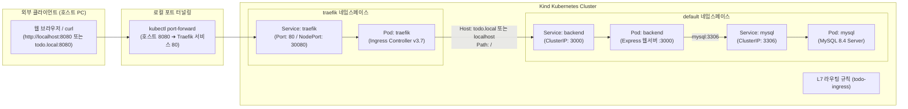

# Traefik Ingress Controller 기반 L7 라우팅 실습 가이드

본 문서는 Kind(Kubernetes in Docker) 로컬 클러스터 환경에서 **Helm을 통해 Traefik Ingress Controller를 구축**하고, **Todo 애플리케이션(Express 백엔드 + MySQL)을 L7 Ingress 규칙으로 외부에 노출**하며 발생한 트러블슈팅과 해결 과정을 체계적으로 정리한 실습 종합 가이드입니다.

---

## 📋 목차 (Table of Contents)
1. [Ingress 핵심 개념 및 아키텍처](#1-ingress-핵심-개념-및-아키텍처)
2. [실습 환경 및 매니페스트 구성 요약](#2-실습-환경-및-매니페스트-구성-요약)
3. [사전 준비: Traefik Ingress Controller 설치 (Helm)](#3-사전-준비-traefik-ingress-controller-설치-helm)
4. [매니페스트 상세 분석](#4-매니페스트-상세-분석)
   - 4.1 MySQL Service (`mysql-service.yaml`)
   - 4.2 Todo Backend Deployment (`backend-deployment.yaml`)
   - 4.3 Todo Backend Service (`backend-service.yaml`)
   - 4.4 Ingress 규칙 정의 (`todo-ingress.yaml`)
5. [엔드투엔드(End-to-End) 배포 및 실행 순서](#5-엔드투엔드end-to-end-배포-및-실행-순서)
6. [트래픽 라우팅 및 기능 검증](#6-트래픽-라우팅-및-기능-검증)
   - 6.1 `curl` 명령어 검증 (도메인 헤더 및 로컬 호출)
   - 6.2 Windows `hosts` 파일 등록을 통한 브라우저 접근


---

## 1. Ingress 핵심 개념 및 아키텍처

### 💡 Ingress와 Ingress Controller란?
- **Ingress (인그레스)**: 클러스터 외부에서 내부 Service로의 HTTP/HTTPS L7(애플리케이션 계층) 라우팅 규칙(도메인 기반 가상 호스팅, URL 경로 기반 분기 등)을 선언적으로 정의하는 쿠버네티스 리소스입니다.
- **Ingress Controller (컨트롤러)**: Ingress 리소스에 명시된 규칙을 감시하여 실제 리버스 프록시(Traefik, NGINX, Envoy 등)의 라우팅 테이블로 동적 변환 및 트래픽을 처리하는 구현체입니다.

### 🌐 트래픽 전달 흐름도 (Architecture Flow)



---

## 2. 실습 환경 및 매니페스트 구성 요약

| 항목 | 설정값 / 리소스명 | 비고 |
| :--- | :--- | :--- |
| **클러스터 환경** | Kind 멀티노드 (`my-k8s`) | Control-plane 1대 + Worker 2대 |
| **Ingress Controller** | Traefik v3.7 (`traefik/traefik` Helm 차트) | `traefik` 네임스페이스 |
| **IngressClass** | `traefik` | `todo-ingress.yaml`의 `ingressClassName`으로 지정 |
| **노출 도메인 (Host)** | `todo.local`, `localhost` | L7 Virtual Host 기반 라우팅 |
| **백엔드 애플리케이션** | `ssucloud/getting-started-todo-app:todo-backend` | Node.js Express 번들 (포트: `3000`) |
| **데이터베이스** | MySQL 8.4 Server (포트: `3306`) | DB: `todos`, 계정: `root`, 암호: `secret` |
| **접속 포트** | 로컬 호스트 `8080` 포트 | `kubectl port-forward`를 통해 Traefik 웹 서비스로 전달 |

### 📁 디렉터리 구성 파일 목록
- [todo-ingress.yaml](.../to-ingress/todo-ingress.yaml): Traefik L7 라우팅 규칙 정의 매니페스트
- [backend-deployment.yaml](.../to-ingress/backend-deployment.yaml): Todo 백엔드 앱 컨테이너 배포 정의
- [backend-service.yaml](.../to-ingress/backend-service.yaml): Ingress와 Backend Pod를 연결하는 ClusterIP Service
- [mysql-service.yaml](.../to-ingress/mysql-service.yaml): Backend Pod가 DB에 접근하기 위한 내부 ClusterIP Service

---

## 3. 사전 준비: Traefik Ingress Controller 설치 (Helm)

공식 Traefik 차트 저장소를 추가하고 전용 네임스페이스(`traefik`)에 인그레스 컨트롤러를 배포합니다.

```powershell
# 1) Helm 저장소 추가 및 인덱스 갱신
helm repo add traefik https://traefik.github.io/charts
helm repo update

# 2) Traefik Ingress Controller 설치
helm install traefik traefik/traefik -n traefik --create-namespace `
  --set service.type=NodePort `
  --set ports.web.nodePort=30080
```

배포 완료 후 IngressClass 등록 상태를 확인합니다:
```powershell
kubectl get ingressclass
```
```text
NAME                CONTROLLER                      PARAMETERS   AGE
traefik (default)   traefik.io/ingress-controller   <none>       10m
```

---

## 4. 매니페스트 상세 분석

### 4.1 MySQL Service ([mysql-service.yaml](file:///d:/Lecture%20Notes/2026-2CloudComputing/practices/06week/to-ingress/mysql-service.yaml))
이미 실행 중인 MySQL 파드(`app: mysql`)에 클러스터 내부 도메인(`mysql:3306`)으로 접속할 수 있도록 Service를 구성합니다.

```yaml
apiVersion: v1
kind: Service
metadata:
  name: mysql
  labels:
    app: mysql
spec:
  type: ClusterIP
  selector:
    app: mysql
  ports:
  - name: mysql
    port: 3306
    targetPort: 3306
```

---

### 4.2 Todo Backend Deployment ([backend-deployment.yaml](file:///d:/Lecture%20Notes/2026-2CloudComputing/practices/06week/to-ingress/backend-deployment.yaml))
Todo 백엔드 애플리케이션을 구동하며, 네임스페이스의 ResourceQuota 정책을 통과할 수 있도록 `resources.requests` 및 `limits`를 명시합니다.

```yaml
apiVersion: apps/v1
kind: Deployment
metadata:
  labels:
    io.kompose.service: backend
  name: backend
spec:
  replicas: 1
  selector:
    matchLabels:
      io.kompose.service: backend
  template:
    metadata:
      labels:
        io.kompose.service: backend
    spec:
      containers:
        - name: backend
          image: ssucloud/getting-started-todo-app:todo-backend
          imagePullPolicy: IfNotPresent
          ports:
            - containerPort: 3000
          env:
            - name: MYSQL_DB
              value: todos
            - name: MYSQL_HOST
              value: mysql
            - name: MYSQL_PASSWORD
              value: secret
            - name: MYSQL_USER
              value: root
          resources:
            requests:
              cpu: "100m"
              memory: "128Mi"
            limits:
              cpu: "250m"
              memory: "256Mi"
      restartPolicy: Always
```

---

### 4.3 Todo Backend Service ([backend-service.yaml](file:///d:/Lecture%20Notes/2026-2CloudComputing/practices/06week/to-ingress/backend-service.yaml))
Ingress가 라우팅 대상으로 삼는 ClusterIP 서비스입니다. 백엔드 파드의 라벨(`io.kompose.service: backend`)과 3000번 포트를 연결합니다.

```yaml
apiVersion: v1
kind: Service
metadata:
  name: backend
  labels:
    io.kompose.service: backend
spec:
  type: ClusterIP
  selector:
    io.kompose.service: backend
  ports:
  - name: http
    port: 3000
    targetPort: 3000
```

---

### 4.4 Ingress 규칙 정의 ([todo-ingress.yaml](file:///d:/Lecture%20Notes/2026-2CloudComputing/practices/06week/to-ingress/todo-ingress.yaml))
- `ingressClassName: traefik`: Traefik 컨트롤러가 본 Ingress 객체를 담당하도록 지정합니다.
- `rules`: 가상 호스트 기반 분기를 위해 `todo.local`과 브라우저 직접 접근용 `localhost` 두 개의 호스트를 모두 수용하도록 구성합니다.

```yaml
apiVersion: networking.k8s.io/v1
kind: Ingress
metadata:
  name: todo
spec:
  ingressClassName: traefik
  rules:
  # 1. todo.local 도메인 전용 라우팅
  - host: todo.local
    http:
      paths:
      - path: /
        pathType: Prefix
        backend:
          service:
            name: backend
            port:
              number: 3000
  # 2. 로컬 브라우저 기본 접속(localhost) 라우팅
  - host: localhost
    http:
      paths:
      - path: /
        pathType: Prefix
        backend:
          service:
            name: backend
            port:
              number: 3000
```

---

## 5. 엔드투엔드(End-to-End) 배포 및 실행 순서

### Step 1. 매니페스트 일괄 적용
```powershell
cd "d:\Lecture Notes\2026-2CloudComputing\practices\06week\to-ingress"

# 1) 내부 통신 서비스 및 백엔드 파드 배포
kubectl apply -f mysql-service.yaml
kubectl apply -f backend-deployment.yaml
kubectl apply -f backend-service.yaml

# 2) Ingress 라우팅 적용
kubectl apply -f todo-ingress.yaml
```

### Step 2. 리소스 배포 상태 점검
```powershell
# Ingress 엔드포인트 연결 확인
kubectl describe ingress todo
```
*출력 예시:*
```text
Rules:
  Host        Path  Backends
  ----        ----  --------
  todo.local  /     backend:3000 (10.244.1.38:3000)
  localhost   /     backend:3000 (10.244.1.38:3000)
```
`Backends` 항목에 `10.244.x.x:3000`과 같이 실제 파드 IP가 매핑되어야 정상입니다.

### Step 3. Traefik 서비스 로컬 포트 포워딩
Kind 가상 노드 내부의 Traefik 웹 수신 포트를 로컬 호스트 PC의 `8080` 포트로 터널링합니다.
```powershell
# 별도 PowerShell 창에서 실행하거나 백그라운드 Job으로 실행
kubectl port-forward -n traefik svc/traefik 8080:80
```

---

## 6. 트래픽 라우팅 및 기능 검증

### 6.1 `curl` 명령어 검증

#### [1] 도메인 가상 호스트 헤더 테스트 (`todo.local`)
```powershell
curl.exe -i -H "Host: todo.local" http://localhost:8080/
```
*기대 응답: `HTTP/1.1 200 OK` 및 Todo App HTML 본문 반환*

#### [2] 로컬 브라우저 기본 호스트 테스트 (`localhost`)
```powershell
curl.exe -i http://localhost:8080/
```
*기대 응답: `HTTP/1.1 200 OK` (더 이상 404가 발생하지 않음)*

#### [3] API 엔드포인트 호출 테스트
```powershell
curl.exe -i -H "Host: todo.local" http://localhost:8080/api/items
```
*기대 응답: `HTTP/1.1 200 OK` 및 JSON 데이터(`[]`)*

---

### 6.2 Windows `hosts` 파일 등록을 통한 브라우저 접근

로컬 PC의 `hosts` 파일에 도메인을 매핑하면, 별도의 HTTP `Host` 헤더 조작 없이 일반 웹 브라우저 주소창에서 실제 도메인(`http://todo.local:8080`)으로 직접 접근할 수 있습니다.

#### [1] Hosts 파일 위치 및 매핑 정보
- **파일 위치**: `C:\Windows\System32\drivers\etc\hosts`
- **추가할 매핑 내용**:
  ```text
  127.0.0.1 todo.local
  ```

---

#### [2] 도메인 등록 방법 (택 1)

##### 방법 A. PowerShell 관리자 권한 자동 등록 (권장)
'관리자 권한으로 실행'한 PowerShell 창에서 아래 명령어를 실행하여 한 줄로 자동 추가합니다:
```powershell
# 1) hosts 파일에 도메인 매핑 자동 추가
Add-Content -Path "C:\Windows\System32\drivers\etc\hosts" -Value "`n127.0.0.1 todo.local"

# 2) 윈도우 DNS 캐시 즉시 초기화
ipconfig /flushdns

# 3) 도메인 해석 확인 (127.0.0.1이 반환되는지 확인)
Resolve-DnsName todo.local
```

##### 방법 B. 메모장(Notepad) 수동 편집
1. **메모장(Notepad)**을 **'관리자 권한으로 실행'**합니다.
2. `파일` ➔ `열기` (`C:\Windows\System32\drivers\etc\hosts`, 모든 파일 `*.*` 선택)
3. 파일 맨 아래에 다음 한 줄을 추가하고 저장(`Ctrl + S`)합니다:
   ```text
   127.0.0.1 todo.local
   ```
4. PowerShell이나 CMD에서 DNS 캐시를 갱신합니다:
   ```powershell
   ipconfig /flushdns
   ```

---

#### [3] 웹 브라우저 접속 확인
웹 브라우저 주소창에 다음 URL을 입력하여 Todo App이 정상 로드되는지 확인합니다:
👉 **`http://todo.local:8080`**

> [!TIP]
> **브라우저에서 `DNS_PROBE_FINISHED_NXDOMAIN` 오류가 발생하는 경우:**
> 1. **시크릿 창 접속**: 브라우저 캐시를 우회하기 위해 `Ctrl + Shift + N`(시크릿 모드)으로 접속해 봅니다.
> 2. **Chrome / Edge 보안 DNS 캐시 삭제**: 브라우저 주소창에 `chrome://net-internals/#dns` (Edge의 경우 `edge://net-internals/#dns`) 입력 후 **[Clear host cache]** 버튼을 클릭합니다.
> 3. **보안 DNS 일시 해제**: 브라우저의 '보안 DNS(DNS-over-HTTPS)' 기능이 로컬 hosts 파일을 우회할 수 있으므로, 필요 시 브라우저 설정(`개인정보 및 보안` ➔ `보안` ➔ `보안 DNS 사용`)을 확인합니다.

---
