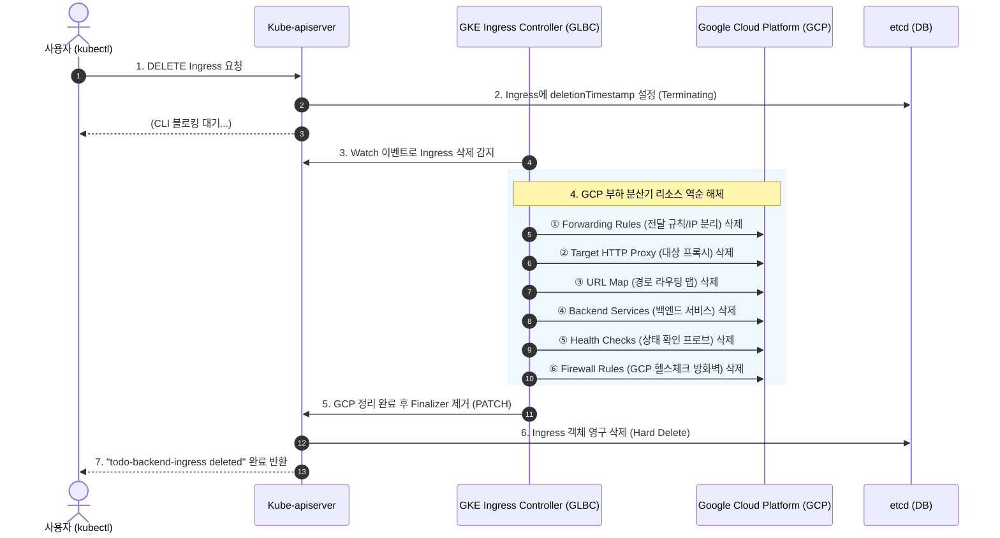

# GKE Ingress 가이드

이 문서는 GKE(Google Kubernetes Engine) 환경에서 Ingress를 설정하고 운영하는 방법, 주요 개념 및 배포 후 확인/테스트 절차를 정리한 가이드입니다.

---

## 1. Ingress 매니페스트 구성 (`GKE-ingress.yaml`)

최신 Kubernetes(v1.18+)에서는 기존의 deprecated된 `kubernetes.io/ingress.class` 어노테이션 대신 **`spec.ingressClassName`** 필드를 사용합니다.

```yaml
apiVersion: networking.k8s.io/v1
kind: Ingress
metadata:
  name: todo-backend-ingress
spec:
  ingressClassName: "gce" # 외부 HTTP(S) 부하 분산기 지정
  rules:
  - host: www.ssu-cloud-computing.com
    http:
      paths:
      - path: /
        pathType: Prefix
        backend:
          service:
            name: todo-backend-lb
            port:
              number: 80
```

---

## 2. `ingressClassName: "gce"`의 의미

- **GCE**: **Google Compute Engine**의 약자입니다.
- GKE 환경에서 Ingress를 배포할 때, 배후의 GKE Ingress Controller에게 **GCP Cloud Load Balancer**를 생성하도록 지시하는 식별자(클래스명)입니다.

| `ingressClassName` | 생성되는 GCP 부하 분산기 | 접근 범위 | 설명 |
| :--- | :--- | :--- | :--- |
| **`gce`** (기본값) | External Application Load Balancer | **공용 인터넷 (External)** | 공인 IP가 부여되어 외부 사용자가 접근 가능 |
| **`gce-internal`** | Internal Application Load Balancer | **VPC 내부 (Internal)** | 사설 IP가 부여되어 동일 VPC 또는 VPN 내부에서만 접근 가능 |

---

## 3. Ingress 배포

작성한 Ingress 매니페스트를 클러스터에 적용합니다:

```powershell
kubectl apply -f GKE-ingress.yaml
```

---

## 4. 배포 후 확인 절차

### 4.1. 공인 IP(ADDRESS) 할당 확인
GKE Ingress는 실제 GCP 부하 분산기를 프로비저닝하므로 외부 IP가 할당될 때까지 **약 2~5분** 정도 소요됩니다.

```powershell
kubectl get ingress
```
- 실시간으로 IP 할당을 확인하려면 감시 플래그(`-w`)를 사용할 수 있습니다:
  ```powershell
  kubectl get ingress -w
  ```
- `ADDRESS` 열에 공인 IP(예: `34.xxx.xxx.xxx`)가 표시되면 프로비저닝이 완료된 것입니다.

### 4.2. Ingress 상세 상태 및 이벤트 확인
부하 분산기 구성 상태, 헬스 체크(Health Check), 백엔드 서비스 연결 상태를 확인합니다.

```powershell
kubectl describe ingress todo-backend-ingress
```
- 하단 **Events** 및 **Annotations**에서 GCP 부하 분산기 관련 리소스(TargetProxy, UrlMap, BackendService 등)가 정상 생성되었는지 확인할 수 있습니다.

---

## 5. 접속 테스트

매니페스트의 규칙에 `host: www.ssu-cloud-computing.com`이 지정되어 있으므로 다음 두 가지 방법으로 접속을 테스트합니다.

### 방법 A: `curl` 명령어로 Host 헤더 지정 (간단한 테스트)
```powershell
# <INGRESS_IP>는 kubectl get ingress에서 확인한 ADDRESS 값입니다.
curl -H "Host: www.ssu-cloud-computing.com" http://<INGRESS_IP>/
```

### 방법 B: 로컬 `hosts` 파일 등록 후 브라우저 접속
1. **메모장**을 **관리자 권한**으로 실행합니다.
2. `C:\Windows\System32\drivers\etc\hosts` 파일을 엽니다.
3. 맨 아래에 다음 한 줄을 추가하고 저장합니다:
   ```text
   <INGRESS_IP> www.ssu-cloud-computing.com
   ```
4. 웹 브라우저를 열고 `http://www.ssu-cloud-computing.com`으로 접속하여 정상 동작을 확인합니다.

---

## 6. 권장 사항 (참고)

- **백엔드 서비스 타입**:
  - GKE Ingress의 백엔드 서비스로는 일반적으로 **`NodePort` 서비스**나 Container-native 부하 분산을 지원하는 **`ClusterIP` 서비스(NEG 연동)**를 사용하는 것이 표준적이고 효율적입니다.
  - `LoadBalancer` 타입 서비스는 별도의 L4 부하 분산기를 생성하므로 불필요한 비용이나 중복 부하 분산이 발생할 수 있습니다.

---

## 7. Ingress 삭제 시 내부 동작 구조 (`kubectl delete -f GKE-ingress.yaml`)

Ingress 삭제 명령어가 즉시 끝나지 않고 1~3분 정도 대기하는 이유는 **GCP 클라우드 인프라 상의 L7 부하 분산기 리소스를 안전하게 역순 해체(Tear-down)**하기 때문입니다.

### 7.1. 전체 흐름 다이어그램



### 7.2. 단계별 세부 메커니즘

1. **삭제 마킹 및 Finalizer 대기**
   - `kubectl delete` 실행 시 API 서버는 Ingress에 `metadata.deletionTimestamp`를 마킹합니다.
   - Ingress에 등록된 **`finalizers`**(예: `networking.gke.io/ingress-finalizer`) 때문에 etcd에서 즉시 삭제되지 않고 `Terminating` 상태로 유지됩니다.
2. **GKE Ingress Controller(GLBC) 감지**
   - 백그라운드에서 동작하는 컨트롤러가 Watch 이벤트를 받아 삭제 작업을 시작합니다.
3. **GCP 클라우드 부하 분산기 리소스 해체 (순차적 역순 삭제)**
   - **Forwarding Rules**: 공인 IP로 들어오는 80번 포트 트래픽 수신 중단 및 IP 분리
   - **Target HTTP Proxy**: URL 맵으로 전달하던 프록시 삭제
   - **URL Map**: 호스트 및 경로 매핑 규칙 삭제
   - **Backend Services**: 노드/파드 풀 연결 해제 및 서비스 객체 삭제
   - **Health Checks**: GCP 인프라가 주기적으로 노드 상태를 확인하던 헬스체크 삭제
   - **Firewall Rules**: GCP 부하 분산기 전용 대역에 허용했던 방화벽 규칙 회수
4. **Finalizer 제거 및 영구 삭제**
   - 모든 GCP 리소스 정리가 완료되면 컨트롤러가 Ingress의 Finalizer를 제거합니다.
   - Finalizer가 모두 사라진 것을 확인한 API 서버가 etcd에서 객체를 완전히 영구 삭제(Hard Delete)하고, 대기 중이던 CLI에 완료 메시지를 반환합니다.

---

## 8. 글로벌 정적(고정) 외부 IP 예약 및 Ingress 연동

기본적으로 GKE Ingress를 생성하면 **임시(Ephemeral) 외부 IP**가 동적으로 발급됩니다. 이 경우 Ingress를 삭제 후 재생성하거나 설정을 변경할 때마다 IP가 바뀌어 DNS 레코드(A 레코드)나 `hosts` 파일을 매번 수정해야 하는 번거로움이 발생합니다.

이를 해결하기 위해 **GCP에 글로벌 고정 IP를 미리 예약**하고 Ingress에 바인딩하여 영구적인 접속 주소를 유지합니다.

### 8.1. 명령어 실행 및 출력 결과

```bash
# 1) 전역 고정 IP 예약
$ gcloud compute addresses create todo-ip --global
Created [https://www.googleapis.com/compute/v1/projects/<PROJECT_ID>/global/addresses/todo-ip].

# 2) 예약된 IP 주소 확인 (IPv4 숫자만 추출)
$ gcloud compute addresses describe todo-ip \
    --global --format="value(address)"
34.36.97.100  # <- 출력된 실제 고정 IP 주소 예시
```

#### 세부 역할 및 사용 이유

1. **`gcloud compute addresses create todo-ip --global`**
   - **사용 이유**: 기본적으로 GKE Ingress를 생성하면 임시(Ephemeral) 외부 IP가 동적으로 할당됩니다. 이 경우 Ingress를 삭제 후 재생성하거나 설정을 변경할 때 IP가 바뀌어 DNS 레코드(A 레코드)나 `hosts` 파일을 매번 수정해야 하는 문제가 발생합니다.
   - **역할**: 전 세계 진입점을 담당하는 글로벌 정적(고정) 외부 IP 리소스(`todo-ip`)를 Google Cloud에 미리 예약하여 IP 주소가 영구히 바뀌지 않도록 만듭니다.

2. **`gcloud compute addresses describe todo-ip --global --format="value(address)"`**
   - **사용 이유**: 예약된 `todo-ip` 리소스의 실제 IPv4 주소(예: `34.36.97.100`) 값만 깔끔하게 추출하기 위해 사용합니다.
   - **역할**: 확인된 IP는 DNS 서버에 도메인을 연결하거나, 로컬 `hosts` 파일 등록 및 최종 접속 테스트(`curl http://<ADDRESS>/`) 시 대상 주소로 입력할 때 쓰입니다.

---

### 8.2. 이후 단계에서 실제로 활용되는 위치

예약한 IP 리소스(`todo-ip`)와 실제 IPv4 주소(`<ADDRESS>`)는 다음 두 곳에서 핵심적으로 사용됩니다:

#### 1) `GKE-ingress.yaml` 내부 바인딩 (리소스 이름: `todo-ip` 사용)
`GKE-ingress.yaml` 파일의 `metadata.annotations`에 예약한 리소스 이름을 지정합니다:

```yaml
apiVersion: networking.k8s.io/v1
kind: Ingress
metadata:
  name: todo-backend-ingress
  annotations:
    kubernetes.io/ingress.class: "gce"
    # 사전 예약한 글로벌 고정 IP 리소스 이름을 바인딩
    kubernetes.io/ingress.global-static-ip-name: "todo-ip"
spec:
  ingressClassName: "gce"
  defaultBackend:
    service:
      name: todo-backend-np
      port:
        number: 80
  rules:
  - host: www.ssu-cloud-computing-gke.com
    http:
      paths:
      - path: /
        pathType: Prefix
        backend:
          service:
            name: todo-backend-np
            port:
              number: 80
```
> **효과**: GKE Ingress Controller가 임의의 새 IP를 발급받지 않고, 미리 예약된 `todo-ip`를 GCP 부하 분산기의 프런트엔드 IP로 즉시 연결합니다.

#### 2) DNS 레코드 등록 및 최종 테스트 (실제 IP 주소: `<ADDRESS>` 사용)
- **도메인 연결**: 도메인 공급자(Cloud DNS, Route 53, 가비아 등)의 DNS 관리 콘솔에서 `A 레코드` 대상 값으로 해당 IP 주소를 등록합니다.
- **로컬 `hosts` 파일 등록**: 테스트를 위해 `C:\Windows\System32\drivers\etc\hosts`에 `<ADDRESS> www.ssu-cloud-computing-gke.com`을 등록합니다.
- **최종 접속 테스트**:
  ```powershell
  # describe 명령어로 얻은 실제 IP 주소를 대입하여 테스트
  curl -H "Host: www.ssu-cloud-computing-gke.com" http://<ADDRESS>/
  ```

---

## 9. Google 관리형 SSL 인증서 및 HTTP → HTTPS 자동 리다이렉트 설정

GKE 환경에서는 **`ManagedCertificate`**와 **`FrontendConfig`** 커스텀 리소스를 활용하여 별도의 인증서 구매/수동 갱신 없이 무료로 Google 관리형 SSL/TLS 인증서를 적용하고, HTTP(80) 트래픽을 HTTPS(443)로 자동 강제 리다이렉트할 수 있습니다.

### 9.1. 설정 파일 작성 (`managed-cert-fc.yaml`)

```yaml
apiVersion: networking.gke.io/v1
kind: ManagedCertificate
metadata:
  name: todo-cert
spec:
  domains:
    - www.ssu-cloud-computing-gke.com

---
apiVersion: networking.gke.io/v1beta1
kind: FrontendConfig
metadata:
  name: todo-fc
spec:
  redirectToHttps:
    enabled: true
```

- **`ManagedCertificate` (`todo-cert`)**: Google Cloud가 도메인 검증을 거쳐 SSL 인증서를 자동 발급하고 만료 전 자동 갱신합니다.
- **`FrontendConfig` (`todo-fc`)**: Ingress 부하 분산기의 프런트엔드 설정을 제어하며, `redirectToHttps.enabled: true`를 통해 HTTP 접속 시 301 영구 이동으로 HTTPS로 유도합니다.

### 9.2. 리소스 배포 및 Ingress 연동

#### ① 인증서 및 프런트엔드 설정 배포
```powershell
kubectl apply -f managed-cert-fc.yaml
```

#### ② Ingress 매니페스트에 어노테이션 추가 (`GKE-ingress.yaml`)
`metadata.annotations`에 위에서 생성한 두 리소스의 이름을 바인딩합니다:

```yaml
apiVersion: networking.k8s.io/v1
kind: Ingress
metadata:
  name: todo-backend-ingress
  annotations:
    kubernetes.io/ingress.class: "gce"
    kubernetes.io/ingress.global-static-ip-name: "todo-ip"
    # Google 관리형 인증서 바인딩
    networking.gke.io/managed-certificates: "todo-cert"
    # HTTP -> HTTPS 자동 리다이렉트 설정 바인딩
    networking.gke.io/v1beta1.FrontendConfig: "todo-fc"
spec:
  ingressClassName: "gce"
  defaultBackend:
    service:
      name: todo-backend-np
      port:
        number: 80
  rules:
  - host: www.ssu-cloud-computing-gke.com
    http:
      paths:
      - path: /
        pathType: Prefix
        backend:
          service:
            name: todo-backend-np
            port:
              number: 80
```

#### ③ Ingress 배포
```powershell
kubectl apply -f GKE-ingress.yaml
```

---

### 9.3. 상태 확인 및 유의사항

#### 1) 인증서 발급 상태 확인
```powershell
kubectl describe managedcertificate todo-cert
```
- **상태 값 확인**:
  - `Provisioning`: 인증서 발급 진행 중 (도메인 소유권 확인 대기 중)
  - `Active`: 인증서 발급 및 부하 분산기 장착 완료
- **주의사항**:
  - Google 관리형 인증서가 `Active`가 되려면 등록한 도메인(`www.ssu-cloud-computing-gke.com`)의 DNS A 레코드가 Ingress의 공인 IP로 정상 라우팅되어야 합니다.
  - 전 세계 DNS 전파 및 구글 인증서 발급 절차에 따라 통상 **15분 ~ 60분** 정도 소요됩니다.

#### 2) Ingress 최종 상태 확인
```powershell
kubectl describe ingress todo-backend-ingress
```
- `Annotations`에 `ingress.gcp.kubernetes.io/ssl-cert` 관련 정보가 생성되고, `Events`에 인증서와 프런트엔드 설정이 부하 분산기에 성공적으로 바인딩되었는지 확인합니다.

---

## 10. 로컬 `hosts` 파일 테스트와 Google 관리형 인증서(`ManagedCertificate`)의 한계 및 주의점

도메인 등록 대행업체(가비아, Cloudflare, Route 53 등)에서 실제 도메인을 구매하거나 DNS A 레코드를 등록하지 않고, 로컬 테스트를 위해 `C:\Windows\System32\drivers\etc\hosts` 파일에만 `<ADDRESS> www.ssu-cloud-computing-gke.com`을 등록하는 경우가 많습니다. 이때 일어나는 동작 원리와 주의사항은 다음과 같습니다.

### 10.1. 동작 메커니즘 비교

| 구분 | 로컬 Ingress 라우팅 (Host 헤더) | Google 관리형 인증서 발급 (`ManagedCertificate`) |
| :--- | :--- | :--- |
| **결과** | **성공 (정상 라우팅)** | **실패 / 발급 불가 (`FailedNotVisible` 발생)** |
| **원리** | 내 PC 브라우저가 `hosts` 파일을 참조하여 로드 밸런서 IP로 접속하고, HTTP 요청에 `Host: www.ssu-cloud-computing-gke.com` 헤더를 포함하므로 Ingress의 `rules.host`와 정확히 일치함 | Google의 인증기관(CA) 서버가 공인 인터넷(Public DNS)을 통해 전 세계 DNS에 도메인 소유권을 질의함. 내 PC 내부의 `hosts` 파일은 외부 인터넷에서 볼 수 없으므로 검증이 실패함 |

### 10.2. "Status: FailedNotVisible" 에러의 의미
`kubectl describe managedcertificate todo-cert` 실행 시 다음과 같은 에러가 발생하는 경우:
```text
Domain Status:
  Domain:  www.ssu-cloud-computing-gke.com
  Status:  FailedNotVisible
```
- **원인**: 구글 CA 서버가 전 세계 공인 DNS에 해당 도메인을 조회했으나 등록되어 있지 않거나 Ingress IP와 매칭되지 않아 소유권 검증에 완전히 실패했음을 뜻합니다.
- **조치**: 공인 도메인이 없는 실습 환경에서는 Google 관리형 인증서 사용을 중단하고, 아래와 같이 Ingress 매니페스트에서 인증서 어노테이션을 주석 처리하여 HTTP(80) 전용 Ingress로 운용해야 합니다.

### 10.3. "연결이 예기치 않게 종료되었습니다" 오류의 원인과 해결
- **문제 발생 원인**:
  - `FrontendConfig`에 `redirectToHttps: enabled: true`가 설정되어 있으면 브라우저가 `http://...` 접속 시 `https://...`로 301 리다이렉트됩니다.
  - 하지만 Google 관리형 인증서가 `FailedNotVisible`로 발급되지 않았으므로 부하 분산기에 유효한 SSL 인증서가 장착되지 않아 SSL 핸드셰이크 단계에서 브라우저 연결이 끊어집니다.
- **로컬 테스트 해결책**:
  1. `GKE-ingress.yaml`의 Ingress `annotations`에서 인증서 및 FrontendConfig 어노테이션을 주석 처리합니다:
     ```yaml
     metadata:
       annotations:
         kubernetes.io/ingress.class: "gce"
         kubernetes.io/ingress.global-static-ip-name: "todo-ip"
         # networking.gke.io/managed-certificates: "todo-cert"   # 주석 처리
         # networking.gke.io/v1beta1.FrontendConfig: "todo-fc"   # 주석 처리
     ```
  2. 매니페스트 재적용:
     ```powershell
     kubectl apply -f GKE-ingress.yaml
     ```
  3. 웹 브라우저에서 **`http://www.ssu-cloud-computing-gke.com`** (반드시 `http://`)으로 접속하면 정상 로딩됩니다.

> [!NOTE]
> 실제 공인 도메인에 A 레코드를 등록하여 `kubectl describe managedcertificate todo-cert` 상태가 **`Active`**로 바뀐 뒤에만 위 주석을 해제하고 `redirectToHttps.enabled: true`를 적용해야 합니다.

---

## 11. Ingress 백엔드로 `NodePort` 서비스가 반드시 필요한가?

**결론: 반드시 필요한 것은 아니며, 최신 GKE에서는 오히려 `ClusterIP` 서비스를 사용하는 것이 표준이자 권장 사항입니다.**

GKE Ingress가 백엔드 Pod로 트래픽을 전달하는 방식은 두 가지가 있습니다:

```text
[ 전통적인 인스턴스 그룹 방식 (NodePort 필수) ]
GCP LB  ──(노드 외부IP : NodePort 30080)──>  GKE 노드(VM)  ──(kube-proxy)──>  Pod (3000)

[ 최신 컨테이너 네이티브 부하 분산 (NEG, ClusterIP 권장) ]
GCP LB  ──────────────────(Pod IP : 3000 으로 직접 전송)───────────────────>  Pod (3000)
```

1. **인스턴스 그룹 방식 (레거시)**:
   - 로드 밸런서가 각 VM 노드의 특정 포트(`NodePort`)로 트래픽을 보내고, 노드 내부의 `kube-proxy`가 이를 Pod로 다시 포워딩합니다.
   - 이 경우 반드시 백엔드 서비스가 **`type: NodePort`**여야 합니다.
2. **컨테이너 네이티브 부하 분산 (NEG, Network Endpoint Group)**:
   - 최신 GKE 클러스터(VPC 네이티브)의 기본 동작 모드입니다.
   - 로드 밸런서가 중간 노드를 건너뛰고 **Pod의 VPC 내부 IP로 직접 트래픽을 전송**합니다 (1홉 통신).
   - 이때는 **`type: ClusterIP`** 서비스(`todo-backend-cip`)만으로도 완벽하게 동작합니다.
   - **장점**: 불필요한 노드 포트(30000~32767)를 외부에 노출하지 않아 **보안이 우수**하며, 중간 경유 단계가 없어 **네트워크 지연(Latency)이 단축**됩니다.

---

## 12. Ingress 배포 및 접속 트러블슈팅 가이드

IP나 도메인으로 접속했을 때 `사이트에 연결할 수 없음` 또는 `연결이 예기치 않게 종료되었습니다` 오류가 발생할 때 점검하는 단계입니다:

### 1) GCP 로드 밸런서 프로비저닝 시간 대기
- GCP 외부 HTTP(S) 로드 밸런서는 Ingress 생성 후 전 세계 구글 에지 프록시에 설정이 완전히 배포되기까지 **최소 5분 ~ 10분**이 소요됩니다.
- 초기에는 IP가 나와도 연결이 거부되거나 빈 응답(Empty response)이 올 수 있으므로 잠시 기다립니다.

### 2) 백엔드 헬스 체크(Health Check) 상태 확인
GCP 로드 밸런서는 백엔드 서비스의 헬스체크가 최소 1개 이상 `HEALTHY`로 통과해야만 정상 트래픽을 전달합니다:

```powershell
kubectl describe ingress todo-backend-ingress
```
- 출력의 **`Backends:`** 항목 확인:
  - `todo-backend-np:80 ... UNKNOWN` 또는 `UNHEALTHY`: `BackendConfig`에 지정된 경로(예: `/api/items`)로 백엔드가 `200 OK`를 반환하지 못하고 있는 상태입니다. (DB 파드 기동 여부 확인 필요)
  - `HEALTHY`: 백엔드가 정상 준비된 상태입니다.

### 3) Host 헤더 불일치 확인 (IP 직접 접속 시)
- Ingress의 `rules`에 `host: www.ssu-cloud-computing-gke.com`이 명시되어 있는 경우, 브라우저 주소창에 IP(`http://35.190.84.200`)로 직접 들어가면 Host 헤더가 달라 차단되거나 `defaultBackend`로 전달됩니다.
- 도메인 설정 전 IP로 테스트할 때는 터미널에서 Host 헤더를 명시해 확인합니다:
  ```powershell
  curl -v -H "Host: www.ssu-cloud-computing-gke.com" http://<INGRESS_IP>/
  ```

---

## 13. [FAQ] `GKE-ingress.yaml`의 도메인을 Gateway의 `nip.io` IP(`34.160.156.124.nip.io`)로 수정하면 작동하는가?

### 1) 결론
> **결론: 작동하지 않으며, 그렇게 수정해서는 안 됩니다.**  
> `GKE-ingress.yaml`에 `34.160.156.124.nip.io`를 지정하고 `kubectl apply`를 실행해도 Ingress를 통한 접속은 정상적으로 이루어지지 않습니다.

---

### 2) 작동하지 않는 핵심 이유

#### ① 로드밸런서 공인 IP 불일치 (서로 다른 독립된 부하 분산기)
클러스터 리소스를 조회해보면 **GKE Gateway**와 **GKE Ingress**는 GCP 인프라 상에서 각각 **완전히 별개로 생성된 독립적인 L7 로드밸런서와 서로 다른 공인 IP**를 가지고 있습니다:

```bash
# Gateway IP 확인
kubectl get gateway -n infra-team
# NAME               ADDRESS          AGE
# external-gateway   34.160.156.124   ...

# Ingress IP 확인
kubectl get ingress
# NAME                   ADDRESS         AGE
# todo-backend-ingress   35.190.84.200   ...
```

* **`34.160.156.124`**: **Gateway (`external-gateway`)**의 부하 분산기 IP입니다.
* **`35.190.84.200`**: **Ingress (`todo-backend-ingress`)**의 부하 분산기 IP입니다.
* 만약 Ingress 설정에 `34.160.156.124.nip.io`를 적으면, 사용자가 해당 주소로 접속할 때 DNS는 `34.160.156.124`(Gateway)로 패킷을 전송합니다. 따라서 **모든 트래픽이 Gateway로 유입되며, Ingress는 트래픽을 전혀 받지 못하게 됩니다.**

#### ② Google 관리형 인증서(`ManagedCertificate`)는 `nip.io`에 발급 불가
`GKE-ingress.yaml` 상단에 선언된 `ManagedCertificate`는 Google CA가 도메인의 소유권을 검증하여 공인 SSL/TLS 인증서를 자동 발급해 주는 기능입니다:
```yaml
apiVersion: networking.gke.io/v1
kind: ManagedCertificate
metadata:
  name: todo-cert
spec:
  domains:
  - www.ssu-cloud-computing-gke.com
```
* Google 관리형 인증서는 **실제 본인이 소유하고 DNS A 레코드를 제어할 수 있는 공인 도메인**에만 발급됩니다.
* `nip.io`는 전 세계 사용자가 공유하는 공개 무료 동적 DNS이므로, CA 발급 기관의 보안 정책 및 Rate Limit 상 **Google 관리형 인증서 발급이 승인되지 않고 실패(`FailedNotVisible`)**합니다.

---

### 3) 만약 Ingress 실습에서도 `nip.io`를 사용하고자 한다면?

Ingress 실습에서 로컬 `hosts` 파일 수정 없이 `nip.io`로 웹 브라우저 접속을 테스트하려면, Gateway IP가 아니라 **Ingress 자체의 공인 IP(`35.190.84.200`)**를 결합해야 합니다:

* **올바른 Ingress nip.io 도메인**:  
  🌐 `http://www.ssu-cloud-computing-gke.35.190.84.200.nip.io/`
* **접속 프로토콜**:  
  SSL 인증서 발급이 불가하므로 `https://`가 아닌 **`http://` (80번 포트)**로 접속해야 합니다.

실제로 터미널에서 Ingress IP를 이용해 요청을 보내면 Ingress의 `defaultBackend`를 통해 정상 응답(200 OK)을 수신할 수 있습니다:
```bash
curl -I http://www.ssu-cloud-computing-gke.35.190.84.200.nip.io/
# HTTP/1.1 200 OK
```

---

### 4. GKE Ingress vs GKE Gateway 실습 비교 표

| 비교 항목 | GKE Ingress 실습 (`GKE-ingress.yaml`) | GKE Gateway API 실습 (`GKE-*-nip.yaml`) |
| :--- | :--- | :--- |
| **GCP L7 부하 분산기 IP** | **`35.190.84.200`** | **`34.160.156.124`** |
| **도메인 테스트 방식** | ① 로컬 `hosts` 파일에 `35.190.84.200` 등록<br>② 또는 Ingress IP 기반 `nip.io` (`...35.190.84.200.nip.io`) | **Gateway 동적 IP 기반 `nip.io`**<br>(`www...34.160.156.124.nip.io`) |
| **SSL/TLS 인증서** | `ManagedCertificate` (실제 소유한 정식 도메인 필수) | HTTP(80) L7 호스트 라우팅 검증 집중 (인증서 불필요) |
| **주요 매니페스트** | [`GKE-ingress.yaml`](...//getting-started-todo-app(GKE)/GKE-ingress.yaml), [`GKE-service-np.yaml`](...//getting-started-todo-app(GKE)/GKE-service-np.yaml) | [`GKE-gateway-nip.yaml`](...//getting-started-todo-app(GKE)/GKE-gateway-nip.yaml), [`GKE-httproutes-nip.yaml`](...//getting-started-todo-app(GKE)/GKE-httproutes-nip.yaml) |
| **상세 매뉴얼 문서** | 본 문서 ([`README-Ingress.md`](...//getting-started-todo-app(GKE)/README-Ingress.md)) | [`README-Gateway.md`](...//getting-started-todo-app(GKE)/README-Gateway.md) |


