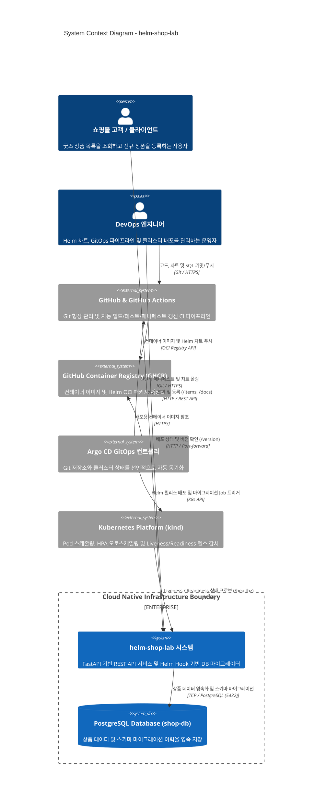

# C4 Context Level: System Context (helm-shop-lab)

## 1. System Overview

### Short Description
**`helm-shop-lab`**은 Kubernetes 및 Helm 기반의 클라우드 네이티브 온라인 굿즈 쇼핑몰 백엔드 시스템으로, REST API 서비스와 안전한 스키마 마이그레이션(Helm Hook) 및 GitOps 배포 파이프라인을 제공합니다.

### Long Description
`helm-shop-lab`은 마이크로서비스 아키텍처의 기본 원칙을 따르는 2-Tier 웹 서비스로, Python 3.12와 FastAPI 기반의 비즈니스 로직 계층(`shop-api`)과 PostgreSQL 기반의 영속 데이터 계층(`shop-db`)으로 구성됩니다. 

쿠버네티스 환경에서 애플리케이션 라이프사이클(빌드, 패키징, 롤링 업데이트, 롤백, 자가 치유)과 데이터베이스 스키마 마이그레이션의 안전성을 실증하도록 설계되었습니다. 단일 Helm 차트 템플릿을 기반으로 개발(`dev`)과 운영(`prod`) 환경을 선언적으로 분리하고, GitHub Actions CI 및 Argo CD GitOps 엔진과 긴밀히 연동되어 Git 커밋을 단일 진실 공급원(SSOT)으로 삼는 무중단 자동 배포 파이프라인을 실현합니다.

---

## 2. Personas

### 1) 쇼핑몰 고객 / API 클라이언트 (Customer / API Client)
- **Type**: Human User / Front-end Application
- **Description**: 온라인 쇼핑몰 굿즈를 검색·조회하고 신규 상품을 등록하는 최종 사용자 또는 모바일/웹 프론트엔드 클라이언트.
- **Goals**: 상품 목록을 안정적으로 조회하고 신규 상품을 등록하며, Swagger 대화형 문서를 통해 API 규격을 확인.
- **Key Features Used**: 상품 목록 조회 (`GET /items`), 신규 상품 등록 (`POST /items`), 루트 안내 (`GET /`), Swagger UI (`/docs`).

### 2) DevOps 엔지니어 / 실습 운영자 (DevOps Engineer / Learner)
- **Type**: Human User
- **Description**: 클라우드 네이티브 애플리케이션의 패키징, 배포, 모니터링, 버전 롤백 및 CI/CD 파이프라인을 운영하는 엔지니어.
- **Goals**: Helm 차트 린트/빌드/배포, 환경별 오버라이드(`values-dev.yaml`, `values-prod.yaml`) 관리, DB 스키마 마이그레이션 검증, Git 커밋 기반 자동 배포 수행.
- **Key Features Used**: 스크립트 도구(`make.sh` / `Makefile`), Helm CLI, 배포 버전 확인 (`GET /version`), Argo CD 웹 대시보드.

### 3) 쿠버네티스 오케스트레이터 (Kubernetes Control Plane & Kubelet)
- **Type**: Programmatic User / System Actor
- **Description**: 워크로드의 상태를 감시하고 트래픽 라우팅 및 팟의 생명주기를 제어하는 오케스트레이션 플랫폼.
- **Goals**: 파드의 실시간 헬스 상태(Liveness/Readiness) 감시, 비정상 파드 재시작, HPA를 통한 동적 오토스케일링.
- **Key Features Used**: 헬스체크 프로브 엔드포인트 (`GET /healthz`), HPA 메트릭 수집, PDB(Pod Disruption Budget) 제약 준수.

### 4) Argo CD GitOps 컨트롤러 (GitOps Controller)
- **Type**: Programmatic User / External System
- **Description**: Git 저장소의 선언적 매니페스트와 클러스터 실제 상태(Live State)의 불일치를 감지하고 동기화하는 자동화 엔진.
- **Goals**: Git 변경사항 자동 감지, PreSync 훅을 통한 마이그레이션 선행 보장, 클러스터 드리프트 자가 치유(Self-healing).
- **Key Features Used**: Git 리포지토리 폴링, Helm 템플릿 렌더링 및 클러스터 적용, PreSync Hook Job 관리, 자동 재시도 및 롤백.

---

## 3. System Features

### Feature 1: 상품 카탈로그 관리 (Product Catalog Management)
- **Description**: 등록된 상품 목록을 데이터베이스에서 읽어오거나 신규 상품을 데이터베이스에 등록하는 핵심 비즈니스 로직 API.
- **Users**: 쇼핑몰 고객 / API 클라이언트, DevOps 엔지니어
- **User Journey**: [상품 조회 및 등록 여정](#1-상품-조회-및-등록-여정)

### Feature 2: 헬스체크 및 배포 버전 검증 (Health Monitoring & Version Verification)
- **Description**: DB 연결 가용성(`status: ok`)을 판별하고, 현재 파드에 주입된 환경변수(`APP_VERSION`, `GREETING`)를 노출하여 롤링 업데이트 및 롤백 결과를 검증.
- **Users**: 쿠버네티스 오케스트레이터, DevOps 엔지니어
- **User Journey**: [시스템 상태 감시 및 버전 검증 여정](#2-시스템-상태-감시-및-버전-검증-여정)

### Feature 3: 안전한 무중단 DB 스키마 마이그레이션 (Helm Hook Migration)
- **Description**: 신규 애플리케이션 파드가 트래픽을 수신하기 전, `pre-install` / `pre-upgrade` Hook Job(`migrate.py`)을 구동하여 DB 스키마를 순차적으로 업그레이드하고 실패 시 롤백 보호.
- **Users**: Argo CD GitOps 컨트롤러, DevOps 엔지니어
- **User Journey**: [선언적 DB 마이그레이션 및 배포 여정](#3-선언적-db-마이그레이션-및-배포-여정)

### Feature 4: 다중 환경 선언적 패키징 (Multi-Environment Helm Packaging)
- **Description**: 단일 차트 템플릿을 유지하면서 `values-dev.yaml`(단일 복제본, NodePort)과 `values-prod.yaml`(다중 복제본, HPA, Ingress, PDB)로 개발 및 운영 환경을 분기 처리.
- **Users**: DevOps 엔지니어, Argo CD GitOps 컨트롤러
- **User Journey**: [선언적 DB 마이그레이션 및 배포 여정](#3-선언적-db-마이그레이션-및-배포-여정)

---

## 4. User Journeys

### 1. 상품 조회 및 등록 여정
1. **API 요청**: 고객(또는 클라이언트)이 `GET /items`를 호출합니다.
2. **비즈니스 처리**: `shop-api` 서비스가 PostgreSQL의 `items` 테이블에서 레코드를 질의합니다.
3. **응답 수신**: JSON 형식으로 상품 목록(`id`, `name`, `price`)을 반환받습니다.
4. **신규 등록**: 필요 시 `POST /items`로 신규 상품 데이터를 페이로드에 담아 전송하여 즉시 DB에 영속화합니다.

### 2. 시스템 상태 감시 및 버전 검증 여정
1. **주기적 프로브**: Kubelet이 10초 간격으로 `GET /healthz`를 호출합니다.
2. **DB Ping**: `shop-api`가 DB 세션을 열고 `SELECT 1` 쿼리를 실행하여 실제 연결성을 검증합니다.
3. **트래픽 라우팅 결정**: 200 OK 응답 수신 시 Service 엔드포인트에 파드를 유지하고, 실패 시 파드를 재기동하거나 트래픽을 차단합니다.
4. **버전 검증**: 엔지니어가 `GET /version`을 호출하여 현재 활성화된 컨테이너의 버전 태그와 배포 메시지를 확인합니다.

### 3. 선언적 DB 마이그레이션 및 배포 여정
1. **코드/스키마 커밋**: 엔지니어가 SQL 마이그레이션 파일(`002_*.sql`) 및 앱 코드를 Git 저장소에 커밋/푸시합니다.
2. **CI 파이프라인 실행**: GitHub Actions가 컨테이너 이미지를 빌드하여 GHCR에 푸시하고, `values-prod.yaml`의 이미지 태그를 갱신합니다.
3. **GitOps 동기화 감지**: Argo CD가 Git 저장소의 변경사항(Desired State)을 감지합니다.
4. **PreSync 훅 실행**: 새 파드가 뜨기 전 `migrate.py` Hook Job이 실행되어 DB 스키마를 선행 반영합니다.
5. **롤링 업데이트**: 마이그레이션이 성공하면 `shop-api` Deployment의 롤링 업데이트가 트리거되어 무중단 배포를 완료합니다.

---

## 5. External Systems and Dependencies

### 1) PostgreSQL Database (`shop-db`)
- **Type**: Database / Persistent Storage
- **Description**: 상품 목록 데이터와 마이그레이션 실행 이력(`schema_migrations`)을 저장하는 관계형 데이터베이스.
- **Integration Type**: TCP / PostgreSQL Wire Protocol (Port 5432) via `psycopg`
- **Purpose**: ACID 트랜잭션 보장, 영속적 데이터 저장, 멱등 마이그레이션 잠금 관리.

### 2) GitHub Repository & GitHub Actions CI
- **Type**: Version Control System & CI/CD Platform
- **Description**: 소스 코드 및 Helm 차트 템플릿의 단일 진실 공급원(SSOT)이자 자동화된 빌드/테스트 파이프라인.
- **Integration Type**: Git HTTPS / GitHub Actions Runner Webhook
- **Purpose**: 소스 코드 형상 관리, 린트 검증, 컨테이너 빌드, GitOps 자동 태그 커밋 트리거.

### 3) GitHub Container Registry (GHCR)
- **Type**: OCI Artifact / Container Image Registry
- **Description**: 빌드된 애플리케이션 Docker 이미지 및 패키징된 Helm OCI 차트 아카이브를 호스팅.
- **Integration Type**: HTTPS / OCI Registry Specification v1.1
- **Purpose**: 검증된 컨테이너 이미지(`shop-api:<tag>`) 및 버전별 Helm 패키지의 중앙 배포소.

### 4) Kubernetes Cluster (kind / Cloud K8s)
- **Type**: Container Orchestration Platform
- **Description**: 네임스페이스 격리(`shop-dev`, `shop-prod`), 오토스케일링(HPA), 고가용성 네트워크 라우팅 및 팟 생명주기를 관장하는 호스팅 인프라.
- **Integration Type**: Kubernetes REST API (HTTPS / kubectl)
- **Purpose**: 워크로드 스케줄링, 장애 복구, 트래픽 분산 및 선언적 리소스 상태 유지.

---

## 6. System Context Diagram

---

## 7. Related Documentation

- [Container Documentation (C4 Level 2)](./c4-container.md)
- [Component Documentation (C4 Level 3)](./c4-component.md)
- [README.md (프로젝트 실습 가이드)](./README.md)
- [FastAPI 애플리케이션 진입점 (`app/main.py`)](./app/main.py)
- [Helm Shop API 차트 정의 (`charts/shop-api/Chart.yaml`)](./charts/shop-api/Chart.yaml)
- [Argo CD 배포 매니페스트 (`argocd/shop-prod.yaml`)](./argocd/shop-prod.yaml)
