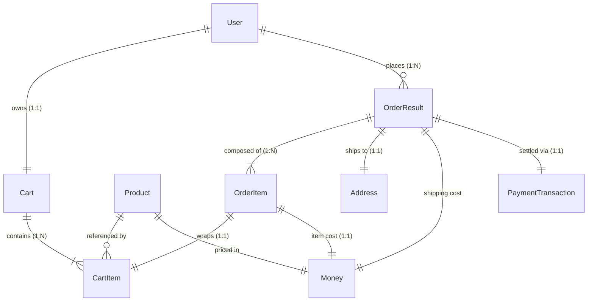
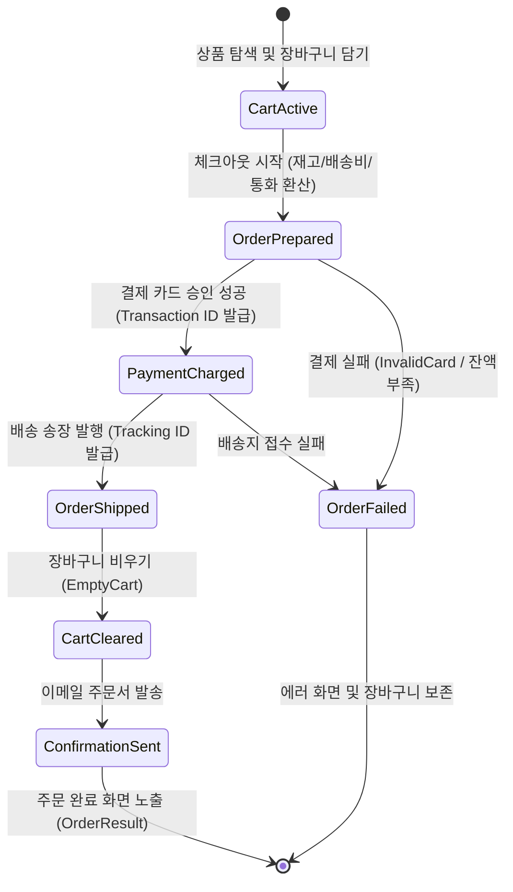

# [Step 2] 비즈니스 도메인 및 모델 분석

## 1. 핵심 비즈니스 목표
Online Boutique 시스템이 해결하는 본질적 문제는 다음과 같습니다.
- **클라우드 네이티브 e-커머스 쇼핑 경험 제공:** 사용자가 별도의 사전 회원가입/로그인 장벽 없이 자동 생성되는 익명 세션(`user_id`)을 기반으로 상품 탐색, 장바구니 담기, 다중 통화 변환, 결제 및 배송 주문을 완결할 수 있는 원활한 쇼핑 플로우를 제공함 ([README.md:6-10](.../microservices-demo/README.md#L6-L10)).
- **다국어/다중 통화(Multi-Currency) 유연성:** 유럽중앙은행(ECB) 환율 기반의 실시간 환율 계산을 통해 글로벌 사용자에게 현지 통화로 가격 표시 및 주문 금액 청구 기능을 지원함 ([src/currencyservice/server.js:100-135](.../microservices-demo/src/currencyservice/server.js#L100-L135)).
- **분산 마이크로서비스 아키텍처의 비즈니스 오케스트레이션 검증:** 단일 장애점(SPOF)을 방지하고 각 도메인(장바구니, 카탈로그, 배송, 결제, 추천, 광고, 알림)의 책임을 독립적으로 격리 및 확장할 수 있는 표준 모델을 제시함 ([protos/demo.proto:21-263](.../microservices-demo/protos/demo.proto#L21-L263)).

---

## 2. 주요 엔티티 관계 (ERD 축약)

마이크로서비스 아키텍처의 Protobuf 도메인 정의에 기반한 엔티티 관계는 다음과 같습니다.

- **엔티티 카디널리티:**
  - `User(Session)` 1 : 1 `Cart` ([protos/demo.proto:47-50](.../microservices-demo/protos/demo.proto#L47-L50))
  - `Cart` 1 : N `CartItem` ([protos/demo.proto:29-32](.../microservices-demo/protos/demo.proto#L29-L32))
  - `OrderResult` 1 : N `OrderItem` ([protos/demo.proto:203-214](.../microservices-demo/protos/demo.proto#L203-L214))
  - `OrderResult` 1 : 1 `Address` (배송지) ([protos/demo.proto:130-136](.../microservices-demo/protos/demo.proto#L130-L136))
  - `OrderResult` 1 : 1 `PaymentTransaction` (트랜잭션 ID 발급) ([protos/demo.proto:193-195](.../microservices-demo/protos/demo.proto#L193-L195))

---

## 3. 도메인 용어 사전 (Domain Glossary)

| 용어 | 정의 및 비즈니스 맥락 | 코드 위치 확인 |
| :--- | :--- | :--- |
| **`Money`** | 부동소수점 반올림 오차를 원천 방지하기 위해 통화 코드(`currency_code`), 정수 단위(`units`), 나노 단위(`nanos`: $10^{-9}$)로 구성된 금액 표현 모델. | [protos/demo.proto:146-161](.../microservices-demo/protos/demo.proto#L146-L161) |
| **`CartItem`** | 사용자가 장바구니에 담은 특정 상품 ID(`product_id`)와 해당 주문 수량(`quantity`)의 값 객체(Value Object). | [protos/demo.proto:29-32](.../microservices-demo/protos/demo.proto#L29-L32) |
| **`Cart`** | 특정 `user_id`에 바인딩된 활성 장바구니 컨테이너. Redis 또는 인메모리 저장소에 직렬화되어 보관됨. | [protos/demo.proto:47-50](.../microservices-demo/protos/demo.proto#L47-L50), [src/cartservice/src/cartstore/RedisCartStore.cs:51-85](.../microservices-demo/src/cartservice/src/cartstore/RedisCartStore.cs#L51-L85) |
| **`Product`** | 상품 고유 식별자(`id`), 상품명, 설명, 이미지 경로, 기본 USD 가격(`price_usd`), 카테고리 태그들을 포함하는 카탈로그 도메인 모델. | [protos/demo.proto:77-87](.../microservices-demo/protos/demo.proto#L77-L87) |
| **`Address`** | 도로명 주소(`street_address`), 도시, 주/도, 국가, 우편번호(`zip_code`)를 포함하는 표준 배송지 모델. | [protos/demo.proto:130-136](.../microservices-demo/protos/demo.proto#L130-L136) |
| **`CreditCardInfo`** | 카드 번호, CVV, 만료 년/월로 구성된 결제 수단 자격증명. 결제 승인 요청 시 일회성으로 검증됨. | [protos/demo.proto:181-186](.../microservices-demo/protos/demo.proto#L181-L186) |
| **`OrderResult`** | 결제, 배송 접수, 이메일 통보 단계까지 완료된 최종 주문 완료 집계 객체(`order_id`, `shipping_tracking_id`, `shipping_cost`, `shipping_address`, `items`). | [protos/demo.proto:208-214](.../microservices-demo/protos/demo.proto#L208-L214) |
| **`Tracking ID`** | `shippingservice`에서 배송 접수 시 생성하는 운송장 추적 고유 번호(예: `QS-12345-67890`). | [src/shippingservice/tracker.go:25-35](.../microservices-demo/src/shippingservice/tracker.go#L25-L35) |

---

## 4. 핵심 비즈니스 규칙 및 상태 전이

### 4.1 세션 및 사용자 식별 규칙
- **규칙:** 사용자가 시스템에 최초 접속할 때 브라우저에 쿠키 `shop_session-id`가 존재하지 않는 경우, 프론트엔드 미들웨어에서 신규 UUID v4를 생성하여 `set-cookie` 헤더를 통해 클라이언트에 주입함 ([src/frontend/main.go:135-145](.../microservices-demo/src/frontend/main.go#L135-L145)).
- 이 식별자는 `CartService`의 장바구니 키(`user_id`) 및 주문 프로세스 전반에 걸쳐 사용자의 identity로 사용됨.

### 4.2 장바구니 적재 및 증분 합산 규칙
- **규칙:** 사용자가 이미 장바구니에 존재하는 `product_id`를 다시 추가하는 경우, 새로운 레코드를 생성하지 않고 기존 아이템의 `quantity`에 신규 추가 수량을 원자적으로 합산함 ([src/cartservice/src/cartstore/RedisCartStore.cs:64-79](.../microservices-demo/src/cartservice/src/cartstore/RedisCartStore.cs#L64-L79)).
- 수량이 0 이하로 내려가지 않도록 유효성 검증을 거침.

### 4.3 신용카드 유효성 및 승인 규칙
- **규칙:** `paymentservice`는 `simple-card-validator` 라이브러리를 통해 카드 번호의 루틴 체크(Luhn 알고리즘 기반 Visa, MasterCard 등 카드사 식별), CVV 길이 및 만료일자(현재 연/월 기준 경과 여부)를 엄격히 검증함 ([src/paymentservice/charge.js:28-48](.../microservices-demo/src/paymentservice/charge.js#L28-L48)).
- 유효하지 않은 카드 번호이거나 만료된 카드인 경우 `InvalidCreditCard` 오류를 반환하여 결제 및 주문 처리를 중단함.

### 4.4 배송비 산출 및 운송장 발행 규칙
- **규칙:** 배송비는 장바구니 품목의 수량을 기반으로 계산되며, 기본 수수료와 품목당 가산 요금을 적용하여 `cost_usd`를 반환함 ([src/shippingservice/quote.go:20-40](.../microservices-demo/src/shippingservice/quote.go#L20-L40)).
- 결제 준비 완료 후 `ShipOrder` 호출 시 국가/우편번호 기반의 고유한 `shipping_tracking_id`를 생성함 ([src/shippingservice/tracker.go:25-35](.../microservices-demo/src/shippingservice/tracker.go#L25-L35)).

### 4.5 주문 라이프사이클 및 상태 전이도

- **상태 보존 규칙:** 주문 실패 시(예: 카드 유효성 에러, 배송지 오류 등), 장바구니를 비우지 않고 그대로 유지하여 사용자가 결제 정보를 수정하고 재시도할 수 있도록 보장함 ([src/checkoutservice/main.go:238-265](.../microservices-demo/src/checkoutservice/main.go#L238-L265)).

