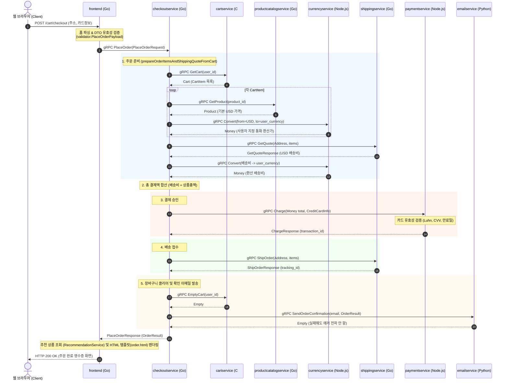

# [Step 3] E2E 데이터 흐름 추적: 주문 및 체크아웃 (Checkout Flow)

## 1. 아키텍처 및 실행 흐름 개요
Online Boutique의 핵심 E2E 플로우인 **'주문 및 결제(Checkout)'** 기능은 분산된 7개 이상의 마이크로서비스(`frontend`, `checkoutservice`, `cartservice`, `productcatalogservice`, `currencyservice`, `shippingservice`, `paymentservice`, `emailservice`)가 유기적으로 연쇄 호출되는 분산 오케스트레이션 패턴을 가집니다.

---

## 2. 트리거 (Entrypoint)
- **HTTP 엔드포인트:** `POST /cart/checkout`
- **호출 주체:** 사용자 웹 브라우저 (HTML 폼 제출)
- **엔트리포인트 매핑:** [src/frontend/main.go:157](.../microservices-demo/src/frontend/main.go#L157)
- **핸들러 함수:** `placeOrderHandler(w http.ResponseWriter, r *http.Request)` ([src/frontend/handlers.go:320-400](.../microservices-demo/src/frontend/handlers.go#L320-L400))

---

## 3. 호출 시퀀스 다이어그램

---

## 4. 단계별 상세 호출 및 코드 매핑

### Step 1. 요청 검증 및 DTO 파싱 (`frontend`)
- 사용자가 전송한 `email`, `street_address`, `zip_code`, `credit_card_number`, `credit_card_cvv` 등의 폼 필드를 수신.
- `validator.PlaceOrderPayload` 구조체에 바인딩하고 필드 누락 및 포맷 검증 수행 ([src/frontend/handlers.go:324-352](.../microservices-demo/src/frontend/handlers.go#L324-L352)).
- 유효성 검증 실패 시 HTTP 422 Unprocessable Entity 에러 반환.

### Step 2. CheckoutService 오케스트레이션 진입 (`checkoutservice`)
- `pb.PlaceOrderRequest`를 수신하여 주문 고유 식별자(UUID v4)를 생성 ([src/checkoutservice/main.go:230-236](.../microservices-demo/src/checkoutservice/main.go#L230-L236)).
- `prepareOrderItemsAndShippingQuoteFromCart()` 호출:
  1. `cs.getUserCart(ctx, req.UserId)`: `CartService.GetCart`를 gRPC로 호출하여 사용자의 장바구니 목록 조회 ([src/checkoutservice/main.go:290-293](.../microservices-demo/src/checkoutservice/main.go#L290-L293)).
  2. `cs.prepOrderItems()`: 장바구니에 담긴 각 상품에 대해 `ProductCatalogService.GetProduct`를 호출하여 최신 상품 정보 확인 후, `CurrencyService.Convert`를 호출하여 사용자가 선택한 통화로 가격을 환산 ([src/checkoutservice/main.go:300-330](.../microservices-demo/src/checkoutservice/main.go#L300-L330)).
  3. `ShippingService.GetQuote`: 수량 및 주소 기반 USD 배송비 산출 후 `CurrencyService.Convert`로 사용자 지정 통화 환산 ([src/checkoutservice/main.go:335-350](.../microservices-demo/src/checkoutservice/main.go#L335-L350)).

### Step 3. 신용카드 결제 승인 (`paymentservice`)
- 계산된 배송비와 상품 총액을 합산하여 최종 결제 금액(`pb.Money total`) 산출 ([src/checkoutservice/main.go:243-250](.../microservices-demo/src/checkoutservice/main.go#L243-L250)).
- `cs.chargeCard()`를 통해 `PaymentService.Charge` gRPC 호출 ([src/checkoutservice/main.go:252-256](.../microservices-demo/src/checkoutservice/main.go#L252-L256)).
- `paymentservice`는 카드의 Luhn 체크섬, 만료일자 등을 검증 후 거래 승인 트랜잭션 UUID 발급 ([src/paymentservice/charge.js:28-48](.../microservices-demo/src/paymentservice/charge.js#L28-L48)).

### Step 4. 배송 지시 및 운송장 발급 (`shippingservice`)
- `cs.shipOrder()` 호출: `ShippingService.ShipOrder` gRPC 호출 ([src/checkoutservice/main.go:258-261](.../microservices-demo/src/checkoutservice/main.go#L258-L261)).
- `shippingservice`에서 주문 물품 수와 배송지 주소를 기반으로 송장 추적 번호(`tracking_id`) 생성 반환 ([src/shippingservice/tracker.go:25-35](.../microservices-demo/src/shippingservice/tracker.go#L25-L35)).

### Step 5. 장바구니 비우기 (`cartservice`)
- 결제 및 배송 등록이 완료되었으므로 `cs.emptyUserCart()`를 호출하여 `CartService.EmptyCart` gRPC 실행 ([src/checkoutservice/main.go:263](.../microservices-demo/src/checkoutservice/main.go#L263)).
- `cartservice`는 Redis에 저장된 해당 유저의 장바구니 키(`user_id`)를 삭제 ([src/cartservice/src/cartstore/RedisCartStore.cs:81-88](.../microservices-demo/src/cartservice/src/cartstore/RedisCartStore.cs#L81-L88)).

### Step 6. 주문 확인 이메일 발송 (`emailservice`)
- `cs.sendOrderConfirmation()`을 호출하여 고객 이메일 주소 및 `OrderResult`를 `EmailService.SendOrderConfirmation`에 전달 ([src/checkoutservice/main.go:273-277](.../microservices-demo/src/checkoutservice/main.go#L273-L277)).
- `emailservice`는 모의 템플릿 엔진을 통해 발송 로그를 기록 ([src/emailservice/email_server.py:40-60](.../microservices-demo/src/emailservice/email_server.py#L40-L60)).
- 이메일 발송에 실패하더라도 전체 주문 트랜잭션은 롤백되지 않고 경고 로그만 기록한 후 정상 종료됨(Non-blocking fault tolerance).

### Step 7. 프론트엔드 응답 렌더링 (`frontend`)
- `CheckoutService`로부터 `pb.OrderResult`를 수신.
- 추가 사용자 경험 향상을 위해 `RecommendationService`를 호출하여 연관 상품 추천 목록을 병합 조회 ([src/frontend/handlers.go:378](.../microservices-demo/src/frontend/handlers.go#L378)).
- `templates.ExecuteTemplate(w, "order", ...)`을 통해 주문 완료 영수증 웹 페이지 렌더링 반환 ([src/frontend/handlers.go:392-400](.../microservices-demo/src/frontend/handlers.go#L392-L400)).

---

## 5. 외부 연동 포인트 및 장애 전파 격리 (Resilience)

1. **Redis Key-Value 스토어 (`redis-cart:6379`):**
   - 사용자 장바구니의 상태 영속화. Redis 연결 장애 시 `cartservice`의 호출이 실패하여 체크아웃 플로우 초입에서 중단됨.
2. **환율 변환 데이터:**
   - `currencyservice` 내 인메모리/파일 기반 ECB 환율 데이터 캐싱으로 외부 네트워크 의존성 최소화.
3. **분산 컨텍스트 전파 (OpenTelemetry):**
   - HTTP 헤더 `traceparent`로부터 시작되어 gRPC 메타데이터를 타고 모든 마이크로서비스 간 분산 트레이스가 연속적으로 추적됨 ([src/checkoutservice/main.go:134-140](.../microservices-demo/src/checkoutservice/main.go#L134-L140)).
4. **장애 격리 전략:**
   - 이메일 발송 실패 및 추천 서비스 장애는 핵심 주문 완료 플로우를 실패시키지 않는 Graceful Degradation(우아한 성능 저하) 패턴을 적용함.

