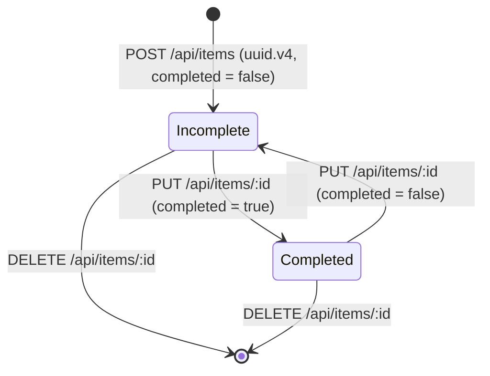

# Phase 1 Data Model: Getting Started Todo Application

**Feature**: `001-getting-started-todo-app`
**Date**: 2026-11-04
**Source Specification**: [spec.md](./spec.md)

---

## Entities

### 1. `TodoItem`

Represents a single task item in the shared todo list.

#### Fields

| Field | Logical Type | SQLite Storage Type | MySQL Storage Type | Nullable | Default | Constraints & Validation |
| :--- | :--- | :--- | :--- | :--- | :--- | :--- |
| `id` | UUID v4 String | `VARCHAR(36)` | `VARCHAR(36)` | No (PK) | Generated (`uuid.v4()`) | Exactly 36 characters; RFC 4122 / UUID v4 format |
| `name` | String | `VARCHAR(255)` | `VARCHAR(255) CHARSET utf8mb4` | No | — | 1 to 255 characters; must not be empty or whitespace-only (`name.trim().length >= 1`) |
| `completed` | Boolean | `BOOLEAN` (`0` / `1`) | `BOOLEAN` (`TINYINT(1)`) | No | `false` (`0`) | Normalized to JSON `boolean` (`true` / `false`) when returned by persistence layer |

#### Database Schema Definition

- **SQLite (`backend/src/persistence/sqlite.js`)**:
  ```sql
  CREATE TABLE IF NOT EXISTS todo_items (
      id varchar(36) PRIMARY KEY,
      name varchar(255) NOT NULL,
      completed boolean NOT NULL DEFAULT 0
  );
  ```
- **MySQL (`backend/src/persistence/mysql.js`)**:
  ```sql
  CREATE TABLE IF NOT EXISTS todo_items (
      id varchar(36) PRIMARY KEY,
      name varchar(255) NOT NULL,
      completed boolean NOT NULL DEFAULT 0
  ) DEFAULT CHARSET utf8mb4;
  ```
  *(Note: Both persistence modules normalize row `completed` values from integer `0`/`1` to boolean `false`/`true` on read.)*

#### Lifecycle & State Transitions



---

### 2. `Greeting` (Value Object)

Represents the static service connectivity greeting payload returned by the backend service.

| Field | Logical Type | Value | Notes |
| :--- | :--- | :--- | :--- |
| `greeting` | String | `"Hello world!"` | Returned by `GET /api/greeting` as `{ "greeting": "Hello world!" }` |

---

## Persistence Adapter Contract (`backend/src/persistence/`)

Both `sqlite.js` and `mysql.js` expose the identical asynchronous module interface through `backend/src/persistence/index.js`:

| Method | Signature | Behavior |
| :--- | :--- | :--- |
| `init` | `init(): Promise<void>` | Initializes storage directory/connection (waiting for port if MySQL) and creates `todo_items` table if absent |
| `teardown` | `teardown(): Promise<void>` | Gracefully closes the active SQLite database handle or MySQL connection pool |
| `getItems` | `getItems(): Promise<TodoItem[]>` | Returns all stored items with `completed` mapped to boolean |
| `getItem` | `getItem(id: string): Promise<TodoItem \| undefined>` | Returns a single item by `id` with `completed` mapped to boolean |
| `storeItem` | `storeItem(item: TodoItem): Promise<void>` | Inserts a new `TodoItem` record into `todo_items` |
| `updateItem` | `updateItem(id: string, item: { name: string, completed: boolean }): Promise<void>` | Updates `name` and `completed` for the given `id` |
| `removeItem` | `removeItem(id: string): Promise<void>` | Deletes the record matching `id` from `todo_items` |

