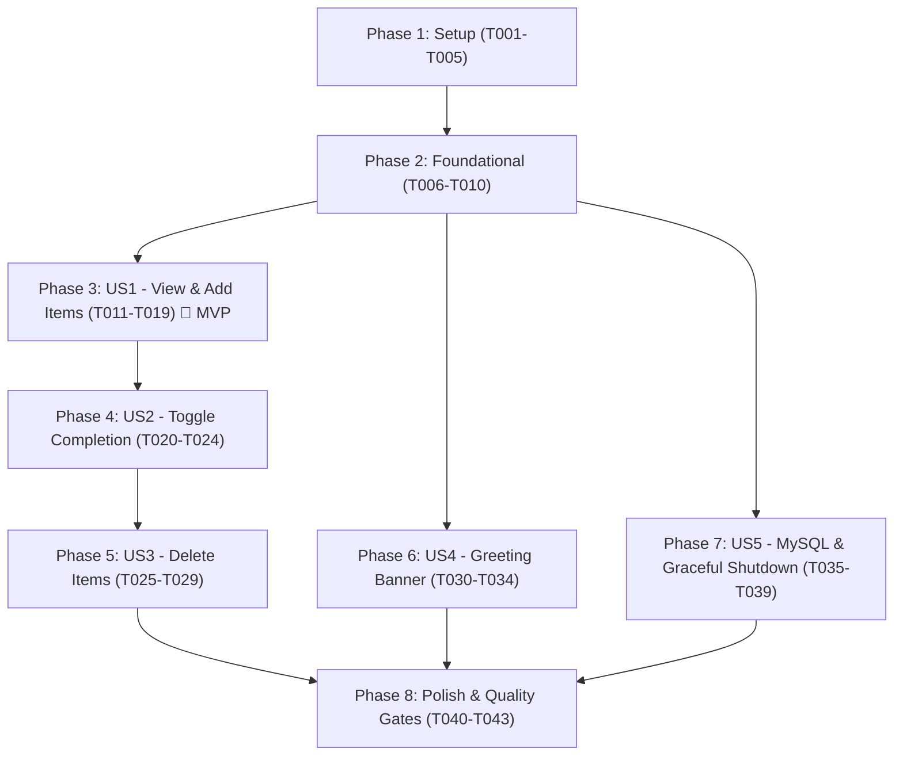

---

description: "Task list for Getting Started Todo Application implementation"
---

# Tasks: Getting Started Todo Application

**Input**: Design documents from `/specs/001-getting-started-todo-app/`

**Prerequisites**: [plan.md](./plan.md) (required), [spec.md](./spec.md) (required for user stories), [research.md](./research.md), [data-model.md](./data-model.md), [contracts/rest-api.md](./contracts/rest-api.md)

**Tests**: Mandatory per [Constitution](../../.specify/memory/constitution.md) Principle II (Test-First Approach - NON-NEGOTIABLE). All test tasks MUST be written and verified to fail before implementing the corresponding production code.

**Organization**: Tasks are grouped by user story (`US1`–`US5`) to enable independent implementation and testing of each increment.

## Format: `[ID] [P?] [Story] Description`

- **[P]**: Can run in parallel (different files, no dependencies on incomplete tasks)
- **[Story]**: Which user story this task belongs to (`[US1]`–`[US5]`)
- Exact file paths and verbatim data model constraints are included in every task description

## Path Conventions

- **Web application**: `backend/src/`, `backend/spec/`, `client/src/`, `client/src/__tests__/` at repository root

---

## Phase 1: Setup (Shared Infrastructure)

**Purpose**: Initialize the `backend/` and `client/` packages, build/test tooling, and linting/formatting configurations.

- [X] T001 Create `backend/src/persistence`, `backend/src/routes`, `backend/spec/persistence`, `backend/spec/routes`, `client/src/components`, and `client/src/__tests__` directory structure per `specs/001-getting-started-todo-app/plan.md`
- [X] T002 Initialize backend package configuration with runtime dependencies (`express ^5.1.0`, `mysql2 ^3.14.1`, `sqlite3 ^5.1.7`, `uuid ^11.1.0`, `wait-port ^1.1.0`), dev dependencies (`jest ^29.7.0`, `nodemon ^3.0.3`, `prettier ^3.2.4`), and `@babel/core 7.23.9` override in `backend/package.json`
- [X] T003 [P] Initialize frontend package configuration with runtime dependencies (`react ^19.1.0`, `react-dom ^19.1.0`, `bootstrap ^5.3.6`, `react-bootstrap ^2.10.10`, `@fortawesome/fontawesome-svg-core ^6.5.1`, `@fortawesome/free-solid-svg-icons ^6.5.1`, `@fortawesome/fontawesome-free-regular ^5.0.13`, `@fortawesome/react-fontawesome ^0.2.2`, `prop-types ^15.8.1`) and dev/test dependencies (`vite ^6.3.5`, `@vitejs/plugin-react ^4.5.1`, `sass ^1.62.1`, `eslint ^8.55.0`, `prettier ^3.2.4`, `vitest`, `@testing-library/react`, `@testing-library/user-event`, `@testing-library/jest-dom`, `jsdom`, `axe-core`) in `client/package.json`
- [X] T004 [P] Configure Vite bundler, `/api` dev server proxy to `http://localhost:3000`, Vitest `jsdom` environment, and HTML shell in `client/vite.config.js` and `client/index.html`
- [X] T005 [P] Configure ESLint rules (`eslint-plugin-react`, `eslint-plugin-react-hooks`, `eslint-plugin-react-refresh`) and Prettier formatting configurations in `client/.eslintrc.cjs` and `.prettierrc`

---

## Phase 2: Foundational (Blocking Prerequisites)

**Purpose**: Core persistence and frontend test/styling foundation that MUST be complete before any user story can be implemented.

**⚠️ CRITICAL**: No user story work can begin until this phase is complete.

- [X] T006 [P] Write failing unit and lifecycle tests for SQLite persistence adapter (`init`, `teardown`, `getItems`, `getItem`, `storeItem`, `updateItem`, `removeItem` enforcing `"Normalized to JSON boolean (true / false) when returned by persistence layer"`) in `backend/spec/persistence/sqlite.spec.js`
- [X] T007 Implement SQLite persistence adapter creating `todo_items (id varchar(36) PRIMARY KEY, name varchar(255) NOT NULL, completed boolean NOT NULL DEFAULT 0)` and auto-creating parent directories for `SQLITE_DB_LOCATION` (default `/etc/todos/todo.db`) in `backend/src/persistence/sqlite.js`
- [X] T008 Create persistence entry module exporting `sqlite.js` as the default adapter in `backend/src/persistence/index.js`
- [X] T009 [P] Create global SCSS stylesheet importing Bootstrap and defining `.item`, `.completed`, and WCAG 2.1 Level AA color contrast and focus styles in `client/src/index.scss`
- [X] T010 [P] Create React 19 application mount and Vitest setup file (`@testing-library/jest-dom` cleanup and `fetch` reset) in `client/src/main.jsx` and `client/src/__tests__/setup.js`

**Checkpoint**: Foundation ready — user story implementation can now begin.

---

## Phase 3: User Story 1 - View and Add Todo Items (Priority: P1) 🎯 MVP

**Goal**: Allow users to view all stored todo items (with `"Loading..."` and `"No items yet! Add one above!"` states) and add new tasks (1–255 non-whitespace characters) with accessible inline error recovery.

**Independent Test**: Start the application with an empty SQLite database, verify `"No items yet! Add one above!"` is displayed, verify the `"Add Item"` button is disabled for empty/whitespace input, submit a new task, and confirm it renders in the list and persists across a page reload.

### Tests for User Story 1 ⚠️

> **NOTE: Write these tests FIRST and verify they FAIL before implementing production code**

- [X] T011 [P] [US1] Write failing unit tests for `GET /api/items` route handler in `backend/spec/routes/getItems.spec.js`
- [X] T012 [P] [US1] Write failing unit tests for `POST /api/items` route handler verifying `id` (`"Exactly 36 characters; RFC 4122 / UUID v4 format"`), `name` (`"1 to 255 characters; must not be empty or whitespace-only (name.trim().length >= 1)"`), `completed: false`, and HTTP `400` on invalid input in `backend/spec/routes/addItem.spec.js`
- [X] T013 [P] [US1] Write failing component tests for `AddNewItemForm` (disabled button on empty/whitespace input, `maxLength={255}`, `"Adding..."` label during submission, and dismissible `<Alert role="alert">` preserving input text on error) in `client/src/__tests__/AddNewItemForm.test.jsx`
- [X] T014 [P] [US1] Write failing component tests for `TodoListCard` (`"Loading..."` indicator while fetching, `"No items yet! Add one above!"` when empty, rendering fetched items, appending newly added items, and displaying dismissible error alert on fetch failure) in `client/src/__tests__/TodoListCard.test.jsx`

### Implementation for User Story 1

- [X] T015 [P] [US1] Implement `GET /api/items` route handler returning all stored `TodoItem` records via `db.getItems()` in `backend/src/routes/getItems.js`
- [X] T016 [P] [US1] Implement `POST /api/items` route handler generating UUID v4 (`"Exactly 36 characters; RFC 4122 / UUID v4 format"`), validating `name` (`"1 to 255 characters; must not be empty or whitespace-only (name.trim().length >= 1)"`), and persisting `completed: false` via `db.storeItem()` in `backend/src/routes/addItem.js`
- [X] T017 [P] [US1] Implement `AddNewItemForm` component with controlled input (`maxLength={255}`, accessible label), whitespace validation, `"Adding..."` submit state, `PropTypes` validation, and dismissible inline error alert in `client/src/components/AddNewItemForm.jsx`
- [X] T018 [US1] Implement `TodoListCard` component with `GET /api/items` fetch, `"Loading..."` indicator, `"No items yet! Add one above!"` empty message, basic `.item` row rendering (prior to `ItemDisplay` delegation in `T024`), `onNewItem` state update, and dismissible `<Alert role="alert">` error banner in `client/src/components/TodoListCard.jsx`
- [X] T019 [US1] Wire `GET /api/items` and `POST /api/items` into the Express application in `backend/src/index.js` and render `TodoListCard` inside the Bootstrap layout in `client/src/App.jsx`

**Checkpoint**: User Story 1 (MVP) is complete and independently testable.

---

## Phase 4: User Story 2 - Toggle Task Completion Status (Priority: P2)

**Goal**: Enable users to toggle any todo item between incomplete and completed via a left-side checkbox control, persisting the change and visually distinguishing completed items with the `.completed` CSS class.

**Independent Test**: Create an item, activate its completion toggle control, verify it receives the `.completed` styling and `completed: true` persists after a browser refresh, then activate it again to revert to `completed: false`.

### Tests for User Story 2 ⚠️

- [X] T020 [P] [US2] Write failing unit tests for `PUT /api/items/:id` route handler verifying `name` (`"1 to 255 characters; must not be empty or whitespace-only (name.trim().length >= 1)"`), boolean `completed`, and HTTP `400` on invalid payload in `backend/spec/routes/updateItem.spec.js`
- [X] T021 [P] [US2] Write failing component tests for `ItemDisplay` completion toggle button (`faSquare` / `faCheckSquare`), `.completed` class toggling, accessible `aria-label`, and inline error recovery on failed `PUT` in `client/src/__tests__/ItemDisplay.test.jsx`

### Implementation for User Story 2

- [X] T022 [P] [US2] Implement `PUT /api/items/:id` route handler validating `name` (`"1 to 255 characters; must not be empty or whitespace-only (name.trim().length >= 1)"`) and boolean `completed`, updating storage via `db.updateItem()`, and returning the updated `TodoItem` in `backend/src/routes/updateItem.js`
- [X] T023 [US2] Implement `ItemDisplay` component with left-side completion toggle `<Button>`, `.completed` class binding, `PropTypes` declarations, and error reporting callback in `client/src/components/ItemDisplay.jsx`
- [X] T024 [US2] Register `PUT /api/items/:id` in `backend/src/index.js` and delegate item row rendering to `<ItemDisplay />` with `onItemUpdate` state handler in `client/src/components/TodoListCard.jsx`

**Checkpoint**: User Stories 1 and 2 work independently and together.

---

## Phase 5: User Story 3 - Delete Todo Items (Priority: P2)

**Goal**: Enable users to permanently delete any todo item via a right-side trash icon control and smoothly return to the empty-state message when the last item is removed.

**Independent Test**: Activate the delete button on an existing todo item, verify it disappears immediately from the UI, verify `"No items yet! Add one above!"` appears when the list becomes empty, and confirm the item does not return after a page refresh.

### Tests for User Story 3 ⚠️

- [X] T025 [P] [US3] Write failing unit tests for `DELETE /api/items/:id` route handler calling `db.removeItem(id)` and returning HTTP `200` in `backend/spec/routes/deleteItem.spec.js`
- [X] T026 [P] [US3] Extend component tests for `ItemDisplay` and `TodoListCard` to verify right-side delete button (`faTrash`), removal callback, transition to `"No items yet! Add one above!"`, and error alert on failed `DELETE` in `client/src/__tests__/ItemDisplay.test.jsx` and `client/src/__tests__/TodoListCard.test.jsx`

### Implementation for User Story 3

- [X] T027 [P] [US3] Implement `DELETE /api/items/:id` route handler invoking `db.removeItem(req.params.id)` and returning HTTP `200` in `backend/src/routes/deleteItem.js`
- [X] T028 [US3] Add right-side delete `<Button>` (`faTrash`, accessible `aria-label`) with `DELETE /api/items/:id` call and failure recovery to `client/src/components/ItemDisplay.jsx`
- [X] T029 [US3] Register `DELETE /api/items/:id` in `backend/src/index.js` and connect `onItemRemoval` state handler in `client/src/components/TodoListCard.jsx`

**Checkpoint**: Full CRUD lifecycle (`US1` + `US2` + `US3`) is functional and independently verified.

---

## Phase 6: User Story 4 - Service Connectivity Greeting Banner (Priority: P3)

**Goal**: Display the `"Hello world!"` greeting banner at the top of the screen retrieved from `GET /api/greeting` to confirm frontend-backend connectivity.

**Independent Test**: Load the application and confirm the `<h1>Hello world!</h1>` banner rendered by `Greeting.jsx` appears above the todo list card.

### Tests for User Story 4 ⚠️

- [X] T030 [P] [US4] Write failing unit tests for `GET /api/greeting` route handler returning `{ greeting: "Hello world!" }` in `backend/spec/routes/getGreeting.spec.js`
- [X] T031 [P] [US4] Write failing component tests for `Greeting` rendering `"Hello world!"` and displaying a dismissible error alert on fetch failure in `client/src/__tests__/Greeting.test.jsx`

### Implementation for User Story 4

- [X] T032 [P] [US4] Implement `GET /api/greeting` route handler returning `{ greeting: 'Hello world!' }` in `backend/src/routes/getGreeting.js`
- [X] T033 [P] [US4] Implement `Greeting` component fetching `/api/greeting`, rendering `<h1>{greeting}</h1>`, and showing a dismissible `<Alert role="alert">` on failure in `client/src/components/Greeting.jsx`
- [X] T034 [US4] Register `GET /api/greeting` in `backend/src/index.js` and render `<Greeting />` above `<TodoListCard />` in `client/src/App.jsx`

**Checkpoint**: Greeting connectivity banner is active and tested independently.

---

## Phase 7: User Story 5 - Adaptive Persistence and Clean Service Shutdown (Priority: P3)

**Goal**: Automatically select MySQL persistence (with `wait-port` startup readiness and `*_FILE` secret file support) when `MYSQL_HOST` is configured, fall back to SQLite otherwise, and cleanly close database connections on `SIGINT`, `SIGTERM`, and `SIGUSR2`.

**Independent Test**: Run persistence unit/integration tests verifying MySQL adapter initialization (`wait-port` + `todo_items` table creation + `*_FILE` environment variable resolution), automatic adapter switching in `persistence/index.js`, and clean `db.teardown()` execution on termination signals.

### Tests for User Story 5 ⚠️

- [X] T035 [P] [US5] Write failing unit tests for MySQL persistence adapter (`MYSQL_HOST` and `MYSQL_*_FILE` secret loading, `wait-port` invocation, `todo_items` table creation, CRUD boolean normalization `"Normalized to JSON boolean (true / false) when returned by persistence layer"`, and pool `teardown`) in `backend/spec/persistence/mysql.spec.js`
- [X] T036 [P] [US5] Write failing unit tests for dynamic persistence selection (`MYSQL_HOST` vs SQLite fallback) and graceful shutdown signal handlers (`SIGINT`, `SIGTERM`, `SIGUSR2`) in `backend/spec/persistence/index.spec.js`

### Implementation for User Story 5

- [X] T037 [US5] Implement MySQL persistence adapter using `mysql2` and `wait-port` with `MYSQL_HOST` / `MYSQL_USER` / `MYSQL_PASSWORD` / `MYSQL_DB` (and `*_FILE` secret variants) and `CREATE TABLE IF NOT EXISTS todo_items (id varchar(36) PRIMARY KEY, name varchar(255) NOT NULL, completed boolean NOT NULL DEFAULT 0) DEFAULT CHARSET utf8mb4` in `backend/src/persistence/mysql.js`
- [X] T038 [US5] Update persistence selector to export `mysql.js` when `process.env.MYSQL_HOST` or `process.env.MYSQL_HOST_FILE` is defined and `sqlite.js` otherwise in `backend/src/persistence/index.js`
- [X] T039 [US5] Implement static asset serving (`express.static`) and graceful shutdown signal handlers (`SIGINT`, `SIGTERM`, `SIGUSR2`) invoking `db.teardown()` before `process.exit(0)` in `backend/src/index.js`

**Checkpoint**: All 5 user stories (`US1`–`US5`) are complete and independently testable.

---

## Phase 8: Polish & Cross-Cutting Concerns

**Purpose**: Final accessibility auditing, code quality gates, coverage verification, and end-to-end quickstart validation across all stories.

- [X] T040 [P] Write and execute automated WCAG 2.1 Level AA `axe-core` accessibility and keyboard-only navigation tests across `App`, `Greeting`, `TodoListCard`, `AddNewItemForm`, and `ItemDisplay` in `client/src/__tests__/a11y.test.jsx`
- [X] T041 [P] Run ESLint (`npm run lint`) and Prettier (`npm run format-check`) across all files configured in `backend/package.json` and `client/package.json`
- [X] T042 Verify `>= 80%` line and branch test coverage across backend (`jest --coverage`) and client (`vitest run --coverage`) via `backend/package.json` and `client/vite.config.js`
- [X] T043 Execute end-to-end validation scenarios (including `< 200ms` p95 CRUD response latency for `SC-001` and `LCP < 2.5s` / `CLS < 0.1` layout stability for `SC-002`) documented in `specs/001-getting-started-todo-app/quickstart.md`

---

## Dependencies & Execution Order

### Phase Dependencies



- **Setup (Phase 1)**: No dependencies — can start immediately.
- **Foundational (Phase 2)**: Depends on Setup completion — **BLOCKS** all user stories.
- **User Story 1 (Phase 3 - P1 🎯 MVP)**: Depends on Foundational (Phase 2).
- **User Story 2 (Phase 4 - P2)**: Depends on Foundational (Phase 2) and integrates `ItemDisplay.jsx` into `TodoListCard.jsx` from `US1`.
- **User Story 3 (Phase 5 - P2)**: Extends `ItemDisplay.jsx` and `TodoListCard.jsx` with item deletion.
- **User Story 4 (Phase 6 - P3)**: Depends only on Foundational (Phase 2) — can run in parallel with `US1`/`US2`/`US3`.
- **User Story 5 (Phase 7 - P3)**: Depends only on Foundational (Phase 2) — can run in parallel with `US1`–`US4`.
- **Polish (Phase 8)**: Depends on completion of all user stories (`US1`–`US5`).

### Within Each User Story

1. **Red**: Write automated unit/component tests first (`T011`–`T014`, `T020`–`T021`, `T025`–`T026`, `T030`–`T031`, `T035`–`T036`) and verify they fail.
2. **Green**: Implement backend route/persistence modules and frontend components to make tests pass.
3. **Refactor**: Clean up code while keeping tests green and adhering to ESLint/Prettier rules.

---

## Parallel Opportunities

### Parallel Example: User Story 1 (`Phase 3`)

```bash
# 1. Author all failing tests for User Story 1 in parallel:
Task T011: "Write failing unit tests for GET /api/items route handler in backend/spec/routes/getItems.spec.js"
Task T012: "Write failing unit tests for POST /api/items route handler in backend/spec/routes/addItem.spec.js"
Task T013: "Write failing component tests for AddNewItemForm in client/src/__tests__/AddNewItemForm.test.jsx"
Task T014: "Write failing component tests for TodoListCard in client/src/__tests__/TodoListCard.test.jsx"

# 2. Implement independent backend routes and form component in parallel:
Task T015: "Implement GET /api/items route handler in backend/src/routes/getItems.js"
Task T016: "Implement POST /api/items route handler in backend/src/routes/addItem.js"
Task T017: "Implement AddNewItemForm component in client/src/components/AddNewItemForm.jsx"
```

### Parallel Example: Cross-Story Execution (After Phase 2)

```bash
# Once Phase 2 (Foundational) completes, three streams can run concurrently:
Stream A (Core Todo CRUD): Phase 3 (US1) -> Phase 4 (US2) -> Phase 5 (US3)
Stream B (Greeting Banner): Phase 6 (US4: T030-T034)
Stream C (MySQL & Shutdown): Phase 7 (US5: T035-T039)
```

---

## Implementation Strategy

### MVP First (User Story 1 Only)

1. Complete **Phase 1: Setup** (`T001`–`T005`).
2. Complete **Phase 2: Foundational** (`T006`–`T010`).
3. Complete **Phase 3: User Story 1** (`T011`–`T019`).
4. **STOP and VALIDATE**: Run backend Jest tests and client Vitest tests to verify viewing and adding todo items end-to-end with SQLite persistence.

### Incremental Delivery

1. **Foundation** (`Phase 1` + `Phase 2`) → SQLite persistence & test harness ready.
2. **Increment 1 (`US1` - P1)** → View list, empty/loading states, add validated todo items (MVP).
3. **Increment 2 (`US2` & `US3` - P2)** → Toggle item completion and delete items.
4. **Increment 3 (`US4` & `US5` - P3)** → `"Hello world!"` greeting banner, MySQL persistence adapter with `wait-port`, and graceful shutdown.
5. **Increment 4 (`Phase 8`)** → Full `axe-core` WCAG 2.1 AA verification, lint/format checks, and `>= 80%` coverage gate.

